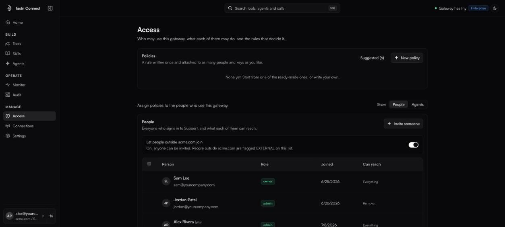

# People and roles

**Access** is where you decide who may use the gateway, what each of them may do, and the rules that decide it. It has three parts: [Policies](policies.md) at the top, **People** (or **Access keys** in an agents workspace) in the middle, and **Identity mappings** at the bottom.

<figure><figcaption>Access: policies, then people.</figcaption></figure>

Members can open Access too, but see the People list read-only.

### How people join

* **Teammates on your domain join by signing in.** Anyone who signs in with an address on your verified company domain joins the organisation automatically, as a **Viewer**. No invite needed.
* **Anyone else needs an invite.** To let in contractors or partners on another domain, an admin turns on **Let people outside {domain} join** (the **Allow external members** toggle), then invites them. They are marked **EXTERNAL** in the list.
* **Workspaces are always invite-only.** Domain sign-in covers the organisation, not its [workspaces](../workspaces.md).

### Invite someone

*Owners and admins.*

1. On **Access**, click **Invite someone**.
2. Enter their **Email**, choose a **Role** (**viewer**, **member** or **admin**; the default is **member**), and optionally a **Connection group**.
3. Click **Send invite**.

They receive an email and join when they sign in. If the email could not be sent, you see *Added {email}, but the email could not be sent. Share the sign-in link manually.*

### Roles

| Role | What they can do |
| --- | --- |
| **Owner** | Everything. Set when the organisation is created; cannot be changed or removed. |
| **Admin** | Everything in the app: tools, people, policies, agents, Monitor, Audit, Settings. |
| **Member** | Use the gateway with the tools admins turned on, and connect their own accounts. In the app: Home, Tools, Access (read-only) and Connections. |
| **Viewer** | The same as a member through the gateway, but cannot change connectors in the app. The default for people who join by signing in. |

Change a role with the dropdown in the **Role** column. You cannot change your own role or the owner's, and an admin cannot change another admin's role.

Owners and admins always have full access (**Everything** in the **Can reach** column). Limit everyone else with policies.

### Give a person a policy

In the **Can reach** column, click the person's current policies (or **Full access**), add or remove [policies](policies.md), and click **Save**. With no policy a person has *full access to every exposed tool*. Stacked policies combine, and the most restrictive rule wins.

To apply the same policies to many people at once, tick their rows, pick policies in the bar that appears, and click **Apply**. (Applying with no policies gives full access.)

### Connection groups

A connection group puts people on a shared set of accounts: everyone in group `acme` uses the accounts connected for `acme`. Set a person's group with **+ group** in their row, or when inviting them. Leave it blank for the organisation's default.

When groups exist, **Connection group policies** lets you attach policies to a whole group. They apply to every member of the group, on top of their own.

### Remove someone

Click **Remove** in the person's row and confirm. *They lose access and won't auto-rejoin with their company email. Re-invite them to restore access.* The owner, and you yourself, cannot be removed.

### Identity mappings

When people reach your gateway through another system (a Slack or Teams bot, say), Fastn Connect needs to know which person each external account belongs to. **Identity mappings** maps an external account to a person in your organisation:

1. Enter the **provider** (for example `slack`), the external **workspace** (optional), the **external id**, and the **gateway user (email)**.
2. Click **Add mapping**.

Mappings are also added automatically as people connect their accounts. **Remove** deletes a mapping immediately.
