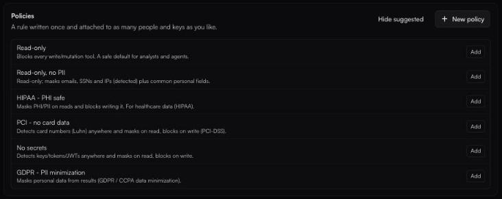
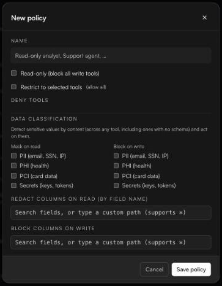

# Policies

**What this page answers**

* How do I make a person or an agent read-only?
* How do I hide personal data, card numbers or secrets from the model?
* What happens when several policies apply?
* Which ready-made policies are there?

A policy is *a rule written once and attached to as many people and keys as you like*. Policies live at the top of the **Access** page. *Owners and admins.*

<figure><figcaption>Policies, with the suggested presets shown.</figcaption></figure>

### Start from a suggested policy

Click **Suggested** and **Add** any of these:

| Preset | What it does |
| --- | --- |
| **Read-only** | Blocks every write tool. A safe default for analysts and agents. |
| **Read-only, no PII** | Read-only, and masks emails, SSNs and IP addresses, plus common personal fields. |
| **HIPAA - PHI safe** | Read-only, masks personal data it detects, and redacts common health-record fields by name. |
| **PCI - no card data** | Detects card numbers anywhere; masks them on read, blocks them on write. |
| **No secrets** | Detects keys, tokens and JWTs anywhere; masks on read, blocks on write. |
| **GDPR - PII minimization** | Masks personal data in results. |

Edit a preset after adding it, like any other policy.

### Write your own

1. Click **New policy** and give it a **Name** (for example *Support agent*).
2. Set the rules you need:

| Rule | Effect |
| --- | --- |
| **Read-only (block all write tools)** | Only read tools can run. |
| **Restrict to selected tools** | Only the tools you pick under **Allowed tools** can run. Off means all tools are allowed. |
| **Deny tools** | These tools never run, whatever else is allowed. |
| **Data classification → Mask on read** | Detected values in results are masked before the model sees them. |
| **Data classification → Block on write** | A call whose arguments contain a detected value is refused. |
| **Redact columns on read (by field name)** | These fields are removed from results. |
| **Block columns on write** | Calls that set these fields are refused. |

3. Click **Save policy**.

**Data classification** detects sensitive values by their content, across any tool, including tools with no schema. The categories are **PII (email, SSN, IP)**, **PHI (health)**, **PCI (card data)** and **Secrets (keys, tokens)**.

For the column rules, type to search a field, or type a path (wildcards `*` allowed) and press <kbd>Enter</kbd>.

<figure><figcaption>The policy editor.</figcaption></figure>

### Attach a policy

* **To a person:** on **Access**, click their **Can reach** cell. See [People and roles](README.md#give-a-person-a-policy).
* **To a group:** under **Connection group policies**.
* **To an access key:** in the key's **Policies** field, or **More actions** → **Edit policy** on [Agents](../agents/README.md#manage-keys).

Each policy row shows how many access keys use it (*on N keys*, or *not in use*). That count covers keys only: a policy attached only to people or groups still reads *not in use*. Before deleting a policy, also check the **Can reach** column and **Connection group policies** on Access.

### How policies combine

* **Most restrictive wins.** A person with *Read-only* and *No secrets* gets both.
* **Policies only narrow.** They never grant more than the underlying app allows. The app's own permissions stay the final gate.
* **Owners and admins, as people, always have full access.** Policies apply to members, viewers and access keys.
* A refused call returns an error to the client and appears in [Monitor](../monitor.md) with the **policy** tag, and in [Audit](../audit.md) as **Refused**.


**Delete policy** (the trash icon) takes effect immediately, with no confirmation. Anyone who relied on it for restrictions loses them at once.



**Plan limits.** The Free plan includes one policy. If saving a policy fails with *Could not save.*, check whether you have reached your plan's limit. See [Plans and limits](../plans-and-limits.md).


### Redaction and free text

* **Data classification** (**Mask on read**) works on content, so it also masks detected values inside plain text results.
* **Field-name rules** (**Redact columns on read**) need fields to match. They apply to structured results and to JSON inside text results. Plain prose has no fields, so it is left as it is. For tools that return prose, rely on data classification or **Deny tools**.
