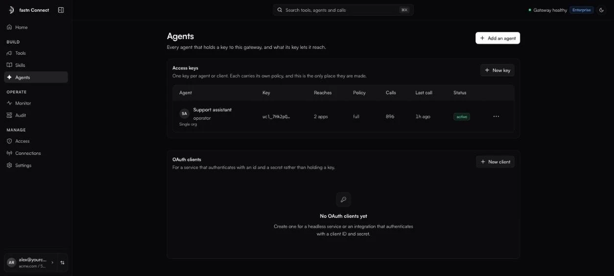
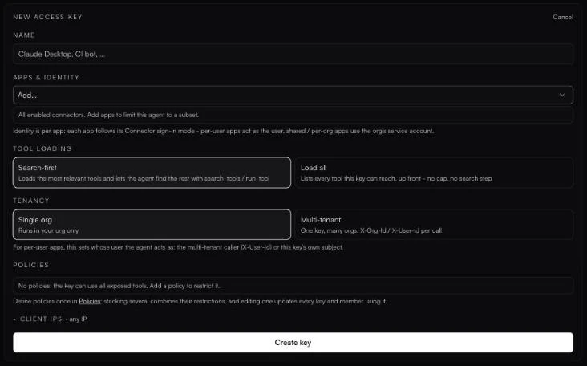

# Agents and access keys

*Owners and admins.* **Agents** lists every agent that holds a key to this gateway and what its key lets it reach. People sign in through their client; agents and services use one of these instead:

| Credential | What it is | Use it for |
| --- | --- | --- |
| **Access key** | A long-lived bearer token starting `ucl_`. | An agent, a script, a client without OAuth. |
| **OAuth client** | A client ID and client secret (OAuth2 client credentials). | A service that authenticates with an ID and a secret rather than holding a key. |

<figure><figcaption>Agents: one key per agent or client.</figcaption></figure>

### Create an access key

1. Open **Agents** and click **Add an agent** (or **New key**).
2. Fill in the form:

| Field | What to set |
| --- | --- |
| **Name** | Name it after the agent or client, for example *Claude Desktop* or *CI bot*. It labels every call in Monitor and Audit. |
| **Apps & identity** | Leave empty for *all enabled connectors*, or add apps to limit the key to a subset. Each app shows whether it **Acts as user** or uses a **Service account**, following that app's [sign-in mode](../tools/sign-in-modes.md). |
| **Tool loading** | **Search-first** loads the most relevant tools and lets the agent find the rest with `search_tools` and `run_tool`. **Load all** lists every tool the key can reach, up front. |
| **Tenancy** | **Single org** runs in your organisation only. **Multi-tenant** lets one key serve many customer orgs and users. See [Multi-tenant agents](multi-tenant.md). |
| **Policies** | Add one or more [policies](../access/policies.md). With none, *the key can use all exposed tools*. |
| **Client IPs** | Optional. Allow or block exact addresses or CIDR ranges (IPv4 or IPv6). A blocked IP is rejected even if it is also allowed. |

3. Click **Create key**.
4. Copy the key straight away. *Key created - copy it now. You won't be able to see it again.*

<figure><figcaption>The <strong>New access key</strong> form.</figcaption></figure>

Fastn Connect stores only a hash of the key. If you lose it, revoke it and create a new one.


**Load all on a big workspace.** If a key would send several hundred tool schemas, the form warns you: some MCP clients reject the connection outright. Use **Search-first** if that happens.


### Use the key

Send it as a bearer token to your gateway URL:

```bash
curl https://mcp.fastn.dev/<your-org> \
  -H "Authorization: Bearer ucl_<your-key>" \
  -H "Content-Type: application/json" \
  -H "Accept: application/json, text/event-stream" \
  -d '{"jsonrpc":"2.0","id":1,"method":"tools/list"}'
```

Home has ready-to-paste examples under **Building an agent?** for **LangChain**, **OpenAI** (Agents SDK), **TypeScript** (MCP SDK), **cURL** and **mTLS**. Clicking the key placeholder in a snippet creates a real key, named *Agent key*, that is multi-tenant and can reach all apps, and drops it in. For a narrower key, create one on Agents instead.

```python
from langchain_mcp_adapters.client import MultiServerMCPClient

client = MultiServerMCPClient({
    "fastn-connect": {
        "transport": "streamable_http",
        "url": "https://mcp.fastn.dev/<your-org>",
        "headers": {"Authorization": "Bearer ucl_<your-key>"},
    }
})
tools = await client.get_tools()
```

For a single-org key, that is all. A [multi-tenant key](multi-tenant.md) also sends `X-Org-Id` and `X-User-Id` on every call.

### Manage keys

Each key's row shows what it **Reaches** (*All apps* or *N apps*), its **Policy**, **Calls**, **Last call** and **Status** (*active* or *idle*). The **More actions** menu has:

* **Edit apps** and **Edit policy**.
* For multi-tenant keys: **Edit org rules**, and identity verification (**Verify identity (monitor)**, **Enforce verification**, **Rotate secret**, **Turn verification off**).
* **Revoke key**.


**Revoke key** takes effect immediately and there is no confirmation step. Any agent using the key stops working at once.


### OAuth clients

For a service that should authenticate with an ID and a secret:

1. Under **OAuth clients**, click **New client**.
2. Enter a **Name** (for example *Billing service*), choose the **Apps** it may reach, and tick **Read-only** to block write tools.
3. Click **Create client**, then copy the **Client ID** and **Client secret**. The secret is shown once.

The service exchanges these for an access token with the standard client-credentials grant:

```bash
curl https://connect.fastn.dev/oauth/token \
  -d grant_type=client_credentials \
  -d client_id=<client-id> \
  -d client_secret=<client-secret>
```

It then calls the gateway URL with `Authorization: Bearer <access_token>` from the response, and requests a new token when that one expires.

### In this section

* [Multi-tenant agents](multi-tenant.md)
