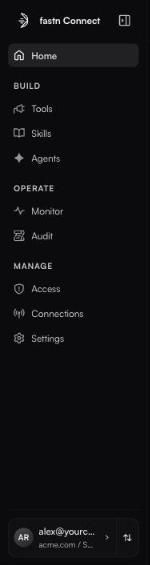
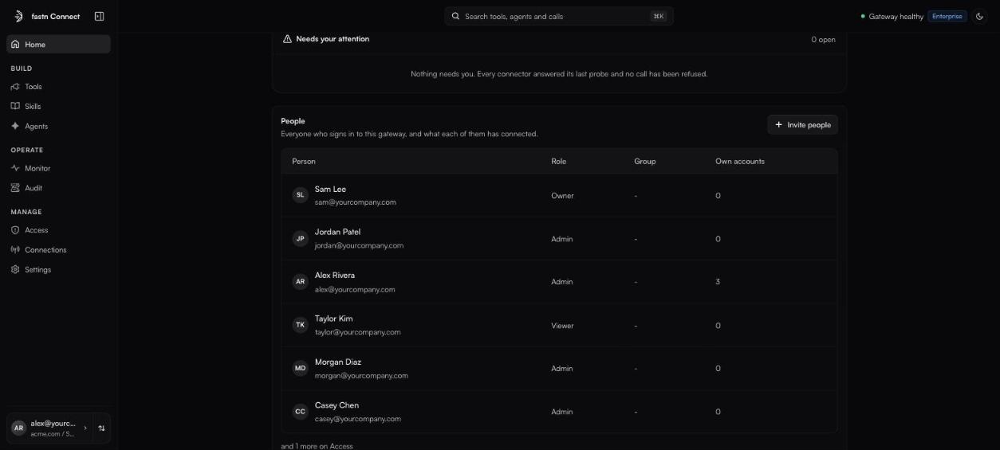

# A tour of the app

### The sidebar

The sidebar is grouped into **Build**, **Operate** and **Manage**. What you see depends on your role.

| Item | What it is for | Who sees it |
| --- | --- | --- |
| **Home** | Your gateway URL, what is connected, and anything that needs you. | Everyone |
| **Tools** | The apps your agents can reach, and whose account each call runs with. | Everyone |
| **Skills** | Reusable tool sequences and playbooks. | Owners and admins |
| **Agents** | Access keys and OAuth clients for headless agents. | Owners and admins |
| **Monitor** | Every call: what ran, how long it took, what was refused. | Owners and admins |
| **Audit** | A tamper-evident record of sign-ins, access changes and tool calls. | Owners and admins |
| **Access** | People, roles and policies. | Everyone (read-only for members) |
| **Connections** | The clients that authorised your gateway, and the accounts it holds. | Everyone |
| **Settings** | **Organisation** and **Plan and billing**. | Owners and admins |

A member's sidebar is therefore **Home**, **Tools**, **Access** and **Connections**.

<figure><figcaption>The sidebar, as an admin sees it.</figcaption></figure>

At the foot of the sidebar is your **account card**. Click your name to open your [Profile](settings.md#your-profile). Click the switcher beside it to move between **Organisations & workspaces**, create a **New workspace**, or **Sign out**.

### The top bar

* **Search tools, agents and calls** (or press <kbd>⌘</kbd> <kbd>K</kbd>) jumps to anything.
* The status light reads **Gateway healthy**, **Checking gateway** or **Gateway unreachable**.
* Admins see the current plan's name.
* The sun/moon button switches between light and dark.

### Home

Home is laid out top to bottom:

1. **Your gateway.** The gateway URL with **Copy**, **Add to Claude** and (for admins) **Invite your team**, plus counts of apps, tools and people. Admins also get a **Governance** row linking to tool optimisation, policies and access.
2. **Equip an agent** (admins). Describe what you are building and click **Build it**. Fastn Connect suggests a toolset on the Tools page. The **Try** chips fill in common examples.
3. **Needs your attention.** Failing connectors, connectors that have not refreshed in six weeks, and refused calls. When all is well it reads *Nothing needs you.*
4. **People** (or **Agents** in an agents workspace). Who uses the gateway.
5. **Latest calls** (admins). The most recent calls, with **View all activity** linking to Monitor.
6. **Connect a client.** One tile per supported client. See [Connecting AI clients](clients/README.md).
7. **Building an agent?** (admins). Copy-paste code for LangChain, OpenAI, TypeScript, cURL and mTLS. See [Agents and access keys](agents/README.md).

<figure><figcaption>Needs your attention, People, Latest calls and Connect a client.</figcaption></figure>


**Team or Agents view.** A workspace is either for people (Claude and other chat clients) or for agents (keys). Admins see a **Team** / **Agents** switch on Home (**People** / **Agents** on Access) in the organisation's default workspace, and in a team workspace where **Also enable for agents** is on. Members always see the Team view. An Agents workspace always shows agents.

