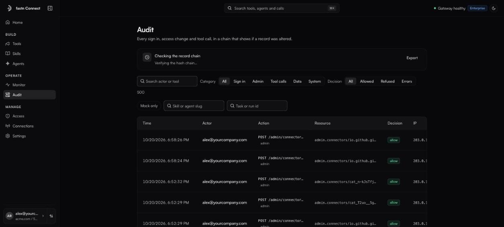

# Audit

*Owners and admins.* **Audit** records every sign-in, access change and tool call, in a chain that shows if a record was altered.

<figure><figcaption>Audit, with the chain check at the top.</figcaption></figure>

### The chain check

Each record carries a hash of the one before it, so a changed or deleted record breaks the chain. The banner at the top checks it every time you open Audit:

* *The record chain is intact. {n} records, hash chain intact.*
* *The record chain has a gap at entry {n}*, with an explanation. If the gap is expected (for example, after old records were deliberately removed), an admin can **Set a baseline** to start checking from there.

### Find what you need

* **Search actor or tool.**
* **Category**: **Sign in**, **Admin**, **Tool calls**, **Data** or **System**.
* **Decision**: **Allowed**, **Refused** or **Errors**.
* More filters: **Mock only**, a skill or agent slug, or a task or run id.

Each row shows **Time**, **Actor**, **Action**, **Resource**, **Decision** and **IP**. A **task ↗** link opens the same task in [Monitor](monitor.md). Calls that touched health data are marked **PHI**, and skill runs are marked **Skill run**.

The newest events load first. Click **Load more** (or **Search older events** when filtering) to go further back.

### Export

Click **Export** (or **Export filtered**) to download `audit-export.json` (`audit-export-filtered.json` when filtered), including the result of the chain check, for your own records or an auditor.
