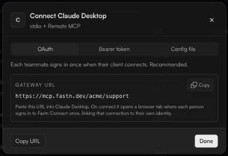
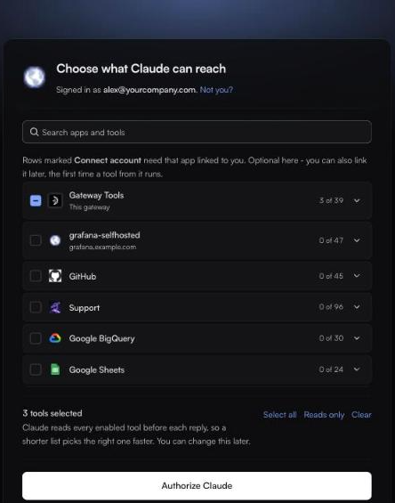

# Connecting AI clients

Every client connects to the same thing: your **gateway URL**.

```
https://mcp.fastn.dev/<your-org>
```

Copy it from **Home**. Inside a named workspace the URL is `https://mcp.fastn.dev/<your-org>/<workspace>`. Every other form is listed in [Gateway URLs](../reference/gateway-urls.md).

### Pick how the client signs in

On Home, under **Connect a client**, click your client's tile. The **Connect {client}** dialog offers up to three tabs:

| Tab | How it works | Use it for |
| --- | --- | --- |
| **OAuth** | *Each teammate signs in once when their client connects. Recommended.* | People using Claude, ChatGPT or Cursor. |
| **Bearer token** | Paste a scoped access key into the client. | Clients without OAuth support, scripts. |
| **Config file** | Drop a JSON snippet into the client's MCP config and restart it. | Clients configured by file. |

<figure><figcaption>The <strong>Connect {client}</strong> dialog, on the <strong>OAuth</strong> tab.</figcaption></figure>

| Client | Tabs offered |
| --- | --- |
| [Claude](claude.md) (claude.ai, Claude Desktop, Claude Code) | OAuth, Bearer token, Config file |
| [ChatGPT](chatgpt.md) | OAuth, Bearer token |
| [Cursor](other-clients.md#cursor) | OAuth, Bearer token, Config file |
| [Windsurf](other-clients.md#windsurf), [Cline](other-clients.md#cline) | Bearer token, Config file |
| [Zed](other-clients.md#zed) | Config file |

Any other client that supports remote MCP over Streamable HTTP works the same way: give it the URL, and sign in through OAuth or send an access key.

### What happens when someone connects with OAuth

1. The person adds the gateway URL to their client and clicks the client's **Connect** button.
2. A browser tab opens on Fastn Connect: *Connect {client} to fastn*. They click **Continue with fastn** and sign in with their work account. *Nothing is shared with {client} until you choose.*
3. **Choose what {client} can reach.** They pick the tools this client may use, then click **Authorize {client}**.
4. The tab returns them to the client, which now sees exactly those tools.

<figure><figcaption>The consent screen. Each person chooses, per client.</figcaption></figure>

On the consent screen:

* **Search apps and tools** filters the list. Expand an app to see its tools, each tagged *read*, *write* or *deletes*.
* **Select all** includes whole apps, so tools added to them later are included too. **Reads only** picks read tools one by one. **Clear** starts again.
* *{client} reads every enabled tool before each reply, so a shorter list picks the right one faster. You can change this later.*
* Apps marked **Connect account** need that app linked to you. Connect it here, or later, the first time one of its tools runs.
* **Gateway Tools** (*This gateway*) are Fastn Connect's own tools. They include `search_tools` and `run_tool`, which let the client find and run any tool in the workspace, not just the ones picked here. A few are selected for you; expand the group to see which.
* If you belong to more than one workspace and connected with the plain `https://mcp.fastn.dev` URL, a workspace picker appears at the top. Picking another one also switches your workspace in Fastn Connect.

*{client} acts as you, and only through the tools above.* The client only ever reaches what *you* can reach: tools your admins turned on, through your own accounts, narrowed by any policy on you.

### Change or revoke a client later

* To change the tools, reconnect the client (remove and re-add the connector, or use its reconnect option) and choose again.
* To cut a client off, an admin clicks **Revoke** on it under **Connections** → **MCP clients**. See [Connections](../connections.md).

### In this section

* [Claude](claude.md)
* [ChatGPT](chatgpt.md)
* [Cursor, VS Code, Windsurf and other clients](other-clients.md)
