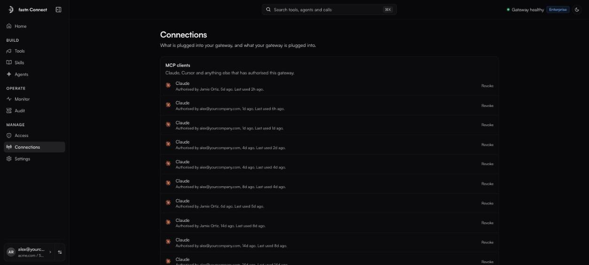

# Connections

**Connections** shows what is plugged into your gateway, and what your gateway is plugged into.

<figure><figcaption>Connections, as an admin sees it.</figcaption></figure>

### What members see

A member sees one card, **Your accounts**: the apps they connected with their own identity. Disconnect one from your [Profile](settings.md#your-profile).

### What admins see

| Card | What it lists | Actions |
| --- | --- | --- |
| **MCP clients** | *Claude, Cursor and anything else that has authorised this gateway.* One row per person per client. | **Revoke** |
| **Connected apps** | *The accounts fastn holds on your behalf, and whose they are.* | **Manage**, **Connect an app** (opens Tools) |
| **Personal accounts** | Accounts people connected for themselves, filterable by org. | **Accounts**, **Disconnect** |
| **Access keys** (agents view) | Keys that *authenticate agents to fastn*. Managed on [Agents](agents/README.md). | |

Which connections are listed follows the view you are in: the Team view lists people's connections, the Agents view lists agents'. Switch view on Home (or on Access, **People** / **Agents**).

Row badges tell you the state at a glance: **Needs reconnect**, **Expiring**, **Expired**, **Removed**, **Single org** or **Multi-tenant**, and who it runs as (**user · {who}** or **agent · {key}**).

### Revoke a client

Click **Revoke** on a client under **MCP clients**. That person's client loses its authorisation. To use the gateway again they reconnect it, and see the consent screen again.

### Fix an expired account

If an account shows **Needs reconnect** or **Expired**, its owner reconnects it: **Reconnect** on their own row here, or **Connect** on the app's row in [Tools](tools/README.md). A shared account is reconnected by an admin.
