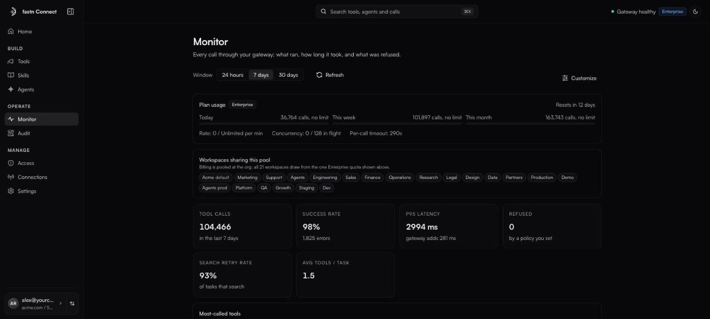

# Monitor

*Owners and admins.* **Monitor** shows every call through your gateway: what ran, how long it took, and what was refused.

<figure><figcaption>Monitor: plan usage and the overview tiles.</figcaption></figure>

### Pick a window

Choose **24 hours**, **7 days** or **30 days** at the top. Click **Customize** to drag cards into your own order or hide them (hidden cards wait in a tray; click one to put it back). Your layout is saved for you.

### Plan usage

Calls used **Today**, **This week** and **This month** against your plan, when the month resets (UTC), and your plan's rate, concurrency and per-call timeout. If you have more than one workspace, **Workspaces sharing this pool** reminds you that all workspaces draw on the one organisation quota. See [Plans and limits](plans-and-limits.md).

### Overview

| Tile | What it tells you |
| --- | --- |
| **Tool calls** | Total calls in the window. |
| **Success rate** | Share of calls that succeeded. |
| **p95 latency** | 95th-percentile call time, and how much of it the gateway adds. |
| **Refused** | Calls stopped by a policy you set. |
| **Search retry rate**, **Avg tools / task** | How well clients find the right tool. High numbers suggest [trimming the tool list](tools/choosing-tools.md). |

Further cards cover the most-called tools, busiest connectors, top users and agents, traffic, latency distribution, error attribution, denials by reason, connector health and dead connectors.

### Recent calls

The call log at the bottom lists the most recent calls, 25 per page.

* Search by tool, identity, connector or error, and filter by **all**, **ok**, **denied** or **error**.
* Click the **ms** value of a call to see where the time went: auth, budget, slot, exec, upstream, audit, and the gateway's own overhead.
* A **task** chip groups calls made for one task. **audit ↗** opens the matching Audit records.
* Each failure is tagged with where it came from (calls made in mock mode carry a separate **mock** label):

| Tag | Meaning |
| --- | --- |
| **connector** | The app itself returned an error. |
| **gateway** | Fastn Connect failed to complete the call. |
| **auth** | The caller has not connected their account for this app yet. |
| **policy** | A policy or permission rule blocked the call. |

### Alerts

*Enterprise plan.* Get told on Slack, email or a webhook when a metric crosses a threshold:

1. Click **New alert** and optionally name it.
2. Set **Alert when** {metric} **is above** / **is below** {threshold} **over** {window}.
3. Add at least one channel: a **Slack Incoming Webhook URL**, **Emails (comma-separated)**, or a webhook URL.
4. Click **Create alert**.

A banner at the top of Monitor shows when any alert is **Firing**.


On the Free plan, Monitor shows plan usage and the call log; the full dashboard is a Pro feature.

