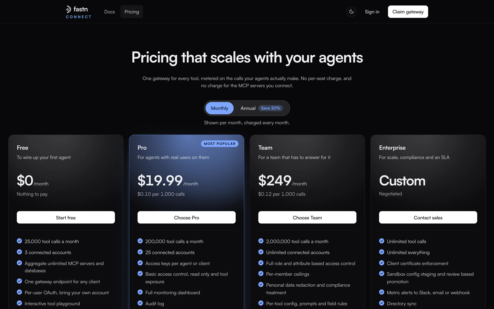

# Plans and limits

Every plan is billed on tool calls, never per seat. There is no charge for the MCP servers you connect, and listing tools and reading config are always free.

<figure><figcaption>Plans at <a href="https://connect.fastn.dev/pricing">connect.fastn.dev/pricing</a>.</figcaption></figure>

### Plans

| | Free | Pro | Team | Enterprise |
| --- | --- | --- | --- | --- |
| **Price, monthly** | $0 | $19.99 / month | $249 / month | Custom |
| **Price, billed annually** | $0 | $16 / month | $199 / month | Custom |
| **Tool calls per month** | 25,000 | 200,000 | 2,000,000 | Unlimited |
| **Connected accounts** | 3 | 25 | Unlimited | Unlimited |
| **Usage rate** | Nothing to pay | $0.10 per 1,000 calls ($0.08 annual) | $0.12 per 1,000 calls ($0.10 annual) | Negotiated |
| **Trial** | | 14 days free, no card | 14 days free, no card | |

**Free** includes unlimited MCP servers and databases, one endpoint for any client, per-user OAuth, the tool playground and community support.

**Pro** adds access keys per agent or client, basic access control (read-only and tool exposure), the full Monitor dashboard, Audit and email support.

**Team** adds full role- and attribute-based access control, per-member ceilings, personal-data redaction and compliance treatment, per-tool config, team management and roles, and priority support.

**Enterprise** adds client certificate enforcement (mTLS), sandbox config staging with review-based promotion, metric alerts to Slack, email or webhook, directory sync, advanced audit and compliance export, on-prem or private cloud deployment, and dedicated support with an SLA.

### Limits the gateway enforces

| | Free | Pro | Team | Enterprise |
| --- | --- | --- | --- | --- |
| Calls per day | 1,000 | 8,000 | 80,000 | Unlimited |
| Calls per week | 5,000 | 40,000 | 400,000 | Unlimited |
| Requests per minute | 60 | 300 | 1,200 | No ceiling |
| Calls in flight at once | 4 | 16 | 48 | 128 |
| Per-call timeout | 20 s | 60 s | 120 s | 290 s |
| Named workspaces | 1 | Unlimited | Unlimited | Unlimited |
| Other organisations' workspaces you can join as a guest | 1 | Unlimited | Unlimited | Unlimited |
| Policies | 1 | Unlimited | Unlimited | Unlimited |
| Cache read results | No | Yes | Yes | Yes |

Any of these can differ for your organisation if fastn has set custom limits for it. Limits count across the whole organisation: all its workspaces share one quota. Months reset on the calendar month, in UTC. Monitor and **Settings** → **Plan and billing** show where you are.

### Going over

* **Daily, weekly, rate and concurrency limits** answer `429` with a `Retry-After` header. Calls resume once the window passes.
* **The monthly quota** answers `402` on every plan that has one (Free, Pro and Team). Calls resume when the month resets or the organisation moves to a bigger plan.

The pricing page lists overage at $0.25 per 1,000 tool calls on paid plans. Ask the fastn team how overage applies to your organisation; the gateway itself stops calls at the monthly quota.

### Changing plan

Owners and admins change plan from **Settings** → **Plan and billing**. Each plan button opens an email to the fastn sales team.
