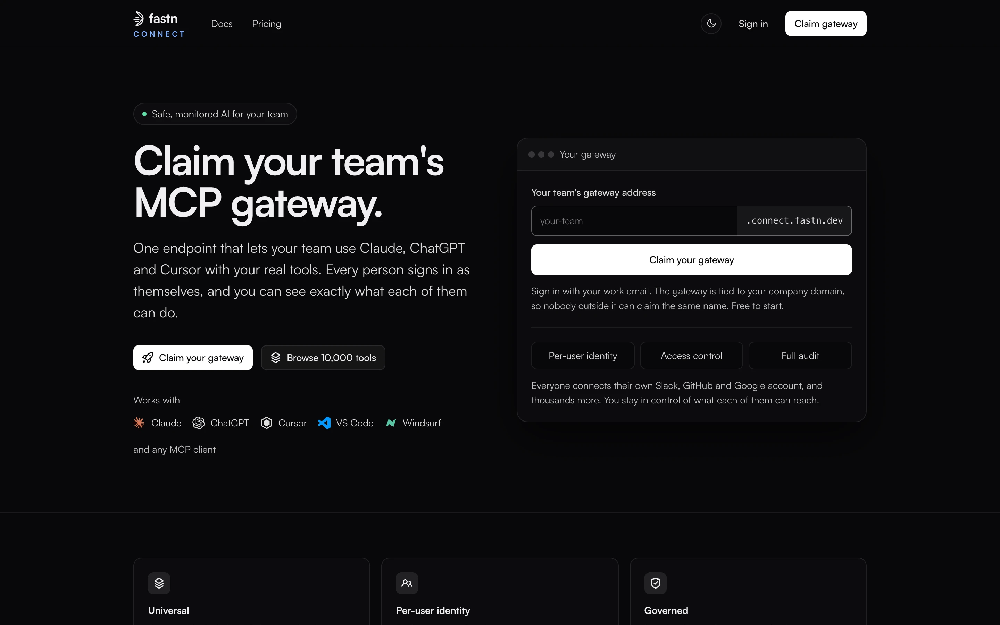
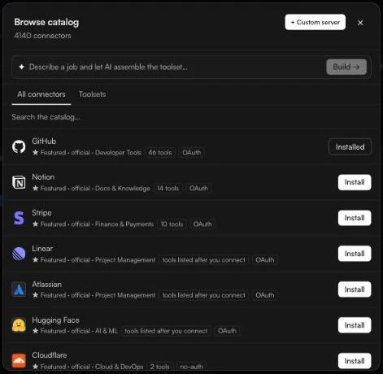
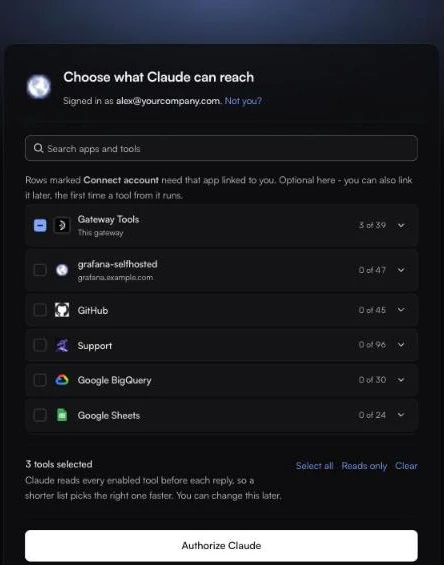

# Quickstart

By the end of this page you will have a live gateway, one connected app, and Claude calling that app's tools as you.

**You need:** a work email address (the gateway is tied to your company domain) and a Claude account that can add custom connectors.

### 1. Claim your gateway

1. Go to [connect.fastn.dev](https://connect.fastn.dev) and click **Claim your gateway** (or **Sign in**).
2. Sign in with your work email.

<figure><figcaption>Claim your gateway from the landing page. Sign in with your work email.</figcaption></figure>

The first person to sign in from a company domain creates that company's organisation and becomes its **Owner**. Teammates who sign in later with the same domain join it automatically. See [People and roles](access/README.md).

### 2. Connect your first app

1. In the sidebar, open **Tools** and click **Browse connectors**.
2. Search for an app (for example *GitHub* or *Linear*) and click **Install**.
3. In **Set up {app}**, choose how it signs in. For a first try, pick **Each user**: every person who uses the tool connects their own account. Click **Done**.
4. On the app's row, click **Connect** and sign in to the app in the pop-up.

<figure><figcaption>Browse catalog: search, then <strong>Install</strong>.</figcaption></figure>

The row now shows how many of the app's tools are turned on and whose account calls run with. More on this in [Tools](tools/README.md) and [Whose account a call runs with](tools/sign-in-modes.md).

### 3. Copy your gateway URL

Open **Home**. Your gateway URL is at the top, with a **Copy** button:

```
https://mcp.fastn.dev/<your-org>
```

`<your-org>` is your organisation's short name. Copy the URL from Home rather than typing it.

### 4. Add it to Claude

1. On Home, click **Add to Claude** to see the setup steps and the URL to paste.
2. In Claude, open **Customize** → **Connectors**, click **Add custom connector**, give it a name (for example `Fastn Connect`) and paste your gateway URL. Click **Add**.
3. Click **Connect** on the new connector. Your browser opens Fastn Connect.
4. On **Choose what Claude can reach**, tick the apps and tools Claude may use (or **Select all**), then click **Authorize Claude**.

<figure><figcaption>You choose what Claude can reach. You can change it later.</figcaption></figure>

Full details, including Claude Team and Enterprise plans, are in [Claude](clients/claude.md).

### 5. Try it

Start a new chat in Claude, make sure the connector is switched on (**+** → **Connectors**), and ask for something the app can do, for example *"List my open GitHub pull requests."*

Claude asks before each tool call. The call runs through your gateway, with your own account, and shows up in [Monitor](monitor.md) and [Audit](audit.md).

### 6. Bring your team

On Home, click **Invite your team**, or open **Access** and click **Invite someone**. Anyone on your company domain can also just sign in. Each teammate adds the same gateway URL to their own client and signs in as themselves.

### Next steps

* [Turn on only the tools you need](tools/choosing-tools.md). A shorter tool list helps the model pick the right tool.
* [Make people or agents read-only, or mask personal data](access/policies.md).
* [Connect a headless agent with an access key](agents/README.md).
