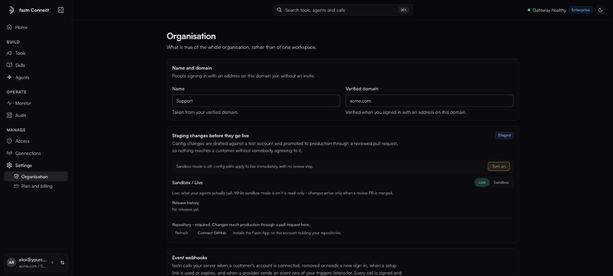
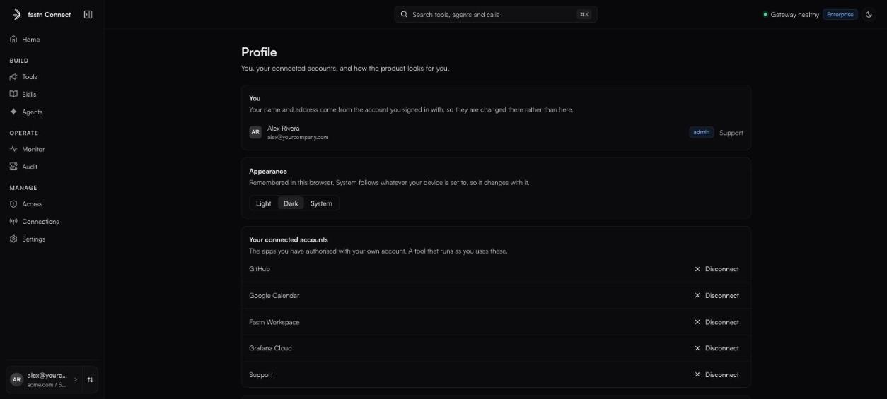

# Settings and your profile

### Organisation

*Owners and admins.* **Settings** → **Organisation** holds what is true of the whole organisation, rather than of one workspace.

<figure><figcaption>Settings → Organisation.</figcaption></figure>

| Section | What it is |
| --- | --- |
| **Name and domain** | The organisation's name and **Verified domain**, both taken from your verified company domain. *People signing in with an address on this domain join without an invite.* Neither can be edited here. |
| **Staging changes before they go live** | Marked **Staged**. With sandbox mode on (**Turn on**), config changes are drafted against a test account and reach production only through a reviewed pull request in the GitHub repository you connect (**Connect GitHub**). The **Sandbox** / **Live** switch shows either side, and **Release history** lists what was promoted. Enterprise. |
| **Event webhooks** | Fastn Connect calls your server when a customer's account is connected, removed or needs a new sign-in. Every call is signed and retried for 24 hours. |
| **Client certificate (mTLS)** | Marked **Immediate**: require callers to present a client certificate in addition to their key. Applies as soon as you save, and is recorded in Audit. Set on the organisation only, never on a workspace. Enterprise. |

With mTLS on, every call under the organisation must present a verified client certificate as well as its bearer key:

```bash
curl https://mcp.fastn.dev/<your-org> \
  --cert client.pem --key client.key \
  -H "Authorization: Bearer ucl_<your-key>" \
  -H "Content-Type: application/json" \
  -H "Accept: application/json, text/event-stream" \
  -d '{"jsonrpc":"2.0","id":1,"method":"tools/list"}'
```

### Plan and billing

*Owners and admins.* **Settings** → **Plan and billing** shows **Usage against your plan** (**Today**, **This week**, **This month**) and the plan cards. Bars change colour at 80% and 100% of a limit.

To change plan, click the plan's button. It opens an email to the fastn sales team; there is no self-serve checkout yet. Plans, prices and limits are on [Plans and limits](plans-and-limits.md).

### Your profile

Click your name on the account card at the foot of the sidebar.

* **You**: your name, address, role and organisation. These come from the account you signed in with, so change them there.
* **Appearance**: **Light**, **Dark** or **System**, remembered in this browser.
* **Your connected accounts**: every app you authorised with your own account. **Disconnect** deletes your stored credential for that app. Tools that run as you will ask you to connect again the next time.
* **Your session**: **Sign out** ends this browser session only. *Access keys and running agents keep working.*

<figure><figcaption>Your profile.</figcaption></figure>
