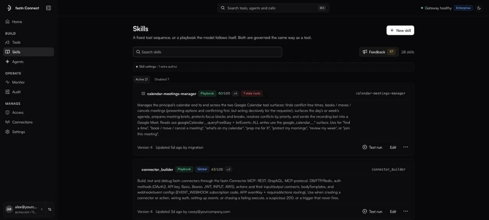

# Skills

*Owners and admins.* A skill is a reusable recipe your clients and agents can call by name. It is governed the same way as a tool: policies, Monitor and Audit all apply.

<figure><figcaption>Skills.</figcaption></figure>

### Two kinds of skill

| Kind | What it is | Best for |
| --- | --- | --- |
| **Composite tool** | *Runs a fixed sequence of tool calls as one governed action.* | A bounded task with side effects, for example *file a ticket and post the link*. |
| **Instructions playbook** | *Returns a playbook the model runs itself*: paginating, summarising, using judgement. | Open-ended reads, for example *summarise a Slack channel*. |

You choose the kind when you create the skill. It is locked once you start.

### Create a skill

1. Click **New skill** and pick **Composite tool** or **Instructions playbook**. To import an existing skill file, choose **Paste a SKILL.md**.
2. Give it a name and a description. The description is what the model reads to decide when to use it, so say *when*, not just *what*.
3. For a composite tool:
   * **Inputs**: what the caller provides (**Name**, **Description**, **Default**, **Required**). A required input is asked for before the skill runs, unless it has a default.
   * **Steps**: the tools to call, top to bottom. Each step has a **Tool to call**, its **Arguments (JSON sent to the tool)** and an optional **Run only if** condition.
   * **Returns** (optional): what the skill hands back.
4. Click **Create skill**.

The editor shows a **Quality score** with reasons, and flags any step whose tool no longer exists in the workspace (*Stale*). Click a stale tool to swap it everywhere in the skill.

### Test a skill

Click **Test run** on a skill. It is a dry run: every step is mocked, so nothing is written to your apps.

### Manage skills

* **Active** / **Disabled** filter the list. A skill row shows its kind, its version, its quality score and badges such as **Global** or **Platform default**.
* **More actions** has **History**, **Enable** / **Disable**, **Promote** (copy the skill to another workspace or environment) and **Delete**. Select several skills to **Promote selected →** together.
* Skills that fastn provides open with **View** instead of **Edit**.

### Skill settings

Expand **Skill settings** for workspace-wide switches:

* **Capture feedback**: collect feedback on skill runs. A **Feedback** button appears in the toolbar.
* **Disable all skills (master kill-switch)**: turns every skill off at once.
* **Skill authors**: people or agent IDs, besides admins, who may create skills.
* **Show skills as tools**: list skills to clients alongside ordinary tools.
