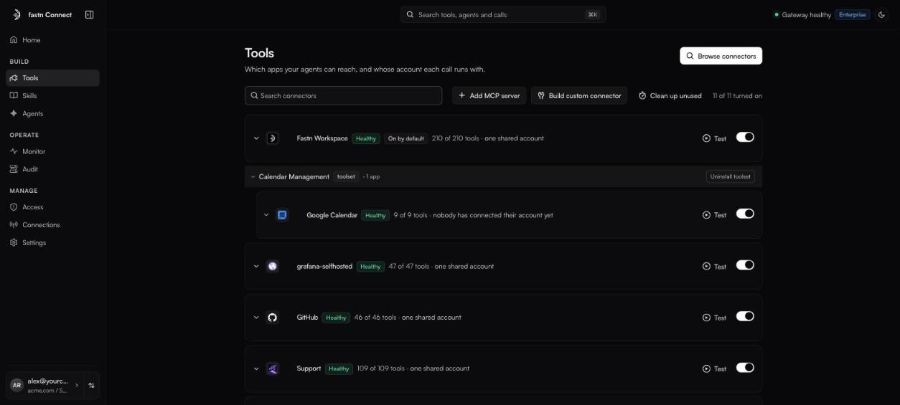
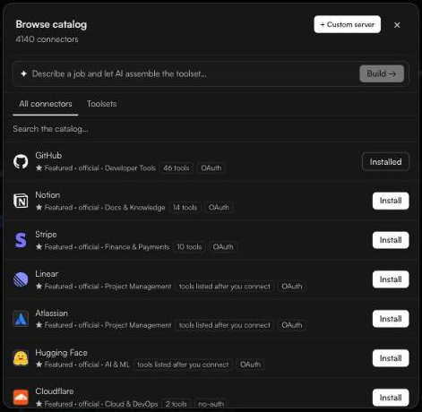

# Tools

**Tools** lists every connector in the current workspace: which apps your agents can reach, how many of each app's tools are turned on, and whose account each call runs with.

<figure><figcaption>Tools, as an admin sees it.</figcaption></figure>

### Add an app from the catalog

*Owners and admins.*

1. Click **Browse connectors**.
2. On the **All connectors** tab, search for the app. Each result shows its category, how many tools it has, and how it signs in (**OAuth**, **API key**, **Token**, **no-auth**).
3. Click **Install**.
   * If the app can be connected more than one way, **Install…** opens **Choose how to connect**. Pick **Fastn connector**, **Official** or **MCP server** (one is marked **Recommended**) and confirm.
4. In **Set up {app}**, choose how the app signs in: **One shared account**, **Each user**, **Each org** or **Caller's token**. You can change it later. See [Whose account a call runs with](sign-in-modes.md).
5. Click **Done**, then **Connect** on the app's row if it needs an account.

<figure><figcaption>Browse catalog. Apps provided by fastn show <strong>Included by default</strong>.</figcaption></figure>

The **Toolsets** tab installs a ready-made bundle of apps and tools in one click. To have one assembled for a job, describe the job in the box at the top of the catalog and click **Build →**. See [Choosing tools](choosing-tools.md#toolsets).

Not in the catalog? [Add an MCP server by URL](add-mcp-server.md).

### Read a connector row

Each row tells you, at a glance:

* **Health:** **Healthy**, **Needs a refresh**, **Failing** or **Needs sign-in**.
* **Who provides it:** **Managed by fastn** or **On by default** for apps fastn provides.
* **Tool count:** *{x} of {y} tools* turned on, or *tools listed after you connect*.
* **Whose account:** for example *one shared account*, *{n} people, each their own account*, *your own account, connected*, or *no sign-in needed*.

Click a row to open it. Admins can change the sign-in mode, connect or disconnect accounts, **Choose tools**, **Refresh tools**, and **Uninstall** (catalog apps) or **Remove** (your own). Uninstalling removes the app's tools and the credentials stored for your organisation.

The toggle on the right turns a connector off without removing it. A connector that is off is not exposed through the gateway. Apps marked **Managed by fastn** show **Always on** and cannot be turned off. Apps marked **On by default** have a toggle like any other.

### Test a tool by hand

Click **Test** on a connector that is on. The playground lets you pick one of its tools, fill in its inputs and run it, using the same account and policies a real call would. It is the quickest way to check a connection works before you hand the URL to anyone.

### What members see

Members see the same list but cannot add, remove or configure connectors. For apps where each person signs in, a member opens the row and clicks **Connect** (or **Reconnect**) to link their own account. Other rows explain where the account comes from, for example *Runs on an account your admin connected. Nothing to connect here.*

### Keep it healthy

* A failing connector, or one that has not refreshed in six weeks, appears on Home under **Needs your attention**.
* If a refresh fails, the row says *Couldn't refresh tools* with a **Retry** button.
* **Clean up unused** finds tools nobody called in the last 7, 30 or 90 days, so you can switch them off. See [Choosing tools](choosing-tools.md#clean-up-unused-tools).

### In this section

* [Add an MCP server](add-mcp-server.md)
* [Whose account a call runs with](sign-in-modes.md)
* [Choosing tools](choosing-tools.md)
