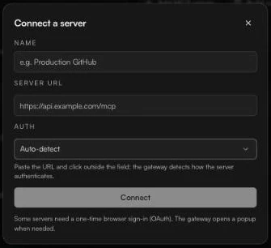

# Add an MCP server

*Owners and admins.* Use this for any remote MCP server that is not in the catalog: a vendor's hosted server, or one your own team runs.

### Add it

1. Open **Tools** and click **Add MCP server**.
2. Fill in **Name** (for example *Production GitHub*) and **Server URL** (for example `https://api.example.com/mcp`).
3. Click outside the URL field. Fastn Connect contacts the server and reports how it signs in:
   * *Detected: {type}*, with that option selected for you under **Auth**.
   * *No auth challenge detected*: the server is public, or wants a key it does not advertise.
   * *Could not reach this server. Check the URL.*
4. Check **Auth**, fill in any credential fields, and click **Connect**.

<figure><figcaption>Paste the URL and leave <strong>Auth</strong> on <strong>Auto-detect</strong>.</figcaption></figure>

If the server could not be reached when you click **Connect**, the button becomes **Add anyway**, so you can add a server that is not up yet.

### Auth options

| Auth | When to use it | What you fill in |
| --- | --- | --- |
| **Auto-detect** | The default. Fastn Connect works it out from the server. | Nothing |
| **No auth** | A public server. | Nothing |
| **OAuth sign-in** | The server supports OAuth. Add it, then click **Connect** on its row to sign in. | Nothing here |
| **Bearer token** | The server takes `Authorization: Bearer <token>`. | **API token** |
| **API key header** | The server takes a key in a header or the query string. | Header name, key value, and **Send the key as** **Header** or **Query param** |
| **Basic auth** | Username and password. | **Username**, **Password** |
| **OAuth2 client credentials** | Machine-to-machine OAuth. | **Token URL**, **Client ID**, **Client secret**, optional **Scope** |

Some providers (GitHub, for example) do not let apps register themselves for OAuth. For those, Fastn Connect walks you through creating your own OAuth app in three steps and asks for its **Client ID** and **Client secret**. If you do not want to create an app, choose **No app? Use a personal access token instead**.


**Template variables.** If the server URL contains placeholders in braces, for example `https://{region}.example.com/mcp`, each one becomes a variable you can describe as **Text** or **Choice (enum)**.


### After you add it

The server appears on **Tools** like any other connector. Open its row to:

* set [whose account a call runs with](sign-in-modes.md),
* [choose which of its tools are turned on](choosing-tools.md),
* or click **Test** to run one of its tools by hand.

### Build a custom connector

If the system you need does not speak MCP, click **Build custom connector** on Tools to build a connector for this workspace, with its own actions, auth methods and versions.
