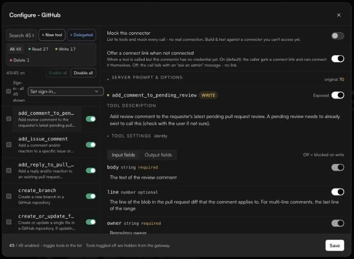

# Choosing tools

A client reads every tool it is given before each reply. Fewer, clearer tools mean the model picks the right one faster and makes fewer mistakes. This page covers every place you shape the tool list.

### Turn a connector's tools on or off

*Owners and admins.*

1. Open the connector on **Tools** and click **Choose tools**.
2. Toggle tools in the list, or use **Enable all** / **Disable all**. *Tools toggled off are hidden from the gateway.*
3. Use the **Read** / **Write** / **Delete** filter to find, say, every write tool at once.
4. Click **Save**. Nothing changes until you save.

<figure><figcaption><strong>Choose tools</strong>: toggle tools on the left, edit the selected tool on the right.</figcaption></figure>

Required fields are always sent and cannot be turned off. Tools that fastn has disabled for everyone show *Disabled by fastn for all organizations. You cannot turn this on.*

### Change what the model sees

Select a tool to edit it:

* **Tool description** (in the agents view, **Tool prompt (description shown to agents)**). Rewrite the description in your own words, for example to say *when* to use this tool.
* **Input fields.** Turn an input off to remove it from the schema the model sees and strip it from calls (*Off = blocked on write*).
* **Output fields.** Turn an output off to remove it from results before they reach the model (*Off = redacted on read*).

At the top of the dialog are two connector-wide switches:

* **Mock this connector**: list its tools and mock every call, with no real connection. Useful to build and test against an app you cannot access yet.
* **Offer a connect link when not connected** (on by default): when a tool is called before an account is connected, the caller gets a link to connect it. Off, the call fails with an *ask an admin* message instead.

Expand **Server prompt & options** for instructions that apply to the whole connector, and for **Enrich with Fastn Connect**, which generates clearer descriptions and parameter docs for every tool of the connector. In the agents view, **LLM output format** shapes the connector's results for LLM clients (*Off returns raw payloads*).


To hide the same field across many tools, or to mask by content (emails, card numbers, secrets) rather than by field name, use a [policy](../access/policies.md) instead.


### Toolsets

A toolset is a named bundle of apps and specific tools, installed in one go.

* **From the catalog:** **Browse connectors** → **Toolsets** → **Install**.
* **Assembled for a job:** describe the job in the box at the top of the catalog and click **Build →** (or describe it under **Equip an agent** on Home and click **Build it**). Then:
  1. **Choose the apps.** Add or remove apps, then **Next: choose tools →**.
  2. Pick tools per app. Reads (*safe lookups*) are suggested; writes are *off by default*.
  3. **Review & install**: name the toolset and click **Install toolset**.

### Clean up unused tools

1. On **Tools**, click **Clean up unused**.
2. Pick a window (**Last 7 days**, **Last 30 days** or **Last 90 days**) and click **Review**.
3. Under **Will be disabled**, untick anything you want to keep, then click **Disable {n} tools**.

Disabled tools are turned off, not deleted. Turn them back on from **Choose tools**.

### How many tools load into the prompt

*Owners and admins.* On Home, under **Governance**, click **Optimization**.

| Setting | What it does |
| --- | --- |
| **Auto** (*By count*) | Loads everything when the set is small, and switches to search when it is large. With Auto, **Recently used** can also drop tools nobody touched in the last *n* days. |
| **Load all** (*Small sets*) | Sends every tool up front. |
| **Smart** (*Always defer*) | Sends two gateway tools, `search_tools` and `run_tool`. The model searches for the tool it needs, then runs it. |
| **Enabled tools only** | On by default: search stays within your connected and enabled tools. Turn it off to let search also surface catalog apps that can be connected on first use. |
| **Prefer connected app** | When two apps do the same thing (Slack and Teams, say), hides the one that is not connected. If several are connected, the agent asks which to use. |
| **Cache read results** | Serves a repeated read from cache instead of calling the app again (read-only, per user). Paid plans. |

Access keys have their own **Tool loading** setting (**Search-first** or **Load all**). See [Agents and access keys](../agents/README.md#create-an-access-key).


Some MCP clients reject a connection outright when they are sent more than a few hundred tool schemas. If a client fails to connect to a large workspace, switch to **Smart**, or have each person pick fewer tools on the consent screen.

