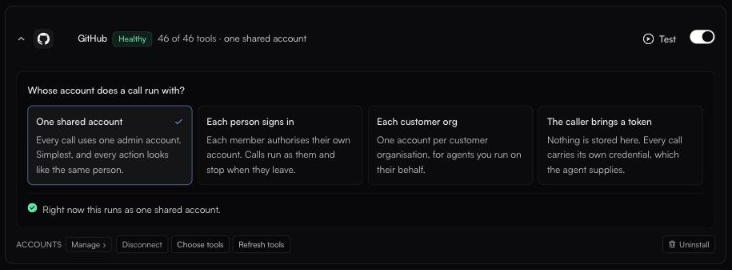

# Whose account a call runs with

**What this page answers**

* Which sign-in mode should I pick for an app?
* What happens when someone calls a tool before connecting their account?
* How do I switch a connector to another mode?

### The four modes

Open a connector on **Tools**. Under **Whose account does a call run with?** pick one of:

| Mode | What it means | Pick it when |
| --- | --- | --- |
| **One shared account** | Every call uses one account an admin connected. | The data is the team's, not personal: a shared docs space, a status page, a read-only analytics account. |
| **Each person signs in** | Each member authorises their own account. Calls run as them. | The data is personal or permissioned: Gmail, Slack, GitHub, your CRM. Each person only reaches what *they* can reach in the app. |
| **Each customer org** | One account per customer organisation. | An agent serves many of your customers, and each customer connects their own account. See [Multi-tenant agents](../agents/multi-tenant.md). |
| **The caller brings a token** | Nothing is stored. The client sends its own token for this app on every call. | Your own backend already holds the user's token. |

Below the choices, the row reads *Right now this runs as {...}*, so you can always check the current setting. A public server that needs no sign-in shows *Public server: no sign-in needed* instead.

<figure><figcaption>The sign-in mode on an open connector row.</figcaption></figure>


Right after you install an app, **Set up {app}** asks the same question with shorter labels: **One shared account**, **Each user**, **Each org** and **Caller's token**. They are the same four modes.


### Each person signs in: the connect link

With **Each person signs in**, nobody has to set anything up in advance. The first time someone calls one of the app's tools before connecting, the tool does not fail silently. It replies:

```
Authorization required: the Slack account isn't connected.

https://connect.fastn.dev/...

[Connect Slack](https://connect.fastn.dev/...)

Open the link to authorize your Slack account, then run the tool again.
```

The person opens the link, signs in to the app, sees *Connected to Slack*, and goes back to the chat. The next call runs as them.

* If the stored account was rejected (for example, a revoked token), the reply says *Authorization failed... Reconnect to continue.* with a **Reconnect** link.
* If an agent is calling on someone's behalf, the reply asks the agent to *share this link* with that person, because granting access is always the person's own action.
* People can also connect ahead of time: from the app's row on **Tools**, from the consent screen when they first connect their client, or from their [Profile](../settings.md#your-profile).

Connected accounts are stored encrypted and refreshed automatically. They are never shown to the model. Anyone can disconnect their own account from their Profile at any time.

### One shared account

After choosing this mode, click **Connect {app}** and sign in with the account to share. **Accounts** → **Manage** lists the shared account and lets you add or remove it. **Disconnect** asks you to confirm, because the app's tools stop working until you reconnect.

### More than one account for the same app

One person (or one customer org) can connect more than one account for the same app, for example two HubSpot portals. Each is a separate connection. **My accounts** → **Manage** on the row lists them. An agent can choose one per call with the `X-Connection-Id` header; otherwise the active account is used.

### Members and sign-in modes

Only owners and admins change a connector's mode. Members see a line explaining it instead, for example *Runs on an account your admin connected. Nothing to connect here.* or *Your client sends its own token for this app on every call.*
