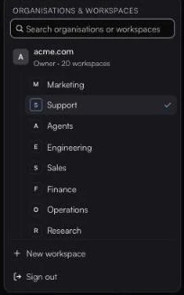

# Workspaces

A workspace is a separate gateway inside your organisation: *its own connectors, agents, and permissions, isolated from the rest.* Your organisation itself is the default workspace. Billing and plan limits stay at the organisation level and are shared by all its workspaces.

### Team or Agents

Each workspace has a type:

| Type | For |
| --- | --- |
| **Team** | *A gateway your people use from Claude & other tools.* People sign in through their client. |
| **Agents** | *A gateway your agents connect to with keys.* Home and Access show agents instead of people. |

An admin can also turn on **Also enable for agents** on a team workspace, which adds a **Team** / **Agents** switch to Home (**People** / **Agents** on Access).

### Create a workspace

*Owners and admins.*

1. Open the switcher at the foot of the sidebar and click **New workspace**.
2. Enter a name (for example *Marketing*) and pick **Team** or **Agents**. (**Agents** is offered only when agent access is turned on for your organisation.)
3. Click **Create workspace**.

<figure><figcaption>Switch, create and delete workspaces from the account card.</figcaption></figure>

The Free plan includes one workspace. See [Plans and limits](plans-and-limits.md).

### Add people to a workspace

Workspaces are invite-only. Signing in with your company domain gets someone into the organisation, not into its workspaces. Switch to the workspace, then invite them from **Access**. See [People and roles](access/README.md#invite-someone).

### Each workspace has its own URL

```
https://mcp.fastn.dev/<your-org>               # the organisation's default workspace
https://mcp.fastn.dev/<your-org>/<workspace>   # a named workspace
```

Home always shows the URL of the workspace you are in. With the plain `https://mcp.fastn.dev`, a person who belongs to several workspaces picks one on the consent screen. See [Gateway URLs](reference/gateway-urls.md).

### Switch workspace

Open the switcher at the foot of the sidebar, search if you need to, and pick a workspace. Agents workspaces are tagged **agents**, and organisations you belong to as an outside member are tagged **external**. The app reloads in the workspace you picked.

### Delete a workspace

Hover over it in the switcher, click the trash icon, and confirm. *Its connectors, members, agents, and permissions become unreachable.* Billing and limits are unaffected, because they are organisation-wide.
