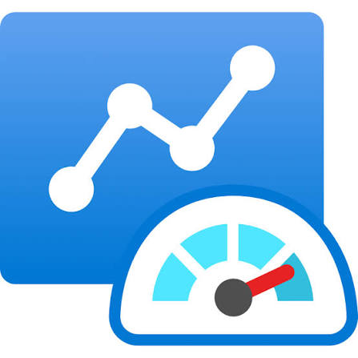
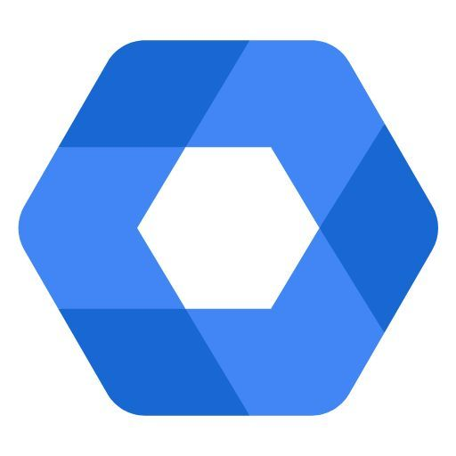

# Analytics and monitoring

Analytics and monitoring apps you can connect to with fastn, the most used first. Open a connector to see how it authenticates and every action and event it offers. Back to the [connector catalog](../README.md).

| | Connector | Authentication | About |
| --- | --- | --- | --- |
|  | [Amplitude](amplitude.md) | Basic auth | Amplitude Analytics — HTTP V2 ingest (api2.amplitude.com: /2/httpapi, /batch, /identify) plus Dashboard REST, Behavioral Cohorts, and Taxonomy APIs… |
|  | [AppDynamics](app-dynamics.md) | Credentials you enter | Cisco AppDynamics (Splunk AppDynamics) Controller REST API — full-stack application performance monitoring. |
|  | [Azure Monitor](azure-monitor.md) | OAuth 2.0 | Azure Monitor over the Microsoft.Insights Azure Resource Manager API at https://management.azure.com. |
|  | [Bugsnag](bugsnagio.md) | Credentials you enter | Bugsnag (now part of SmartBear Insight Hub) is an error monitoring and application stability platform. |
|  | [Carbon Intensity API (GB)](carbon-intensity-gb.md) | No authentication | The Carbon Intensity API from National Energy System Operator (NESO) gives the carbon intensity (gCO2/kWh) of Great Britain's electricity: current, forecast,… |
|  | [Chameleon](chameleon.md) | Credentials you enter | Chameleon is a product-adoption platform for in-product Tours, Microsurveys, Tooltips, Launchers, Embeddables, Product Demos and the HelpBar. |
|  | [Chartly](chartly.md) | Credentials you enter | Chartly renders Chart.js configurations into PNG or SVG chart images over a simple HTTP API, for embedding charts in emails, Slack messages, PDFs and low-code… |
|  | [Data USA](data-usa.md) | No authentication | Data USA (by Datawheel and Deloitte) publishes US public data - census, economy, education, health and more - through its Tesseract API. |
|  | [Datadog](datadog.md) | Credentials you enter | Datadog monitoring and observability platform. |
|  | [Domo](domo.md) | OAuth 2.0 | Domo is a cloud business intelligence platform for connecting, visualizing, and acting on data. |
|  | [Dynatrace](dynatrace-oauth.md) | OAuth 2.0 | Dynatrace unified observability platform, accessed through an Account Management OAuth2 client (client_credentials). |
|  | [Dynatrace](dynatrace.md) | Credentials you enter | Dynatrace is a unified observability and security platform for applications, infrastructure, logs, and digital experience. |
|  | [Fullstory](fullstory.md) | Credentials you enter | Fullstory is a digital experience analytics platform that captures web and mobile sessions. |
|  | [Google Analytics Admin](google-analytics-admin.md) | OAuth 2.0 | Manage Google Analytics 4 configuration through the Google Analytics Admin API v1beta: accounts, account summaries, properties, data streams, measurement… |
|  | [Google Analytics GA4](google-analytics-ga4.md) | Bearer token, OAuth 2.0 | Google Analytics 4 — Data API v1 (analyticsdata.googleapis.com: runReport, batchRunReports, runRealtimeReport, runPivotReport, checkCompatibility, metadata,… |
|  | [Google Cloud Logging](google-cloud-logging.md) | OAuth 2.0 | Google Cloud Logging API v2 for writing, reading and managing logs across projects, organizations, folders and billing accounts. |
|  | [Google Cloud Monitoring](google-cloud-monitoring.md) | OAuth 2.0 | Google Cloud Monitoring API v3 (https://monitoring.googleapis.com/v3). |
|  | [Google Cloud Trace](google-cloud-trace.md) | OAuth 2.0 | Google Cloud Trace API (https://cloudtrace.googleapis.com). |
|  | [GoSquared](go-squared.md) | Credentials you enter | GoSquared is a website analytics and customer engagement platform. |
|  | [GTmetrix](gtmetrix.md) | Credentials you enter | GTmetrix is a web page performance testing service. |
|  | [Hex](hex.md) | Credentials you enter | Hex is a collaborative data workspace for notebooks, data apps and AI agents. |
|  | [Hightouch](hightouch.md) | Bearer token | Hightouch Composable CDP and data activation platform. |
|  | [Honeycomb](honeycomb.md) | Credentials you enter | Honeycomb is an observability platform for querying, alerting on and exploring event, trace and log data. |
|  | [Instatus](instatus.md) | Bearer token | Instatus status pages, uptime monitoring and incident communication. |
|  | [Kibana](kibana.md) | Credentials you enter | Kibana is the management and visualization layer for the Elastic Stack. |
|  | [LiveSession](livesession.md) | Credentials you enter | LiveSession is a product-analytics and session-replay platform. |
|  | [Looker](looker.md) | Credentials you enter | Looker (Google Cloud) BI platform — Looker API 4.0. |
|  | [Looker Studio](looker-studio.md) | OAuth 2.0 | Looker Studio (formerly Google Data Studio) — the Data Studio REST API v1 (https://datastudio.googleapis.com/v1). |
|  | [Microsoft Fabric](microsoft-fabric.md) | OAuth 2.0 | Microsoft Fabric and Power BI analytics management. |
|  | [Microsoft Power BI](powerbi.md) | OAuth 2.0 | Microsoft Power BI REST API connector. |
|  | [Mixpanel](mixpanel.md) | Basic auth | Mixpanel product analytics — Query API (segmentation, funnels, retention, insights, activity stream, profiles), Lexicon schemas, annotations, cohorts, service… |
|  | [New Relic](new-relic.md) | Credentials you enter | New Relic observability platform. |
|  | [OctoLens](octolens.md) | Bearer token | OctoLens social listening — query brand mentions across Reddit, Twitter, LinkedIn, YouTube, HackerNews, GitHub and other platforms. |
|  | [Pingdom](pingdom.md) | API key | SolarWinds Pingdom website and transaction monitoring. |
|  | [Plausible Analytics](plausible.md) | Credentials you enter | Plausible Analytics is a privacy-friendly, cookie-free web analytics platform. |
|  | [PostHog](posthog.md) | Credentials you enter | PostHog product analytics, feature flags, experiments, surveys, session replay, and data management. |
|  | [SeekTable](seektable.md) | Credentials you enter | SeekTable is a self-service BI tool for pivot tables, charts and reports over CSV files, SQL databases, MongoDB, ElasticSearch and OLAP cubes. |
|  | [Simple Analytics](simple-analytics.md) | Credentials you enter | Simple Analytics is a privacy-friendly web analytics platform. |
|  | [SimpleKPI](simplekpi.md) | Bearer token | SimpleKPI is a KPI tracking and dashboard platform. |
|  | [Splunk](splunk.md) | Credentials you enter | Splunk Enterprise / Splunk Cloud REST API connector. |
|  | [Statsig](statsig.md) | API key | Statsig is a feature flagging, experimentation and product analytics platform. |
|  | [Statuspage](statuspage.md) | Credentials you enter | Atlassian Statuspage REST API v1. |
|  | [Tableau](tableau.md) | Credentials you enter | Tableau Cloud and Tableau Server REST API. |
|  | [ThoughtSpot](thoughtspot.md) | Credentials you enter | ThoughtSpot analytics platform — REST API v2. |
|  | [Updown.io](updown-io.md) | API key | Updown.io website and uptime monitoring. |
|  | [UptimeRobot](uptimerobot.md) | Credentials you enter | UptimeRobot monitors websites, APIs, ports, and cron jobs for uptime and downtime, and sends alerts when a monitor goes down. |
|  | [Userflow](userflow.md) | Credentials you enter | Userflow builds in-app onboarding flows, checklists, surveys and resource centres without code. |
|  | [Visualping](visualping.md) | Bearer token | Visualping website-change monitoring — create and manage monitoring jobs that fire a webhook when a page changes. |
