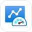

# Azure Monitor

Read platform metrics, metric definitions and metric namespaces for any Azure resource, query subscription and tenant activity logs and event categories, and manage the alerting and collection surface - action groups, metric alert rules and their status, activity log alert rules, scheduled query (log search) alert rules, autoscale settings, diagnostic settings and diagnostic setting categories, log profiles, and data collection rules, endpoints and associations. Also runs Log Analytics KQL queries through the ARM proxy endpoint. Connect with Microsoft Entra ID OAuth 2.0; the signed-in user needs Azure RBAC rights such as Monitoring Reader or Monitoring Contributor on the target scope.

| | |
| --- | --- |
| **Category** | [Analytics and monitoring](README.md) |
| **Website** | [monitor.azure.com](https://monitor.azure.com) |
| **Authentication** | OAuth 2.0 |
| **Slug** | `azureMonitor` |

## Use it

Add Azure Monitor from **Build → Integrations → Connectors** and connect an account, as in [Connect a system](../../build/connectors/connect-a-system.md). In workflow code, call an action as `fastn.connector.azureMonitor.<action>()`, with the action's slug from the table below. See [Workflow runtime API](../../reference/workflow-runtime.md).

## Actions

<table><thead><tr><th width="240">Action</th><th width="260">Slug</th><th>What it does</th></tr></thead><tbody><tr><td>Create Action Group Test Notifications</td><td><code>createActionGroupTestNotifications</code></td><td>Sends a test notification through the receivers of an existing action group. The call is asynchronous and returns a notification id to poll with Get Action Group Test Notification Status. This really delivers messages to the configured recipients.</td></tr><tr><td>Create Data Collection Endpoint</td><td><code>createDataCollectionEndpoint</code></td><td>Creates or replaces a data collection endpoint. The service generates the ingestion and configuration URLs; the caller supplies the region, an optional description and the public network access setting.</td></tr><tr><td>Create Data Collection Rule</td><td><code>createDataCollectionRule</code></td><td>Creates or replaces a data collection rule. Data Sources declares what is collected (performance counters, syslog, Windows event logs, extensions, log files), Destinations declares where it goes (Log Analytics workspaces, Azure Monitor metrics, storage), and Data Flows connects named streams to destinations.</td></tr><tr><td>Create Data Collection Rule Association</td><td><code>createDataCollectionRuleAssociation</code></td><td>Associates a data collection rule or a data collection endpoint with an Azure resource, which is what starts collection on that resource. Supply exactly one of Data Collection Rule ID or Data Collection Endpoint ID.</td></tr><tr><td>Create or Update Action Group</td><td><code>createOrUpdateActionGroup</code></td><td>Creates a new action group or replaces an existing one, including its full list of email, SMS, webhook, ITSM, mobile push, runbook, voice, logic app, Azure function, ARM role and event hub receivers. Action groups are global resources, so Location is normally "Global".</td></tr><tr><td>Create or Update Activity Log Alert</td><td><code>createOrUpdateActivityLogAlert</code></td><td>Creates a new activity log alert rule or replaces an existing one. Activity log alert rules are global resources, so Location is normally "global". The condition is an allOf list of field comparisons over activity log event properties such as category, level, operationName and resourceGroup.</td></tr><tr><td>Create or Update Autoscale Setting</td><td><code>createOrUpdateAutoscaleSetting</code></td><td>Creates a new autoscale setting or replaces an existing one. Each profile defines an instance-count range and a set of rules that pair a metric trigger with a scale action; profiles may also carry a fixed date window or a weekly recurrence.</td></tr><tr><td>Create or Update Diagnostic Setting</td><td><code>createOrUpdateDiagnosticSetting</code></td><td>Creates or replaces a diagnostic setting on an Azure resource, routing selected log and metric categories to a Log Analytics workspace, storage account, event hub or marketplace partner. At least one destination must be supplied.</td></tr><tr><td>Create or Update Metric Alert</td><td><code>createOrUpdateMetricAlert</code></td><td>Creates a new metric alert rule or replaces an existing one. Metric alert rules are global resources, so Location is normally "global". The Criteria object is a discriminated union selected by its odata.type field; see the Azure Monitor metric alerts reference for the shape of each variant.</td></tr><tr><td>Create or Update Scheduled Query Rule</td><td><code>createOrUpdateScheduledQueryRule</code></td><td>Creates a new scheduled query (log search) alert rule or replaces an existing one. Each condition in the criteria carries the Kusto query, the metric measure, the operator and threshold, and how many evaluation periods must fail before the alert fires.</td></tr></tbody></table>

View 58 more actions

<table><thead><tr><th width="240">Action</th><th width="260">Slug</th><th>What it does</th></tr></thead><tbody><tr><td>Delete Action Group</td><td><code>deleteActionGroup</code></td><td>Deletes an action group. Alert rules that still reference it will no longer notify anyone.</td></tr><tr><td>Delete Activity Log Alert</td><td><code>deleteActivityLogAlert</code></td><td>Deletes an activity log alert rule.</td></tr><tr><td>Delete Autoscale Setting</td><td><code>deleteAutoscaleSetting</code></td><td>Deletes an autoscale setting. The target resource keeps its current instance count but stops scaling automatically.</td></tr><tr><td>Delete Data Collection Endpoint</td><td><code>deleteDataCollectionEndpoint</code></td><td>Deletes a data collection endpoint. Rules and associations that reference it stop ingesting.</td></tr><tr><td>Delete Data Collection Rule</td><td><code>deleteDataCollectionRule</code></td><td>Deletes a data collection rule. Delete its associations first, or the call is rejected.</td></tr><tr><td>Delete Data Collection Rule Association</td><td><code>deleteDataCollectionRuleAssociation</code></td><td>Removes a data collection rule association from an Azure resource, stopping collection on that resource without deleting the rule itself.</td></tr><tr><td>Delete Diagnostic Setting</td><td><code>deleteDiagnosticSetting</code></td><td>Deletes a named diagnostic setting from an Azure resource, stopping the export of its logs and metrics to that destination.</td></tr><tr><td>Delete Metric Alert</td><td><code>deleteMetricAlert</code></td><td>Deletes a metric alert rule.</td></tr><tr><td>Delete Scheduled Query Rule</td><td><code>deleteScheduledQueryRule</code></td><td>Deletes a scheduled query (log search) alert rule.</td></tr><tr><td>Enable Action Group Receiver</td><td><code>enableActionGroupReceiver</code></td><td>Re-enables a receiver in an action group that was disabled because the recipient unsubscribed. Applies only to SMS, voice and Azure mobile app push receivers.</td></tr><tr><td>Get Action Group</td><td><code>getActionGroup</code></td><td>Gets a single action group with all of its configured receivers.</td></tr><tr><td>Get Action Group Test Notification Status</td><td><code>getActionGroupTestNotificationStatus</code></td><td>Gets the delivery status of a test notification previously started with Create Action Group Test Notifications, broken down per receiver.</td></tr><tr><td>Get Activity Log Alert</td><td><code>getActivityLogAlert</code></td><td>Gets a single activity log alert rule, including the condition it matches and the action groups it fires into.</td></tr><tr><td>Get Autoscale Setting</td><td><code>getAutoscaleSetting</code></td><td>Gets a single autoscale setting with its full profile, rule and notification configuration.</td></tr><tr><td>Get Data Collection Endpoint</td><td><code>getDataCollectionEndpoint</code></td><td>Gets a single data collection endpoint, including the logs ingestion and configuration access URLs that clients post to.</td></tr><tr><td>Get Data Collection Rule</td><td><code>getDataCollectionRule</code></td><td>Gets a single data collection rule with its data sources, destinations, stream declarations and data flows.</td></tr><tr><td>Get Data Collection Rule Association</td><td><code>getDataCollectionRuleAssociation</code></td><td>Gets a single named data collection rule association on an Azure resource.</td></tr><tr><td>Get Diagnostic Setting</td><td><code>getDiagnosticSetting</code></td><td>Gets a single named diagnostic setting on an Azure resource, including its destinations and the log and metric categories it routes.</td></tr><tr><td>Get Metric Alert</td><td><code>getMetricAlert</code></td><td>Gets a single metric alert rule, including its full criteria definition and the action groups it fires into.</td></tr><tr><td>Get Metric Alert Status by Name</td><td><code>getMetricAlertStatusByName</code></td><td>Gets the firing status of a metric alert rule for one named dimension combination, as returned by List Metric Alert Status.</td></tr><tr><td>Get Predictive Metric</td><td><code>getPredictiveMetric</code></td><td>Gets the predictive autoscale forecast for an autoscale setting over a time range, so you can compare the predicted metric against the actual one before enabling predictive scaling.</td></tr><tr><td>Get Scheduled Query Rule</td><td><code>getScheduledQueryRule</code></td><td>Gets a single scheduled query (log search) alert rule, including its query, threshold criteria, schedule and actions.</td></tr><tr><td>List Action Groups by Resource Group</td><td><code>listActionGroupsByResourceGroup</code></td><td>Lists the action groups in a single resource group.</td></tr><tr><td>List Action Groups by Subscription</td><td><code>listActionGroupsBySubscription</code></td><td>Lists every action group in a subscription. An action group is the reusable set of notification and automation receivers that alert rules fire into.</td></tr><tr><td>List Activity Log Alerts by Resource Group</td><td><code>listActivityLogAlertsByResourceGroup</code></td><td>Lists the activity log alert rules in a single resource group.</td></tr><tr><td>List Activity Log Alerts by Subscription</td><td><code>listActivityLogAlertsBySubscription</code></td><td>Lists every activity log alert rule in a subscription. These rules fire on control-plane events rather than metric thresholds.</td></tr><tr><td>List Activity Logs</td><td><code>listActivityLogs</code></td><td>Lists control-plane activity log events for a subscription. A filter over eventTimestamp is required and must span no more than 90 days, for example "eventTimestamp ge '2026-01-01T00:00:00Z' and eventTimestamp le '2026-01-08T00:00:00Z'".</td></tr><tr><td>List Autoscale Settings by Resource Group</td><td><code>listAutoscaleSettingsByResourceGroup</code></td><td>Lists the autoscale settings in a single resource group.</td></tr><tr><td>List Autoscale Settings by Subscription</td><td><code>listAutoscaleSettingsBySubscription</code></td><td>Lists every autoscale setting in a subscription. An autoscale setting drives instance counts of a scalable resource from metric rules and schedules.</td></tr><tr><td>List Data Collection Endpoints by Resource Group</td><td><code>listDataCollectionEndpointsByResourceGroup</code></td><td>Lists the data collection endpoints in a single resource group.</td></tr><tr><td>List Data Collection Endpoints by Subscription</td><td><code>listDataCollectionEndpointsBySubscription</code></td><td>Lists every data collection endpoint in a subscription. A data collection endpoint provides the ingestion and configuration URLs agents and custom log senders connect to.</td></tr><tr><td>List Data Collection Rule Associations by Endpoint</td><td><code>listDataCollectionRuleAssociationsByEndpoint</code></td><td>Lists every association of a single data collection endpoint, showing which resources use that endpoint for ingestion.</td></tr><tr><td>List Data Collection Rule Associations by Resource</td><td><code>listDataCollectionRuleAssociationsByResource</code></td><td>Lists the data collection rule associations attached to a single Azure resource, such as a virtual machine or Arc-enabled server. An association is what actually applies a rule to a machine.</td></tr><tr><td>List Data Collection Rule Associations by Rule</td><td><code>listDataCollectionRuleAssociationsByRule</code></td><td>Lists every association of a single data collection rule, which is how you discover the resources the rule is applied to.</td></tr><tr><td>List Data Collection Rules by Resource Group</td><td><code>listDataCollectionRulesByResourceGroup</code></td><td>Lists the data collection rules in a single resource group.</td></tr><tr><td>List Data Collection Rules by Subscription</td><td><code>listDataCollectionRulesBySubscription</code></td><td>Lists every data collection rule in a subscription. A data collection rule defines what the Azure Monitor agent collects and where it sends it.</td></tr><tr><td>List Diagnostic Settings</td><td><code>listDiagnosticSettings</code></td><td>Lists the diagnostic settings on an Azure resource. A diagnostic setting routes the resource's platform logs and metrics to a Log Analytics workspace, storage account, event hub or partner destination.</td></tr><tr><td>List Event Categories</td><td><code>listEventCategories</code></td><td>Lists the activity log event categories supported by Azure Monitor, such as Administrative, Security, ServiceHealth, Alert, Recommendation, Policy and Autoscale. Use the returned values in activity log filters.</td></tr><tr><td>List Metric Alert Status</td><td><code>listMetricAlertStatus</code></td><td>Lists the current firing status of a metric alert rule, one entry per monitored dimension combination.</td></tr><tr><td>List Metric Alerts by Resource Group</td><td><code>listMetricAlertsByResourceGroup</code></td><td>Lists the metric alert rules in a single resource group.</td></tr><tr><td>List Metric Alerts by Subscription</td><td><code>listMetricAlertsBySubscription</code></td><td>Lists every metric alert rule in a subscription, with its scopes, criteria, evaluation frequency and actions.</td></tr><tr><td>List Metric Definitions</td><td><code>listMetricDefinitions</code></td><td>Lists the metric definitions available for a single Azure resource, including each metric's unit, supported aggregations, time grains and dimensions. Use it to discover the metric names accepted by List Metrics.</td></tr><tr><td>List Metric Definitions at Subscription Scope</td><td><code>listMetricDefinitionsAtSubscriptionScope</code></td><td>Lists the metric definitions available in one region of a subscription for a given metric namespace, rather than for a single resource.</td></tr><tr><td>List Metric Namespaces</td><td><code>listMetricNamespaces</code></td><td>Lists the metric namespaces available for a single Azure resource, including custom namespaces emitted by the resource. Use it to discover the value to pass as Metric Namespace on the metric actions.</td></tr><tr><td>List Metrics</td><td><code>listMetrics</code></td><td>Reads platform metric values for a single Azure resource over a time range. The resource is addressed by its subscription, resource group, provider namespace, resource type and name, which together form the resource URI. Requires the Monitoring Reader role or equivalent on the resource.</td></tr><tr><td>List Metrics at Subscription Scope</td><td><code>listMetricsAtSubscriptionScope</code></td><td>Reads platform metric values across every resource of a given metric namespace in one region of a subscription, rather than for a single resource. Region and Metric Namespace are both required by the service.</td></tr><tr><td>List Monitor Operations</td><td><code>listMonitorOperations</code></td><td>Lists all Azure Resource Manager operations exposed by the Microsoft.Insights provider, with their display names and descriptions. Useful for discovering the RBAC actions Azure Monitor defines.</td></tr><tr><td>List Scheduled Query Rules by Resource Group</td><td><code>listScheduledQueryRulesByResourceGroup</code></td><td>Lists the scheduled query (log search) alert rules in a single resource group.</td></tr><tr><td>List Scheduled Query Rules by Subscription</td><td><code>listScheduledQueryRulesBySubscription</code></td><td>Lists every scheduled query (log search) alert rule in a subscription. These rules run a Kusto query on a schedule and alert on its result.</td></tr><tr><td>List Tenant Activity Logs</td><td><code>listTenantActivityLogs</code></td><td>Lists activity log events across the whole tenant rather than a single subscription. Everything the caller can see is returned; a filter over eventTimestamp is strongly recommended because the tenant log is large.</td></tr><tr><td>Run Log Analytics Query</td><td><code>runLogAnalyticsQuery</code></td><td>Runs a Kusto (KQL) query against a Log Analytics workspace through the Azure Resource Manager proxy endpoint, so the same Entra token used for the rest of this connector applies. Returns tables of columns and rows.</td></tr><tr><td>Update Action Group</td><td><code>updateActionGroup</code></td><td>Updates only the tags and enabled state of an existing action group. Use Create or Update Action Group to change its receivers.</td></tr><tr><td>Update Activity Log Alert</td><td><code>updateActivityLogAlert</code></td><td>Updates the tags or enabled state of an existing activity log alert rule. Use Create or Update Activity Log Alert to change its condition or actions.</td></tr><tr><td>Update Autoscale Setting</td><td><code>updateAutoscaleSetting</code></td><td>Updates the tags or selected properties of an existing autoscale setting without replacing the whole resource.</td></tr><tr><td>Update Data Collection Endpoint</td><td><code>updateDataCollectionEndpoint</code></td><td>Updates the tags of an existing data collection endpoint.</td></tr><tr><td>Update Data Collection Rule</td><td><code>updateDataCollectionRule</code></td><td>Updates the tags of an existing data collection rule. Use Create Data Collection Rule to change its data sources, destinations or data flows.</td></tr><tr><td>Update Metric Alert</td><td><code>updateMetricAlert</code></td><td>Updates the tags or selected properties of an existing metric alert rule without replacing the whole resource.</td></tr><tr><td>Update Scheduled Query Rule</td><td><code>updateScheduledQueryRule</code></td><td>Updates the tags or selected properties of an existing scheduled query alert rule without replacing the whole resource.</td></tr></tbody></table>

