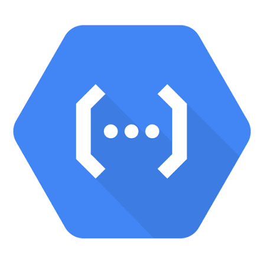
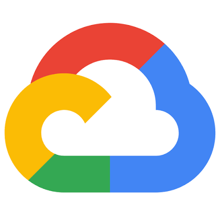
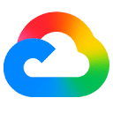

# Cloud and DevOps

Cloud and DevOps apps you can connect to with fastn, the most used first. Open a connector to see how it authenticates and every action and event it offers. Back to the [connector catalog](../README.md).

| | Connector | Authentication | About |
| --- | --- | --- | --- |
|  | [AWS S3](aws-s3.md) | Custom | Amazon Simple Storage Service (S3) REST API. |
|  | [AWS Security Token Service](aws-sts.md) | Custom | AWS Security Token Service (STS) Query API. |
|  | [Azure File Storage](azure-file-storage.md) | OAuth 2.0 | Azure File Storage — cloud file shares over SMB/NFS. |
|  | [Azure Resource Manager](azure-resource-manager.md) | OAuth 2.0 | Azure Resource Manager (ARM) control-plane API at https://management.azure.com. |
|  | [Azure Service Bus](azure-service-bus.md) | Credentials you enter | Azure Service Bus messaging. |
|  | [Backblaze B2](backblaze-b2.md) | Credentials you enter | Backblaze B2 Cloud Storage connector using the B2 Native API v3. |
|  | [Cloudflare](cloudflare.md) | Bearer token | Cloudflare API v4 (base https://api.cloudflare.com/client/v4). |
|  | [Cloudmersive](cloudmersive.md) | Credentials you enter | Cloudmersive is a multi-API platform providing document/data conversion, OCR, data validation, image recognition, virus scanning, NLP, and barcode generation… |
|  | [Cube Cloud](cube-cloud.md) | Credentials you enter | Cube Cloud is a universal semantic layer that serves governed metrics and data models to BI tools, applications and AI agents. |
|  | [DNSFilter](dnsfilter.md) | Bearer token | DNSFilter is a cloud-based DNS security and content filtering platform. |
|  | [Doppler](doppler.md) | Bearer token | Doppler is a secrets management platform for storing, syncing, and rotating environment variables, API keys, and secrets across projects, environments, and… |
|  | [Google Cloud Functions](google-cloud-functions.md) | OAuth 2.0 | Manage Google Cloud Functions (2nd gen) through the Cloud Functions API v2: create, update, list, get and delete functions, generate signed upload and… |
|  | [Google Cloud Pub/Sub](google-cloud-pub-sub.md) | OAuth 2.0 | Google Cloud Pub/Sub REST API v1 connector (https://pubsub.googleapis.com/v1). |
|  | [Google Cloud Resource Manager](google-cloud-resource-manager.md) | OAuth 2.0 | Google Cloud Resource Manager API v3 connector (https://cloudresourcemanager.googleapis.com/v3). |
|  | [Google Cloud Run](google-cloud-run.md) | OAuth 2.0 | Deploy and operate serverless containers with the Google Cloud Run Admin API v2: services and revisions, jobs, executions and tasks, worker pools and worker… |
|  | [Google Cloud Scheduler](google-cloud-scheduler.md) | OAuth 2.0 | Google Cloud Scheduler is a fully managed enterprise-grade cron job scheduler. |
|  | [Google Cloud Storage](google-cloud-storage.md) | OAuth 2.0 | Google Cloud Storage JSON API connector. |
|  | [Google Compute Engine](google-compute-engine.md) | OAuth 2.0 | Google Compute Engine API v1 (https://compute.googleapis.com/compute/v1). |
|  | [Google Firebase](google-firebase.md) | OAuth 2.0 | Firebase Management API — list and inspect Firebase projects, their Android, iOS and Web apps, app configuration, admin SDK config, and available project… |
|  | [Google IAM Service Account Credentials](google-iam-credentials.md) | OAuth 2.0 | Google IAM Service Account Credentials API (iamcredentials.googleapis.com v1). |
|  | [Google Network Management](google-network-management.md) | OAuth 2.0 | Google Network Management API (networkmanagement.googleapis.com v1), part of Network Intelligence Center. |
|  | [Google Service Management](google-service-management.md) | OAuth 2.0 | Google Service Management API (servicemanagement.googleapis.com v1). |
|  | [HotspotSystem](hotspotsystem.md) | API key | HotspotSystem cloud WiFi hotspot management. |
|  | [Inngest](inngest.md) | Credentials you enter | Inngest is a durable execution platform for background jobs, step functions, scheduled workflows and AI agent orchestration. |
|  | [Netlify](netlify.md) | Credentials you enter | Netlify web hosting and deployment platform. |
|  | [NextDNS](next-dns.md) | Credentials you enter | NextDNS is a cloud DNS firewall that blocks ads, trackers and threats and provides parental controls and DNS analytics. |
|  | [PagerDuty](pagerduty.md) | Credentials you enter | PagerDuty is an incident response and digital operations platform. |
|  | [Terraform Cloud](terraform-cloud.md) | Credentials you enter | HashiCorp HCP Terraform (Terraform Cloud) API v2. |
|  | [Uploadcare](uploadcare.md) | Credentials you enter | Uploadcare file uploading, storage, CDN delivery, and processing platform. |
|  | [Vercel](vercel.md) | Bearer token | Vercel REST API (base https://api.vercel.com). |
|  | [WebDAV](webdav.md) | Digest auth | WebDAV (Web Distributed Authoring and Versioning) connector for remote file management over HTTP. |
