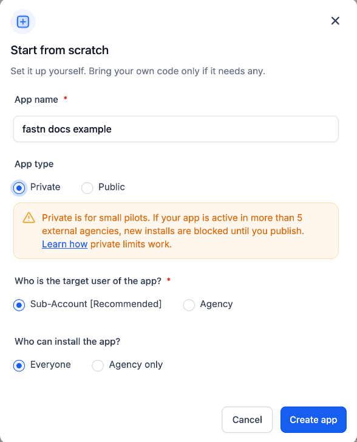
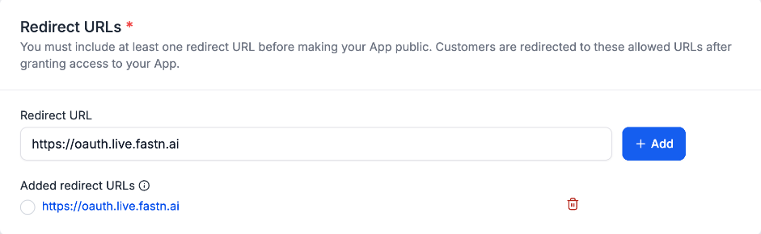
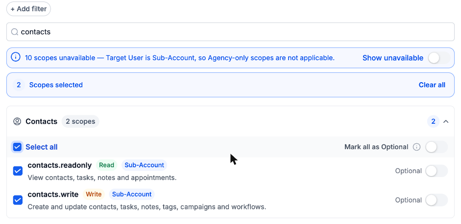
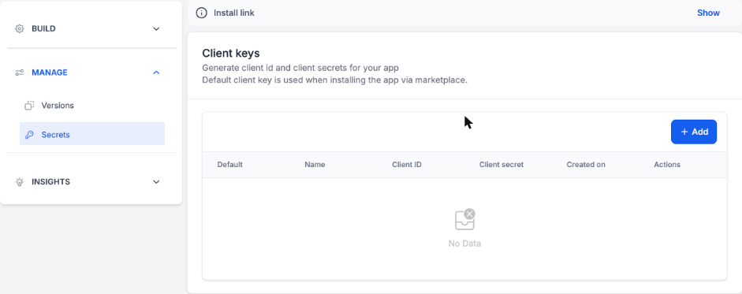
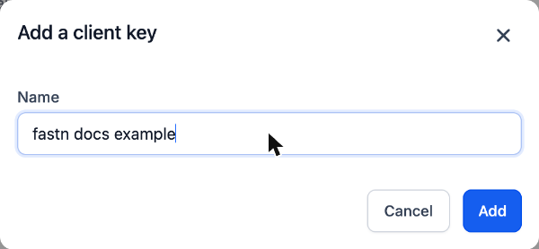
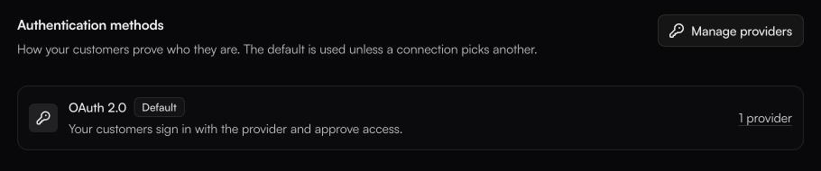

# GoHighLevel

This connector wraps its LeadConnector REST API v2 at https://services.leadconnectorhq.com, covering contacts, tasks, notes, tags, conversations and messaging (SMS/email/call), opportunities and pipelines, calendars, appointments and free slots, forms, surveys, workflows, campaigns, trigger links, sub-accounts (locations), users, businesses, custom fields and custom values, invoices, estimates, products and prices, payments, orders, transactions and subscriptions, media files, custom objects and associations. Every v2 request requires a date-based Version header (2021-07-28 for most groups, 2021-04-15 for calendars and conversations) and most endpoints are scoped to a single sub-account via locationId. Authenticate with a marketplace OAuth 2.0 app (Sub-Account or Agency/Company token) or with a Private Integration Token.

| | |
| --- | --- |
| **Category** | [CRM and sales](README.md) |
| **Website** | [leadconnectorhq.com](https://leadconnectorhq.com) |
| **Authentication** | Credentials you enter, OAuth 2.0 |
| **Slug** | `leadConnector` |

## Setup guide
This guide shows how to connect GoHighLevel to fastn, either with your own GoHighLevel marketplace app (OAuth) or with a Private Integration Token from a sub-account.

### Before you start
- You need the Owner, Admin or Developer role in fastn.
- To use your own OAuth app, you need a GoHighLevel Marketplace developer account at marketplace.gohighlevel.com.
- To use a Private Integration Token, you need a GoHighLevel user who can manage Private Integrations. Agency admins can do this by default; other users need the permission under Settings > Users > Roles & Permissions.
- Some endpoints depend on your GoHighLevel plan and the token's scopes, not only on the connection.

### Create your GoHighLevel app
1. Sign in to the GoHighLevel Marketplace at marketplace.gohighlevel.com. On the **App dashboard**, click **Create app**.
2. In the **Start from scratch** dialog, enter an **App name** and choose the **App type** (Private is a good start for testing). Under **Who is the target user of the app?**, choose **Sub-Account** for the sub-account (location) connection or **Agency** for the agency (company) connection, pick **Who can install the app?**, and click **Create app**.

<figure><figcaption>
The Start from scratch dialog with the app name, app type and target user
</figcaption></figure>

3. In the app's sidebar, go to **BUILD > Advanced Settings > Auth**.
4. Under **Redirect URLs**, enter `https://oauth.live.fastn.ai` in the **Redirect URL** field and click **Add**. Enter it exactly, with no trailing slash. It then appears under **Added redirect URLs**.

<figure><figcaption>
fastn's redirect URL added to the app
</figcaption></figure>

5. Under **Scopes**, search for each scope fastn requests, tick it (or use **Select all** for a group), and click **Save**. Scopes that do not match the app's target user are hidden unless you turn on **Show unavailable**.
   - For the sub-account connection: `contacts.readonly`, `contacts.write`, `conversations.readonly`, `conversations.write`, `conversations/message.readonly`, `conversations/message.write`, `opportunities.readonly`, `opportunities.write`, `calendars.readonly`, `calendars.write`, `calendars/events.readonly`, `calendars/events.write`, `calendars/groups.readonly`, `calendars/groups.write`, `calendars/resources.readonly`, `calendars/resources.write`, `forms.readonly`, `surveys.readonly`, `workflows.readonly`, `campaigns.readonly`, `links.readonly`, `links.write`, `locations.readonly`, `locations/customFields.readonly`, `locations/customFields.write`, `locations/customValues.readonly`, `locations/customValues.write`, `locations/tags.readonly`, `locations/tags.write`, `locations/tasks.readonly`, `locations/templates.readonly`, `users.readonly`, `users.write`, `businesses.readonly`, `businesses.write`, `medias.readonly`, `medias.write`, `invoices.readonly`, `invoices.write`, `invoices/estimate.readonly`, `invoices/estimate.write`, `invoices/schedule.readonly`, `invoices/schedule.write`, `invoices/template.readonly`, `invoices/template.write`, `products.readonly`, `products.write`, `products/prices.readonly`, `products/prices.write`, `products/collection.readonly`, `products/collection.write`, `payments/orders.readonly`, `payments/orders.write`, `payments/transactions.readonly`, `payments/subscriptions.readonly`, `payments/coupons.readonly`, `payments/coupons.write`, `payments/integration.readonly`, `payments/integration.write`, `objects/schema.readonly`, `objects/schema.write`, `objects/record.readonly`, `objects/record.write`, `associations.readonly`, `associations.write`, `associations/relation.readonly`, `associations/relation.write`.
   - For the agency connection: `companies.readonly`, `locations.readonly`, `locations.write`, `users.readonly`, `users.write`, `snapshots.readonly`, `oauth.readonly`, `oauth.write`, `saas/company.write`, `saas/location.read`, `saas/location.write`, `emails/schedule.readonly`.

<figure><figcaption>
Selecting scopes on the Auth page
</figcaption></figure>

6. In the sidebar, go to **MANAGE > Secrets**. Under **Client keys**, click **Add**, enter a name for the key, and click **Add**. Copy the Client ID and Client Secret right away. GoHighLevel does not show the secret again after you close the dialog.

<figure> Secrets"><figcaption>
The Client keys section under Manage > Secrets
</figcaption></figure>

<figure><figcaption>
Naming a new client key
</figcaption></figure>

Scopes can only be changed while the app is a draft, so add them all before you publish.

### Add your app to fastn
1. In fastn, go to **Build → Integrations → Connectors** and open **GoHighLevel**.
2. Open the **Auth** tab and click **Manage providers**.

<figure><figcaption>
Open the connector's Auth tab, then Manage providers.
</figcaption></figure>

3. Click **+ Create Provider**.
4. In the **New Auth Provider** form, enter a **Name** and **Description**, paste the **Client ID** and **Client Secret** from GoHighLevel, and enter the **Scopes** you added to the app.

<figure><figcaption>
The New Auth Provider form: paste your app's Client ID and Client Secret.
</figcaption></figure>

5. Save the provider, then choose **Use this app** so it becomes the Preferred app.
6. In your widget, set the connector's **Auth provider** to your app instead of **Use platform default**.

Customers who skip this sign in through fastn's shared GoHighLevel app.

### Get your GoHighLevel credentials
To connect with a Private Integration Token instead of OAuth, fastn asks for one value, **token**.

1. In the GoHighLevel sub-account, go to **Settings > Private Integrations**.
2. Click **Create New Integration**.
3. Enter a name and description.
4. Select the scopes the integration needs. The token can only call endpoints its scopes allow.
5. Generate the token and copy it. It starts with `pit-`. GoHighLevel may show it only once, so store it somewhere safe.

You can change the token's scopes later by editing the integration, without creating a new token.

### Connect in fastn
Your customers enter the token when they connect GoHighLevel in your widget, or you enter it under **Build → Integrations → Connectors → GoHighLevel**.

### Events
fastn supports GoHighLevel events such as contact, opportunity, appointment, task, note, message and order changes. To run a workflow when one happens, add an [App event trigger](../../build/triggers/app-events.md) under **Build → Integrations → Triggers → Add trigger → App events**. Contact fastn support to set up events for GoHighLevel.

## Actions

<table><thead><tr><th width="240">Action</th><th width="260">Slug</th><th>What it does</th></tr></thead><tbody><tr><td>Add Contact Followers</td><td><code>addContactFollowers</code></td><td>Add users as followers of a contact so they receive its activity. Returns {followers, followersAdded}.</td></tr><tr><td>Add Contact Tags</td><td><code>addContactTags</code></td><td>Add one or more tags to a contact. Tags are created in the location if they do not exist. Returns the contact's full tag list.</td></tr><tr><td>Add Contact To Campaign</td><td><code>addContactToCampaign</code></td><td>Enrol a contact into a campaign. Returns {succeded:true}.</td></tr><tr><td>Add Contact To Workflow</td><td><code>addContactToWorkflow</code></td><td>Enrol a contact into a workflow, optionally scheduling when the workflow starts. Returns {succeded:true}.</td></tr><tr><td>Add Facebook Custom Audience Member</td><td><code>fbAddCustomAudienceMember</code></td><td>Add a member to a Facebook custom audience. Spec note: the ad-manager spec declares no 200 response schema for any of its 94 operations, so the output contract is left open (object-rooted, additionalProperties true). Version header 2021-07-28.</td></tr><tr><td>Add Inbound Message</td><td><code>addInboundMessage</code></td><td>Record an inbound message received outside LeadConnector into an existing conversation, for custom conversation providers. Returns {success, conversationId, messageId}.</td></tr><tr><td>Add Message Attachments</td><td><code>addMessageAttachments</code></td><td>Set the attachments on an existing conversation message, replacing any already there. Maximum 5 URLs. Supported for TYPE_CUSTOM_CALL (34) and TYPE_CALL (1) with subType EXTERNAL_CALL. Version header 2021-04-15.</td></tr><tr><td>Add Opportunity Followers</td><td><code>addOpportunityFollowers</code></td><td>Add users as followers of an opportunity. Returns {followers, followersAdded}.</td></tr><tr><td>Add Outbound Call</td><td><code>addOutboundCall</code></td><td>Record an outbound call placed outside LeadConnector into an existing conversation. Returns {success, conversationId, messageId}.</td></tr><tr><td>Apply User Availability Schedule To A Calendar</td><td><code>addCalendarSchedule</code></td><td>Apply user availability schedule to a calendar. Associates a calendar with the given schedule by adding the calendarId to a schedule. Version header 2021-04-15.</td></tr></tbody></table>

View 543 more actions

<table><thead><tr><th width="240">Action</th><th width="260">Slug</th><th>What it does</th></tr></thead><tbody><tr><td>Attach Action To Conversation AI Agent</td><td><code>convAiCreateAction</code></td><td>Create and attach an action to a conversation AI agent. Actions are the tasks the agent can perform: book an appointment, trigger a workflow, update a contact field, hand over to a human and so on. Returns {success, data}. Version header 2021-04-15.</td></tr><tr><td>Attach Facebook Page Or Group</td><td><code>attachFacebookPageGroup</code></td><td>Attach a Facebook page or group to a social planner account after OAuth. Spec note: type is declared as an empty object here but is a plain string in the sibling LinkedIn call, so it is typed string. Returns {success, statusCode, message, results}. Version header 2021-07-28.</td></tr><tr><td>Attach Google Business Location</td><td><code>attachGoogleBusinessLocation</code></td><td>Attach a Google Business Profile location to a social planner account after OAuth. The location and account objects are the entries returned by Get Google Business Locations. Spec note: AttachGMBLocationDTO declares location and account as bare objects with no properties, so they are modelled from the GoogleLocationSchema returned by the paired GET. Version header 2021-07-28.</td></tr><tr><td>Attach Instagram Professional Account</td><td><code>attachInstagramPageGroup</code></td><td>Attach an Instagram professional account to a social planner account after OAuth. pageId is the linked Facebook page. Returns {success, statusCode, message, results}. Version header 2021-07-28.</td></tr><tr><td>Attach LinkedIn Page Or Profile</td><td><code>attachLinkedinPageProfile</code></td><td>Attach a LinkedIn page or personal profile to a social planner account after OAuth. Returns {success, statusCode, message, results}. Version header 2021-07-28.</td></tr><tr><td>Attach TikTok Profile</td><td><code>attachTiktokProfile</code></td><td>Attach a TikTok profile to a social planner account after OAuth. Version header 2021-07-28.</td></tr><tr><td>Batch Update Facebook Audience Members</td><td><code>fbBatchUpdateAudienceMembers</code></td><td>Add or remove members in bulk from a Facebook custom audience, sourced from a CSV or from smart lists. Spec note: the ad-manager spec declares no 200 response schema for any of its 94 operations, so the output contract is left open. Version header 2021-07-28.</td></tr><tr><td>Bulk Delete Or Trash Media Files</td><td><code>bulkDeleteMediaObjects</code></td><td>Soft-delete or trash several media files and folders in one request. status=deleted removes, status=trashed moves to trash. Version header 2021-07-28.</td></tr><tr><td>Bulk Delete Social Planner Posts</td><td><code>bulkDeleteSocialPlannerPosts</code></td><td>Delete multiple social planner posts by ID. Maximum 50 post IDs per request; deletion applies to the HighLevel database only. Version header 2021-07-28.</td></tr><tr><td>Bulk Disable SaaS For Locations</td><td><code>bulkDisableSaas</code></td><td>Disable SaaS mode across a list of sub-accounts under an agency. Agency-scoped. Version header 2021-04-15.</td></tr><tr><td>Bulk Edit Products And Prices</td><td><code>bulkEdit</code></td><td>Bulk edit products and their prices, max 30 entities per call where the count includes every price inside each product. Returns {status, message, updatedCount}. Version header 2021-07-28.</td></tr><tr><td>Bulk Enable SaaS For Locations</td><td><code>bulkEnableSaas</code></td><td>Enable SaaS mode across a list of sub-accounts. isSaaSV2 selects the v1 or v2 flow and actionPayload carries the flow-specific settings. Agency-scoped. Version header 2021-04-15.</td></tr><tr><td>Bulk Set Contacts Business</td><td><code>bulkSetContactsBusiness</code></td><td>Attach many contacts to a business, or detach them by passing an empty businessId. Returns {success, ids}.</td></tr><tr><td>Bulk Update Contacts Tags</td><td><code>bulkUpdateContactsTags</code></td><td>Add or remove the same set of tags across many contacts in one call. The type path segment is 'add' or 'remove'. Returns {succeded, errorCount, responses}.</td></tr><tr><td>Bulk Update Media Files</td><td><code>bulkUpdateMediaObjects</code></td><td>Update the metadata or status of several media files and folders in one request. Version header 2021-07-28.</td></tr><tr><td>Bulk Update Product Reviews</td><td><code>bulkUpdateProductReview</code></td><td>Update one or several product reviews: status, reply and so on. Returns {status, message}. Version header 2021-07-28.</td></tr><tr><td>Bulk Update Products</td><td><code>bulkUpdate</code></td><td>Bulk update products: price, availability, collections, currency, or bulk delete. type selects the operation and only the matching payload field is read. Returns {status, message}. Version header 2021-07-28.</td></tr><tr><td>Bulk Update Rebilling</td><td><code>updateRebilling</code></td><td>Bulk update the rebilling configuration for one product across a list of sub-accounts. The spec declares no 200 schema, so the outputContract is left open. Agency-scoped. Version header 2021-04-15.</td></tr><tr><td>Cancel Invoice Schedule</td><td><code>cancelInvoiceSchedule</code></td><td>Cancel a scheduled recurring invoice by schedule id. The Invoices API identifies the account as altId plus altType 'location'. Returns the schedule object at the root. Version header 2021-07-28.</td></tr><tr><td>Cancel Scheduled Email</td><td><code>cancelScheduledEmail</code></td><td>Cancel a scheduled email message that has not been sent yet. Returns {status, message}.</td></tr><tr><td>Cancel Scheduled Message</td><td><code>cancelScheduledMessage</code></td><td>Cancel a message that was scheduled with scheduledTimestamp but has not been sent yet. Returns {status, message}.</td></tr><tr><td>Change Contact Subscription As User</td><td><code>userSubscriptionChange</code></td><td>Process a subscription change initiated by an admin or agent, for one custom subscription or as a resubscribe-all. Legal forms are created automatically for user-initiated resubscribes. legal_reason is required for resubscribe and resub_all. Version header 2021-04-15.</td></tr><tr><td>Check Blog Post URL Slug</td><td><code>checkUrlSlugExists</code></td><td>Check whether a blog post URL slug is already taken, which must be validated before publishing. postId comes from the post edit URL. Needs the blogs/check-slug.readonly scope. Returns {exists}. Version header 2021-07-28.</td></tr><tr><td>Check Marketplace Wallet Funds</td><td><code>hasFunds</code></td><td>Check whether the account behind the current token has enough wallet funds to be charged. Takes no input. Returns {hasFunds}. Version header 2021-07-28.</td></tr><tr><td>Complete Message File Upload</td><td><code>completeFileUpload</code></td><td>Validate a file uploaded to the GCS signed URL and return its public URL. Call after initiateFileUpload and after PUTting the bytes to the signed URL. Returns {uploadedFiles, metadata}. Version header 2021-04-15.</td></tr><tr><td>Count Funnel Pages</td><td><code>getPagesCountByFunnelId</code></td><td>Return how many pages a funnel has, with an optional name filter. Returns {count}. Version header 2021-07-28.</td></tr><tr><td>Count Product Reviews By Status</td><td><code>getReviewsCount</code></td><td>Get product review counts broken down by status, optionally filtered by product, store, rating and date range. Returns {data:[...]}. Version header 2021-07-28.</td></tr><tr><td>Create Agent Studio Agent</td><td><code>agentStudioCreateAgent</code></td><td>Create an Agent Studio agent with an initial staging version that can later be promoted to production. version carries the nodes, edges and configuration; the top-level nodes and edges fields are deprecated in favour of version.nodes and version.edges. Returns {success, agent, versions}. Version header 2021-04-15.</td></tr><tr><td>Create And Send Text2Pay Invoice</td><td><code>text2payInvoice</code></td><td>Create or update a Text2Pay invoice and optionally send it. Pass id to update an existing invoice; omit it to create a new one. action selects draft or send. Dates are YYYY-MM-DD. Returns {invoice, invoiceUrl}. Version header 2021-07-28.</td></tr><tr><td>Create Appointment</td><td><code>createAppointment</code></td><td>Book an appointment on a calendar for a contact. calendarId, locationId, contactId and startTime are required. Returns the appointment object at the root (not wrapped).</td></tr><tr><td>Create Appointment Note</td><td><code>createAppointmentNote</code></td><td>Create a note on a calendar appointment. Returns {note}. Version header 2021-04-15.</td></tr><tr><td>Create Association</td><td><code>createAssociation</code></td><td>Create a contact-to-contact or contact-to-custom-object association. Spec note: the four firstObject*/secondObject* fields are declared type object in the OpenAPI spec but every example is a plain string (e.g. "student", "custom_objects.children"), so they are typed string here. Returns the association object at the root. Version header 2021-07-28.</td></tr><tr><td>Create Block Slot</td><td><code>createBlockSlot</code></td><td>Block out a period on a calendar so it cannot be booked. Returns the block slot at the root.</td></tr><tr><td>Create Blog Post</td><td><code>createBlogPost</code></td><td>Create a blog post on a blog site. blogId comes from the blog site dashboard link, categories are category ids from getCategoriesLocation, author is an author id from getBlogAuthorsLocation, publishedAt is an ISO timestamp. No bodyTemplate is set, so fastn JSON-serializes the inputContract with proper escaping — necessary because rawHTML carries newlines and quotes that a literal template substitution would turn into invalid JSON. Needs blogs/post.write. Returns {data}. Version header 2021-07-28.</td></tr><tr><td>Create Brand Board</td><td><code>createBrandBoard</code></td><td>Create a brand board holding logos, colors and fonts. Pass brandBoardId to copy an existing board as a template. Returns the brand board object at the root. Version header 2021-07-28.</td></tr><tr><td>Create Business</td><td><code>createBusiness</code></td><td>Create a business record in a sub-account, which contacts can then be attached to. Returns {success, buiseness} - note the API's own misspelling of the response key.</td></tr><tr><td>Create Calendar</td><td><code>createCalendar</code></td><td>Create a calendar in a sub-account. locationId and name are required; the rest configures slot length, availability and team members. Returns {calendar:{...}}.</td></tr><tr><td>Create Calendar Group</td><td><code>createCalendarGroup</code></td><td>Create a calendar group in a sub-account. Returns {group}. Version header 2021-04-15.</td></tr><tr><td>Create Calendar Notifications</td><td><code>createEventNotification</code></td><td>Create one or more calendar event notification settings. The body is a raw JSON array, so pass notifications as a JSON array string, e.g. [{"receiverType":"contact","channel":"email","notificationType":"booked","isActive":true}]. All settings must target the one calendar. Returns {items:[...]}. Version header 2021-04-15.</td></tr><tr><td>Create Calendar Resource</td><td><code>createCalendarResource</code></td><td>Create a calendar resource (room or equipment). resourceType is the path segment and must be 'equipments' or 'rooms'. Returns the resource object at the root. Version header 2021-04-15.</td></tr><tr><td>Create Contact</td><td><code>createContact</code></td><td>Create a contact in a sub-account (location). locationId plus at least one identifier (email or phone) is required. Returns {contact:{...}}.</td></tr><tr><td>Create Contact Note</td><td><code>createContactNote</code></td><td>Add a note to a contact. Returns {note:{...}}.</td></tr><tr><td>Create Contact Task</td><td><code>createContactTask</code></td><td>Create a task on a contact. title, dueDate and completed are required by the API. Returns {task:{...}}.</td></tr><tr><td>Create Conversation</td><td><code>createConversation</code></td><td>Open a conversation thread for a contact in a sub-account. Returns {success, conversation}.</td></tr><tr><td>Create Conversation AI Agent</td><td><code>convAiCreateAgent</code></td><td>Create a conversation AI agent for a sub-account. mode selects off / suggestive / auto-pilot. waitTime caps at 5 minutes or 300 seconds; sleepTime caps at 48 hours, 2880 minutes or 172800 seconds and may be null for indefinite. autoPilotMaxMessages is 1-100. Returns the agent object at the root. Version header 2021-04-15.</td></tr><tr><td>Create Conversation Custom Subtype</td><td><code>createCustomSubtype</code></td><td>Create a custom conversation subtype for a sub-account. Requires an agency or account admin role. locationId is sent as a query param. Version header 2021-04-15.</td></tr><tr><td>Create Coupon</td><td><code>createCoupon</code></td><td>Create a promotional coupon with a discount type, validity window, usage limits and optional product scope. Dates are YYYY-MM-DDTHH:mm:ssZ. Returns the coupon object at the root. Version header 2021-07-28.</td></tr><tr><td>Create Custom Field</td><td><code>createCustomField</code></td><td>Create a custom field on contacts or opportunities in a sub-account. dataType is the field kind, e.g. TEXT, LARGE_TEXT, NUMERICAL, PHONE, MONETORY, CHECKBOX, SINGLE_OPTIONS, MULTIPLE_OPTIONS, DATE, TEXTBOX_LIST, FILE_UPLOAD, RADIO. Returns {customField:{...}}.</td></tr><tr><td>Create Custom Menu Link</td><td><code>createCustomMenu</code></td><td>Create a custom menu link for an agency. locations only applies when showOnLocation is true and showToAllLocations is false. allowCamera and allowMicrophone only apply in iframe openMode. Returns {customMenu}. Version header 2021-07-28.</td></tr><tr><td>Create Custom Object Record</td><td><code>createObjectRecord</code></td><td>Create a record on a business or custom object. schemaKey is the object key, e.g. custom_objects.pets. The spec ships an EMPTY CreateCustomObjectRecordDto, so the body fields below are modelled from the record shape in the 201 response schema (owner, followers, properties); re-verify against a live call. No bodyTemplate is set, so fastn serializes the inputContract minus the URL-templated schemaKey. Returns {record}. Version header 2021-07-28.</td></tr><tr><td>Create Custom Object Schema</td><td><code>createCustomObjectSchema</code></td><td>Create a custom object schema in a sub-account. key is lowercase underscore_separated and is automatically prefixed with "custom_objects.". labels is {singular, plural}; primaryDisplayPropertyDetails names the field shown as the record title. Returns {object}. Version header 2021-07-28.</td></tr><tr><td>Create Custom Payment Provider</td><td><code>createIntegration</code></td><td>Associate a custom payment provider with a sub-account. paymentsUrl is loaded in an iframe to start a payment session; queryUrl serves verify, refund and subscription queries. locationId is sent as a query param. Returns the provider object at the root. Version header 2021-07-28.</td></tr><tr><td>Create Custom Value</td><td><code>createCustomValue</code></td><td>Create a custom value (account-level merge field) in a sub-account. Returns {customValue:{...}}.</td></tr><tr><td>Create Email Template</td><td><code>createTemplate</code></td><td>Create an email builder template or folder. type=import with importProvider and importURL pulls a template in from Mailchimp, ActiveCampaign or Kajabi. Returns {redirect, traceId}. Version header 2021-07-28.</td></tr><tr><td>Create Estimate</td><td><code>createNewEstimate</code></td><td>Create an estimate for a contact. estimateNumber defaults to the next valid number when omitted. termsNotes supports HTML. The Invoices API identifies the account as altId plus altType 'location'. Returns the estimate object at the root. Version header 2021-07-28.</td></tr><tr><td>Create Estimate Template</td><td><code>createEstimateTemplate</code></td><td>Create a reusable estimate template. The Invoices API identifies the account as altId plus altType 'location'. termsNotes supports HTML. Returns the template object at the root. Version header 2021-07-28.</td></tr><tr><td>Create Facebook Conversation Form</td><td><code>fbCreateConversationForm</code></td><td>Create a Facebook conversation lead form with a welcome message and quick-reply questions. Spec note: the ad-manager spec declares no 200 response schema for any of its 94 operations, so the output contract is left open. Version header 2021-07-28.</td></tr><tr><td>Create Facebook Integration</td><td><code>fbCreateIntegration</code></td><td>Create a Facebook ad integration for a location, binding a page and an ad account. Spec note: the ad-manager spec declares no 200 response schema for any of its 94 operations, so the output contract is left open. Version header 2021-07-28.</td></tr><tr><td>Create Facebook Page Lead Form</td><td><code>fbCreatePageLeadForm</code></td><td>Create a lead gen form on a Facebook page. Built without a bodyTemplate so fastn JSON-serializes the input, which keeps the free-text privacy policy and disclaimer fields escaped. Spec note: the ad-manager spec declares no 200 response schema for any of its 94 operations, so the output contract is left open. Version header 2021-07-28.</td></tr><tr><td>Create Google Ads Integration</td><td><code>googleCreateIntegration</code></td><td>Create a Google Ads integration for a location, binding an ad account under an MCC. Spec note: no 200 response schema is declared for any ad-manager operation, so the output contract is left open. Version header 2021-07-28.</td></tr><tr><td>Create Google Offline User List Job</td><td><code>googleCreateOfflineUserListJob</code></td><td>Create a job that uploads users to a Google customer match list, sourced from smart lists or a CSV. Spec note: no 200 response schema is declared for any ad-manager operation, so the output contract is left open. Version header 2021-07-28.</td></tr><tr><td>Create Invoice</td><td><code>createInvoice</code></td><td>Create a draft invoice. invoiceItems is an array of line items, each {name, currency, amount, qty, productId?, priceId?, description?, taxes?}. Use Generate Invoice Number first if you want a specific number. Returns the invoice at the root.</td></tr><tr><td>Create Invoice From Estimate</td><td><code>createInvoiceEstimate</code></td><td>Convert an existing estimate into an invoice, optionally marking the estimate as invoiced. Returns {estimate, invoice}. Version header 2021-07-28.</td></tr><tr><td>Create Invoice Schedule</td><td><code>createInvoiceSchedule</code></td><td>Create a recurring invoice schedule. schedule carries the executeAt / rrule recurrence. The Invoices API identifies the account as altId plus altType 'location'. Returns the schedule object at the root. Version header 2021-07-28.</td></tr><tr><td>Create Invoice Template</td><td><code>createInvoiceTemplate</code></td><td>Create a reusable invoice template. The Invoices API identifies the account as altId plus altType 'location'. Returns the template object at the root. Version header 2021-07-28.</td></tr><tr><td>Create Knowledge Base</td><td><code>kbCreateKnowledgeBase</code></td><td>Create a knowledge base in a sub-account. Maximum 15 knowledge bases per sub-account. Returns {success, data}. Version header 2021-04-15.</td></tr><tr><td>Create Knowledge Base FAQ</td><td><code>kbCreate</code></td><td>Add a question-and-answer FAQ entry to a knowledge base. Returns {success, faq}. Version header 2021-04-15.</td></tr><tr><td>Create LinkedIn Integration</td><td><code>liCreateIntegration</code></td><td>Create a LinkedIn Ads integration for a location with its ad account details. Spec note: no 200 response schema is declared for any ad-manager operation, so the output contract is left open. Version header 2021-07-28.</td></tr><tr><td>Create LinkedIn Lead Form</td><td><code>liCreateLeadForm</code></td><td>Create a LinkedIn lead gen form on an ad account. Spec note: no 200 response schema is declared for any ad-manager operation, so the output contract is left open. Version header 2021-07-28.</td></tr><tr><td>Create Location Tag</td><td><code>createLocationTag</code></td><td>Create a tag in a sub-account. Returns {tag:{...}}.</td></tr><tr><td>Create Marketplace Wallet Charge</td><td><code>charge</code></td><td>Charge a sub-account's wallet for marketplace app usage. meterId comes from the app's pricing page; eventId is your own transaction reference. eventTime is ISO 8601 and defaults to the billing timestamp. Returns {success, chargeId}. Version header 2021-07-28.</td></tr><tr><td>Create Media Folder</td><td><code>createMediaFolder</code></td><td>Create a folder in the sub-account's media storage. Returns the folder object at the root. Version header 2021-07-28.</td></tr><tr><td>Create Object Custom Field</td><td><code>objectCfCreateCustomField</code></td><td>Create a custom field on a custom object or on Company (Business). This is the object-scoped custom-fields API; use createCustomField for the contact-level location custom fields. fieldKey is formatted custom_object.{objectKey}.{fieldKey}. Returns {field}. Version header 2021-07-28.</td></tr><tr><td>Create Object Custom Field Folder</td><td><code>objectCfCreateCustomFieldFolder</code></td><td>Create a folder to group custom fields on a custom object or on Company (Business). Version header 2021-07-28.</td></tr><tr><td>Create Opportunity</td><td><code>createOpportunity</code></td><td>Create an opportunity (deal) on a pipeline for a contact. pipelineId, locationId, name, status and contactId are required. Returns {opportunity:{...}}.</td></tr><tr><td>Create Or Update Store Settings</td><td><code>createStoreSetting</code></td><td>Create or update the store settings for a sub-account: shipping origin and the order and fulfillment notification settings. Returns {status, message, data}. Version header 2021-07-28.</td></tr><tr><td>Create Order Fulfillment</td><td><code>createOrderFulfillment</code></td><td>Fulfil an order, recording tracking details and the fulfilled items, and optionally notifying the customer. Returns {status, data}. Version header 2021-07-28.</td></tr><tr><td>Create Payment Provider Config</td><td><code>createConfig</code></td><td>Create a custom payment provider config for a sub-account, carrying separate live and test credentials. locationId is sent as a query param. Returns the config object at the root. Version header 2021-07-28.</td></tr><tr><td>Create Product</td><td><code>createProduct</code></td><td>Create a product in a sub-account. Prices are added separately with Create Product Price. Returns the product at the root.</td></tr><tr><td>Create Product Collection</td><td><code>createProductCollection</code></td><td>Create a product collection in a sub-account. slug drives the storefront navigation URL. Returns {data}. Version header 2021-07-28.</td></tr><tr><td>Create Product Price</td><td><code>createProductPrice</code></td><td>Add a price to a product. type is one_time or recurring; amount is in the currency's minor unit convention used by the account. Returns the price at the root.</td></tr><tr><td>Create Recurring Task</td><td><code>createRecurringTask</code></td><td>Create a recurring task in a sub-account. rruleOptions carries the recurrence rule. Set ignoreTaskCreation true to define the series without creating the first task. Returns {recurringTask}. Version header 2021-07-28.</td></tr><tr><td>Create Relation</td><td><code>createRelation</code></td><td>Create a relation between two records under an existing association. firstRecordId and secondRecordId follow the object order fixed when the association was created. Returns the relation object at the root. Version header 2021-07-28.</td></tr><tr><td>Create Shipping Carrier</td><td><code>createShippingCarrier</code></td><td>Add a shipping carrier. callbackUrl must be a public URL that GoHighLevel calls to retrieve live shipping rates. Returns {status, message, data}. Version header 2021-07-28.</td></tr><tr><td>Create Shipping Rate</td><td><code>createShippingRate</code></td><td>Add a shipping rate to a shipping zone. amount is the flat rate (0 means free), or the fixed handling fee added on top when isCarrierRate is true. Set minCondition/maxCondition to 0 or null for no bound. Returns {status, message, data}. Version header 2021-07-28.</td></tr><tr><td>Create Shipping Zone</td><td><code>createShippingZone</code></td><td>Add a shipping zone covering a list of countries. Returns {status, message, data}. Version header 2021-07-28.</td></tr><tr><td>Create Snapshot Share Link</td><td><code>createSnapshotShareLink</code></td><td>Create a share link for a snapshot. companyId is sent as a query param. relationship_number restricts to named agencies; share_location_id restricts to named sub-accounts. Returns {id, shareLink}. Agency-scoped. Version header 2021-07-28.</td></tr><tr><td>Create Social Planner Post</td><td><code>createPost</code></td><td>Create a social planner post across the supported platforms. To customise per channel, call this repeatedly with different summaries and account IDs. Content and media limits are per platform. No bodyTemplate is set so fastn JSON-serializes the input, which keeps newlines and quotes in the post summary correctly escaped. Version header 2021-07-28.</td></tr><tr><td>Create Sub Account</td><td><code>createSubAccount</code></td><td>Create a sub-account (location) under an agency. Search Locations and Get Location were already covered, so sub-accounts were read-only. Agency-level call. Scope: locations.write. Optional documented body fields not templated here: prospectInfo, settings, social, twilio, mailgun, snapshotId.</td></tr><tr><td>Create Trigger Link</td><td><code>createTriggerLink</code></td><td>Create a trigger link that redirects to a URL and fires a Link Clicked trigger when used. Returns {link:{...}}.</td></tr><tr><td>Create URL Redirect</td><td><code>createRedirect</code></td><td>Add a URL redirect to a sub-account. action selects what the path resolves to: funnel, website, url or all. Returns {data}. Version header 2021-07-28.</td></tr><tr><td>Create User</td><td><code>createUser</code></td><td>Create a user under an agency and assign them to sub-accounts. type is account or agency, role is admin or user. Agency-scoped. Returns the user object at the root.</td></tr><tr><td>Create User Availability Schedule</td><td><code>createSchedule</code></td><td>Create a user availability schedule with rules, timezone, location, user and calendar associations. Returns {schedule}. Version header 2021-04-15.</td></tr><tr><td>Create Voice AI Agent</td><td><code>voiceAiCreateAgent</code></td><td>Create a voice AI agent. agentName is 1-40 characters; maxCallDuration is 180-900 seconds; reminderAfterIdleTimeSeconds is 1-20. Empty agentWorkingHours means available 24/7. Most fields have server-side defaults. Returns the agent object at the root. Version header 2021-04-15.</td></tr><tr><td>Create Voice AI Agent Action</td><td><code>voiceAiCreateAction</code></td><td>Create an action on a voice AI agent. Actions are what the agent can do during a call: transfer, extract data, trigger a workflow, send an SMS, book an appointment, consult a knowledge base or run a custom action. Returns the action object at the root. Version header 2021-04-15.</td></tr><tr><td>Create White-Label Integration Provider</td><td><code>createIntegrationProvider</code></td><td>Add a white-label payment provider integration built on Authorize.net or NMI. uniqueName must start and end with a letter and use only lowercase letters and hyphens; imageUrl must be a public https URL. Can only be called with a marketplace-app token. Returns the provider object at the root. Version header 2021-07-28.</td></tr><tr><td>Delete Agent Studio Agent</td><td><code>agentStudioDeleteAgent</code></td><td>Delete an Agent Studio agent and all its versions. locationId and source go on the query string. Returns {success, message, agentId}. Version header 2021-04-15.</td></tr><tr><td>Delete Appointment Note</td><td><code>deleteAppointmentNote</code></td><td>Delete a note from a calendar appointment. Returns {success}. Version header 2021-04-15.</td></tr><tr><td>Delete Association</td><td><code>deleteAssociation</code></td><td>Delete a USER_DEFINED association by id. Every relation under that association is deleted with it. Returns {deleted, id, message}. Version header 2021-07-28.</td></tr><tr><td>Delete Brand Board</td><td><code>deleteBrandBoard</code></td><td>Delete a brand board. Returns the deleted brand board object at the root. Version header 2021-07-28.</td></tr><tr><td>Delete Business</td><td><code>deleteBusiness</code></td><td>Delete a business record by id. Returns {success:true}.</td></tr><tr><td>Delete Calendar</td><td><code>deleteCalendar</code></td><td>Delete a calendar by id. Returns {success:true}.</td></tr><tr><td>Delete Calendar Event</td><td><code>deleteCalendarEvent</code></td><td>Delete a calendar event - an appointment or a block slot - by event id. Returns {succeeded:true}.</td></tr><tr><td>Delete Calendar Group</td><td><code>deleteGroup</code></td><td>Delete a calendar group by id. Returns {success}. Version header 2021-04-15.</td></tr><tr><td>Delete Calendar Notification</td><td><code>deleteEventNotification</code></td><td>Delete a calendar event notification setting by id. Returns {message}. Version header 2021-04-15.</td></tr><tr><td>Delete Calendar Resource</td><td><code>deleteCalendarResource</code></td><td>Delete a calendar resource (room or equipment) by id. Returns {success}. Version header 2021-04-15.</td></tr><tr><td>Delete Contact</td><td><code>deleteContact</code></td><td>Permanently delete a contact by id. Returns {succeded:true}.</td></tr><tr><td>Delete Contact Note</td><td><code>deleteContactNote</code></td><td>Delete a note from a contact. Returns {succeded:true}.</td></tr><tr><td>Delete Contact Task</td><td><code>deleteContactTask</code></td><td>Delete a task from a contact. Returns {succeded:true}.</td></tr><tr><td>Delete Conversation</td><td><code>deleteConversation</code></td><td>Delete a conversation by id. Returns {success:true}.</td></tr><tr><td>Delete Conversation AI Agent</td><td><code>convAiDeleteAgent</code></td><td>Permanently delete a conversation AI agent, its configuration and its conversation history. Cannot be undone. Returns {success, id}. Version header 2021-04-15.</td></tr><tr><td>Delete Coupon</td><td><code>deleteCoupon</code></td><td>Permanently delete a coupon by id. Cannot be undone. Note this DELETE carries a JSON body. Returns {success, traceId}. Version header 2021-07-28.</td></tr><tr><td>Delete Custom Field</td><td><code>deleteCustomField</code></td><td>Delete a custom field definition from a sub-account. Returns {succeded:true}.</td></tr><tr><td>Delete Custom Menu Link</td><td><code>deleteCustomMenu</code></td><td>Delete a custom menu link by id. Returns {success, message, deletedMenuId, deletedAt}. Version header 2021-07-28.</td></tr><tr><td>Delete Custom Object Record</td><td><code>deleteObjectRecord</code></td><td>Delete a record by id from a business or custom object. Returns {id, success}. Version header 2021-07-28.</td></tr><tr><td>Delete Custom Payment Provider</td><td><code>deleteIntegration</code></td><td>Remove the custom payment provider association from a sub-account. locationId is sent as a query param. Returns {success}. Version header 2021-07-28.</td></tr><tr><td>Delete Custom Value</td><td><code>deleteCustomValue</code></td><td>Delete a custom value from a sub-account. Returns {succeded:true}.</td></tr><tr><td>Delete Email Or SMS Template</td><td><code>deleteEmailSmsTemplate</code></td><td>Delete an email or SMS template from a sub-account. Version header 2021-07-28.</td></tr><tr><td>Delete Email Template</td><td><code>deleteTemplate</code></td><td>Delete an email builder template. Returns {ok, traceId}. Version header 2021-07-28.</td></tr><tr><td>Delete Estimate</td><td><code>deleteEstimate</code></td><td>Delete an estimate. Note this DELETE carries a JSON body with altId and altType. Returns the deleted estimate object at the root. Version header 2021-07-28.</td></tr><tr><td>Delete Estimate Template</td><td><code>deleteEstimateTemplate</code></td><td>Delete an estimate template. Note this DELETE carries a JSON body with altId and altType. Returns the deleted template object at the root. Version header 2021-07-28.</td></tr><tr><td>Delete Facebook Ad</td><td><code>fbDeleteAd</code></td><td>Delete a Facebook ad by ID. The spec declares a JSON request body on this DELETE. Spec note: no 200 response schema is declared for any ad-manager operation, so the output contract is left open. Version header 2021-07-28.</td></tr><tr><td>Delete Facebook Ad Account</td><td><code>fbDeleteAdAccount</code></td><td>Remove a Facebook ad account connection from a location. The spec declares a JSON request body on this DELETE. Spec note: no 200 response schema is declared for any ad-manager operation, so the output contract is left open. Version header 2021-07-28.</td></tr><tr><td>Delete Facebook Ad Set</td><td><code>fbDeleteAdset</code></td><td>Delete a Facebook ad set by ID. The spec declares a JSON request body on this DELETE. Spec note: no 200 response schema is declared for any ad-manager operation, so the output contract is left open. Version header 2021-07-28.</td></tr><tr><td>Delete Facebook Campaign</td><td><code>fbDeleteCampaign</code></td><td>Delete a Facebook campaign by ID. The spec declares a JSON request body on this DELETE. Spec note: no 200 response schema is declared for any ad-manager operation, so the output contract is left open. Version header 2021-07-28.</td></tr><tr><td>Delete Facebook Custom Audience</td><td><code>fbDeleteCustomAudience</code></td><td>Delete a Facebook custom audience by ID. Spec note: no 200 response schema is declared for any ad-manager operation, so the output contract is left open. Version header 2021-07-28.</td></tr><tr><td>Delete Facebook Integration</td><td><code>fbDeleteIntegration</code></td><td>Remove the Facebook ad integration from a location. The spec declares a JSON request body on this DELETE. Spec note: no 200 response schema is declared for any ad-manager operation, so the output contract is left open. Version header 2021-07-28.</td></tr><tr><td>Delete Facebook Page Connection</td><td><code>fbDeletePage</code></td><td>Remove a Facebook page connection from a location. Spec note: no 200 response schema is declared for any ad-manager operation, so the output contract is left open. Version header 2021-07-28.</td></tr><tr><td>Delete Google Ad Account</td><td><code>googleDeleteAdAccount</code></td><td>Remove a Google Ads account connection from a location. The spec declares a JSON request body on this DELETE. Spec note: no 200 response schema is declared for any ad-manager operation, so the output contract is left open. Version header 2021-07-28.</td></tr><tr><td>Delete Google Conversion</td><td><code>googleDeleteConversion</code></td><td>Delete a Google Ads conversion action by ID. Spec note: no 200 response schema is declared for any ad-manager operation, so the output contract is left open. Version header 2021-07-28.</td></tr><tr><td>Delete Google Segment</td><td><code>googleDeleteSegment</code></td><td>Delete a Google Ads audience segment by ID. Spec note: no 200 response schema is declared for any ad-manager operation, so the output contract is left open. Version header 2021-07-28.</td></tr><tr><td>Delete Invoice</td><td><code>deleteInvoice</code></td><td>Delete an invoice by id. Returns the deleted invoice at the root.</td></tr><tr><td>Delete Invoice Schedule</td><td><code>deleteInvoiceSchedule</code></td><td>Delete a recurring invoice schedule by id. altId and altType go on the query string. Returns {success}. Version header 2021-07-28.</td></tr><tr><td>Delete Invoice Template</td><td><code>deleteInvoiceTemplate</code></td><td>Delete an invoice template by id. altId and altType go on the query string. Returns {success}. Version header 2021-07-28.</td></tr><tr><td>Delete Knowledge Base</td><td><code>kbDeleteKnowledgeBase</code></td><td>Delete an entire knowledge base by id. Returns {success}. Version header 2021-04-15.</td></tr><tr><td>Delete Knowledge Base FAQ</td><td><code>kbDelete</code></td><td>Delete one FAQ entry from a knowledge base. Returns {success}. Version header 2021-04-15.</td></tr><tr><td>Delete LinkedIn Ad Account</td><td><code>liDeleteAdAccount</code></td><td>Remove a LinkedIn ad account connection from a location. Spec note: no 200 response schema is declared for any ad-manager operation, so the output contract is left open. Version header 2021-07-28.</td></tr><tr><td>Delete Location Tag</td><td><code>deleteLocationTag</code></td><td>Delete a tag from a sub-account. Returns {succeded:true}.</td></tr><tr><td>Delete Marketplace Wallet Charge</td><td><code>deleteCharge</code></td><td>Delete (refund) a marketplace wallet charge by id. Returns {success}. Version header 2021-07-28.</td></tr><tr><td>Delete Media File</td><td><code>deleteMediaFile</code></td><td>Delete a file or folder from the media library by id.</td></tr><tr><td>Delete Object Custom Field</td><td><code>objectCfDeleteCustomField</code></td><td>Delete a custom object / Company custom field by id. Returns {succeded, id, key} — note GoHighLevel's real spelling of "succeded". Version header 2021-07-28.</td></tr><tr><td>Delete Object Custom Field Folder</td><td><code>objectCfDeleteCustomFieldFolder</code></td><td>Delete a custom-field folder on a custom object or Company (Business). locationId is sent as a query param. Returns {succeded, id, key}. Version header 2021-07-28.</td></tr><tr><td>Delete Opportunity</td><td><code>deleteOpportunity</code></td><td>Permanently delete an opportunity by id. Returns {succeded:true}.</td></tr><tr><td>Delete Product</td><td><code>deleteProduct</code></td><td>Delete a product by id. Returns {status:true}.</td></tr><tr><td>Delete Product Collection</td><td><code>deleteProductCollection</code></td><td>Delete a product collection by id. altId and altType go on the query string. Returns {status, message}. Version header 2021-07-28.</td></tr><tr><td>Delete Product Price</td><td><code>deleteProductPrice</code></td><td>Delete a price from a product. Returns {status:true}.</td></tr><tr><td>Delete Product Review</td><td><code>deleteProductReview</code></td><td>Delete one product review. altId, altType and productId go on the query string. Returns {status, message}. Version header 2021-07-28.</td></tr><tr><td>Delete Recurring Task</td><td><code>deleteRecurringTask</code></td><td>Delete a recurring task series by id. Returns {id, success}. Version header 2021-07-28.</td></tr><tr><td>Delete Relation</td><td><code>deleteRelation</code></td><td>Delete one relation between two records by relation id. locationId is sent as a query param. Returns the deleted relation object at the root. Version header 2021-07-28.</td></tr><tr><td>Delete Shipping Carrier</td><td><code>deleteShippingCarrier</code></td><td>Delete a shipping carrier by id. altId and altType go on the query string. Returns {status, message}. Version header 2021-07-28.</td></tr><tr><td>Delete Shipping Rate</td><td><code>deleteShippingRate</code></td><td>Delete a shipping rate from a shipping zone. altId and altType go on the query string. Returns {status, message}. Version header 2021-07-28.</td></tr><tr><td>Delete Shipping Zone</td><td><code>deleteShippingZone</code></td><td>Delete a shipping zone by id. altId and altType go on the query string. Returns {status, message}. Version header 2021-07-28.</td></tr><tr><td>Delete Social Planner Account</td><td><code>deleteSocialAccount</code></td><td>Delete a social planner account, and the account from its group. Version header 2021-07-28.</td></tr><tr><td>Delete Social Planner CSV</td><td><code>deleteSocialCsv</code></td><td>Delete an uploaded social planner CSV import by ID. Version header 2021-07-28.</td></tr><tr><td>Delete Social Planner CSV Post</td><td><code>deleteSocialCsvPost</code></td><td>Delete a single post from a social planner CSV import. Version header 2021-07-28.</td></tr><tr><td>Delete Social Planner Post</td><td><code>deleteSocialPost</code></td><td>Delete a single social planner post by ID. Version header 2021-07-28.</td></tr><tr><td>Delete Sub Account</td><td><code>deleteSubAccount</code></td><td>Delete a sub-account (location). Requires the scope locations.internal-access-only, which is more restrictive than locations.write and is not granted to most apps. deleteTwilioAccount is required and controls whether the attached Twilio subaccount is torn down with it.</td></tr><tr><td>Delete Trained Knowledge Base Pages</td><td><code>kbDeleteTrainedUrlsForKnowledgeBase</code></td><td>Remove trained page URLs from a knowledge base. urlIds come from kbGetAllWebsiteUrlsDataByKnowledgeBase. Note this DELETE carries a JSON body. Returns {success}. Version header 2021-04-15.</td></tr><tr><td>Delete Trigger Link</td><td><code>deleteTriggerLink</code></td><td>Delete a trigger link by id. Returns {succeded:true} - note the API's own spelling.</td></tr><tr><td>Delete URL Redirect</td><td><code>deleteRedirectId</code></td><td>Delete a URL redirect by id. locationId is sent as a query param. Returns {data}. Version header 2021-07-28.</td></tr><tr><td>Delete User</td><td><code>deleteUser</code></td><td>Delete a user by id. Returns {succeded, message}.</td></tr><tr><td>Delete User Availability Schedule</td><td><code>deleteSchedule</code></td><td>Permanently remove a user availability schedule and all its rules. Cannot be undone. Returns {success}. Version header 2021-04-15.</td></tr><tr><td>Delete Voice AI Agent</td><td><code>voiceAiDeleteAgent</code></td><td>Delete a voice AI agent and all its configuration. locationId goes on the query string. Version header 2021-04-15.</td></tr><tr><td>Delete Voice AI Agent Action</td><td><code>voiceAiDeleteAction</code></td><td>Permanently delete an action from a voice AI agent. locationId and agentId go on the query string. Version header 2021-04-15.</td></tr><tr><td>Disconnect Payment Provider Config</td><td><code>disconnectConfig</code></td><td>Disconnect an existing payment provider config from a sub-account. liveMode true targets the live config, false the test config. locationId is sent as a query param. Returns {success}. Version header 2021-07-28.</td></tr><tr><td>Download Message Transcription</td><td><code>downloadMessageTranscription</code></td><td>Download the recording transcription for a conversation message. Note: this endpoint streams a file, so fastn may fail on a non-JSON body; prefer getMessageTranscription for the parsed text. Version header 2021-04-15.</td></tr><tr><td>Duplicate Facebook Ad</td><td><code>fbDuplicateAd</code></td><td>Duplicate an existing Facebook ad. Requires a JSON body carrying locationId, same as every other ad-manager write - the earlier build sent no body at all because adId was the only input and it lives in the path. Spec note: no 200 response schema is declared for any ad-manager operation, so the output contract is left open. Version header 2021-07-28.</td></tr><tr><td>Duplicate Facebook Ad Set</td><td><code>fbDuplicateAdset</code></td><td>Duplicate an existing Facebook ad set. Requires a JSON body carrying locationId, same as every other ad-manager write - the earlier build sent no body at all because adsetId was the only input and it lives in the path. Spec note: no 200 response schema is declared for any ad-manager operation, so the output contract is left open. Version header 2021-07-28.</td></tr><tr><td>Duplicate Facebook Campaign</td><td><code>fbDuplicateCampaign</code></td><td>Duplicate an existing Facebook campaign. Spec note: no 200 response schema is declared for any ad-manager operation, so the output contract is left open. Version header 2021-07-28.</td></tr><tr><td>Edit Social Planner Post</td><td><code>editPost</code></td><td>Update an existing social planner post. Content and media limits are per platform. No bodyTemplate is set so fastn JSON-serializes the input, which keeps newlines and quotes in the post summary correctly escaped. Version header 2021-07-28.</td></tr><tr><td>Enable Or Disable Calendar Group</td><td><code>disableGroup</code></td><td>Toggle a calendar group active or inactive. Returns {success}. Version header 2021-04-15.</td></tr><tr><td>Enable SaaS For A Sub-Account</td><td><code>enableSaasLocation</code></td><td>Enable SaaS mode on one sub-account. Only available on the Agency Pro ($497) plan. stripeAccountId, name, email and stripeCustomerId are SaaS V1 only; contactId is SaaS V2 only. saasPlanId and priceId are only needed when pre-configuring the subscription. Agency-scoped. Version header 2021-04-15.</td></tr><tr><td>Execute Agent Studio Agent</td><td><code>agentStudioExecuteAgent</code></td><td>Run an Agent Studio agent and get the complete non-streaming JSON output. The agent must be active and belong to the location. Session handling: omit executionId on the first message, then pass the executionId returned in the response back on every subsequent message to keep the conversation context. versionId pins a published version; otherwise the latest published production version runs. Returns {success, executionId, response, ...}. Version header 2021-04-15.</td></tr><tr><td>Export Messages</td><td><code>exportMessages</code></td><td>Export messages across a whole sub-account with cursor pagination, filtered by channel, conversation, contact and date range. Returns {messages:[...], nextCursor, total}.</td></tr><tr><td>Filter Users By Email</td><td><code>filterUsersEmail</code></td><td>Filter agency users by company id, deleted status and a comma-separated email list. Returns {users:[...], count}. By default only id and email are returned; set projection to "all" or a comma-separated field list for more. Version header 2021-07-28.</td></tr><tr><td>Finalize Social Planner CSV</td><td><code>finalizeSocialCsv</code></td><td>Start finalization of an uploaded social planner CSV, which schedules its posts. Version header 2021-07-28.</td></tr><tr><td>Find Sub-Accounts By Stripe ID</td><td><code>getSaasLocationsByStripeId</code></td><td>Find the sub-accounts attached to a Stripe customer id or subscription id under an agency. The spec declares no 200 schema, so the outputContract is left open. Agency-scoped. Version header 2021-04-15.</td></tr><tr><td>Generate Estimate Number</td><td><code>generateEstimateNumber</code></td><td>Get the next available estimate number for a sub-account. Returns {estimateNumber, traceId}. Version header 2021-07-28.</td></tr><tr><td>Generate Invoice Number</td><td><code>generateInvoiceNumber</code></td><td>Get the next available invoice number for a sub-account, to pass into Create Invoice. Returns {invoiceNumber}.</td></tr><tr><td>Get Affiliate</td><td><code>getAffiliate</code></td><td>Get one affiliate by id in a sub-account, with its revenue, lead and payout totals. Returns the affiliate object at the root. Version header 2021-07-28.</td></tr><tr><td>Get Agent Studio Agent</td><td><code>agentStudioGetAgentById</code></td><td>Get one Agent Studio agent with all its non-deleted versions (draft, staging, production). The agent must be active. Returns {success, agent, traceId}. Version header 2021-04-15.</td></tr><tr><td>Get App Rebilling Config For A Location</td><td><code>getRebillingConfigApp</code></td><td>Get the subscription and usage rebilling plans configured for a marketplace app in one sub-account. Returns {plans:{subscription:[...], usage:[...]}}. Version header 2021-07-28.</td></tr><tr><td>Get Appointment</td><td><code>getAppointment</code></td><td>Fetch a single appointment by event id. Returns {event:{...}}.</td></tr><tr><td>Get Association By ID</td><td><code>getAssociationID</code></td><td>Get one SYSTEM_DEFINED or USER_DEFINED association by id. Returns the association object at the root. Version header 2021-07-28.</td></tr><tr><td>Get Association By Key Name</td><td><code>getAssociationKeyKeyName</code></td><td>Get a standard or user-defined association by its key name. Returns the association object at the root. Version header 2021-07-28.</td></tr><tr><td>Get Associations By Object Key</td><td><code>getAssociationObjectKeys</code></td><td>Get the associations defined for one object key, e.g. contact, opportunity or a custom object key. Version header 2021-07-28.</td></tr><tr><td>Get Available Shipping Rates</td><td><code>getAvailableShippingZones</code></td><td>Return the shipping rates available for a country given the order amount and weight. amountAvailable / weightAvailable tell the API those figures are already computed and must not be recalculated. Returns {status, message, data:[...]}. Version header 2021-07-28.</td></tr><tr><td>Get Blocked Slots</td><td><code>getBlockedSlots</code></td><td>List blocked-off time slots in a sub-account between two epoch-millisecond timestamps. Same envelope as Get Calendar Events: {events:[...]}.</td></tr><tr><td>Get Brand Board</td><td><code>getBrandBoardById</code></td><td>Get one brand board by id, with its logos, colors and fonts. Returns the brand board object at the root. Version header 2021-07-28.</td></tr><tr><td>Get Business</td><td><code>getBusiness</code></td><td>Fetch a business record by id. Returns {business:{...}}.</td></tr><tr><td>Get Calendar</td><td><code>getCalendar</code></td><td>Fetch a calendar by id, including its team members, open hours and slot configuration. Returns {calendar:{...}}.</td></tr><tr><td>Get Calendar Events</td><td><code>getCalendarEvents</code></td><td>List calendar events (appointments) in a sub-account between two epoch-millisecond timestamps, optionally scoped to one calendar, group or user. Returns {events:[...]}.</td></tr><tr><td>Get Calendar Free Slots</td><td><code>getCalendarFreeSlots</code></td><td>Get the bookable free slots on a calendar between two epoch-millisecond timestamps. The response is keyed by date, each holding a slots array of ISO timestamps, so read it dynamically rather than by a fixed field.</td></tr><tr><td>Get Calendar Notification</td><td><code>findEventNotification</code></td><td>Get one calendar event notification setting by id. Returns the notification object at the root. Version header 2021-04-15.</td></tr><tr><td>Get Calendar Resource</td><td><code>getCalendarResource</code></td><td>Get one calendar resource (room or equipment) by id. Returns the resource object at the root. Version header 2021-04-15.</td></tr><tr><td>Get Call Recording</td><td><code>getCallRecording</code></td><td>Fetch the call recording audio for a call message. Returns binary audio, so the executor may not be able to render the body - use it to confirm a recording exists.</td></tr><tr><td>Get Call Transcription</td><td><code>getCallTranscription</code></td><td>Fetch the sentence-level transcription of a call message, with per-sentence timing and confidence.</td></tr><tr><td>Get Company</td><td><code>getCompany</code></td><td>Fetch the agency (company) record by id. Use its id as companyId for the agency-scoped endpoints such as Get Location Access Token and Search Users.</td></tr><tr><td>Get Contact</td><td><code>getContact</code></td><td>Fetch a single contact by id. Returns {contact:{...}}.</td></tr><tr><td>Get Contact Appointments</td><td><code>getContactAppointments</code></td><td>List all calendar appointments booked for a contact. Returns {events:[...]}.</td></tr><tr><td>Get Contact Note</td><td><code>getContactNote</code></td><td>Fetch a single note on a contact by note id. Returns {note:{...}}.</td></tr><tr><td>Get Contact Task</td><td><code>getContactTask</code></td><td>Fetch a single task on a contact by task id. Returns {task:{...}}.</td></tr><tr><td>Get Contact Unsubscription Status</td><td><code>getContactUnsubscriptionStatus</code></td><td>Get the subscription status for a contact, across all its emails or one specific email. Version header 2021-04-15.</td></tr><tr><td>Get Contacts By Business</td><td><code>getContactsByBusiness</code></td><td>List the contacts associated with a business record. Returns {contacts:[...], count}.</td></tr><tr><td>Get Conversation</td><td><code>getConversation</code></td><td>Fetch a single conversation by id. Returns the conversation object at the root (not wrapped).</td></tr><tr><td>Get Conversation AI Agent</td><td><code>convAiGetAgent</code></td><td>Get one conversation AI agent by id, with its full configuration and attached actions. Returns the agent object at the root. Version header 2021-04-15.</td></tr><tr><td>Get Conversation AI Agent Action</td><td><code>convAiGetActionId</code></td><td>Get one agent action by id, with its configuration, the agents using it and its performance metrics. Returns {success, data}. Version header 2021-04-15.</td></tr><tr><td>Get Conversation AI Generation Details</td><td><code>convAiGetGenerationDetails</code></td><td>Get the full trace behind one AI response: system prompt, conversation history, and the knowledge base, website, FAQ and rich-text chunks that were used. Useful for debugging why an agent answered the way it did. Version header 2021-04-15.</td></tr><tr><td>Get Conversation Messages</td><td><code>getConversationMessages</code></td><td>List the messages in a conversation, newest first, with cursor pagination via lastMessageId. Returns {messages:[...], lastMessageId, nextPage}.</td></tr><tr><td>Get Coupon</td><td><code>getCoupon</code></td><td>Fetch one coupon by its id or its promotional code, with usage statistics and validity. Returns the coupon object at the root. Version header 2021-07-28.</td></tr><tr><td>Get Current Facebook User</td><td><code>fbGetCurrentUser</code></td><td>Retrieve the authenticated Facebook user profile for a location. Spec note: no 200 response schema is declared for any ad-manager operation, so the output contract is left open. Version header 2021-07-28.</td></tr><tr><td>Get Current Google User</td><td><code>googleGetCurrentUser</code></td><td>Retrieve the authenticated Google user info for a location. Spec note: no 200 response schema is declared for any ad-manager operation, so the output contract is left open. Version header 2021-07-28.</td></tr><tr><td>Get Current LinkedIn User</td><td><code>liGetCurrentUser</code></td><td>Retrieve the authenticated LinkedIn user info for a location. Spec note: no 200 response schema is declared for any ad-manager operation, so the output contract is left open. Version header 2021-07-28.</td></tr><tr><td>Get Custom Field</td><td><code>getCustomField</code></td><td>Fetch one custom field definition by id. Returns {customField:{...}}.</td></tr><tr><td>Get Custom Menu Link</td><td><code>getCustomMenuId</code></td><td>Get one custom menu link by id. Returns {customMenu}. Version header 2021-07-28.</td></tr><tr><td>Get Custom Object Record</td><td><code>getRecordId</code></td><td>Get one record by id from a business or custom object. Returns {record}. Version header 2021-07-28.</td></tr><tr><td>Get Custom Value</td><td><code>getCustomValue</code></td><td>Get a single sub-account custom value by ID. List, create, update and delete were already shipped; the by-id read was not.</td></tr><tr><td>Get Duplicate Contact</td><td><code>getDuplicateContact</code></td><td>Check whether a contact already exists in a location for a given email or phone number, before creating one. Supply at least one of number or email.</td></tr><tr><td>Get Email Message</td><td><code>getEmailMessage</code></td><td>Fetch a single email message by its email message id, including from, to, cc, bcc, subject and body. Returns the email object at the root.</td></tr><tr><td>Get Facebook Ad Account Details</td><td><code>fbGetAdAccount</code></td><td>Retrieve details of a specific Facebook ad account. Spec note: no 200 response schema is declared for any ad-manager operation, so the output contract is left open. Version header 2021-07-28.</td></tr><tr><td>Get Facebook Ad Accounts</td><td><code>fbGetAdAccounts</code></td><td>Retrieve the Facebook ad accounts available to the connected user. Spec note: no 200 response schema is declared for any ad-manager operation, so the output contract is left open. Version header 2021-07-28.</td></tr><tr><td>Get Facebook Ad Pages</td><td><code>fbGetAdPages</code></td><td>Retrieve the Facebook pages associated with the connected ad account. Distinct from the social planner's Get Facebook Pages, which reads the social-media-posting OAuth account. Spec note: no 200 response schema is declared for any ad-manager operation, so the output contract is left open. Version header 2021-07-28.</td></tr><tr><td>Get Facebook Campaign Reporting</td><td><code>fbGetCampaignReporting</code></td><td>Retrieve reporting metrics for a specific Facebook campaign over a date range. Spec note: no 200 response schema is declared for any ad-manager operation, so the output contract is left open. Version header 2021-07-28.</td></tr><tr><td>Get Facebook Campaign With Linked Entities</td><td><code>fbGetCampaign</code></td><td>Retrieve a Facebook campaign together with its linked ad sets and ads. Spec note: no 200 response schema is declared for any ad-manager operation, so the output contract is left open. Version header 2021-07-28.</td></tr><tr><td>Get Facebook Conversation Forms</td><td><code>fbGetConversationForms</code></td><td>Retrieve the Facebook conversation lead forms configured for a location. Spec note: no 200 response schema is declared for any ad-manager operation, so the output contract is left open. Version header 2021-07-28.</td></tr><tr><td>Get Facebook Conversion Pixels</td><td><code>fbGetPixels</code></td><td>Retrieve the Facebook conversion pixels for a location. Spec note: no 200 response schema is declared for any ad-manager operation, so the output contract is left open. Version header 2021-07-28.</td></tr><tr><td>Get Facebook Custom Audience By ID</td><td><code>fbGetCustomAudienceId</code></td><td>Retrieve a specific Facebook custom audience by ID. Spec note: no 200 response schema is declared for any ad-manager operation, so the output contract is left open. Version header 2021-07-28.</td></tr><tr><td>Get Facebook Custom Audiences</td><td><code>fbGetCustomAudiences</code></td><td>Retrieve the Facebook custom and lookalike audiences for a location. Spec note: no 200 response schema is declared for any ad-manager operation, so the output contract is left open. Version header 2021-07-28.</td></tr><tr><td>Get Facebook Entities</td><td><code>fbGetEntity</code></td><td>Retrieve Facebook campaigns, ad sets or ads, selected by entityType. Spec note: no 200 response schema is declared for any ad-manager operation, so the output contract is left open. Version header 2021-07-28.</td></tr><tr><td>Get Facebook Integration</td><td><code>fbGetIntegration</code></td><td>Retrieve the Facebook ad integration details for a location. Spec note: no 200 response schema is declared for any ad-manager operation, so the output contract is left open. Version header 2021-07-28.</td></tr><tr><td>Get Facebook Lead Form By ID</td><td><code>fbGetLeadForm</code></td><td>Retrieve a specific Facebook lead form by ID. Spec note: no 200 response schema is declared for any ad-manager operation, so the output contract is left open. Version header 2021-07-28.</td></tr><tr><td>Get Facebook Page Lead Forms</td><td><code>fbGetPageLeadForms</code></td><td>Retrieve the lead gen forms on a specific Facebook page. Spec note: no 200 response schema is declared for any ad-manager operation, so the output contract is left open. Version header 2021-07-28.</td></tr><tr><td>Get Facebook Pages</td><td><code>getFacebookPages</code></td><td>List the Facebook pages available on an OAuth account, so one can be attached to the social planner. Version header 2021-07-28.</td></tr><tr><td>Get Facebook Reporting Data</td><td><code>fbGetReporting</code></td><td>Retrieve aggregated Facebook ad reporting metrics for a location over a date range, grouped by day, week or month. Spec note: no 200 response schema is declared for any ad-manager operation, so the output contract is left open. Version header 2021-07-28.</td></tr><tr><td>Get Facebook Reporting List</td><td><code>fbGetReportingList</code></td><td>Retrieve a list of Facebook campaigns, ad sets or ads with their reporting data. Spec note: no 200 response schema is declared for any ad-manager operation, so the output contract is left open. Version header 2021-07-28.</td></tr><tr><td>Get Form Submissions</td><td><code>getFormSubmissions</code></td><td>List form submissions in a sub-account, optionally for one form and date range. Each submission carries the submitted field values under others. Returns {submissions:[...], meta:{total,currentPage,nextPage,prevPage}}.</td></tr><tr><td>Get Google Ad Account Details</td><td><code>googleGetAdAccountDetails</code></td><td>Retrieve details of a specific Google Ads account. Spec note: no 200 response schema is declared for any ad-manager operation, so the output contract is left open. Version header 2021-07-28.</td></tr><tr><td>Get Google Ad Accounts</td><td><code>googleGetAdAccounts</code></td><td>Retrieve the Google Ads accounts available to the connected user. Spec note: no 200 response schema is declared for any ad-manager operation, so the output contract is left open. Version header 2021-07-28.</td></tr><tr><td>Get Google Ads Integration</td><td><code>googleGetIntegration</code></td><td>Retrieve the Google Ads integration details for a location. Spec note: no 200 response schema is declared for any ad-manager operation, so the output contract is left open. Version header 2021-07-28.</td></tr><tr><td>Get Google Assets</td><td><code>googleGetAssets</code></td><td>Retrieve Google Ads creative assets for a location, filtered by asset type. Spec note: no 200 response schema is declared for any ad-manager operation, so the output contract is left open. Version header 2021-07-28.</td></tr><tr><td>Get Google Audience By ID</td><td><code>googleGetAudienceId</code></td><td>Retrieve a specific Google Ads combined audience by ID. Spec note: no 200 response schema is declared for any ad-manager operation, so the output contract is left open. Version header 2021-07-28.</td></tr><tr><td>Get Google Audiences</td><td><code>googleGetAudiences</code></td><td>Retrieve the Google Ads combined audiences for a location. Spec note: no 200 response schema is declared for any ad-manager operation, so the output contract is left open. Version header 2021-07-28.</td></tr><tr><td>Get Google Business Locations</td><td><code>getGoogleBusinessLocations</code></td><td>List the Google Business Profile locations available on an OAuth account, so one can be attached to the social planner. Version header 2021-07-28.</td></tr><tr><td>Get Google Campaign By ID</td><td><code>googleGetCampaignId</code></td><td>Retrieve a specific Google Ads campaign by ID. The path parameter is named adId in the spec although it identifies a campaign. Spec note: no 200 response schema is declared for any ad-manager operation, so the output contract is left open. Version header 2021-07-28.</td></tr><tr><td>Get Google Campaign Reporting</td><td><code>googleGetCampaignReporting</code></td><td>Retrieve reporting metrics for a specific Google Ads campaign over a date range. Spec note: no 200 response schema is declared for any ad-manager operation, so the output contract is left open. Version header 2021-07-28.</td></tr><tr><td>Get Google Conversion By ID</td><td><code>googleGetConversionId</code></td><td>Retrieve a specific Google Ads conversion action by ID. Spec note: no 200 response schema is declared for any ad-manager operation, so the output contract is left open. Version header 2021-07-28.</td></tr><tr><td>Get Google Conversion Goals</td><td><code>googleGetConversionGoals</code></td><td>Retrieve the Google Ads conversion goals for a location. Spec note: no 200 response schema is declared for any ad-manager operation, so the output contract is left open. Version header 2021-07-28.</td></tr><tr><td>Get Google Conversions</td><td><code>googleGetConversions</code></td><td>Retrieve the Google Ads conversion actions for a location. Spec note: no 200 response schema is declared for any ad-manager operation, so the output contract is left open. Version header 2021-07-28.</td></tr><tr><td>Get Google Entities</td><td><code>googleGetEntity</code></td><td>Retrieve Google Ads campaigns, ad groups or ads, selected by entityType. Spec note: no 200 response schema is declared for any ad-manager operation, so the output contract is left open. Version header 2021-07-28.</td></tr><tr><td>Get Google Keyword Ideas</td><td><code>googleGetKeywordIdeas</code></td><td>Retrieve keyword suggestions for Google Ads campaigns from a target URL and seed keywords. Spec note: no 200 response schema is declared for any ad-manager operation, so the output contract is left open. Version header 2021-07-28.</td></tr><tr><td>Get Google Reporting Data</td><td><code>googleGetReporting</code></td><td>Retrieve aggregated Google Ads reporting metrics for a location over a date range. Spec note: no 200 response schema is declared for any ad-manager operation, so the output contract is left open. Version header 2021-07-28.</td></tr><tr><td>Get Google Reporting List</td><td><code>googleGetReportingList</code></td><td>Retrieve a list of Google Ads campaigns or ad groups with their reporting data. Spec note: no 200 response schema is declared for any ad-manager operation, so the output contract is left open. Version header 2021-07-28.</td></tr><tr><td>Get Google Segment By ID</td><td><code>googleGetSegmentId</code></td><td>Retrieve a specific Google Ads audience segment by ID. Spec note: no 200 response schema is declared for any ad-manager operation, so the output contract is left open. Version header 2021-07-28.</td></tr><tr><td>Get Google Segments</td><td><code>googleGetSegments</code></td><td>Retrieve the Google Ads audience segments for a location. Spec note: no 200 response schema is declared for any ad-manager operation, so the output contract is left open. Version header 2021-07-28.</td></tr><tr><td>Get Google Target Interests</td><td><code>googleGetTargetInterests</code></td><td>Retrieve affinity and in-market audience options for Google Ads targeting. Spec note: no 200 response schema is declared for any ad-manager operation, so the output contract is left open. Version header 2021-07-28.</td></tr><tr><td>Get Instagram Accounts For Facebook Page</td><td><code>fbGetInstagramAccounts</code></td><td>Retrieve the Instagram accounts linked to a specific Facebook page. Spec note: no 200 response schema is declared for any ad-manager operation, so the output contract is left open. Version header 2021-07-28.</td></tr><tr><td>Get Instagram Professional Accounts</td><td><code>getInstagramProfessionalAccounts</code></td><td>List the Instagram professional accounts available on an OAuth account, so one can be attached to the social planner. Version header 2021-07-28.</td></tr><tr><td>Get Installed Locations</td><td><code>getInstalledLocations</code></td><td>List the sub-accounts under an agency where the marketplace app is installed. Agency-Access-Only - use the Agency/Company OAuth connection. Returns {locations:[...], count, installToFutureLocations}.</td></tr><tr><td>Get Invoice</td><td><code>getInvoice</code></td><td>Fetch a single invoice by id, including its line items and totals. Returns the invoice at the root.</td></tr><tr><td>Get Invoice Schedule</td><td><code>getInvoiceSchedule</code></td><td>Get one recurring invoice schedule by id. Returns the schedule object at the root. Version header 2021-07-28.</td></tr><tr><td>Get Invoice Settings</td><td><code>getInvoiceSettings</code></td><td>Get the invoice and estimate settings for a sub-account: numbering prefixes, due/expiry windows, reminders, late fees, tips and payment methods. Returns the settings object at the root. Version header 2021-07-28.</td></tr><tr><td>Get Invoice Template</td><td><code>getInvoiceTemplate</code></td><td>Get one invoice template by id. Returns the template object at the root. Version header 2021-07-28.</td></tr><tr><td>Get Knowledge Base</td><td><code>kbGetKnowledgeBaseById</code></td><td>Get one knowledge base by id. Returns {success, data}. Version header 2021-04-15.</td></tr><tr><td>Get Knowledge Base Crawl Status</td><td><code>kbGetCrawlingStatusForLatestOperation</code></td><td>Get the status of the latest knowledge base crawl operation. operationId comes from the kbDiscoverWebsite response. Returns {success, data}. Version header 2021-04-15.</td></tr><tr><td>Get Last Snapshot Push For A Location</td><td><code>getLatestSnapshotPush</code></td><td>Get the latest snapshot push status for one sub-account. Returns {data} with completed and pending asset lists. Agency-scoped. Version header 2021-07-28.</td></tr><tr><td>Get LinkedIn Ad Account Details</td><td><code>liGetAdAccountDetails</code></td><td>Retrieve details of a specific LinkedIn ad account. Spec note: no 200 response schema is declared for any ad-manager operation, so the output contract is left open. Version header 2021-07-28.</td></tr><tr><td>Get LinkedIn Ad Accounts</td><td><code>liGetAdAccounts</code></td><td>Retrieve the LinkedIn Ads accounts available to the connected user. Spec note: no 200 response schema is declared for any ad-manager operation, so the output contract is left open. Version header 2021-07-28.</td></tr><tr><td>Get LinkedIn Ad Analytics</td><td><code>liGetAdAnalytics</code></td><td>Retrieve LinkedIn Ads analytics with a configurable pivot and time grouping. Spec note: no 200 response schema is declared for any ad-manager operation, so the output contract is left open. Version header 2021-07-28.</td></tr><tr><td>Get LinkedIn Campaign Group</td><td><code>liGetCampaignGroup</code></td><td>Retrieve a LinkedIn ad campaign group by ID. The path parameter is named adId in the spec although it identifies a campaign group. Spec note: no 200 response schema is declared for any ad-manager operation, so the output contract is left open. Version header 2021-07-28.</td></tr><tr><td>Get LinkedIn Campaign Group Reporting</td><td><code>liGetCampaignGroupReporting</code></td><td>Retrieve reporting metrics for a specific LinkedIn campaign group over a date range. Spec note: no 200 response schema is declared for any ad-manager operation, so the output contract is left open. Version header 2021-07-28.</td></tr><tr><td>Get LinkedIn Integration</td><td><code>liGetIntegration</code></td><td>Retrieve the LinkedIn Ads integration details for a location. Spec note: no 200 response schema is declared for any ad-manager operation, so the output contract is left open. Version header 2021-07-28.</td></tr><tr><td>Get LinkedIn Lead Forms</td><td><code>liGetLeadForms</code></td><td>Retrieve the LinkedIn lead gen forms for an ad account. Spec note: no 200 response schema is declared for any ad-manager operation, so the output contract is left open. Version header 2021-07-28.</td></tr><tr><td>Get LinkedIn Pages And Profiles</td><td><code>getLinkedinPagesAndProfiles</code></td><td>List the LinkedIn pages and personal profiles available on an OAuth account, so one can be attached to the social planner. Version header 2021-07-28.</td></tr><tr><td>Get LinkedIn Reporting List</td><td><code>liGetReportingList</code></td><td>Retrieve a list of LinkedIn campaigns or campaign groups with their reporting data. Spec note: no 200 response schema is declared for any ad-manager operation, so the output contract is left open. Version header 2021-07-28.</td></tr><tr><td>Get Location</td><td><code>getLocation</code></td><td>Fetch a sub-account (location) by id, including its address, timezone, business details and settings. Returns {location:{...}}.</td></tr><tr><td>Get Location Access Token</td><td><code>getLocationAccessToken</code></td><td>Exchange an Agency/Company token for a Location-scoped access token, which is what most sub-account endpoints require. This connection must be authenticated with the Agency/Company OAuth method - the endpoint is Agency-Access-Only and rejects Private Integration Tokens. The response carries no refresh_token; the token lives about 24h, so re-derive it from the agency token when it expires. Body is form-urlencoded.</td></tr><tr><td>Get Location Tag</td><td><code>getLocationTag</code></td><td>Get a single sub-account tag by ID. List, create, update and delete were already shipped; the by-id read was not.</td></tr><tr><td>Get Marketplace App Installer Details</td><td><code>getInstallerDetails</code></td><td>Get the company, location, user and installation details behind the current OAuth token for a marketplace app. Returns {installationDetails}. Version header 2021-07-28.</td></tr><tr><td>Get Marketplace Wallet Charge</td><td><code>getSpecificCharge</code></td><td>Get one marketplace wallet charge by id. Returns the charge object at the root. Version header 2021-07-28.</td></tr><tr><td>Get Message</td><td><code>getMessage</code></td><td>Fetch a single message by message id. Returns the message object at the root.</td></tr><tr><td>Get Object Custom Field Or Folder</td><td><code>objectCfGetCustomFieldId</code></td><td>Get one custom field or folder by id, on a custom object or Company (Business). Returns {field}. Version header 2021-07-28.</td></tr><tr><td>Get Object Schema By Key Or ID</td><td><code>getObjectSchemaKey</code></td><td>Retrieve one object schema by key or id, including its fields. Works for contact, opportunity, business and custom objects. Returns {object, fields:[...], cache}. Version header 2021-07-28.</td></tr><tr><td>Get Opportunity</td><td><code>getOpportunity</code></td><td>Fetch a single opportunity by id. Returns {opportunity:{...}}.</td></tr><tr><td>Get Order</td><td><code>getOrder</code></td><td>Fetch a payment order by id, including its items, amount summary and fulfilment status. Returns the order at the root.</td></tr><tr><td>Get Payment Provider Config</td><td><code>fetchConfig</code></td><td>Fetch the custom payment provider config for a sub-account. Returns the config object at the root. Version header 2021-07-28.</td></tr><tr><td>Get Payment Transaction</td><td><code>getTransactionId</code></td><td>Get one payment transaction by id. Returns the transaction object at the root. Version header 2021-07-28.</td></tr><tr><td>Get Product</td><td><code>getProduct</code></td><td>Fetch a product by id, including its variants and media. Returns the product at the root.</td></tr><tr><td>Get Product Collection</td><td><code>getProductCollectionId</code></td><td>Get one product collection by id. Returns {data, status}. Version header 2021-07-28.</td></tr><tr><td>Get Product Price</td><td><code>getPriceIdProduct</code></td><td>Get one price on a product by price id. Returns the price object at the root. Version header 2021-07-28.</td></tr><tr><td>Get Product Store Stats</td><td><code>getProductStoreStats</code></td><td>Get product counts for a store: total, included in the store and excluded from it. Returns {totalProducts, includedInStore, excludedFromStore}. Version header 2021-07-28.</td></tr><tr><td>Get Recurring Task</td><td><code>getRecurringTaskId</code></td><td>Get one recurring task series by id. Returns {recurringTask}. Version header 2021-07-28.</td></tr><tr><td>Get SaaS Plan</td><td><code>getSaasPlan</code></td><td>Fetch one SaaS plan by plan id. The spec declares no 200 schema, so the outputContract is left open. Agency-scoped. Version header 2021-04-15.</td></tr><tr><td>Get Shipping Carrier</td><td><code>getShippingCarriers</code></td><td>Get one shipping carrier by id. Returns {status, message, data}. Version header 2021-07-28.</td></tr><tr><td>Get Shipping Rate</td><td><code>getShippingRates</code></td><td>Get one shipping rate inside a shipping zone. Returns {status, message, data}. Version header 2021-07-28.</td></tr><tr><td>Get Shipping Zone</td><td><code>getShippingZones</code></td><td>Get one shipping zone by id, optionally with its shipping rates inlined. Returns {status, message, data}. Version header 2021-07-28.</td></tr><tr><td>Get Social Media Statistics</td><td><code>getSocialMediaStatistics</code></td><td>Retrieve analytics for multiple connected social accounts: last 7 days with a comparison against the previous 7 days. Profile IDs come from the profileId field returned by the accounts endpoint. LinkedIn is PAGE only and TikTok is BUSINESS only. Version header 2021-07-28.</td></tr><tr><td>Get Social Planner Category By ID</td><td><code>getSocialCategoryById</code></td><td>Get a single social planner post category by ID. Version header 2021-07-28.</td></tr><tr><td>Get Social Planner CSV Posts</td><td><code>getSocialCsvPosts</code></td><td>Get the posts contained in a social planner CSV import, with paging. Version header 2021-07-28.</td></tr><tr><td>Get Social Planner CSV Upload Status</td><td><code>getSocialCsvUploadStatus</code></td><td>List social planner CSV imports for a location and their upload status. Version header 2021-07-28.</td></tr><tr><td>Get Social Planner Post</td><td><code>getSocialPost</code></td><td>Get a single social planner post by ID. Version header 2021-07-28.</td></tr><tr><td>Get Social Planner Tags By IDs</td><td><code>getSocialTagsByIds</code></td><td>Get social planner tag details for a list of tag IDs. Version header 2021-07-28.</td></tr><tr><td>Get Store Settings</td><td><code>getStoreSettings</code></td><td>Get the store settings for a sub-account. Returns {status, message, data}. Version header 2021-07-28.</td></tr><tr><td>Get Sub-Account SaaS Subscription</td><td><code>getLocationSubscription</code></td><td>Fetch the SaaS subscription details held in a sub-account's metadata. The spec declares no 200 schema, so the outputContract is left open. Agency-scoped. Version header 2021-04-15.</td></tr><tr><td>Get Subscription</td><td><code>getSubscriptionId</code></td><td>Get one payment subscription by id. Returns the subscription object at the root. Version header 2021-07-28.</td></tr><tr><td>Get Survey Submissions</td><td><code>getSurveySubmissions</code></td><td>List survey submissions in a sub-account, optionally for one survey and date range. Returns {submissions:[...], meta:{total,currentPage,nextPage,prevPage}}.</td></tr><tr><td>Get TikTok Business Profile</td><td><code>getTiktokBusinessProfile</code></td><td>Get the TikTok Business profile available on an OAuth account, so it can be attached to the social planner. Version header 2021-07-28.</td></tr><tr><td>Get TikTok Profile</td><td><code>getTiktokProfile</code></td><td>Get the TikTok profile available on an OAuth account, so it can be attached to the social planner. Version header 2021-07-28.</td></tr><tr><td>Get Trigger Link</td><td><code>getTriggerLink</code></td><td>Get a single trigger link by ID. Version header is 2021-04-15 for this endpoint, unlike the rest of the links group.</td></tr><tr><td>Get User</td><td><code>getUser</code></td><td>Fetch a single user by id, including permissions, scopes and roles. Returns the user object at the root.</td></tr><tr><td>Get User Availability Schedule</td><td><code>getScheduleById</code></td><td>Get one user availability schedule by id, including its rules, timezone and associated calendars and user. Returns {schedule}. Version header 2021-04-15.</td></tr><tr><td>Get Users By Location</td><td><code>getUsersByLocation</code></td><td>List the users assigned to a sub-account. Use this to resolve assignedTo / assignedUserId values. Returns {users:[...]}.</td></tr><tr><td>Get Voice AI Agent</td><td><code>voiceAiGetAgent</code></td><td>Get one voice AI agent's full configuration and attached actions. Returns the agent object at the root. Version header 2021-04-15.</td></tr><tr><td>Get Voice AI Agent Action</td><td><code>voiceAiGetAction</code></td><td>Get one voice AI agent action by id, including its actionParameters. Returns the action object at the root. Version header 2021-04-15.</td></tr><tr><td>Get Voice AI Call Log</td><td><code>voiceAiGetCallLog</code></td><td>Get one voice AI call log by call id, with its transcript, summary, extracted data and executed call actions. Returns the call log object at the root. Version header 2021-04-15.</td></tr><tr><td>Import Courses</td><td><code>importCourses</code></td><td>Bulk-import courses into a sub-account through the public course exporter channel. This is the only Courses/Memberships write in the public API. Version header 2021-07-28.</td></tr><tr><td>Include Or Exclude Products In Store</td><td><code>updateStoreStatus</code></td><td>Include products in, or exclude them from, a particular store. Returns {status, message}. Version header 2021-07-28.</td></tr><tr><td>Initiate Message File Upload</td><td><code>initiateFileUpload</code></td><td>Generate a signed Google Cloud Storage URL for a direct file upload, valid 15 minutes. PUT the bytes to uploadUrl, then call completeFileUpload. Returns {uploadUrl, uploadId, filePath, expiresAt, maxFileSize}. Version header 2021-04-15.</td></tr><tr><td>List Active Phone Numbers</td><td><code>activeNumbers</code></td><td>List the active phone numbers on a sub-account, paginated, with an optional search filter and the option to skip number-pool assignments. Returns {numbers:[...], page, pageSize, accountStatus}. Version header 2021-07-28.</td></tr><tr><td>List Affiliate Commissions</td><td><code>listCommissions</code></td><td>List affiliate commissions in a sub-account, filterable by campaign, affiliate, status, search query and date range. Returns {commissions:[...], meta:{count}}. Version header 2021-07-28.</td></tr><tr><td>List Affiliate Payouts</td><td><code>listPayouts</code></td><td>List affiliate payouts in a sub-account, filterable by status, affiliate, campaign and date range. Returns {payouts:[...], meta:{count}}. Version header 2021-07-28.</td></tr><tr><td>List Affiliates</td><td><code>listAffiliates</code></td><td>List the affiliates in a sub-account, filterable by search query, active state, campaign and date range. Returns {affiliates:[...], meta:{count}}. Version header 2021-07-28.</td></tr><tr><td>List Agency SaaS Plans</td><td><code>getAgencyPlans</code></td><td>Fetch the agency's SaaS subscription plans. The spec declares no 200 schema for this operation, so the outputContract is left open. Agency-scoped. Version header 2021-04-15.</td></tr><tr><td>List Agent Studio Agents</td><td><code>agentStudioGetAgents</code></td><td>List the active Agent Studio agents in a sub-account, with limit/offset paging. Set isPublished=true to return only agents that have a published production version. Returns {success, agents:[...], pagination}. Version header 2021-04-15.</td></tr><tr><td>List Appointment Notes</td><td><code>getAppointmentNotes</code></td><td>List the notes on a calendar appointment. Returns {notes:[...], hasMore}. Version header 2021-04-15.</td></tr><tr><td>List Associations For A Location</td><td><code>findAssociations</code></td><td>List every association defined in a sub-account, with skip/limit pagination. Returns {associations:[...], total} — the spec declares a single association object here, which is a spec bug, so additionalProperties is left open. Version header 2021-07-28.</td></tr><tr><td>List Blog Authors</td><td><code>getBlogAuthorsLocation</code></td><td>List the blog authors in a sub-account. Their ids are what createBlogPost / updateBlogPost take as author. Needs blogs/author.readonly. Returns {authors:[...]}. Version header 2021-07-28.</td></tr><tr><td>List Blog Categories</td><td><code>getCategoriesLocation</code></td><td>List the blog categories in a sub-account. Their _id values are what createBlogPost / updateBlogPost take in categories. Needs blogs/category.readonly. Returns {categories:[...]}. Version header 2021-07-28.</td></tr><tr><td>List Blog Posts By Blog ID</td><td><code>getBlogPost</code></td><td>List the posts on one blog site, optionally filtered by search term and status. Needs blogs/posts.readonly. Returns {blogs:[...]}. Version header 2021-07-28.</td></tr><tr><td>List Blog Sites</td><td><code>getBlogs</code></td><td>List the blog sites in a sub-account. Their _id values are the blogId that the post endpoints take. Needs blogs/list.readonly. Returns {data:[...]}. Version header 2021-07-28.</td></tr><tr><td>List Brand Boards</td><td><code>getBrandBoardsByLocation</code></td><td>List the brand boards in a sub-account, with limit/offset, an optional search term and an optional deleted filter. Returns {brandBoards:[...], totalCount}. Version header 2021-07-28.</td></tr><tr><td>List Businesses</td><td><code>listBusinesses</code></td><td>List the business records (company accounts that contacts can belong to) in a sub-account. Returns {businesses:[...]}.</td></tr><tr><td>List Calendar Groups</td><td><code>getGroups</code></td><td>List all calendar groups in a sub-account. Returns {groups:[...]}. Version header 2021-04-15.</td></tr><tr><td>List Calendar Notifications</td><td><code>getEventNotification</code></td><td>List the event notification settings on a calendar. Returns {items:[...]} wrapping the bare array this endpoint returns. Version header 2021-04-15.</td></tr><tr><td>List Calendar Resources</td><td><code>fetchCalendarResources</code></td><td>List calendar resources by resource type and location. Returns {items:[...]} wrapping the bare array this endpoint returns. Version header 2021-04-15.</td></tr><tr><td>List Calendars</td><td><code>listCalendars</code></td><td>List the calendars in a sub-account. Returns {calendars:[...]}. Uses Version header 2021-04-15.</td></tr><tr><td>List Campaigns</td><td><code>listCampaigns</code></td><td>List the campaigns in a sub-account, optionally filtered by status. The v2 API is read-only for campaigns. Returns {campaigns:[...]}.</td></tr><tr><td>List Contact Notes</td><td><code>listContactNotes</code></td><td>List all notes attached to a contact. Returns {notes:[...]}.</td></tr><tr><td>List Contact Tasks</td><td><code>listContactTasks</code></td><td>List all tasks attached to a contact. Returns {tasks:[...]}.</td></tr><tr><td>List Contacts</td><td><code>listContacts</code></td><td>List contacts in a sub-account (location) with cursor pagination. Returns {contacts:[...], count}. Use startAfter (epoch ms) + startAfterId from the previous page to page forward.</td></tr><tr><td>List Conversation AI Agent Actions</td><td><code>convAiListActions</code></td><td>List the actions attached to a conversation AI agent. Returns {success, data:[...]}. Version header 2021-04-15.</td></tr><tr><td>List Conversation Custom Subtypes</td><td><code>getCustomSubtypes</code></td><td>List every custom conversation subtype configured for a sub-account. Version header 2021-04-15.</td></tr><tr><td>List Coupons</td><td><code>listCoupons</code></td><td>List discount coupons in a sub-account. Returns {data:[...], totalCount, traceId}.</td></tr><tr><td>List Custom Fields</td><td><code>listCustomFields</code></td><td>List the custom fields defined in a sub-account for contacts and/or opportunities. Use the returned id and fieldKey when writing customFields on a contact or opportunity. Returns {customFields:[...]}.</td></tr><tr><td>List Custom Menu Links</td><td><code>getCustomMenus</code></td><td>List custom menu links, optionally filtered by location, search query or company scope, with skip/limit pagination. Returns {customMenus:[...], totalLinks}. Version header 2021-07-28.</td></tr><tr><td>List Custom Values</td><td><code>listCustomValues</code></td><td>List the custom values (account-level merge fields) in a sub-account. Returns {customValues:[...]}.</td></tr><tr><td>List Email Campaigns</td><td><code>fetchCampaigns</code></td><td>List email campaigns and schedules in a sub-account, filterable by status, email status, name, parent folder and archived flag. Returns {schedules:[...], total, traceId}. Version header 2021-07-28.</td></tr><tr><td>List Email Templates</td><td><code>fetchTemplate</code></td><td>List the email builder templates in a sub-account. Returns {templates:[...]} — the spec declares a single template object here, which is a spec bug, so additionalProperties is left open. Version header 2021-07-28.</td></tr><tr><td>List Estimate Templates</td><td><code>listEstimateTemplates</code></td><td>List estimate templates in a sub-account with limit/offset paging and an optional search term. Returns {data:[...], totalCount, traceId}. Version header 2021-07-28.</td></tr><tr><td>List Estimates</td><td><code>listEstimates</code></td><td>List estimates in a sub-account, filterable by status, contact, search term and date range, with limit/offset paging. Returns {estimates:[...], total, traceId}. Version header 2021-07-28.</td></tr><tr><td>List Forms</td><td><code>listForms</code></td><td>List the forms in a sub-account. Returns {forms:[...], total}. There is no get-form-by-id endpoint in the v2 API.</td></tr><tr><td>List Funnel Pages</td><td><code>getPagesByFunnelId</code></td><td>List the pages in one funnel, with limit/offset and an optional name filter. Returns {pages:[...]} — the spec declares a single page object here, which is a spec bug, so additionalProperties is left open. Version header 2021-07-28.</td></tr><tr><td>List Funnels</td><td><code>getFunnels</code></td><td>List the funnels in a sub-account, optionally filtered by type, category, parent or name. Returns {funnels, count, traceId}. Version header 2021-07-28.</td></tr><tr><td>List Invoice Schedules</td><td><code>listInvoiceSchedules</code></td><td>List recurring invoice schedules in a sub-account, filterable by status, payment mode, search term and date range. Returns {schedules:[...], total}. Version header 2021-07-28.</td></tr><tr><td>List Invoice Templates</td><td><code>listInvoiceTemplates</code></td><td>List invoice templates in a sub-account with limit/offset paging and optional filters. Returns {data:[...], totalCount}. Version header 2021-07-28.</td></tr><tr><td>List Invoices</td><td><code>listInvoices</code></td><td>List invoices in a sub-account. The Invoices API identifies the account with altId plus altType='location' rather than locationId. Returns {invoices:[...], total}.</td></tr><tr><td>List Knowledge Base FAQs</td><td><code>kbList</code></td><td>List the FAQs in a knowledge base. Paginates by cursor: pass the returned lastFaqId back as lastFaqId for the next page. Returns {faqs:[...], count, lastFaqId, hasMore}. Version header 2021-04-15.</td></tr><tr><td>List Knowledge Bases</td><td><code>kbListAllKnowledgeBasesPaginated</code></td><td>List the knowledge bases in a sub-account. Paginates by cursor: pass the last knowledge base id back as lastKnowledgeBaseId. Returns {success, data}. Version header 2021-04-15.</td></tr><tr><td>List Location Tags</td><td><code>listLocationTags</code></td><td>List every tag defined in a sub-account. Returns {tags:[...]}.</td></tr><tr><td>List Location Templates</td><td><code>listLocationTemplates</code></td><td>List a sub-account's email and SMS templates. originId is required by the spec. Scope: locations/templates.readonly.</td></tr><tr><td>List Location Timezones</td><td><code>listLocationTimezones</code></td><td>Fetch the valid timezone strings for a sub-account. Use it to populate the timezone field on Create Sub Account and Update Sub Account. Scope: locations.readonly.</td></tr><tr><td>List Lost Reasons</td><td><code>listLostReasons</code></td><td>List the configured opportunity lost reasons for a sub-account. Use the returned id as lostReasonId when marking an opportunity lost. Returns {lostReasons:[...], total}.</td></tr><tr><td>List Marketplace Wallet Charges</td><td><code>getCharges</code></td><td>List marketplace wallet charges, filterable by meter, event, user and date range, with skip/limit pagination. Returns {charges:[...], count, pagination}. Version header 2021-07-28.</td></tr><tr><td>List Media Files</td><td><code>listMediaFiles</code></td><td>List files and folders in the media library of a sub-account or agency. Returns {files:[...]}.</td></tr><tr><td>List Number Pools</td><td><code>getNumberPoolList</code></td><td>List the phone number pools, optionally scoped to one sub-account. Returns {success, data:[...], total}. Version header 2021-07-28.</td></tr><tr><td>List Object Custom Fields By Object Key</td><td><code>objectCfGetCustomFieldsObjectKey</code></td><td>List the custom fields and folders defined on one custom object or on Company (Business). Returns {fields:[...], folders:[...]}. Version header 2021-07-28.</td></tr><tr><td>List Objects For A Location</td><td><code>getObjectLocationId</code></td><td>List every object schema in a sub-account: contact, opportunity, business and custom objects. Returns {objects:[...]}. Version header 2021-07-28.</td></tr><tr><td>List Order Fulfillments</td><td><code>listOrderFulfillment</code></td><td>List the full fulfillment history of an order. Returns {status, data:[...]}. Version header 2021-07-28.</td></tr><tr><td>List Order Notes</td><td><code>listOrderNotes</code></td><td>List the notes recorded on an order. Version header 2021-07-28.</td></tr><tr><td>List Orders</td><td><code>listOrders</code></td><td>List payment orders in a sub-account, filtered by status, payment status, contact or date range. Returns {data:[...], totalCount}.</td></tr><tr><td>List Pipelines</td><td><code>listPipelines</code></td><td>List the opportunity pipelines in a sub-account, each with its ordered stages. Use this to resolve pipelineId and pipelineStageId before creating an opportunity. Returns {pipelines:[...]}.</td></tr><tr><td>List Product Collections</td><td><code>getProductCollection</code></td><td>List the product collections in a sub-account, optionally narrowed by collection ids or name. Returns {data:[...], total}. Version header 2021-07-28.</td></tr><tr><td>List Product Inventory</td><td><code>getListInventory</code></td><td>List inventory items for a sub-account with limit/offset paging and an optional search term. Returns {inventory:[...], total}. Version header 2021-07-28.</td></tr><tr><td>List Product Prices</td><td><code>listProductPrices</code></td><td>List the prices attached to a product. Returns {prices:[...], total}. Price ids are what invoices and orders reference.</td></tr><tr><td>List Product Reviews</td><td><code>getProductReviews</code></td><td>List product reviews in a sub-account, filterable by product, store, rating and date range, sortable by createdAt or rating. Returns {data:[...], total}. Version header 2021-07-28.</td></tr><tr><td>List Products</td><td><code>listProducts</code></td><td>List the products in a sub-account. Returns {products:[...], total}. Product ids are used when building invoices and orders.</td></tr><tr><td>List Proposal And Contract Templates</td><td><code>listDocumentsContractsTemplates</code></td><td>List document templates (proposal, estimate, content library) in a sub-account. Returns {data:[...], total, traceId}. Version header 2021-07-28.</td></tr><tr><td>List Proposals And Contracts</td><td><code>listDocumentsContracts</code></td><td>List proposal and contract documents in a sub-account, filterable by status, payment status, search query and date range. Returns {documents:[...], total}. Version header 2021-07-28.</td></tr><tr><td>List Relations By Record ID</td><td><code>getRelationsRecordId</code></td><td>List every relation attached to one record, optionally narrowed to specific associations, with skip/limit pagination. Version header 2021-07-28.</td></tr><tr><td>List SaaS-Enabled Sub-Accounts</td><td><code>getSaasLocations</code></td><td>List the SaaS-activated sub-accounts under an agency, paginated. The spec declares no 200 schema, so the outputContract is left open. Agency-scoped. Version header 2021-04-15.</td></tr><tr><td>List Shipping Carriers</td><td><code>listShippingCarriers</code></td><td>List the shipping carriers configured for a sub-account. Returns {status, message, data:[...]}. Version header 2021-07-28.</td></tr><tr><td>List Shipping Rates</td><td><code>listShippingRates</code></td><td>List the shipping rates inside a shipping zone, with limit/offset paging. Returns {data:[...], total}. Version header 2021-07-28.</td></tr><tr><td>List Shipping Zones</td><td><code>listShippingZones</code></td><td>List the shipping zones in a sub-account, with limit/offset paging and optionally with their rates inlined. Returns {data:[...], total}. Version header 2021-07-28.</td></tr><tr><td>List Snapshot Pushes Between Dates</td><td><code>getSnapshotPush</code></td><td>List the sub-accounts a snapshot was pushed to in a time period. lastDoc is the cursor from the previous page. Returns {data:[...]}. Agency-scoped. Version header 2021-07-28.</td></tr><tr><td>List Snapshots</td><td><code>getCustomSnapshots</code></td><td>List an agency's own and imported snapshots. Returns {snapshots:[...]}. Agency-scoped. Version header 2021-07-28.</td></tr><tr><td>List Social Planner Accounts</td><td><code>listSocialAccounts</code></td><td>List the social planner accounts and account groups connected to a location. Version header 2021-07-28.</td></tr><tr><td>List Social Planner Categories</td><td><code>listSocialCategories</code></td><td>List social planner post categories for a location, with optional text search and paging. Version header 2021-07-28.</td></tr><tr><td>List Social Planner Posts</td><td><code>listSocialPosts</code></td><td>List social planner posts for a location over a date range. This is a POST endpoint despite being a read. Version header 2021-07-28.</td></tr><tr><td>List Social Planner Tags</td><td><code>listSocialTags</code></td><td>List social planner tags for a location, with optional text search and paging. Version header 2021-07-28.</td></tr><tr><td>List Subscriptions</td><td><code>listSubscriptions</code></td><td>List recurring subscriptions in a sub-account. Returns {data:[...], totalCount}.</td></tr><tr><td>List Surveys</td><td><code>listSurveys</code></td><td>List the surveys in a sub-account. Returns {surveys:[...], total}. There is no get-survey-by-id endpoint in the v2 API.</td></tr><tr><td>List Trained Knowledge Base Pages</td><td><code>kbGetAllWebsiteUrlsDataByKnowledgeBase</code></td><td>List the trained page URLs in a knowledge base, paginated and searchable. Their ids are what kbDeleteTrainedUrlsForKnowledgeBase and kbTrainDiscoveredUrls take. Returns {urls:[...], count}. Version header 2021-04-15.</td></tr><tr><td>List Transactions</td><td><code>listTransactions</code></td><td>List payment transactions in a sub-account, filtered by contact, subscription, entity or date range. Returns {data:[...], totalCount}.</td></tr><tr><td>List Trigger Links</td><td><code>listTriggerLinks</code></td><td>List the trigger links in a sub-account. Returns {links:[...]}.</td></tr><tr><td>List URL Redirects</td><td><code>fetchRedirectsList</code></td><td>List the URL redirects in a sub-account, with limit/offset and an optional search term. Returns {data}. Version header 2021-07-28.</td></tr><tr><td>List User Availability Schedules</td><td><code>getAllSchedules</code></td><td>List user availability schedules, filtered by location, user and optionally calendar. Supports skip/limit pagination. Returns {schedules:[...]}. Version header 2021-04-15.</td></tr><tr><td>List Voice AI Agents</td><td><code>voiceAiGetAgents</code></td><td>List the voice AI agents in a sub-account, paginated and searchable. Returns {agents:[...], total, page, pageSize}. Version header 2021-04-15.</td></tr><tr><td>List Voice AI Call Logs</td><td><code>voiceAiGetCallLogs</code></td><td>List voice AI call logs for a sub-account, filterable by agent, contact, call type, action type and date range, sortable, with 1-based paging. Dates are interpreted in the supplied IANA timezone. Returns {callLogs:[...], total, page, pageSize}. Version header 2021-04-15.</td></tr><tr><td>List White-Label Integration Providers</td><td><code>listIntegrationProviders</code></td><td>List the white-label payment integration providers (built on Authorize.net or NMI) with limit/offset paging. Returns {providers}. Version header 2021-07-28.</td></tr><tr><td>List Workflows</td><td><code>listWorkflows</code></td><td>List the automation workflows in a sub-account. The v2 API is read-only for workflows - there is no create, update, delete or trigger endpoint. Returns {workflows:[...]}.</td></tr><tr><td>Manage Auto Payment On Invoice Schedule</td><td><code>autoPaymentInvoiceSchedule</code></td><td>Enable or configure auto payment on a recurring invoice schedule. The Invoices API identifies the account as altId plus altType 'location', not locationId. Returns the schedule object at the root. Version header 2021-07-28.</td></tr><tr><td>Migrate External Auth Connection</td><td><code>migrateConnection</code></td><td>Migrate an external authentication connection (basic or oauth2) into GoHighLevel's encrypted storage so the CRM manages the token lifecycle. apiKey and basicCredentials apply when type is basic; accessToken and refreshToken are required when type is oauth2. Returns {success, identifier, message}. Version header 2021-07-28.</td></tr><tr><td>Pause Facebook Ad</td><td><code>fbPauseAd</code></td><td>Pause a running Facebook ad. Spec note: no 200 response schema is declared for any ad-manager operation, so the output contract is left open. Version header 2021-07-28.</td></tr><tr><td>Pause Facebook Ad Set</td><td><code>fbPauseAdset</code></td><td>Pause a running Facebook ad set. Spec note: no 200 response schema is declared for any ad-manager operation, so the output contract is left open. Version header 2021-07-28.</td></tr><tr><td>Pause Facebook Campaign</td><td><code>fbPauseCampaign</code></td><td>Pause a running Facebook campaign. Spec note: no 200 response schema is declared for any ad-manager operation, so the output contract is left open. Version header 2021-07-28.</td></tr><tr><td>Pause Or Resume Sub-Account</td><td><code>pauseLocation</code></td><td>Pause or resume a SaaS sub-account. The spec declares no 200 schema, so the outputContract is left open. Agency-scoped. Version header 2021-04-15.</td></tr><tr><td>Preview Estimate Template</td><td><code>previewEstimateTemplate</code></td><td>Render a preview of an estimate template. Returns the resolved template object at the root. Version header 2021-07-28.</td></tr><tr><td>Promote Agent Studio Version To Production</td><td><code>agentStudioPromoteAndPublish</code></td><td>Promote a draft Agent Studio version to production. Returns {success, message, data}. Version header 2021-04-15.</td></tr><tr><td>Publish Facebook Campaign</td><td><code>fbPublishCampaign</code></td><td>Publish a Facebook campaign and push it live to Facebook. Spec note: no 200 response schema is declared for any ad-manager operation, so the output contract is left open. Version header 2021-07-28.</td></tr><tr><td>Publish Google Ad</td><td><code>googlePublishAd</code></td><td>Publish a Google ad and push it live. Requires a JSON body carrying locationId, same as every other ad-manager write - the earlier build sent no body at all because adId was the only input and it lives in the path. Spec note: no 200 response schema is declared for any ad-manager operation, so the output contract is left open. Version header 2021-07-28.</td></tr><tr><td>Publish LinkedIn Campaign Group</td><td><code>liPublishCampaignGroup</code></td><td>Publish a LinkedIn ad campaign group and push it live. Spec note: no 200 response schema is declared for any ad-manager operation, so the output contract is left open. Version header 2021-07-28.</td></tr><tr><td>Purchase Phone Number</td><td><code>purchasePhoneNumber</code></td><td>Purchase a phone number for a sub-account. fingerprintId comes from availableNumbers and makes the purchase idempotent. addressSid and bundleSid carry Twilio regulatory compliance. Version header 2021-07-28.</td></tr><tr><td>Record Invoice Payment</td><td><code>recordInvoicePayment</code></td><td>Record a manual (offline) payment against an invoice - cash, cheque, card or bank transfer. Returns {success, invoice}.</td></tr><tr><td>Record Order Payment</td><td><code>recordOrderPayment</code></td><td>Record a manual payment against an order and move it to Paid. card applies when mode is card, cheque when mode is cheque. Set isPartialPayment for a part payment. Returns {success}. Version header 2021-07-28.</td></tr><tr><td>Remove Action From Conversation AI Agent</td><td><code>convAiDeleteAction</code></td><td>Permanently delete an action. It is removed from every agent that uses it and this cannot be undone. Returns {success, data}. Version header 2021-04-15.</td></tr><tr><td>Remove Contact Followers</td><td><code>removeContactFollowers</code></td><td>Remove users from a contact's follower list. Returns {followers, followersRemoved}.</td></tr><tr><td>Remove Contact From All Campaigns</td><td><code>removeContactFromAllCampaigns</code></td><td>Remove a contact from every campaign it is currently enrolled in. Returns {succeded:true}.</td></tr><tr><td>Remove Contact From Campaign</td><td><code>removeContactFromCampaign</code></td><td>Remove a contact from one campaign. Returns {succeded:true}.</td></tr><tr><td>Remove Contact From Workflow</td><td><code>removeContactFromWorkflow</code></td><td>Remove a contact from a workflow it is enrolled in. Returns {succeded:true}.</td></tr><tr><td>Remove Contact Tags</td><td><code>removeContactTags</code></td><td>Remove one or more tags from a contact. Returns the contact's remaining tag list.</td></tr><tr><td>Remove Facebook Custom Audience Member</td><td><code>fbRemoveCustomAudienceMember</code></td><td>Remove a member from a Facebook custom audience. The spec declares a JSON request body on this DELETE. Spec note: no 200 response schema is declared for any ad-manager operation, so the output contract is left open. Version header 2021-07-28.</td></tr><tr><td>Remove Opportunity Followers</td><td><code>removeOpportunityFollowers</code></td><td>Remove users from an opportunity's follower list. Returns {followers, followersRemoved}.</td></tr><tr><td>Remove User Availability Schedule From A Calendar</td><td><code>removeCalendarSchedule</code></td><td>Remove the association between a team calendar and a user availability schedule. Returns {success}. Version header 2021-04-15.</td></tr><tr><td>Rename Media File Or Folder</td><td><code>updateMediaObject</code></td><td>Rename one media file or folder by id. Note this endpoint is POST, not PUT. Version header 2021-07-28.</td></tr><tr><td>Rename Object Custom Field Folder</td><td><code>objectCfUpdateCustomFieldFolder</code></td><td>Rename a custom-field folder on a custom object or Company (Business). Version header 2021-07-28.</td></tr><tr><td>Resume Facebook Ad</td><td><code>fbResumeAd</code></td><td>Resume a paused Facebook ad. Spec note: no 200 response schema is declared for any ad-manager operation, so the output contract is left open. Version header 2021-07-28.</td></tr><tr><td>Resume Facebook Ad Set</td><td><code>fbResumeAdset</code></td><td>Resume a paused Facebook ad set. Spec note: no 200 response schema is declared for any ad-manager operation, so the output contract is left open. Version header 2021-07-28.</td></tr><tr><td>Resume Facebook Campaign</td><td><code>fbResumeCampaign</code></td><td>Resume a paused Facebook campaign. Spec note: no 200 response schema is declared for any ad-manager operation, so the output contract is left open. Version header 2021-07-28.</td></tr><tr><td>Search Available Phone Numbers</td><td><code>availableNumbers</code></td><td>Search phone numbers available to purchase for a sub-account, filtered by country, pattern and capabilities. The returned fingerprintId is passed to purchasePhoneNumber for idempotency. Returns {fingerprintId, numbers:[...]}. Version header 2021-07-28.</td></tr><tr><td>Search Contacts Advanced</td><td><code>searchContactsAdvanced</code></td><td>Search contacts with combinations of advanced filters. The OpenAPI spec ships an EMPTY body DTO (SearchBodyV2DTO has no properties) and declares no 200 schema, so the fields below come from GoHighLevel's published advanced-search documentation, not from the spec, and should be re-verified against a live 200. No bodyTemplate is set, so fastn serializes the supplied inputContract fields as the JSON body. Version header 2021-07-28.</td></tr><tr><td>Search Conversation AI Agents</td><td><code>convAiSearchAgent</code></td><td>Search conversation AI agents by name, status and configuration, with cursor pagination via startAfter. Returns {agents:[...], count, totalCount}. Version header 2021-04-15.</td></tr><tr><td>Search Conversations</td><td><code>searchConversations</code></td><td>Search conversations in a sub-account by contact, assignee, channel, read state and date. Returns {conversations:[...], total}. Uses Version header 2021-04-15.</td></tr><tr><td>Search Custom Object Records</td><td><code>searchObjectRecords</code></td><td>Search records on a custom or standard object. query uses the object's searchable properties, e.g. name:Buddy. searchAfter is the cursor from the previous page's last record. Returns {records:[...], total}. Version header 2021-07-28.</td></tr><tr><td>Search Facebook Targeting Options</td><td><code>fbSearchTargeting</code></td><td>Search Facebook geo-locations and interests for ad targeting. Spec note: no 200 response schema is declared for any ad-manager operation, so the output contract is left open. Version header 2021-07-28.</td></tr><tr><td>Search Google Targeting Options</td><td><code>googleSearchTargeting</code></td><td>Search Google geo-locations for ad targeting. Spec note: no 200 response schema is declared for any ad-manager operation, so the output contract is left open. Version header 2021-07-28.</td></tr><tr><td>Search LinkedIn Targeting Options</td><td><code>liSearchTargeting</code></td><td>Search LinkedIn targeting facets such as locations, industries and job titles. Spec note: no 200 response schema is declared for any ad-manager operation, so the output contract is left open. Version header 2021-07-28.</td></tr><tr><td>Search Location Tasks</td><td><code>searchLocationTasks</code></td><td>Search tasks across a sub-account with a filter body. The shipped task actions are all contact-scoped, so there was no way to list a sub-account's tasks at all. Every documented body field is optional; the ones templated here are the filter dimensions - pass an empty string or a zero for a dimension you are not filtering on. Scope: locations/tasks.readonly.</td></tr><tr><td>Search Locations</td><td><code>searchLocations</code></td><td>Search the sub-accounts (locations) the token can see. With an Agency/Company token this lists the agency's sub-accounts; it takes no required inputs, so it is the usual first call to discover locationId values. Returns {locations:[...]}.</td></tr><tr><td>Search Opportunities</td><td><code>searchOpportunities</code></td><td>Search and filter opportunities in a sub-account by pipeline, stage, status, contact, owner and date. Returns {opportunities:[...], meta:{total,nextPageUrl,startAfter,startAfterId,currentPage,nextPage,prevPage}}. Note the query params use snake_case (location_id, pipeline_id).</td></tr><tr><td>Search Opportunities (Cursor)</td><td><code>searchOpportunitiesCursor</code></td><td>Body-style opportunity search with cursor pagination. The shipped Search Opportunities is the older query-string GET, which pages by offset and cannot walk a large pipeline reliably; this is the v3 replacement. Note the Version header is the literal string v3, not a date. searchAfter and additionalDetails are passed as JSON strings and emitted verbatim. Scope: opportunities.readonly.</td></tr><tr><td>Search Trigger Links</td><td><code>searchTriggerLinks</code></td><td>Search trigger links in a sub-account. This is the API's only trigger-link lookup surface - GoHighLevel has no standalone Triggers API - and it was missing alongside the shipped list, create, update and delete. Note the Version header is 2021-04-15 here, not the 2021-07-28 the rest of the links group uses.</td></tr><tr><td>Search Users</td><td><code>searchUsers</code></td><td>Search users across an agency, optionally filtered to a sub-account, type or role. Agency-scoped - companyId is required. Returns {users:[...], count}.</td></tr><tr><td>Send Estimate</td><td><code>sendEstimate</code></td><td>Send an estimate by id over SMS, email, both, or mark it as sent manually. userId must be an employee or agency user authorized on the location; it becomes the channel for future communication. Returns the estimate object at the root. Version header 2021-07-28.</td></tr><tr><td>Send Google My Business Review Reply</td><td><code>sendReviewReply</code></td><td>Post a reply to a customer review on Google My Business. The conversation must carry a reviewId. Returns {conversationId, messageId, status, ...}. Version header 2021-04-15.</td></tr><tr><td>Send Invoice</td><td><code>sendInvoice</code></td><td>Send a draft invoice to the contact by email, SMS, both, or mark it sent manually. Returns {invoice, smsData, emailData}.</td></tr><tr><td>Send Live Chat Typing Indicator</td><td><code>liveChatAgentTyping</code></td><td>Send an agent or AI-bot "is typing" indicator into a live chat conversation. Returns {success}. Version header 2021-04-15.</td></tr><tr><td>Send Message</td><td><code>sendMessage</code></td><td>Send an outbound message to a contact on a channel - SMS, Email, WhatsApp, Instagram, Facebook, Live Chat or a custom provider. Use message for SMS-style channels and html plus subject for Email. Returns {conversationId, messageId, status}.</td></tr><tr><td>Send Proposal Or Contract Document</td><td><code>sendDocumentsContracts</code></td><td>Send a proposal or contract document to a client by email or link. Returns {success, links:[...]}. Version header 2021-07-28.</td></tr><tr><td>Send Proposal Or Contract Template</td><td><code>sendDocumentsContractsTemplate</code></td><td>Instantiate a document template for a contact and optionally send it. Returns {success, links:[...]}. Version header 2021-07-28.</td></tr><tr><td>Set Contact Task Completed</td><td><code>setContactTaskCompleted</code></td><td>Mark a contact task complete or incomplete without touching its other fields. Returns {task:{...}}.</td></tr><tr><td>Set Facebook Default Page</td><td><code>fbSetDefaultPage</code></td><td>Set the default Facebook page for a location. Spec note: no 200 response schema is declared for any ad-manager operation, so the output contract is left open. Version header 2021-07-28.</td></tr><tr><td>Set Social Planner CSV Accounts</td><td><code>setSocialCsvAccounts</code></td><td>Attach the target social accounts to an uploaded social planner CSV before finalizing it. rowsCount must be between 1 and the number of posts in the CSV. Version header 2021-07-28.</td></tr><tr><td>Start Facebook OAuth</td><td><code>startFacebookOauth</code></td><td>Begin the Facebook OAuth flow for the social planner. This endpoint returns a redirect to Facebook's login screen and is intended to be opened in a browser window rather than called server-side; the resulting accountId arrives via a postMessage event on the opener window and is then passed to Get Facebook Pages. Version header 2021-07-28.</td></tr><tr><td>Start Google OAuth</td><td><code>startGoogleOauth</code></td><td>Begin the Google Business Profile OAuth flow for the social planner. This endpoint returns a redirect to Google's login screen and is intended to be opened in a browser window rather than called server-side; the resulting accountId arrives via a postMessage event on the opener window and is then passed to Get Google Business Locations. Version header 2021-07-28.</td></tr><tr><td>Start Instagram OAuth</td><td><code>startInstagramOauth</code></td><td>Begin the Instagram OAuth flow for the social planner. This endpoint returns a redirect to Instagram's login screen and is intended to be opened in a browser window rather than called server-side; the resulting accountId arrives via a postMessage event on the opener window and is then passed to Get Instagram Professional Accounts. Version header 2021-07-28.</td></tr><tr><td>Start Invoice Schedule</td><td><code>scheduleInvoiceSchedule</code></td><td>Start a recurring invoice schedule so it begins sending to the customer. Returns the schedule object at the root. Version header 2021-07-28.</td></tr><tr><td>Start Knowledge Base Crawl</td><td><code>kbDiscoverWebsite</code></td><td>Start crawling a website to discover pages for knowledge base training. option controls the scope: Exact (that URL only), Path (that path and below) or Domain (the whole domain). Returns {success, data}. Version header 2021-04-15.</td></tr><tr><td>Start LinkedIn OAuth</td><td><code>startLinkedinOauth</code></td><td>Begin the LinkedIn OAuth flow for the social planner. This endpoint returns a redirect to LinkedIn's login screen and is intended to be opened in a browser window rather than called server-side; the resulting accountId arrives via a postMessage event on the opener window and is then passed to Get LinkedIn Pages And Profiles. Version header 2021-07-28.</td></tr><tr><td>Start TikTok Business OAuth</td><td><code>startTiktokBusinessOauth</code></td><td>Begin the TikTok Business OAuth flow for the social planner. This endpoint returns a redirect to TikTok's login screen and is intended to be opened in a browser window rather than called server-side; the resulting accountId arrives via a postMessage event on the opener window and is then passed to Get TikTok Business Profile. Version header 2021-07-28.</td></tr><tr><td>Start TikTok OAuth</td><td><code>startTiktokOauth</code></td><td>Begin the TikTok OAuth flow for the social planner. This endpoint returns a redirect to TikTok's login screen and is intended to be opened in a browser window rather than called server-side; the resulting accountId arrives via a postMessage event on the opener window and is then passed to Get TikTok Profile. Version header 2021-07-28.</td></tr><tr><td>Train Discovered Knowledge Base Pages</td><td><code>kbTrainDiscoveredUrls</code></td><td>Ingest a set of discovered page URLs into the knowledge base as training data. urlIds and operationId come from the kbDiscoverWebsite crawl. Returns {success}. Version header 2021-04-15.</td></tr><tr><td>Uninstall Marketplace Application</td><td><code>uninstallApplication</code></td><td>Uninstall a marketplace app from an agency or one sub-account. With an agency token pass companyId, which also uninstalls from every sub-account; with a location token pass locationId. reason is required when uninstalling as the developer. Returns {success}. Version header 2021-07-28.</td></tr><tr><td>Update Agent Studio Agent Metadata</td><td><code>agentStudioUpdateAgentMetadata</code></td><td>Update an Agent Studio agent's name, description or status. locationId is for authorization and cannot itself be changed. Returns {success, message, data}. Version header 2021-04-15.</td></tr><tr><td>Update Agent Studio Agent Version</td><td><code>agentStudioUpdateAgentVersion</code></td><td>Update one Agent Studio version's nodes, edges, variables and configuration. nodes and edges are full replacements — send every node and edge, including unchanged ones. Returns {success, message, data}. Version header 2021-04-15.</td></tr><tr><td>Update And Restart Invoice Schedule</td><td><code>updateScheduleInvoiceSchedule</code></td><td>Update a recurring invoice schedule and immediately reschedule it. The spec declares no request body for this operation, so none is sent. Returns the schedule object at the root. Version header 2021-07-28.</td></tr><tr><td>Update Appointment</td><td><code>updateAppointment</code></td><td>Reschedule an appointment or change its status, owner or meeting location. Set appointmentStatus to cancelled to cancel it. Only supplied fields are sent.</td></tr><tr><td>Update Appointment Note</td><td><code>updateAppointmentNote</code></td><td>Update a note on a calendar appointment. Returns {note}. Version header 2021-04-15.</td></tr><tr><td>Update Association Labels</td><td><code>updateAssociation</code></td><td>Update the two labels on an association. Only the labels can change; the object keys are fixed at create time. Spec note: both label fields are declared type object but their examples are plain strings, so they are typed string here. Version header 2021-07-28.</td></tr><tr><td>Update Block Slot</td><td><code>updateBlockSlot</code></td><td>Move or retitle an existing block slot. Returns the block slot at the root.</td></tr><tr><td>Update Blog Post</td><td><code>updateBlogPost</code></td><td>Update a blog post by post id. No bodyTemplate is set, so fastn JSON-serializes the inputContract with proper escaping — necessary because rawHTML carries newlines and quotes that a literal template substitution would turn into invalid JSON; postId is excluded automatically because it is used in the URL. Needs blogs/post-update.write. Returns {updatedBlogPost}. Version header 2021-07-28.</td></tr><tr><td>Update Brand Board</td><td><code>updateBrandBoard</code></td><td>Update a brand board's name, logos, colors, fonts or default flag. Returns the brand board object at the root. Version header 2021-07-28.</td></tr><tr><td>Update Business</td><td><code>updateBusiness</code></td><td>Update a business record. Only supplied fields are sent. Returns {success, buiseness}.</td></tr><tr><td>Update Calendar</td><td><code>updateCalendar</code></td><td>Update a calendar's name, availability, slot settings or team members. Only supplied fields are sent. Returns {calendar:{...}}.</td></tr><tr><td>Update Calendar Group</td><td><code>editGroup</code></td><td>Update a calendar group by id. Returns {group}. Version header 2021-04-15.</td></tr><tr><td>Update Calendar Notification</td><td><code>updateEventNotification</code></td><td>Update a calendar event notification setting by id. Returns {message}. Version header 2021-04-15.</td></tr><tr><td>Update Calendar Resource</td><td><code>updateCalendarResource</code></td><td>Update a calendar resource (room or equipment) by id. Returns the resource object at the root. Version header 2021-04-15.</td></tr><tr><td>Update Contact</td><td><code>updateContact</code></td><td>Partially update a contact by id. Only the fields you supply are sent; omitted fields are left untouched. Returns {succeded, contact:{...}}.</td></tr><tr><td>Update Contact Note</td><td><code>updateContactNote</code></td><td>Update a note on a contact. Only supplied fields are sent. Returns {note:{...}}.</td></tr><tr><td>Update Contact Task</td><td><code>updateContactTask</code></td><td>Update a task on a contact. Only supplied fields are sent. Returns {task:{...}}.</td></tr><tr><td>Update Conversation</td><td><code>updateConversation</code></td><td>Update a conversation - star it or set its unread count (0 marks it read). Returns {success, conversation}.</td></tr><tr><td>Update Conversation AI Agent</td><td><code>convAiUpdateAgent</code></td><td>Update a conversation AI agent's configuration. mode is required when isPrimary is set. waitTime caps at 5 minutes or 300 seconds; sleepTime caps at 48 hours, 2880 minutes or 172800 seconds and may be null for indefinite. Returns the agent object at the root. Version header 2021-04-15.</td></tr><tr><td>Update Conversation AI Agent Action</td><td><code>convAiUpdateAction</code></td><td>Update an agent action's name, type and type-specific configuration. Returns {success, data}. Version header 2021-04-15.</td></tr><tr><td>Update Conversation AI Followup Settings</td><td><code>convAiUpdateFollowupSettings</code></td><td>Update the followup settings applied to a set of an agent's actions. Returns {success, data}. Version header 2021-04-15.</td></tr><tr><td>Update Conversation Custom Subtype</td><td><code>updateCustomSubtype</code></td><td>Update or archive a custom conversation subtype. Requires an agency or account admin role. locationId is sent as a query param. Version header 2021-04-15.</td></tr><tr><td>Update Coupon</td><td><code>updateCoupon</code></td><td>Update an existing coupon: discount, validity window, usage limits and product scope. Dates are YYYY-MM-DDTHH:mm:ssZ. Returns the coupon object at the root. Version header 2021-07-28.</td></tr><tr><td>Update Custom Field</td><td><code>updateCustomField</code></td><td>Update a custom field definition. dataType cannot be changed after creation. Returns {customField:{...}}.</td></tr><tr><td>Update Custom Menu Link</td><td><code>updateCustomMenu</code></td><td>Update a custom menu link by id. Returns {success, customMenu}. Version header 2021-07-28.</td></tr><tr><td>Update Custom Object Record</td><td><code>updateObjectRecord</code></td><td>Update a record by id on a business or custom object. locationId is sent as a query param. The spec ships an EMPTY UpdateCustomObjectRecordDto, so the body fields below are modelled from the record shape in the 200 response schema (owner, followers, properties); re-verify against a live call. No bodyTemplate is set, so fastn serializes the inputContract minus the URL-templated fields. Returns {record}. Version header 2021-07-28.</td></tr><tr><td>Update Custom Provider Capabilities</td><td><code>updateCustomProviderCapabilities</code></td><td>Toggle capabilities on the marketplace app tied to the OAuth client. One of companyId or locationId is required. Returns {success}. Version header 2021-07-28.</td></tr><tr><td>Update Custom Value</td><td><code>updateCustomValue</code></td><td>Update a custom value's name or value. Returns {customValue:{...}}.</td></tr><tr><td>Update Email Template</td><td><code>updateTemplate</code></td><td>Update an email builder template's HTML and drag-and-drop JSON. No bodyTemplate is set, so fastn JSON-serializes the inputContract with proper escaping — necessary because html carries raw newlines and quotes that a literal template substitution would turn into invalid JSON. Returns {ok, traceId, previewUrl, templateDownloadUrl}. Version header 2021-07-28.</td></tr><tr><td>Update Estimate</td><td><code>updateEstimate</code></td><td>Update an existing estimate. The Invoices API identifies the account as altId plus altType 'location'. Returns the estimate object at the root. Version header 2021-07-28.</td></tr><tr><td>Update Estimate Last Visited At</td><td><code>updateEstimateLastVisitedAt</code></td><td>Stamp the last-visited timestamp on an estimate. Version header 2021-07-28.</td></tr><tr><td>Update Estimate Template</td><td><code>updateEstimateTemplate</code></td><td>Update an estimate template. The Invoices API identifies the account as altId plus altType 'location'. Returns the template object at the root. Version header 2021-07-28.</td></tr><tr><td>Update Facebook Custom Audience</td><td><code>fbUpdateCustomAudience</code></td><td>Update the name or description of a Facebook custom audience. Spec note: no 200 response schema is declared for any ad-manager operation, so the output contract is left open. Version header 2021-07-28.</td></tr><tr><td>Update Invoice</td><td><code>updateInvoice</code></td><td>Update a draft invoice. Create, get, list, delete, void, send and record-payment were already covered, so invoices could not be edited once created. Body mirrors Create Invoice. Scope: invoices.write.</td></tr><tr><td>Update Invoice Last Visited At</td><td><code>updateInvoiceLastVisitedAt</code></td><td>Stamp the last-visited timestamp on an invoice. Version header 2021-07-28.</td></tr><tr><td>Update Invoice Late Fees Configuration</td><td><code>updateInvoiceLateFeesConfiguration</code></td><td>Update the late-fees configuration on one invoice. The Invoices API identifies the account as altId plus altType 'location'. Returns the invoice object at the root. Version header 2021-07-28.</td></tr><tr><td>Update Invoice Schedule</td><td><code>updateInvoiceSchedule</code></td><td>Update a recurring invoice schedule by id. The Invoices API identifies the account as altId plus altType 'location'. Returns the schedule object at the root. Version header 2021-07-28.</td></tr><tr><td>Update Invoice Template</td><td><code>updateInvoiceTemplate</code></td><td>Update an invoice template by id. The Invoices API identifies the account as altId plus altType 'location'. Returns the template object at the root. Version header 2021-07-28.</td></tr><tr><td>Update Invoice Template Late Fees</td><td><code>updateInvoiceTemplateLateFeesConfiguration</code></td><td>Update the late-fees configuration on an invoice template. The Invoices API identifies the account as altId plus altType 'location'. Returns the template object at the root. Version header 2021-07-28.</td></tr><tr><td>Update Invoice Template Payment Methods</td><td><code>updateInvoicePaymentMethodsConfiguration</code></td><td>Update the payment-methods configuration on an invoice template. Note the spec's summary for this operation says "late fees configuration", which is a copy-paste error — the path and body are payment methods. Returns the template object at the root. Version header 2021-07-28.</td></tr><tr><td>Update Knowledge Base</td><td><code>kbUpdateKnowledgeBase</code></td><td>Update a knowledge base's name or description. Returns {success}. Version header 2021-04-15.</td></tr><tr><td>Update Knowledge Base FAQ</td><td><code>kbUpdate</code></td><td>Update the question and answer on one knowledge base FAQ. Returns {success}. Version header 2021-04-15.</td></tr><tr><td>Update LinkedIn Ad Status</td><td><code>liUpdateAdStatus</code></td><td>Pause, archive or resume a LinkedIn ad, campaign or ad group. Spec note: no 200 response schema is declared for any ad-manager operation, so the output contract is left open. Version header 2021-07-28.</td></tr><tr><td>Update Location Tag</td><td><code>updateLocationTag</code></td><td>Rename a tag in a sub-account. Returns {tag:{...}}.</td></tr><tr><td>Update Message Status</td><td><code>updateMessageStatus</code></td><td>Report delivery status back for a message sent through a custom conversation provider. Returns {conversationId, messageId, status}.</td></tr><tr><td>Update Object Custom Field</td><td><code>objectCfUpdateCustomField</code></td><td>Update a custom object / Company custom field by id. Passing options REPLACES the whole options array, so include the existing ones; option removal is not supported here. Returns {field}. Version header 2021-07-28.</td></tr><tr><td>Update Object Schema By Key Or ID</td><td><code>updateCustomObject</code></td><td>Update a custom object schema, or the searchable fields of a standard object (contact, opportunity, business). searchableProperties uses the format custom_objects.&amp;lt;object&amp;gt;.&amp;lt;field_key&amp;gt;. Returns {object}. Version header 2021-07-28.</td></tr><tr><td>Update Opportunity</td><td><code>updateOpportunity</code></td><td>Update an opportunity - move it between stages or pipelines, rename it, change its value or owner. Only supplied fields are sent. Returns {opportunity:{...}}.</td></tr><tr><td>Update Opportunity Status</td><td><code>updateOpportunityStatus</code></td><td>Mark an opportunity won, lost, abandoned or open without touching its other fields. Pass lostReasonId when marking lost. Returns {succeded:true}.</td></tr><tr><td>Update Product</td><td><code>updateProduct</code></td><td>Update a product. The API requires name, locationId and productType on every update, so re-send them with whatever you are changing. Returns the product at the root.</td></tr><tr><td>Update Product Collection</td><td><code>updateProductCollection</code></td><td>Update a product collection by id. Returns {status, message}. Version header 2021-07-28.</td></tr><tr><td>Update Product Display Priorities In Store</td><td><code>updateDisplayPriority</code></td><td>Set the display priority of products inside a store. Version header 2021-07-28.</td></tr><tr><td>Update Product Inventory</td><td><code>updateInventory</code></td><td>Bulk update inventory: available quantity and out-of-stock purchase settings for several items. Returns {status, message}. Version header 2021-07-28.</td></tr><tr><td>Update Product Price</td><td><code>updatePriceIdProduct</code></td><td>Update one price on a product. recurring, trialPeriod, totalCycles and setupFee only apply when type is recurring. Returns the price object at the root. Version header 2021-07-28.</td></tr><tr><td>Update Product Review</td><td><code>updateProductReview</code></td><td>Update one product review: status, reply, rating, headline or detail. Returns {status, message}. Version header 2021-07-28.</td></tr><tr><td>Update Recurring Task</td><td><code>updateRecurringTask</code></td><td>Update a recurring task series by id. Returns {recurringTask}. Version header 2021-07-28.</td></tr><tr><td>Update SaaS Subscription</td><td><code>generatePaymentLink</code></td><td>Point a sub-account's SaaS subscription at a given subscription and customer. The spec's operationId for this is generate-payment-link, which is why the slug reads that way. Agency-scoped. Version header 2021-04-15.</td></tr><tr><td>Update Shipping Carrier</td><td><code>updateShippingCarrier</code></td><td>Update a shipping carrier by id. Returns {status, message, data}. Version header 2021-07-28.</td></tr><tr><td>Update Shipping Rate</td><td><code>updateShippingRate</code></td><td>Update a shipping rate inside a shipping zone. amount is the flat rate (0 means free), or the fixed handling fee when isCarrierRate is true. Returns {status, message, data}. Version header 2021-07-28.</td></tr><tr><td>Update Shipping Zone</td><td><code>updateShippingZone</code></td><td>Update a shipping zone's name or country list. Returns {status, message, data}. Version header 2021-07-28.</td></tr><tr><td>Update Sub Account</td><td><code>updateSubAccount</code></td><td>Update a sub-account (location). Same body as Create Sub Account, except that the snapshot field is an object here rather than the snapshotId string; snapshot is not templated. Scope: locations.write.</td></tr><tr><td>Update Trigger Link</td><td><code>updateTriggerLink</code></td><td>Rename a trigger link or change its destination URL. Returns {link:{...}}.</td></tr><tr><td>Update URL Redirect</td><td><code>updateRedirectId</code></td><td>Update the target and action of an existing URL redirect. The domain and path are fixed at create time. Returns {data}. Version header 2021-07-28.</td></tr><tr><td>Update User</td><td><code>updateUser</code></td><td>Update a user's profile, role, permissions or sub-account assignments. Only supplied fields are sent. Returns the user object at the root.</td></tr><tr><td>Update User Availability Schedule</td><td><code>updateSchedule</code></td><td>Update an existing user availability schedule. Only the fields supplied are changed. Returns {schedule}. Version header 2021-04-15.</td></tr><tr><td>Update Voice AI Agent</td><td><code>voiceAiPatchAgent</code></td><td>Partially update a voice AI agent; only the fields supplied are changed. locationId goes on the query string. agentName is 1-40 characters, maxCallDuration 180-900 seconds, reminderAfterIdleTimeSeconds 1-20. Returns the agent object at the root. Version header 2021-04-15.</td></tr><tr><td>Update Voice AI Agent Action</td><td><code>voiceAiUpdateAction</code></td><td>Update an existing voice AI agent action's type, name and parameters. Returns the action object at the root. Version header 2021-04-15.</td></tr><tr><td>Upsert Contact</td><td><code>upsertContact</code></td><td>Create a contact, or update the existing one that matches on email or phone within the location. Returns {new:boolean, contact:{...}, traceId}. Set createNewIfDuplicateAllowed to force a new record instead of merging.</td></tr><tr><td>Upsert Facebook Ad</td><td><code>fbUpsertAd</code></td><td>Create or update a Facebook ad (the v2 endpoint). Omit id to create. Built without a bodyTemplate so fastn JSON-serializes the input, keeping the free-text primaryText, headline and description escaped. Spec note: no 200 response schema is declared for any ad-manager operation, so the output contract is left open. Version header 2021-07-28.</td></tr><tr><td>Upsert Facebook Ad Set</td><td><code>fbUpsertAdset</code></td><td>Create or update a Facebook ad set. Omit id to create. Spec note: no 200 response schema is declared for any ad-manager operation, so the output contract is left open. Version header 2021-07-28.</td></tr><tr><td>Upsert Facebook Campaign</td><td><code>fbUpsertCampaign</code></td><td>Create or update a Facebook campaign. Omit id to create. Spec note: no 200 response schema is declared for any ad-manager operation, so the output contract is left open. Version header 2021-07-28.</td></tr><tr><td>Upsert Facebook Conversion Pixel</td><td><code>fbUpsertPixel</code></td><td>Create or update a Facebook conversion pixel configuration. Spec note: no 200 response schema is declared for any ad-manager operation, so the output contract is left open. Version header 2021-07-28.</td></tr><tr><td>Upsert Google Assets</td><td><code>googleUpsertAssets</code></td><td>Create or update Google Ads creative assets. The payload shape depends on the asset type. Spec note: no 200 response schema is declared for any ad-manager operation, so the output contract is left open. Version header 2021-07-28.</td></tr><tr><td>Upsert Google Audience</td><td><code>googleUpsertAudience</code></td><td>Create or update a Google Ads combined audience. Omit resourceName to create. Spec note: no 200 response schema is declared for any ad-manager operation, so the output contract is left open. Version header 2021-07-28.</td></tr><tr><td>Upsert Google Campaign</td><td><code>googleUpsertCampaign</code></td><td>Create or update a full Google Ads campaign structure, including its ad groups, budget, bidding strategy and assets. Omit id to create. Built without a bodyTemplate so fastn JSON-serializes the input, which keeps the nested ad group and asset objects intact. Spec note: no 200 response schema is declared for any ad-manager operation, so the output contract is left open. Version header 2021-07-28.</td></tr><tr><td>Upsert Google Conversion</td><td><code>googleUpsertConversion</code></td><td>Create or update a Google Ads conversion action. Omit conversionId to create. Spec note: no 200 response schema is declared for any ad-manager operation, so the output contract is left open. Version header 2021-07-28.</td></tr><tr><td>Upsert Google Segment</td><td><code>googleUpsertSegment</code></td><td>Create or update a Google Ads audience segment. locationId and type also travel as query parameters, which is why they are templated explicitly. Spec note: no 200 response schema is declared for any ad-manager operation, so the output contract is left open. Version header 2021-07-28.</td></tr><tr><td>Upsert LinkedIn Campaign Group</td><td><code>liUpsertCampaignGroup</code></td><td>Create or update a LinkedIn ad campaign group with its campaigns and ads. Omit id to create. Built without a bodyTemplate so fastn JSON-serializes the input, which keeps the nested adCampaigns array intact. Spec note: no 200 response schema is declared for any ad-manager operation, so the output contract is left open. Version header 2021-07-28.</td></tr><tr><td>Upsert Opportunity</td><td><code>upsertOpportunity</code></td><td>Create an opportunity or update the one named by id. The API marks followers, isRemoveAllFollowers and followersActionType as required alongside pipelineId and locationId. Returns {opportunity, new}.</td></tr><tr><td>Validate Calendar Group Slug</td><td><code>validateGroupsSlug</code></td><td>Check whether a calendar group slug is available in a sub-account. Returns {available}. Version header 2021-04-15.</td></tr><tr><td>Verify Email Address</td><td><code>verifyEmail</code></td><td>Run an email deliverability check on an address or on a contact's email. locationId is sent as a query param. Returns {result, risk, reason, address, leadconnectorRecomendation}. Version header 2021-07-28.</td></tr><tr><td>Void Invoice</td><td><code>voidInvoice</code></td><td>Void a sent invoice so it can no longer be paid. Returns the invoice at the root with status 'void'.</td></tr></tbody></table>

## Events

Start a workflow when one of these happens, with an [app event trigger](../../build/triggers/README.md).

<table><thead><tr><th width="240">Event</th><th width="260">Id</th><th>When it fires</th></tr></thead><tbody><tr><td>App Installed (INSTALL)</td><td><code>INSTALL</code></td><td>Fired when the marketplace app is installed on a sub-account or agency. Routed on 'type'; account-matched on 'locationId'.</td></tr><tr><td>App Uninstalled (UNINSTALL)</td><td><code>UNINSTALL</code></td><td>Fired when the marketplace app is uninstalled. Routed on 'type'; account-matched on 'locationId'.</td></tr><tr><td>AppointmentCreate</td><td><code>AppointmentCreate</code></td><td>Fired when an appointment is booked. Routed on 'type'; account-matched on 'locationId'.</td></tr><tr><td>AppointmentDelete</td><td><code>AppointmentDelete</code></td><td>Fired when an appointment is deleted. Routed on 'type'; account-matched on 'locationId'. The HighLevel docs sample for this event shows type='AppointmentCreate', a docs copy-paste artifact; the id here is the real slug. Re-verify against a live delivery.</td></tr><tr><td>AppointmentUpdate</td><td><code>AppointmentUpdate</code></td><td>Fired when an appointment is rescheduled or its status changes. Routed on 'type'; account-matched on 'locationId'. The HighLevel docs sample for this event shows type='AppointmentCreate', a docs copy-paste artifact; the id here is the real slug. Re-verify against a live delivery.</td></tr><tr><td>CampaignStatusUpdate</td><td><code>CampaignStatusUpdate</code></td><td>Fired when a contact's campaign status changes. Routed on 'type'; account-matched on 'locationId'.</td></tr><tr><td>ContactCreate</td><td><code>ContactCreate</code></td><td>Fired by HighLevel/LeadConnector on this event. Routed on payload field 'type'='ContactCreate'; account-matched on 'locationId'.</td></tr><tr><td>ContactDelete</td><td><code>ContactDelete</code></td><td>Fired when a contact is deleted. Routed on 'type'; account-matched on 'locationId'.</td></tr><tr><td>ContactDndUpdate</td><td><code>ContactDndUpdate</code></td><td>Fired when a contact's do-not-disturb settings change. Routed on 'type'; account-matched on 'locationId'.</td></tr><tr><td>ContactTagUpdate</td><td><code>ContactTagUpdate</code></td><td>Fired when a contact's tags change. Routed on 'type'; account-matched on 'locationId'.</td></tr></tbody></table>

View 21 more events

<table><thead><tr><th width="240">Event</th><th width="260">Id</th><th>When it fires</th></tr></thead><tbody><tr><td>ContactUpdate</td><td><code>ContactUpdate</code></td><td>Fired when a contact is updated. Routed on 'type'; account-matched on 'locationId'.</td></tr><tr><td>InboundMessage</td><td><code>InboundMessage</code></td><td>Fired when a contact sends an inbound message on any channel. Routed on 'type'; account-matched on 'locationId'.</td></tr><tr><td>LocationCreate</td><td><code>LocationCreate</code></td><td>Agency-level: a new sub-account was created. Its payload carries no locationId, so the account filter is skipped and it fans out to every active trigger on this connector.</td></tr><tr><td>LocationUpdate</td><td><code>LocationUpdate</code></td><td>Agency-level: a sub-account was updated. Its payload carries no locationId, so the account filter is skipped and it fans out to every active trigger on this connector.</td></tr><tr><td>NoteCreate</td><td><code>NoteCreate</code></td><td>Fired when a note is added to a contact. Routed on 'type'; account-matched on 'locationId'.</td></tr><tr><td>NoteDelete</td><td><code>NoteDelete</code></td><td>Fired when a contact note is deleted. Routed on 'type'; account-matched on 'locationId'.</td></tr><tr><td>NoteUpdate</td><td><code>NoteUpdate</code></td><td>Fired when a contact note is updated. Routed on 'type'; account-matched on 'locationId'.</td></tr><tr><td>OpportunityAssignedToUpdate</td><td><code>OpportunityAssignedToUpdate</code></td><td>Fired when an opportunity's owner changes. Routed on 'type'; account-matched on 'locationId'.</td></tr><tr><td>OpportunityCreate</td><td><code>OpportunityCreate</code></td><td>Fired when an opportunity is created. Routed on 'type'; account-matched on 'locationId'.</td></tr><tr><td>OpportunityDelete</td><td><code>OpportunityDelete</code></td><td>Fired when an opportunity is deleted. Routed on 'type'; account-matched on 'locationId'.</td></tr><tr><td>OpportunityMonetaryValueUpdate</td><td><code>OpportunityMonetaryValueUpdate</code></td><td>Fired when an opportunity's value changes. Routed on 'type'; account-matched on 'locationId'.</td></tr><tr><td>OpportunityStageUpdate</td><td><code>OpportunityStageUpdate</code></td><td>Fired when an opportunity moves pipeline stage. Routed on 'type'; account-matched on 'locationId'.</td></tr><tr><td>OpportunityStatusUpdate</td><td><code>OpportunityStatusUpdate</code></td><td>Fired when an opportunity's status changes (open/won/lost/abandoned). Routed on 'type'; account-matched on 'locationId'.</td></tr><tr><td>OpportunityUpdate</td><td><code>OpportunityUpdate</code></td><td>Fired when an opportunity is updated. Routed on 'type'; account-matched on 'locationId'.</td></tr><tr><td>OrderCreate</td><td><code>OrderCreate</code></td><td>Fired when a payment order is created. Routed on 'type'; account-matched on 'locationId'.</td></tr><tr><td>OrderStatusUpdate</td><td><code>OrderStatusUpdate</code></td><td>Fired when a payment order's status changes. Routed on 'type'; account-matched on 'locationId'.</td></tr><tr><td>OutboundMessage</td><td><code>OutboundMessage</code></td><td>Fired when an outbound message is sent to a contact. Routed on 'type'; account-matched on 'locationId'.</td></tr><tr><td>TaskComplete</td><td><code>TaskComplete</code></td><td>Fired when a task is marked complete. Routed on 'type'; account-matched on 'locationId'.</td></tr><tr><td>TaskCreate</td><td><code>TaskCreate</code></td><td>Fired when a task is created on a contact. Routed on 'type'; account-matched on 'locationId'.</td></tr><tr><td>TaskDelete</td><td><code>TaskDelete</code></td><td>Fired when a task is deleted. Routed on 'type'; account-matched on 'locationId'.</td></tr><tr><td>UserCreate</td><td><code>UserCreate</code></td><td>Fired when a user is created. Routed on 'type'; account-matched on 'locationId'. The HighLevel docs sample shows type='string', a docs placeholder; the id here is the real slug. Re-verify against a live delivery.</td></tr></tbody></table>

