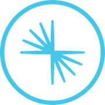
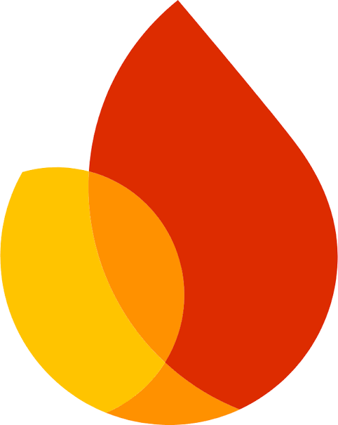
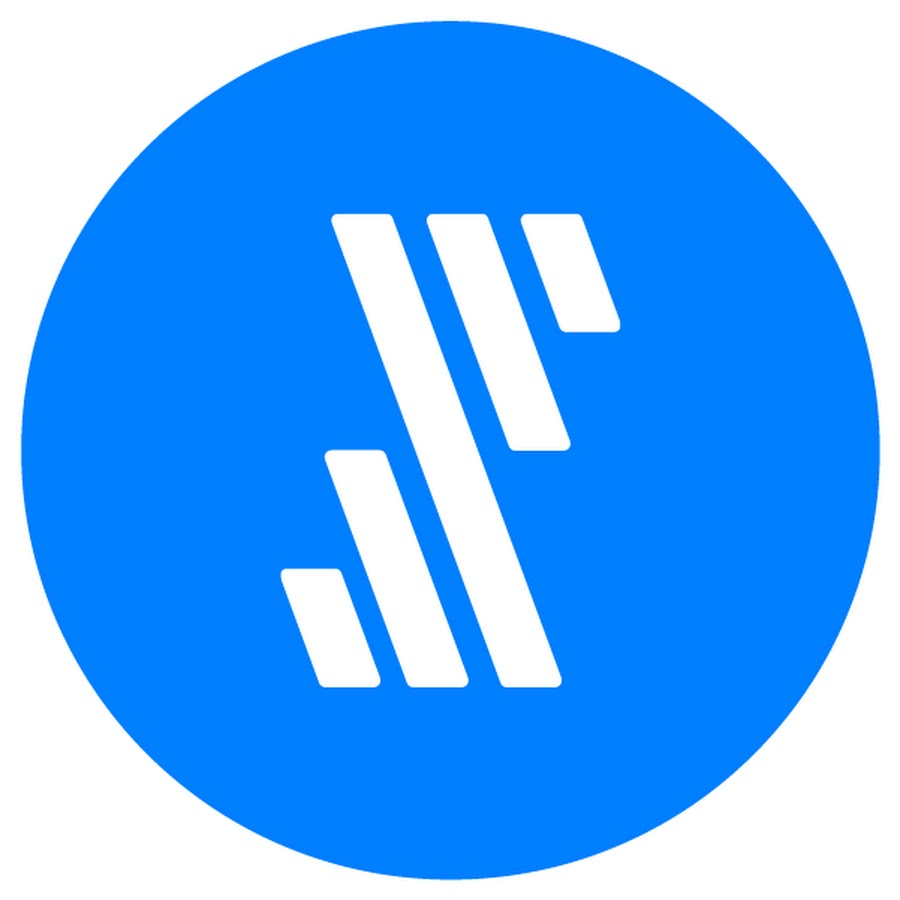
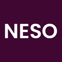
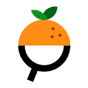

# Data and databases

Data and databases apps you can connect to with fastn, the most used first. Open a connector to see how it authenticates and every action and event it offers. Back to the [connector catalog](../README.md).

| | Connector | Authentication | About |
| --- | --- | --- | --- |
|  | [AITable.ai](aitable.md) | API key | AITable.ai Fusion API — datasheets, records, fields, views, nodes, embed links, contacts (members/teams/roles), attachments and AI chat completions. |
|  | [Azure Cosmos DB](azure-cosmos-db.md) | OAuth 2.0 | Azure Cosmos DB management over the Microsoft.DocumentDB Azure Resource Manager API at https://management.azure.com. |
|  | [Azure Data Explorer](azure-data-explorer.md) | OAuth 2.0 | Azure Data Explorer (Kusto) — run KQL management and query commands against a cluster for real-time analytics on large datasets. |
|  | [Azure Data Lake](azure-data-lake.md) | OAuth 2.0 | Azure Data Lake Storage Gen2 DataLake REST API. |
|  | [Azure Synapse Analytics](azure-synapse-analytics.md) | OAuth 2.0 | Connect to Azure Synapse Analytics data-plane APIs — pipelines, datasets, linked services, data flows, triggers, notebooks, Spark jobs (Livy), SQL pools, role… |
|  | [Azure Table Storage](azure-table-storage.md) | OAuth 2.0 | Azure Table Storage — NoSQL key-value store for structured, non-relational data. |
|  | [Baserow](baserow.md) | Credentials you enter | Baserow is an open-source no-code database platform (an Airtable alternative). |
|  | [Bonsai](bonsai.md) | Credentials you enter | Bonsai is a fully managed Elasticsearch and OpenSearch hosting service. |
|  | [Brønnøysund Register Centre (Enhetsregisteret)](brreg.md) | No authentication | The Brønnøysund Register Centre's open API for Norway's Central Coordinating Register for Legal Entities (Enhetsregisteret) and the Register of Non-Profit… |
|  | [CityBikes](city-bikes.md) | No authentication | CityBikes is a free, open API for bike sharing data. |
|  | [ClickHouse Cloud](clickhousecloud.md) | Basic auth | ClickHouse Cloud Management API for administering organizations, services, API keys, members, invitations, usage/cost, private endpoints, and backups on… |
|  | [ClinicalTrials.gov](clinical-trials-gov.md) | No authentication | ClinicalTrials.gov (U.S. |
|  | [CommCare HQ](commcare-hq.md) | Credentials you enter, OAuth 2.0 | CommCare HQ by Dimagi — mobile data collection and case management for frontline programs. |
|  | [Confluent Cloud](confluent-cloud.md) | Basic auth | Manage Confluent Cloud infrastructure through the Confluent Cloud Control Plane REST API. |
|  | [Databricks](databricks.md) | Credentials you enter, OAuth 2.0 | Databricks is a unified data intelligence platform for data engineering, analytics, machine learning and AI. |
|  | [Disease.sh](disease-sh.md) | No authentication | disease.sh is a free open API for disease statistics. |
|  | [ECB Data Portal](ecb-data-portal.md) | No authentication | The ECB Data Portal API is the European Central Bank's free SDMX 2.1 RESTful web service for euro-area statistics: exchange rates, interest rates, inflation,… |
|  | [Elasticsearch](elasticsearch.md) | Credentials you enter | Elasticsearch is a distributed search and analytics engine. |
|  | [Entur](entur.md) | No authentication | Entur runs Norway's national public transport data platform. |
|  | [Environment Agency Flood Monitoring](ea-flood-monitoring.md) | No authentication | The UK Environment Agency real-time flood-monitoring API gives near real time flood warnings and alerts for England, flood areas with boundaries, and water… |
|  | [Erskine May API](erskine-may-api.md) | No authentication | The Erskine May API gives open access to Erskine May, the authoritative guide to UK parliamentary practice: list parts and chapters, read sections and page… |
|  | [Eurostat](eurostat.md) | No authentication | Eurostat is the statistical office of the European Union. |
|  | [Firebase](firebase.md) | Credentials you enter | Google Firebase app development platform. |
|  | [Fivetran](fivetran.md) | Basic auth | Fivetran is a managed data-movement platform that replicates data from SaaS applications, databases and files into cloud data warehouses and lakes. |
|  | [Flatfile](flatfile.md) | Bearer token | Flatfile is a data onboarding and import platform. |
|  | [Google BigQuery](bigquery.md) | OAuth 2.0 | Google BigQuery REST API v2 connector. |
|  | [Google BigQuery Migration](google-big-query-migration.md) | OAuth 2.0 | Google BigQuery Migration API (bigquerymigration.googleapis.com v2). |
|  | [Google Cloud Datastore](google-cloud-datastore.md) | OAuth 2.0 | Google Cloud Datastore API v1 (https://datastore.googleapis.com/v1), also used by Firestore in Datastore mode. |
|  | [Google Cloud Spanner](google-cloud-spanner.md) | OAuth 2.0 | Google Cloud Spanner API v1 (https://spanner.googleapis.com/v1). |
|  | [Google Cloud SQL Admin](google-cloud-sql-admin.md) | OAuth 2.0 | Google Cloud SQL Admin API v1 (https://sqladmin.googleapis.com/v1). |
|  | [Google Dataplex](google-dataplex.md) | OAuth 2.0 | Google Cloud Dataplex Universal Catalog (dataplex.googleapis.com v1). |
|  | [Grist](grist.md) | Credentials you enter | Grist is a modern relational spreadsheet. |
|  | [Humanitarian Data Exchange (HDX)](humanitarian-data-exchange.md) | No authentication | The Humanitarian Data Exchange (HDX), run by UN OCHA, is a free open platform with over 20,000 humanitarian datasets (population, displacement, food security,… |
|  | [InfluxDB Cloud](influx-db-cloud.md) | Credentials you enter | InfluxDB Cloud is InfluxData's managed time series platform. |
|  | [Knack](knack.md) | Credentials you enter | Knack is a no-code platform for building online databases and business apps. |
|  | [KoboToolbox](kobotoolbox.md) | Credentials you enter | KoboToolbox is an open-source platform for field data collection. |
|  | [Microsoft Excel](microsoft-excel.md) | OAuth 2.0 | Microsoft Excel workbooks stored in OneDrive or SharePoint, via the Microsoft Graph Excel (workbook) API at https://graph.microsoft.com/v1.0. |
|  | [MongoDB Atlas](mongo-db-atlas.md) | Digest auth | Manage MongoDB Atlas resources through the Atlas Administration API v2 — organizations, projects, clusters, database users, IP access lists, network peering,… |
|  | [Neo4j AuraDB](neo4j-aura-db.md) | Basic auth | Execute Cypher queries and manage read/write transactions against a Neo4j AuraDB graph database instance through Neo4j's official HTTP Query API (the REST… |
|  | [NESO Data Portal](neso-data-portal.md) | No authentication | The NESO Data Portal (Great Britain's National Energy System Operator, formerly National Grid ESO) is a free CKAN open data API for GB electricity system… |
|  | [NHTSA vPIC](nhtsa-vpic.md) | No authentication | NHTSA vPIC (Product Information Catalog and Vehicle Listing) is the US Department of Transportation's free vehicle API. |
|  | [Nobel Prize API](nobel-prize-api.md) | No authentication | The official Nobel Prize API (Nobel Prize Outreach, v2.1) gives open data on every Nobel Prize and laureate since 1901: list and filter prizes by year and… |
|  | [NocoDB](nocodb.md) | Credentials you enter | NocoDB is an open-source no-code database and Airtable alternative. |
|  | [NYC Open Data](nyc-open-data.md) | No authentication | NYC Open Data publishes thousands of free datasets from New York City agencies (311 requests, taxi trips, restaurant inspections, crime, housing and more) on… |
|  | [Office for National Statistics (ONS) API](ons-api.md) | No authentication | The UK Office for National Statistics (ONS) open API: browse datasets, editions, versions, dimensions and metadata (e.g. |
|  | [Open Brewery DB](open-brewery-db.md) | No authentication | Open Brewery DB is a free, keyless dataset of breweries, cideries, brewpubs and bottle shops worldwide: list and filter breweries by city, state, country,… |
|  | [Open Food Facts](open-food-facts.md) | No authentication | Open Food Facts is a free, open database of 3M+ food products from around the world. |
|  | [Open Government Canada](open-government-canada.md) | No authentication | Open Government Canada (open.canada.ca) is the Government of Canada's free open data portal with tens of thousands of federal datasets from Statistics Canada,… |
|  | [Open Topo Data](open-topo-data.md) | No authentication | Open Topo Data is an open-source elevation API with a free public server (api.opentopodata.org) serving open datasets such as SRTM, ASTER, EU-DEM, NED,… |
|  | [Open-Elevation](open-elevation.md) | No authentication | Open-Elevation is a free, open-source elevation API. |
|  | [OpenAlex](openalex.md) | Bearer token | OpenAlex is the open catalog of the global research system. |
|  | [openFDA](open-fda.md) | No authentication | openFDA (U.S. |
|  | [Our World in Data](our-world-in-data.md) | No authentication | Our World in Data publishes free research and data on global problems - health, population, energy, CO2, economy, poverty and more - as thousands of charts. |
|  | [Peaka](peaka.md) | Credentials you enter | Peaka is a zero-ETL data integration platform that lets you connect APIs, databases and SaaS tools and query them together with SQL. |
|  | [PopHIVE](pop-hive.md) | API key | PopHIVE is Yale School of Public Health's harmonized US public-health surveillance dataset, covering emergency-department visits, wastewater,… |
|  | [PostgreSQL](postgres.md) | Credentials you enter | Generic PostgreSQL database connector with full introspection coverage. |
|  | [PubChem](pub-chem.md) | No authentication | PubChem (NCBI) is the world's largest free chemistry database. |
|  | [QuintaDB](quintadb.md) | API key | QuintaDB online database and form builder. |
|  | [RCSB Protein Data Bank](rcsb-protein-data-bank.md) | No authentication | The RCSB Protein Data Bank (PDB) offers free APIs for 3D structures of proteins, nucleic acids and complexes. |
|  | [ROR (Research Organization Registry)](ror-registry.md) | No authentication | ROR (Research Organization Registry) is the open global registry of persistent identifiers for 120,000+ research organizations - universities, funders,… |
|  | [RudderStack](rudder-stack.md) | Basic auth, Credentials you enter | RudderStack is a warehouse-native customer data platform. |
|  | [RxNorm (RxNav)](rxnorm-rxnav.md) | No authentication | RxNorm (via the NLM RxNav REST API) is the US National Library of Medicine's normalized naming system for clinical drugs. |
|  | [SEC EDGAR](sec-edgar.md) | No authentication | SEC EDGAR APIs from the U.S. |
|  | [Snowflake](snowflake.md) | Credentials you enter | Snowflake Data Cloud connector using the Snowflake SQL REST API (/api/v2/statements) and the resource-management REST APIs (databases, schemas, tables,… |
|  | [Stackby](stackby.md) | API key | Stackby is a no-code database and spreadsheet work platform. |
|  | [Statistics Finland (StatFin)](statistics-finland.md) | No authentication | Statistics Finland (Tilastokeskus) publishes Finland's official statistics through its free PxWeb API: browse and search the StatFin and other databases, read… |
|  | [Statistics Norway (SSB)](statistics-norway-ssb.md) | No authentication | Statistics Norway (SSB) publishes Norway's official statistics through the free PxWebApi 2.0: search thousands of statistical tables (population, prices,… |
|  | [Statistics Sweden (SCB)](statistics-sweden-scb.md) | No authentication | Statistics Sweden (SCB) publishes Sweden's official statistics through the free PxWebApi 2.0 (Statistikdatabasen): search statistical tables on population,… |
|  | [Stitch](stitch-data.md) | Credentials you enter | Stitch is a cloud ETL service that replicates data from SaaS applications and databases into a data warehouse. |
|  | [Swiss Public Transport (transport.opendata.ch)](swiss-public-transport.md) | No authentication | The Swiss public transport API (transport.opendata.ch) is a free, open API for Swiss trains, trams, buses and boats. |
|  | [Teable](teable.md) | API key | Teable is an open-source, Airtable-style no-code database (spaces &gt; bases &gt; tables &gt; fields &gt; records &gt; views). |
|  | [TimeAPI.io](time-api-io.md) | No authentication | TimeAPI.io is a free time and time zone API. |
|  | [Turso](turso.md) | Credentials you enter | Turso is a managed SQLite-compatible edge database platform built on libSQL. |
|  | [U.S. Census Bureau Data API](census-bureau.md) | Credentials you enter | The U.S. |
|  | [UK Bank Holidays](uk-bank-holidays.md) | No authentication | UK Bank Holidays is the free GOV.UK data feed of bank holidays in England and Wales, Scotland and Northern Ireland, including substitute days. |
|  | [UK Parliament Commons Votes API](uk-parliament-commons-votes.md) | No authentication | The UK Parliament Commons Votes API gives open data on House of Commons divisions (votes): search divisions by title, date and member, get a division with… |
|  | [UK Parliament Lords Votes API](uk-parliament-lords-votes.md) | No authentication | The UK Parliament Lords Votes API gives open data on House of Lords divisions (votes): search divisions by title, date and member, get a division with every… |
|  | [UK Parliament Members API](uk-parliament-members.md) | No authentication | The UK Parliament Members API gives open data on MPs and Lords: search current and historical members, get biographies, contact details, experience,… |
|  | [UK Parliament Register of Interests API](uk-parliament-interests.md) | No authentication | The UK Parliament Register of Members' Financial Interests API gives open data on MPs' declared interests: list interest categories and published registers,… |
|  | [UK Parliament Treaties API](uk-parliament-treaties.md) | No authentication | The UK Parliament Treaties API gives open data on treaties laid before Parliament under the CRaG Act: search treaties by text, lead government department,… |
|  | [UK Police Data](uk-police-data.md) | No authentication | data.police.uk is the UK Home Office's open police data API for England, Wales and Northern Ireland. |
|  | [UniProt](uni-prot.md) | No authentication | UniProt is the free, comprehensive protein sequence and function database (UniProtKB/Swiss-Prot, TrEMBL, UniRef, UniParc, proteomes). |
|  | [Upstash Redis](upstash-redis.md) | Basic auth, Credentials you enter | Serverless Redis by Upstash. |
|  | [USGS Earthquake Catalog](usgs-earthquake-catalog.md) | No authentication | The USGS Earthquake Catalog (ComCat) API, an FDSN event web service from the U.S. |
|  | [USGS Water Data APIs](usgs-water-data.md) | No authentication | The USGS Water Data OGC APIs (successor of the legacy NWIS Water Services) give free US water data: continuous (instantaneous) and daily values, field… |
|  | [World Bank Indicators API](world-bank-indicators.md) | No authentication | The World Bank Indicators API (v2) gives free access to tens of thousands of development indicators and their time series for every country, region and income… |
|  | [Zenodo](zenodo.md) | No authentication | Zenodo is CERN's open research repository for datasets, software, papers and more, each with a DOI. |
