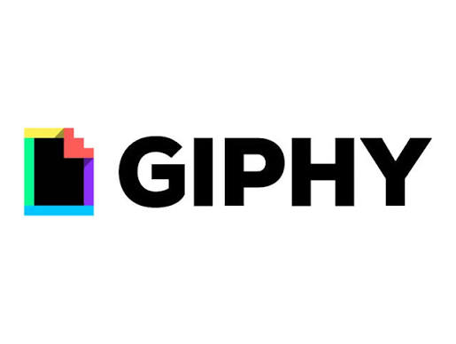

# GIPHY

GIPHY is a library of GIFs, stickers, animated emoji and short video clips, searchable through a public REST API. This connector covers the documented GIPHY API surface: GIF and sticker search, trending, translate, random and fetch-by-id; curated sticker packs; GIPHY Clips; the animated emoji library and its variations; channel search and browsing; browse categories, autocomplete, related and trending search terms; anonymous customer-id generation; the analytics pingback that reports user interaction; and the upload endpoint for publishing an asset to a channel.

| | |
| --- | --- |
| **Category** | [Design](README.md) |
| **Authentication** | Credentials you enter |
| **Slug** | `giphy` |

## Use it

Add GIPHY from **Build → Integrations → Connectors** and connect an account, as in [Connect a system](../../build/connectors/connect-a-system.md). In workflow code, call an action as `fastn.connector.giphy.<action>()`, with the action's slug from the table below. See [Workflow runtime API](../../reference/workflow-runtime.md).

## Actions

| Action | Slug | What it does |
| --- | --- | --- |
| Autocomplete Search Term | `autocompleteSearchTerm` | Returns search terms that complete a partially typed query, for building a search-as-you-type experience. |
| Generate Random ID | `generateRandomId` | Generates an anonymous customer identifier that can be passed as the Customer ID on later calls so GIPHY can personalise results without you supplying your own user id. |
| Get Channel | `getChannel` | Returns a single GIPHY channel by its identifier. |
| Get Clip By ID | `getClipById` | Returns a single GIPHY Clip by its identifier. Access to individual clips is granted per API key, so this endpoint answers 403 Forbidden on keys without Clips entitlement. |
| Get Clips By IDs | `getClipsByIds` | Returns several GIPHY Clips in one call from a comma-separated list of identifiers. Access to individual clips is granted per API key, so this endpoint answers 403 Forbidden on keys without Clips entitlement. |
| Get GIF By ID | `getGifById` | Returns a single GIF by its GIPHY identifier. |
| Get GIFs By IDs | `getGifsByIds` | Returns several GIFs in one call from a comma-separated list of GIPHY identifiers, up to 100 per request. |
| Get Random GIF | `getRandomGif` | Returns one randomly selected GIF, optionally limited to a tag. |
| Get Random Sticker | `getRandomSticker` | Returns one randomly selected sticker, optionally limited to a tag. |
| Get Sticker Pack | `getStickerPack` | Returns a single sticker pack by its identifier. |

See 21 more actions

| Action | Slug | What it does |
| --- | --- | --- |
| List Channel Children | `listChannelChildren` | Returns the sub-channels nested directly under a channel. |
| List Channel GIFs | `listChannelGifs` | Returns the GIFs published by a channel. |
| List Child Sticker Packs | `listChildStickerPacks` | Returns the sticker packs nested directly under a parent pack. |
| List Emoji | `listEmoji` | Returns GIPHY's animated emoji library. |
| List Emoji Variations | `listEmojiVariations` | Returns the skin-tone and styling variations of a single animated emoji. |
| List GIF Categories | `listGifCategories` | Returns GIPHY's browse categories and their subcategories, each with a representative GIF. |
| List Related Search Terms | `listRelatedSearchTerms` | Returns search terms related to a given term, useful for suggesting alternative searches. |
| List Sticker Packs | `listStickerPacks` | Returns GIPHY's curated sticker packs. |
| List Stickers In Pack | `listStickersInPack` | Returns the stickers contained in a sticker pack. |
| List Trending Clips | `listTrendingClips` | Returns the GIPHY Clips currently trending, in the order GIPHY ranks them. |
| List Trending GIFs | `listTrendingGifs` | Returns the GIFs currently trending on GIPHY, in the order GIPHY ranks them. |
| List Trending Search Terms | `listTrendingSearchTerms` | Returns the search terms currently trending across GIPHY. |
| List Trending Stickers | `listTrendingStickers` | Returns the stickers currently trending on GIPHY, in the order GIPHY ranks them. |
| Register User Action | `registerUserAction` | Reports that an end user saw, clicked or sent an asset, so GIPHY can improve the results it returns. Pass the analytics payload GIPHY returned alongside the asset. |
| Search Channels | `searchChannels` | Searches GIPHY channels by name and returns the matching channels with their featured GIF. |
| Search Clips | `searchClips` | Searches GIPHY Clips, the library of short videos with sound, and returns a paginated list of matches. |
| Search GIFs | `searchGifs` | Searches the GIPHY GIF library for a word or phrase and returns a paginated list of matching GIFs. |
| Search Stickers | `searchStickers` | Searches the GIPHY sticker library, which contains only assets with transparent backgrounds, and returns a paginated list of matches. |
| Translate Term To GIF | `translateGif` | Translates a word or phrase into the single GIF that GIPHY's search engine considers the best match. |
| Translate Term To Sticker | `translateSticker` | Translates a word or phrase into the single sticker that GIPHY's search engine considers the best match. |
| Upload GIF | `uploadGif` | Uploads a GIF or video to GIPHY from a URL or file and publishes it on your channel. Uploaded assets become publicly visible on GIPHY and there is no documented delete endpoint, so treat every call as permanent. |

