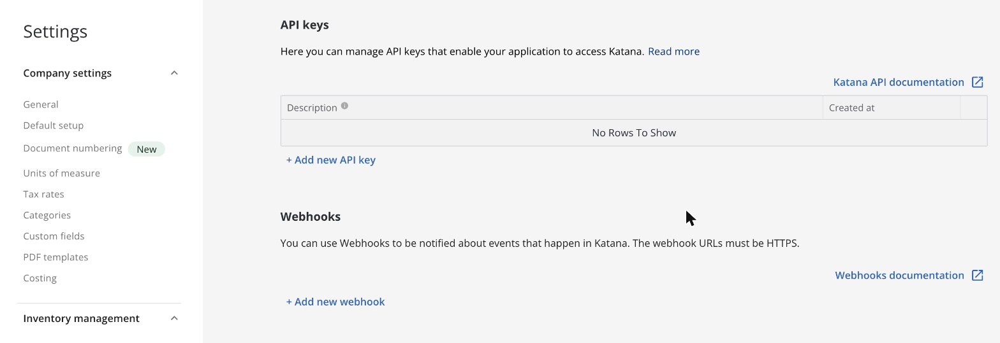
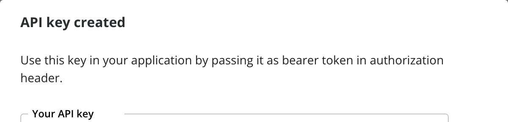
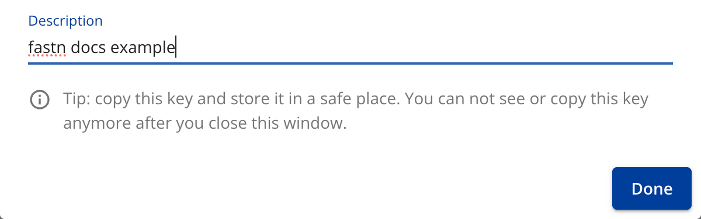

# Katana MRP

Full coverage of the Katana v1 API: products, materials, variants, recipes/BOM, manufacturing orders, sales orders, purchase orders, customers, suppliers, inventory, stock adjustments/transfers/stocktakes, locations, bins, price lists, tax rates, serial/batch tracking, and webhook subscriptions.

| | |
| --- | --- |
| **Category** | [E-commerce](README.md) |
| **Website** | [katanamrp.com](https://katanamrp.com) |
| **Authentication** | Bearer token |
| **Slug** | `katanaMrp` |

## Setup guide
This guide shows where to find the Katana API key that fastn needs, and how it is entered when you connect Katana.

### Before you start
- You need the Owner, Admin or Developer role in fastn to set up the connector.
- You need a Katana account where you can open **Settings > API** and create API keys.

### Get your Katana credentials
fastn asks for one value, **token**: a Katana API key. fastn sends it to Katana as a bearer token in the `Authorization` header.

1. Sign in to your Katana account.
2. Go to **Settings > API**. The **API keys** section lists your existing keys.

<figure><figcaption>
The API keys section in Katana's settings
</figcaption></figure>

3. Click **+ Add new API key**. Katana creates the key right away and shows it in an **API key created** window.

<figure><figcaption>
The API key created window, with the key itself cropped out
</figcaption></figure>

4. Optionally change the **Description** so you can recognise the key later.

<figure><figcaption>
The Description field and the reminder that the key is shown only once
</figcaption></figure>

5. Copy the key before you click **Done**. Katana does not show it again after the window closes. Use it as the **token** value in fastn.

Katana recommends that you limit who can see the key and rotate keys from time to time. If you rotate a key, update the connection in fastn with the new one.

### Connect in fastn
Your customers enter their Katana API key when they connect Katana in your widget. You can also enter it yourself under **Build → Integrations → Connectors → Katana MRP**. After the connection is saved, workflows can call Katana actions, for example `fastn.connector.katanaMrp.<actionSlug>()`.

## Actions

<table><thead><tr><th width="240">Action</th><th width="260">Slug</th><th>What it does</th></tr></thead><tbody><tr><td>Batch Create BOM Rows</td><td><code>batchCreateBomRows</code></td><td>Create a Create in Katana MRP.</td></tr><tr><td>Create Batch</td><td><code>createBatch</code></td><td>Create a Batche in Katana MRP.</td></tr><tr><td>Create Bin Location</td><td><code>createBinLocation</code></td><td>Create a Bin Location in Katana MRP.</td></tr><tr><td>Create Bin Transfer</td><td><code>createBinTransfer</code></td><td>Create a Bin Transfer in Katana MRP.</td></tr><tr><td>Create Bin Transfer Row</td><td><code>createBinTransferRow</code></td><td>Create a Bin Transfer Row in Katana MRP.</td></tr><tr><td>Create Bom Row</td><td><code>createBomRow</code></td><td>Create a Bom Row in Katana MRP.</td></tr><tr><td>Create Custom Field Definition</td><td><code>createCustomFieldDefinition</code></td><td>Create a Custom Field Definition in Katana MRP.</td></tr><tr><td>Create Customer</td><td><code>createCustomer</code></td><td>Create a Customer in Katana MRP.</td></tr><tr><td>Create Customer Address</td><td><code>createCustomerAddress</code></td><td>Create a Customer Address in Katana MRP.</td></tr><tr><td>Create Demand Forecast</td><td><code>createDemandForecast</code></td><td>Create a Demand Forecast in Katana MRP.</td></tr></tbody></table>

View 213 more actions

<table><thead><tr><th width="240">Action</th><th width="260">Slug</th><th>What it does</th></tr></thead><tbody><tr><td>Create Make To Order Manufacturing Order</td><td><code>createManufacturingOrderMakeToOrder</code></td><td>Create a Manufacturing Order Make To Order in Katana MRP.</td></tr><tr><td>Create Manufacturing Order</td><td><code>createManufacturingOrder</code></td><td>Create a Manufacturing Order in Katana MRP.</td></tr><tr><td>Create Manufacturing Order Operation Row</td><td><code>createManufacturingOrderOperationRow</code></td><td>Create a Manufacturing Order Operation Row in Katana MRP.</td></tr><tr><td>Create Manufacturing Order Production</td><td><code>createManufacturingOrderProduction</code></td><td>Create a Manufacturing Order Production in Katana MRP.</td></tr><tr><td>Create Manufacturing Order Recipe Row</td><td><code>createManufacturingOrderRecipeRow</code></td><td>Create a Manufacturing Order Recipe Row in Katana MRP.</td></tr><tr><td>Create Material</td><td><code>createMaterial</code></td><td>Create a Material in Katana MRP.</td></tr><tr><td>Create Outsourced Purchase Order Recipe Row</td><td><code>createOutsourcedPurchaseOrderRecipeRow</code></td><td>Create a Outsourced Purchase Order Recipe Row in Katana MRP.</td></tr><tr><td>Create Po Additional Cost Row</td><td><code>createPoAdditionalCostRow</code></td><td>Create a Po Additional Cost Row in Katana MRP.</td></tr><tr><td>Create Price List</td><td><code>createPriceList</code></td><td>Create a Price List in Katana MRP.</td></tr><tr><td>Create Price List Customer</td><td><code>createPriceListCustomer</code></td><td>Create a Price List Customer in Katana MRP.</td></tr><tr><td>Create Price List Row</td><td><code>createPriceListRow</code></td><td>Create a Price List Row in Katana MRP.</td></tr><tr><td>Create Product</td><td><code>createProduct</code></td><td>Create a Product in Katana MRP.</td></tr><tr><td>Create Product Operation Row</td><td><code>createProductOperationRow</code></td><td>Create a Product Operation Row in Katana MRP.</td></tr><tr><td>Create Purchase Order</td><td><code>createPurchaseOrder</code></td><td>Create a Purchase Order in Katana MRP.</td></tr><tr><td>Create Purchase Order Row</td><td><code>createPurchaseOrderRow</code></td><td>Create a Purchase Order Row in Katana MRP.</td></tr><tr><td>Create Recipe</td><td><code>createRecipe</code></td><td>Create a Recipe in Katana MRP.</td></tr><tr><td>Create Sales Order</td><td><code>createSalesOrder</code></td><td>Create a Sales Order in Katana MRP.</td></tr><tr><td>Create Sales Order Address</td><td><code>createSalesOrderAddress</code></td><td>Create a Sales Order Address in Katana MRP.</td></tr><tr><td>Create Sales Order Fulfillment</td><td><code>createSalesOrderFulfillment</code></td><td>Create a Sales Order Fulfillment in Katana MRP.</td></tr><tr><td>Create Sales Order Row</td><td><code>createSalesOrderRow</code></td><td>Create a Sales Order Row in Katana MRP.</td></tr><tr><td>Create Sales Order Shipping Fee</td><td><code>createSalesOrderShippingFee</code></td><td>Create a Sales Order Shipping Fee in Katana MRP.</td></tr><tr><td>Create Sales Return</td><td><code>createSalesReturn</code></td><td>Create a Sales Return in Katana MRP.</td></tr><tr><td>Create Sales Return Row</td><td><code>createSalesReturnRow</code></td><td>Create a Sales Return Row in Katana MRP.</td></tr><tr><td>Create Serial Number</td><td><code>createSerialNumber</code></td><td>Create a Serial Number in Katana MRP.</td></tr><tr><td>Create Service</td><td><code>createService</code></td><td>Create a Service in Katana MRP.</td></tr><tr><td>Create Stock Adjustment</td><td><code>createStockAdjustment</code></td><td>Create a Stock Adjustment in Katana MRP.</td></tr><tr><td>Create Stock Transfer</td><td><code>createStockTransfer</code></td><td>Create a Stock Transfer in Katana MRP.</td></tr><tr><td>Create Stocktake</td><td><code>createStocktake</code></td><td>Create a Stocktake in Katana MRP.</td></tr><tr><td>Create Stocktake Row</td><td><code>createStocktakeRow</code></td><td>Create a Stocktake Row in Katana MRP.</td></tr><tr><td>Create Supplier</td><td><code>createSupplier</code></td><td>Create a Supplier in Katana MRP.</td></tr><tr><td>Create Supplier Address</td><td><code>createSupplierAddress</code></td><td>Create a Supplier Address in Katana MRP.</td></tr><tr><td>Create Tax Rate</td><td><code>createTaxRate</code></td><td>Create a Tax Rate in Katana MRP.</td></tr><tr><td>Create Variant</td><td><code>createVariant</code></td><td>Create a Variant in Katana MRP.</td></tr><tr><td>Create Webhook</td><td><code>createWebhook</code></td><td>Create a Webhook in Katana MRP.</td></tr><tr><td>Delete Bin Location</td><td><code>deleteBinLocation</code></td><td>Delete a Bin Location in Katana MRP.</td></tr><tr><td>Delete Bin Transfer</td><td><code>deleteBinTransfer</code></td><td>Delete a Bin Transfer in Katana MRP.</td></tr><tr><td>Delete Bin Transfer Row</td><td><code>deleteBinTransferRow</code></td><td>Delete a Bin Transfer Row in Katana MRP.</td></tr><tr><td>Delete Bom Row</td><td><code>deleteBomRow</code></td><td>Delete a Bom Row in Katana MRP.</td></tr><tr><td>Delete Custom Field Definition</td><td><code>deleteCustomFieldDefinition</code></td><td>Delete a Custom Field Definition in Katana MRP.</td></tr><tr><td>Delete Customer</td><td><code>deleteCustomer</code></td><td>Delete a Customer in Katana MRP.</td></tr><tr><td>Delete Customer Address</td><td><code>deleteCustomerAddress</code></td><td>Delete a Customer Address in Katana MRP.</td></tr><tr><td>Delete Demand Forecasts</td><td><code>deleteDemandForecasts</code></td><td>Delete a Demand Forecast in Katana MRP.</td></tr><tr><td>Delete Manufacturing Order</td><td><code>deleteManufacturingOrder</code></td><td>Delete a Manufacturing Order in Katana MRP.</td></tr><tr><td>Delete Manufacturing Order Operation Row</td><td><code>deleteManufacturingOrderOperationRow</code></td><td>Delete a Manufacturing Order Operation Row in Katana MRP.</td></tr><tr><td>Delete Manufacturing Order Production</td><td><code>deleteManufacturingOrderProduction</code></td><td>Delete a Manufacturing Order Production in Katana MRP.</td></tr><tr><td>Delete Manufacturing Order Recipe Row</td><td><code>deleteManufacturingOrderRecipeRow</code></td><td>Delete a Manufacturing Order Recipe Row in Katana MRP.</td></tr><tr><td>Delete Material</td><td><code>deleteMaterial</code></td><td>Delete a Material in Katana MRP.</td></tr><tr><td>Delete Outsourced Purchase Order Recipe Row</td><td><code>deleteOutsourcedPurchaseOrderRecipeRow</code></td><td>Delete a Outsourced Purchase Order Recipe Row in Katana MRP.</td></tr><tr><td>Delete Po Additional Cost Row</td><td><code>deletePoAdditionalCostRow</code></td><td>Delete a Po Additional Cost Row in Katana MRP.</td></tr><tr><td>Delete Price List</td><td><code>deletePriceList</code></td><td>Delete a Price List in Katana MRP.</td></tr><tr><td>Delete Price List Customer</td><td><code>deletePriceListCustomer</code></td><td>Delete a Price List Customer in Katana MRP.</td></tr><tr><td>Delete Price List Row</td><td><code>deletePriceListRow</code></td><td>Delete a Price List Row in Katana MRP.</td></tr><tr><td>Delete Product</td><td><code>deleteProduct</code></td><td>Delete a Product in Katana MRP.</td></tr><tr><td>Delete Product Operation Row</td><td><code>deleteProductOperationRow</code></td><td>Delete a Product Operation Row in Katana MRP.</td></tr><tr><td>Delete Purchase Order</td><td><code>deletePurchaseOrder</code></td><td>Delete a Purchase Order in Katana MRP.</td></tr><tr><td>Delete Purchase Order Row</td><td><code>deletePurchaseOrderRow</code></td><td>Delete a Purchase Order Row in Katana MRP.</td></tr><tr><td>Delete Recipe</td><td><code>deleteRecipe</code></td><td>Delete a Recipe in Katana MRP.</td></tr><tr><td>Delete Recipe Row</td><td><code>deleteRecipeRow</code></td><td>Delete a Recipe Row in Katana MRP.</td></tr><tr><td>Delete Sales Order</td><td><code>deleteSalesOrder</code></td><td>Delete a Sales Order in Katana MRP.</td></tr><tr><td>Delete Sales Order Address</td><td><code>deleteSalesOrderAddress</code></td><td>Delete a Sales Order Address in Katana MRP.</td></tr><tr><td>Delete Sales Order Fulfillment</td><td><code>deleteSalesOrderFulfillment</code></td><td>Delete a Sales Order Fulfillment in Katana MRP.</td></tr><tr><td>Delete Sales Order Row</td><td><code>deleteSalesOrderRow</code></td><td>Delete a Sales Order Row in Katana MRP.</td></tr><tr><td>Delete Sales Order Shipping Fee</td><td><code>deleteSalesOrderShippingFee</code></td><td>Delete a Sales Order Shipping Fee in Katana MRP.</td></tr><tr><td>Delete Sales Return</td><td><code>deleteSalesReturn</code></td><td>Delete a Sales Return in Katana MRP.</td></tr><tr><td>Delete Sales Return Row</td><td><code>deleteSalesReturnRow</code></td><td>Delete a Sales Return Row in Katana MRP.</td></tr><tr><td>Delete Serial Numbers</td><td><code>deleteSerialNumbers</code></td><td>Delete a Serial Number in Katana MRP.</td></tr><tr><td>Delete Service</td><td><code>deleteService</code></td><td>Delete a Service in Katana MRP.</td></tr><tr><td>Delete Stock Adjustment</td><td><code>deleteStockAdjustment</code></td><td>Delete a Stock Adjustment in Katana MRP.</td></tr><tr><td>Delete Stock Transfer</td><td><code>deleteStockTransfer</code></td><td>Delete a Stock Transfer in Katana MRP.</td></tr><tr><td>Delete Stocktake</td><td><code>deleteStocktake</code></td><td>Delete a Stocktake in Katana MRP.</td></tr><tr><td>Delete Stocktake Row</td><td><code>deleteStocktakeRow</code></td><td>Delete a Stocktake Row in Katana MRP.</td></tr><tr><td>Delete Supplier</td><td><code>deleteSupplier</code></td><td>Delete a Supplier in Katana MRP.</td></tr><tr><td>Delete Supplier Address</td><td><code>deleteSupplierAddress</code></td><td>Delete a Supplier Address in Katana MRP.</td></tr><tr><td>Delete Variant</td><td><code>deleteVariant</code></td><td>Delete a Variant in Katana MRP.</td></tr><tr><td>Delete Webhook</td><td><code>deleteWebhook</code></td><td>Delete a Webhook in Katana MRP.</td></tr><tr><td>Export Webhook Logs</td><td><code>exportWebhookLogs</code></td><td>Create a Webhook Logs Export in Katana MRP.</td></tr><tr><td>Get Bin Transfer</td><td><code>getBinTransfer</code></td><td>Retrieve a Bin Transfer in Katana MRP.</td></tr><tr><td>Get Bin Transfer Row</td><td><code>getBinTransferRow</code></td><td>Retrieve a Bin Transfer Row in Katana MRP.</td></tr><tr><td>Get Current User Info</td><td><code>getUserInfo</code></td><td>List User Info in Katana MRP.</td></tr><tr><td>Get Custom Field Definition</td><td><code>getCustomFieldDefinition</code></td><td>Retrieve a Custom Field Definition in Katana MRP.</td></tr><tr><td>Get Factory Settings</td><td><code>getFactory</code></td><td>List Factory in Katana MRP.</td></tr><tr><td>Get Location</td><td><code>getLocation</code></td><td>Retrieve a Location in Katana MRP.</td></tr><tr><td>Get Manufacturing Order</td><td><code>getManufacturingOrder</code></td><td>Retrieve a Manufacturing Order in Katana MRP.</td></tr><tr><td>Get Manufacturing Order Operation Row</td><td><code>getManufacturingOrderOperationRow</code></td><td>Retrieve a Manufacturing Order Operation Row in Katana MRP.</td></tr><tr><td>Get Manufacturing Order Production</td><td><code>getManufacturingOrderProduction</code></td><td>Retrieve a Manufacturing Order Production in Katana MRP.</td></tr><tr><td>Get Manufacturing Order Recipe Row</td><td><code>getManufacturingOrderRecipeRow</code></td><td>Retrieve a Manufacturing Order Recipe Row in Katana MRP.</td></tr><tr><td>Get Material</td><td><code>getMaterial</code></td><td>Retrieve a Material in Katana MRP.</td></tr><tr><td>Get Outsourced Purchase Order Recipe Row</td><td><code>getOutsourcedPurchaseOrderRecipeRow</code></td><td>Retrieve a Outsourced Purchase Order Recipe Row in Katana MRP.</td></tr><tr><td>Get Po Additional Cost Row</td><td><code>getPoAdditionalCostRow</code></td><td>Retrieve a Po Additional Cost Row in Katana MRP.</td></tr><tr><td>Get Price List</td><td><code>getPriceList</code></td><td>Retrieve a Price List in Katana MRP.</td></tr><tr><td>Get Price List Customer</td><td><code>getPriceListCustomer</code></td><td>Retrieve a Price List Customer in Katana MRP.</td></tr><tr><td>Get Price List Row</td><td><code>getPriceListRow</code></td><td>Retrieve a Price List Row in Katana MRP.</td></tr><tr><td>Get Product</td><td><code>getProduct</code></td><td>Retrieve a Product in Katana MRP.</td></tr><tr><td>Get Purchase Order</td><td><code>getPurchaseOrder</code></td><td>Retrieve a Purchase Order in Katana MRP.</td></tr><tr><td>Get Purchase Order Row</td><td><code>getPurchaseOrderRow</code></td><td>Retrieve a Purchase Order Row in Katana MRP.</td></tr><tr><td>Get Sales Order</td><td><code>getSalesOrder</code></td><td>Retrieve a Sales Order in Katana MRP.</td></tr><tr><td>Get Sales Order Fulfillment</td><td><code>getSalesOrderFulfillment</code></td><td>Retrieve a Sales Order Fulfillment in Katana MRP.</td></tr><tr><td>Get Sales Order Returnable Items</td><td><code>getSalesOrderReturnableItems</code></td><td>Retrieve a Returnable Item in Katana MRP.</td></tr><tr><td>Get Sales Order Row</td><td><code>getSalesOrderRow</code></td><td>Retrieve a Sales Order Row in Katana MRP.</td></tr><tr><td>Get Sales Order Shipping Fee</td><td><code>getSalesOrderShippingFee</code></td><td>Retrieve a Sales Order Shipping Fee in Katana MRP.</td></tr><tr><td>Get Sales Return</td><td><code>getSalesReturn</code></td><td>Retrieve a Sales Return in Katana MRP.</td></tr><tr><td>Get Sales Return Row</td><td><code>getSalesReturnRow</code></td><td>Retrieve a Sales Return Row in Katana MRP.</td></tr><tr><td>Get Sales Return Row Unassigned Batch Transactions</td><td><code>getSalesReturnRowUnassignedBatchTransactions</code></td><td>Retrieve a Unassigned Batch Transaction in Katana MRP.</td></tr><tr><td>Get Service</td><td><code>getService</code></td><td>Retrieve a Service in Katana MRP.</td></tr><tr><td>Get Variant</td><td><code>getVariant</code></td><td>Retrieve a Variant in Katana MRP.</td></tr><tr><td>Get Webhook</td><td><code>getWebhook</code></td><td>Retrieve a Webhook in Katana MRP.</td></tr><tr><td>List Additional Costs</td><td><code>listAdditionalCosts</code></td><td>List Additional Costs in Katana MRP.</td></tr><tr><td>List Batch Stocks</td><td><code>listBatchStocks</code></td><td>List Batch Stocks in Katana MRP.</td></tr><tr><td>List Bin Inventory</td><td><code>listBinInventory</code></td><td>List Bin Inventory in Katana MRP.</td></tr><tr><td>List Bin Locations</td><td><code>listBinLocations</code></td><td>List Bin Locations in Katana MRP.</td></tr><tr><td>List Bin Transfer Rows</td><td><code>listBinTransferRows</code></td><td>List Bin Transfer Rows in Katana MRP.</td></tr><tr><td>List Bin Transfers</td><td><code>listBinTransfers</code></td><td>List Bin Transfers in Katana MRP.</td></tr><tr><td>List Bom Rows</td><td><code>listBomRows</code></td><td>List Bom Rows in Katana MRP.</td></tr><tr><td>List Custom Field Definitions</td><td><code>listCustomFieldDefinitions</code></td><td>List Custom Field Definitions in Katana MRP.</td></tr><tr><td>List Custom Fields Collections</td><td><code>listCustomFieldsCollections</code></td><td>List Custom Fields Collections in Katana MRP.</td></tr><tr><td>List Customer Addresses</td><td><code>listCustomerAddresses</code></td><td>List Customer Addresses in Katana MRP.</td></tr><tr><td>List Customers</td><td><code>listCustomers</code></td><td>List Customers in Katana MRP.</td></tr><tr><td>List Demand Forecasts</td><td><code>listDemandForecasts</code></td><td>List Demand Forecasts in Katana MRP.</td></tr><tr><td>List Inventory</td><td><code>listInventory</code></td><td>List Inventory in Katana MRP.</td></tr><tr><td>List Inventory Movements</td><td><code>listInventoryMovements</code></td><td>List Inventory Movements in Katana MRP.</td></tr><tr><td>List Locations</td><td><code>listLocations</code></td><td>List Locations in Katana MRP.</td></tr><tr><td>List Manufacturing Order Operation Rows</td><td><code>listManufacturingOrderOperationRows</code></td><td>List Manufacturing Order Operation Rows in Katana MRP.</td></tr><tr><td>List Manufacturing Order Productions</td><td><code>listManufacturingOrderProductions</code></td><td>List Manufacturing Order Productions in Katana MRP.</td></tr><tr><td>List Manufacturing Order Recipe Rows</td><td><code>listManufacturingOrderRecipeRows</code></td><td>List Manufacturing Order Recipe Rows in Katana MRP.</td></tr><tr><td>List Manufacturing Orders</td><td><code>listManufacturingOrders</code></td><td>List Manufacturing Orders in Katana MRP.</td></tr><tr><td>List Materials</td><td><code>listMaterials</code></td><td>List Materials in Katana MRP.</td></tr><tr><td>List Negative Stock</td><td><code>listNegativeStock</code></td><td>List Negative Stock in Katana MRP.</td></tr><tr><td>List Operators</td><td><code>listOperators</code></td><td>List Operators in Katana MRP.</td></tr><tr><td>List Outsourced Purchase Order Recipe Rows</td><td><code>listOutsourcedPurchaseOrderRecipeRows</code></td><td>List Outsourced Purchase Order Recipe Rows in Katana MRP.</td></tr><tr><td>List Po Additional Cost Rows</td><td><code>listPoAdditionalCostRows</code></td><td>List Po Additional Cost Rows in Katana MRP.</td></tr><tr><td>List Price List Customers</td><td><code>listPriceListCustomers</code></td><td>List Price List Customers in Katana MRP.</td></tr><tr><td>List Price List Rows</td><td><code>listPriceListRows</code></td><td>List Price List Rows in Katana MRP.</td></tr><tr><td>List Price Lists</td><td><code>listPriceLists</code></td><td>List Price Lists in Katana MRP.</td></tr><tr><td>List Product Operation Rows</td><td><code>listProductOperationRows</code></td><td>List Product Operation Rows in Katana MRP.</td></tr><tr><td>List Products</td><td><code>listProducts</code></td><td>List Products in Katana MRP.</td></tr><tr><td>List Purchase Order Accounting Metadata</td><td><code>listPurchaseOrderAccountingMetadata</code></td><td>List Purchase Order Accounting Metadata in Katana MRP.</td></tr><tr><td>List Purchase Order Rows</td><td><code>listPurchaseOrderRows</code></td><td>List Purchase Order Rows in Katana MRP.</td></tr><tr><td>List Purchase Orders</td><td><code>listPurchaseOrders</code></td><td>List Purchase Orders in Katana MRP.</td></tr><tr><td>List Recipes</td><td><code>listRecipes</code></td><td>List Recipes in Katana MRP.</td></tr><tr><td>List Sales Order Accounting Metadata</td><td><code>listSalesOrderAccountingMetadata</code></td><td>List Sales Order Accounting Metadata in Katana MRP.</td></tr><tr><td>List Sales Order Addresses</td><td><code>listSalesOrderAddresses</code></td><td>List Sales Order Addresses in Katana MRP.</td></tr><tr><td>List Sales Order Fulfillments</td><td><code>listSalesOrderFulfillments</code></td><td>List Sales Order Fulfillments in Katana MRP.</td></tr><tr><td>List Sales Order Rows</td><td><code>listSalesOrderRows</code></td><td>List Sales Order Rows in Katana MRP.</td></tr><tr><td>List Sales Order Shipping Fee</td><td><code>listSalesOrderShippingFee</code></td><td>List Sales Order Shipping Fee in Katana MRP.</td></tr><tr><td>List Sales Orders</td><td><code>listSalesOrders</code></td><td>List Sales Orders in Katana MRP.</td></tr><tr><td>List Sales Return Reasons</td><td><code>listSalesReturnReasons</code></td><td>List Return Reasons in Katana MRP.</td></tr><tr><td>List Sales Return Rows</td><td><code>listSalesReturnRows</code></td><td>List Sales Return Rows in Katana MRP.</td></tr><tr><td>List Sales Returns</td><td><code>listSalesReturns</code></td><td>List Sales Returns in Katana MRP.</td></tr><tr><td>List Serial Numbers</td><td><code>listSerialNumbers</code></td><td>List Serial Numbers in Katana MRP.</td></tr><tr><td>List Serial Numbers Stock</td><td><code>listSerialNumbersStock</code></td><td>List Serial Numbers Stock in Katana MRP.</td></tr><tr><td>List Serial Numbers Stock (Nested)</td><td><code>listSerialNumbersStockNested</code></td><td>List Serial Numbers Stock in Katana MRP.</td></tr><tr><td>List Services</td><td><code>listServices</code></td><td>List Services in Katana MRP.</td></tr><tr><td>List Stock Adjustments</td><td><code>listStockAdjustments</code></td><td>List Stock Adjustments in Katana MRP.</td></tr><tr><td>List Stock Transfers</td><td><code>listStockTransfers</code></td><td>List Stock Transfers in Katana MRP.</td></tr><tr><td>List Stocktake Rows</td><td><code>listStocktakeRows</code></td><td>List Stocktake Rows in Katana MRP.</td></tr><tr><td>List Stocktakes</td><td><code>listStocktakes</code></td><td>List Stocktakes in Katana MRP.</td></tr><tr><td>List Supplier Addresses</td><td><code>listSupplierAddresses</code></td><td>List Supplier Addresses in Katana MRP.</td></tr><tr><td>List Suppliers</td><td><code>listSuppliers</code></td><td>List Suppliers in Katana MRP.</td></tr><tr><td>List Tax Rates</td><td><code>listTaxRates</code></td><td>List Tax Rates in Katana MRP.</td></tr><tr><td>List Users</td><td><code>listUsers</code></td><td>List Users in Katana MRP.</td></tr><tr><td>List Variants</td><td><code>listVariants</code></td><td>List Variants in Katana MRP.</td></tr><tr><td>List Webhooks</td><td><code>listWebhooks</code></td><td>List Webhooks in Katana MRP.</td></tr><tr><td>Receive Purchase Order</td><td><code>receivePurchaseOrder</code></td><td>Create a Purchase Order Receive in Katana MRP.</td></tr><tr><td>Rerank Product Operation Rows</td><td><code>rerankProductOperation</code></td><td>Create a Product Operation Rerank in Katana MRP.</td></tr><tr><td>Search Sales Order Rows</td><td><code>searchSalesOrderRows</code></td><td>Create a Search in Katana MRP.</td></tr><tr><td>Search Sales Orders</td><td><code>searchSalesOrders</code></td><td>Create a Search in Katana MRP.</td></tr><tr><td>Set Inventory Reorder Point</td><td><code>setInventoryReorderPoint</code></td><td>Create a Inventory Reorder Point in Katana MRP.</td></tr><tr><td>Set Inventory Safety Stock Level</td><td><code>setInventorySafetyStockLevel</code></td><td>Create a Inventory Safety Stock Level in Katana MRP.</td></tr><tr><td>Set Variant Bin Locations</td><td><code>setVariantBinLocations</code></td><td>Create a Variant Bin Location in Katana MRP.</td></tr><tr><td>Unlink Manufacturing Order</td><td><code>unlinkManufacturingOrder</code></td><td>Create a Manufacturing Order Unlink in Katana MRP.</td></tr><tr><td>Unlink Variant Bin Locations</td><td><code>unlinkVariantBinLocations</code></td><td>Create a Unlink Variant Bin Location in Katana MRP.</td></tr><tr><td>Update Batch Stock</td><td><code>updateBatchStock</code></td><td>Update a Batch Stock in Katana MRP.</td></tr><tr><td>Update Bin Location</td><td><code>updateBinLocation</code></td><td>Update a Bin Location in Katana MRP.</td></tr><tr><td>Update Bin Transfer</td><td><code>updateBinTransfer</code></td><td>Update a Bin Transfer in Katana MRP.</td></tr><tr><td>Update Bin Transfer Row</td><td><code>updateBinTransferRow</code></td><td>Update a Bin Transfer Row in Katana MRP.</td></tr><tr><td>Update Bin Transfer Status</td><td><code>updateBinTransferStatus</code></td><td>Update a Statu in Katana MRP.</td></tr><tr><td>Update Bom Row</td><td><code>updateBomRow</code></td><td>Update a Bom Row in Katana MRP.</td></tr><tr><td>Update Custom Field Definition</td><td><code>updateCustomFieldDefinition</code></td><td>Update a Custom Field Definition in Katana MRP.</td></tr><tr><td>Update Customer</td><td><code>updateCustomer</code></td><td>Update a Customer in Katana MRP.</td></tr><tr><td>Update Customer Address</td><td><code>updateCustomerAddress</code></td><td>Update a Customer Address in Katana MRP.</td></tr><tr><td>Update Manufacturing Order</td><td><code>updateManufacturingOrder</code></td><td>Update a Manufacturing Order in Katana MRP.</td></tr><tr><td>Update Manufacturing Order Operation Row</td><td><code>updateManufacturingOrderOperationRow</code></td><td>Update a Manufacturing Order Operation Row in Katana MRP.</td></tr><tr><td>Update Manufacturing Order Production</td><td><code>updateManufacturingOrderProduction</code></td><td>Update a Manufacturing Order Production in Katana MRP.</td></tr><tr><td>Update Manufacturing Order Production Ingredient</td><td><code>updateManufacturingOrderProductionIngredient</code></td><td>Update a Manufacturing Order Production Ingredient in Katana MRP.</td></tr><tr><td>Update Manufacturing Order Recipe Row</td><td><code>updateManufacturingOrderRecipeRow</code></td><td>Update a Manufacturing Order Recipe Row in Katana MRP.</td></tr><tr><td>Update Material</td><td><code>updateMaterial</code></td><td>Update a Material in Katana MRP.</td></tr><tr><td>Update Outsourced Purchase Order Recipe Row</td><td><code>updateOutsourcedPurchaseOrderRecipeRow</code></td><td>Update a Outsourced Purchase Order Recipe Row in Katana MRP.</td></tr><tr><td>Update Po Additional Cost Row</td><td><code>updatePoAdditionalCostRow</code></td><td>Update a Po Additional Cost Row in Katana MRP.</td></tr><tr><td>Update Price List</td><td><code>updatePriceList</code></td><td>Update a Price List in Katana MRP.</td></tr><tr><td>Update Price List Customer</td><td><code>updatePriceListCustomer</code></td><td>Update a Price List Customer in Katana MRP.</td></tr><tr><td>Update Price List Row</td><td><code>updatePriceListRow</code></td><td>Update a Price List Row in Katana MRP.</td></tr><tr><td>Update Product</td><td><code>updateProduct</code></td><td>Update a Product in Katana MRP.</td></tr><tr><td>Update Product Operation Row</td><td><code>updateProductOperationRow</code></td><td>Update a Product Operation Row in Katana MRP.</td></tr><tr><td>Update Purchase Order</td><td><code>updatePurchaseOrder</code></td><td>Update a Purchase Order in Katana MRP.</td></tr><tr><td>Update Purchase Order Row</td><td><code>updatePurchaseOrderRow</code></td><td>Update a Purchase Order Row in Katana MRP.</td></tr><tr><td>Update Recipe Row</td><td><code>updateRecipeRow</code></td><td>Update a Recipe Row in Katana MRP.</td></tr><tr><td>Update Sales Order</td><td><code>updateSalesOrder</code></td><td>Update a Sales Order in Katana MRP.</td></tr><tr><td>Update Sales Order Address</td><td><code>updateSalesOrderAddress</code></td><td>Update a Sales Order Address in Katana MRP.</td></tr><tr><td>Update Sales Order Fulfillment</td><td><code>updateSalesOrderFulfillment</code></td><td>Update a Sales Order Fulfillment in Katana MRP.</td></tr><tr><td>Update Sales Order Row</td><td><code>updateSalesOrderRow</code></td><td>Update a Sales Order Row in Katana MRP.</td></tr><tr><td>Update Sales Order Shipping Fee</td><td><code>updateSalesOrderShippingFee</code></td><td>Update a Sales Order Shipping Fee in Katana MRP.</td></tr><tr><td>Update Sales Return</td><td><code>updateSalesReturn</code></td><td>Update a Sales Return in Katana MRP.</td></tr><tr><td>Update Sales Return Row</td><td><code>updateSalesReturnRow</code></td><td>Update a Sales Return Row in Katana MRP.</td></tr><tr><td>Update Service</td><td><code>updateService</code></td><td>Update a Service in Katana MRP.</td></tr><tr><td>Update Stock Adjustment</td><td><code>updateStockAdjustment</code></td><td>Update a Stock Adjustment in Katana MRP.</td></tr><tr><td>Update Stock Transfer</td><td><code>updateStockTransfer</code></td><td>Update a Stock Transfer in Katana MRP.</td></tr><tr><td>Update Stock Transfer Status</td><td><code>updateStockTransferStatus</code></td><td>Update a Statu in Katana MRP.</td></tr><tr><td>Update Stocktake</td><td><code>updateStocktake</code></td><td>Update a Stocktake in Katana MRP.</td></tr><tr><td>Update Stocktake Row</td><td><code>updateStocktakeRow</code></td><td>Update a Stocktake Row in Katana MRP.</td></tr><tr><td>Update Supplier</td><td><code>updateSupplier</code></td><td>Update a Supplier in Katana MRP.</td></tr><tr><td>Update Supplier Address</td><td><code>updateSupplierAddress</code></td><td>Update a Supplier Address in Katana MRP.</td></tr><tr><td>Update Variant</td><td><code>updateVariant</code></td><td>Update a Variant in Katana MRP.</td></tr><tr><td>Update Webhook</td><td><code>updateWebhook</code></td><td>Update a Webhook in Katana MRP.</td></tr></tbody></table>

