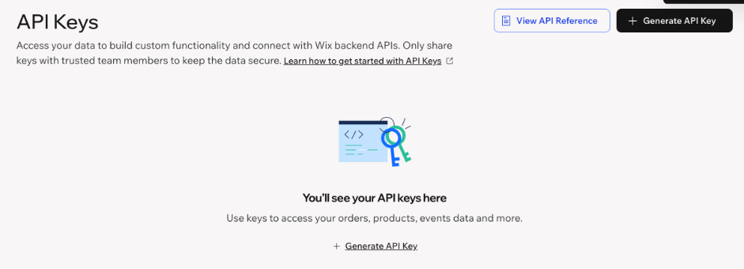
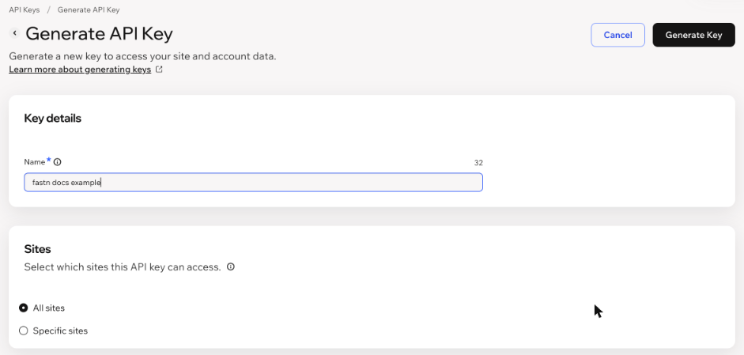
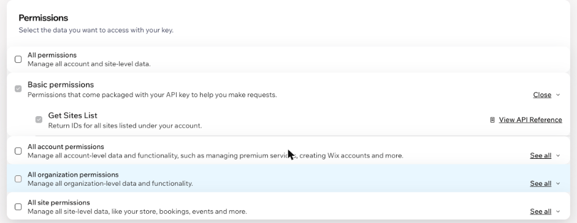

# Wix

Wix REST API connector (www.wixapis.com). Stores (products/inventory/categories), eCommerce (orders/cart/checkout), CRM contacts, members, bookings, Wix Data/CMS, media, site properties, locations. Account-level API key auth: Authorization header (raw key) + wix-site-id (site APIs) / wix-account-id (account APIs).

| | |
| --- | --- |
| **Category** | [E-commerce](README.md) |
| **Website** | [wix.com](https://wix.com) |
| **Authentication** | Credentials you enter, OAuth 2.0 |
| **Slug** | `wix` |

## Setup guide
This guide shows where your customers find the Wix values fastn asks for when they connect Wix, using either a Wix API key or a Wix headless OAuth client.

### Before you start
- You need the Owner, Admin or Developer role in fastn to configure the connector.
- To create a Wix API key, you must be the owner or a co-owner of the Wix account.
- Site-level calls work only with a key created in the account that owns the site, so create the key in the site owner's account.
- To use OAuth instead, you need a Wix headless project with a headless OAuth client.

### Get your Wix credentials
Fastn's **Wix API Key** method asks for `apiKey`, `siteId` and an optional `accountId`.

1. In Wix, open your account page (manage.wix.com/account) and click **API Keys** in the left sidebar.

<figure><figcaption>
The API Keys page in your Wix account
</figcaption></figure>

2. Click **Generate API Key**.
3. Under **Key details**, enter a **Name** for the key. Under **Sites**, choose **All sites** or **Specific sites** to limit the key to the sites you need.

<figure><figcaption>
Naming the key and choosing which sites it can access
</figcaption></figure>

4. Under **Permissions**, select the permissions the key needs for the actions you plan to run. **Basic permissions** (Get Sites List) are always included; open **All site permissions** with **See all** to pick site-level areas such as Stores, eCommerce, Contacts or Bookings.

<figure><figcaption>
The Permissions section of the Generate API Key page
</figcaption></figure>

5. Click **Generate Key**. In the **Verify your account** pop-up, click **Send Code** and enter the 6-digit code Wix emails you. The code is valid for 10 minutes.
6. Click **Verify & Generate Key**, then **Copy Token & Close**. This is your `apiKey`. Wix shows the token only once, so store it safely.
7. On the same **API Keys** page, click **Copy ID** under **Account ID**. This is your `accountId`, used for account-level actions such as Query Sites.
8. Open the site's dashboard and look at the browser address bar. The ID after `/dashboard/` (for example `manage.wix.com/dashboard/<site-id>/home`) is your `siteId`. You can also list site IDs with the Query Sites action.

Fastn's **Wix OAuth 2.0** method uses the client credentials flow and asks for `clientId`, `clientSecret`, `siteId` and `accountId`.

1. In your headless project's dashboard, go to **Settings** > **Development & integrations** > **Headless Settings**.
2. Next to your headless client, open the more actions menu to open the client's settings.
3. Copy the client's ID. This is your `clientId`.
4. In the **Client info** section, under **Client secret**, click **Generate Client Secret** and copy it. This is your `clientSecret`. Wix shows it only once.
5. Find `siteId` and `accountId` as described in steps 7 and 8 above.

### Connect in fastn
Your customers enter these values when they connect Wix in your widget, or you can enter them yourself under **Build → Integrations → Connectors → Wix**.

## Actions

<table><thead><tr><th width="240">Action</th><th width="260">Slug</th><th>What it does</th></tr></thead><tbody><tr><td>Add Customization Choices (V3)</td><td><code>addCustomizationChoices</code></td><td>Add choices to a customization (1-100).</td></tr><tr><td>Add Item To Categories</td><td><code>addItemToCategories</code></td><td>Add ONE product to MANY categories. item:{catalogItemId,appId}, categoryIds:[...].</td></tr><tr><td>Add Line Items To Draft Order</td><td><code>addLineItemsToDraft</code></td><td>Add catalog or custom line items to a draft order. POST /ecom/v1/draft-orders/{draftOrderId}/add-line-items.</td></tr><tr><td>Add Location Type</td><td><code>addLocationType</code></td><td>Adds a location type to an existing business location. The location is identified by its ID in the path.</td></tr><tr><td>Add Order Activities</td><td><code>addOrderActivities</code></td><td>Add activities to an order. POST /ecom/v1/orders/{orderId}/activities/add. Each orderActivities[] entry needs activityType (enum, e.g. MERCHANT_COMMENT) plus the matching content object (e.g. merchantComment:{message} or customActivity:{type,additionalData,appId}).</td></tr><tr><td>Add Payment</td><td><code>addPayment</code></td><td>Record payment(s) on an order (does NOT charge). POST /ecom/v1/payments/orders/{orderId}/add-payment. payments[] item shape: {amount:{amount:'10.00'}, regularPaymentDetails:{offlinePayment:true,status:'APPROVED'}}. amount is a Price object, not a bare string.</td></tr><tr><td>Add Products To Category</td><td><code>addProductsToCategory</code></td><td>Add many products to ONE category (max 1000). Provide items: [{catalogItemId, appId}]. appId is the Wix Stores app GUID.</td></tr><tr><td>Add To Cart</td><td><code>addToCart</code></td><td>Add catalog line items to an existing cart. POST /ecom/v1/carts/{cartId}/add-to-cart with body {lineItems:[{catalogReference,quantity}]}.</td></tr><tr><td>Add To Checkout</td><td><code>addToCheckout</code></td><td>Add line items to an existing checkout. POST /ecom/v1/checkouts/{id}/add-to-checkout.</td></tr><tr><td>Add To Current Cart</td><td><code>addToCurrentCart</code></td><td>Add line items to the current cart. POST /ecom/v1/carts/current/add-to-cart with body {lineItems}.</td></tr></tbody></table>

View 402 more actions

<table><thead><tr><th width="240">Action</th><th width="260">Slug</th><th>What it does</th></tr></thead><tbody><tr><td>Aggregate Data Items</td><td><code>aggregateItems</code></td><td>Run grouping/aggregation (sum/avg/min/max/count) over a Wix Data collection.</td></tr><tr><td>Approve Member</td><td><code>approveMember</code></td><td>Approve a pending member so they can log in.</td></tr><tr><td>Archive Location</td><td><code>archiveLocation</code></td><td>Archive a business location. POST /locations/v1/locations/{id}/archive. The default location cannot be archived.</td></tr><tr><td>Assign Badge</td><td><code>assignBadge</code></td><td>Assign a badge to a member (create badge assignment, Badges v4).</td></tr><tr><td>Assign Working Hours Schedule</td><td><code>assignWorkingHoursSchedule</code></td><td>Assign a working-hours schedule to a staff member (Staff Members v1).</td></tr><tr><td>Block Member</td><td><code>blockMember</code></td><td>Block a member from logging in.</td></tr><tr><td>Bulk Add Customization Choices (V3)</td><td><code>bulkAddCustomizationChoices</code></td><td>Add choices to multiple customizations. customizationsChoices: [{customizationId,choices}].</td></tr><tr><td>Bulk Add Info Sections To Products (V3)</td><td><code>bulkAddInfoSectionsToProducts</code></td><td>Add up to 10 info sections to products (by product id+revision).</td></tr><tr><td>Bulk Add Info Sections To Products By Filter (V3)</td><td><code>bulkAddInfoSectionsToProductsByFilter</code></td><td>Async: add up to 10 info sections to products matching a filter. Returns jobId.</td></tr><tr><td>Bulk Add Products To Categories By Filter (V3)</td><td><code>bulkAddProductsToCategoriesByFilter</code></td><td>Async: add products matching a filter to up to 5 categories. Returns jobId.</td></tr><tr><td>Bulk Adjust Product Variants By Filter (V3)</td><td><code>bulkAdjustProductVariantsByFilter</code></td><td>Async: adjust variant prices/costs by amount or percentage for variants matching a filter. Returns jobId.</td></tr><tr><td>Bulk Approve Members By Filter</td><td><code>bulkApproveMembersByFilter</code></td><td>Approve members matching a filter (async, returns jobId).</td></tr><tr><td>Bulk Assign Badges</td><td><code>bulkAssignBadges</code></td><td>Assign multiple badge-member pairs in one call (Badges v4, up to 100).</td></tr><tr><td>Bulk Block Members By Filter</td><td><code>bulkBlockMembersByFilter</code></td><td>Block members matching a filter (async, returns jobId).</td></tr><tr><td>Bulk Confirm Or Decline Bookings</td><td><code>bulkConfirmOrDeclineBookings</code></td><td>Confirm or decline up to 300 bookings in one call (Bookings v2).</td></tr><tr><td>Bulk Create Bookings</td><td><code>bulkCreateBookings</code></td><td>Create up to 12 bookings in one call (Bookings v2).</td></tr><tr><td>Bulk Create Brands (V3)</td><td><code>bulkCreateBrands</code></td><td>Create multiple brands (1-100).</td></tr><tr><td>Bulk Create Coupons</td><td><code>bulkCreateCoupons</code></td><td>Create multiple coupons at once. POST /stores/v2/bulk/coupons/create with body {specifications}.</td></tr><tr><td>Bulk Create Customizations (V3)</td><td><code>bulkCreateCustomizations</code></td><td>Create multiple customizations (1-100).</td></tr><tr><td>Bulk Create Fulfillments</td><td><code>bulkCreateFulfillments</code></td><td>Create fulfillments for multiple orders. POST /ecom/v1/fulfillments/orders/bulk/create-fulfillments with body {ordersWithFulfillments:[{orderId,fulfillments:[...]}]}.</td></tr><tr><td>Bulk Create Info Sections (V3)</td><td><code>bulkCreateInfoSections</code></td><td>Create multiple info sections (1-100).</td></tr><tr><td>Bulk Create Inventory Items (V3)</td><td><code>bulkCreateInventoryItems</code></td><td>Create multiple inventory items (max 1000). Each needs variantId+productId; quantity (tracked) or inStock.</td></tr><tr><td>Bulk Create Products (V3)</td><td><code>bulkCreateProducts</code></td><td>Create multiple Wix Stores products in one call (max 100). Pass products array; each needs name, productType, variantsInfo with price.</td></tr><tr><td>Bulk Create Products With Inventory (V3)</td><td><code>bulkCreateProductsWithInventory</code></td><td>Create products plus default-location inventory in one call (max 100).</td></tr><tr><td>Bulk Create Ribbons (V3)</td><td><code>bulkCreateRibbons</code></td><td>Create multiple ribbons (1-100).</td></tr><tr><td>Bulk Create Services</td><td><code>bulkCreateServices</code></td><td>Create up to 100 services in one call (Services v2).</td></tr><tr><td>Bulk Decrement Inventory By Variant And Location (V3)</td><td><code>bulkDecrementInventoryItemsByVariantAndLocation</code></td><td>Decrement inventory by variantId (+optional locationId), max 300. decrementData: [{variantId,decrementBy}].</td></tr><tr><td>Bulk Decrement Inventory Items (V3)</td><td><code>bulkDecrementInventoryItems</code></td><td>Decrement quantities for inventory items by ID (max 300). decrementData: [{inventoryItemId,decrementBy}].</td></tr><tr><td>Bulk Delete Brands (V3)</td><td><code>bulkDeleteBrands</code></td><td>Delete multiple brands by IDs (1-100).</td></tr><tr><td>Bulk Delete Contacts</td><td><code>bulkDeleteContacts</code></td><td>Deletes multiple contacts matching filter and/or search. Starts a bulk job, returns jobId. POST /contacts/v4/bulk/contacts/delete. Must include filter or search.</td></tr><tr><td>Bulk Delete Coupons</td><td><code>bulkDeleteCoupons</code></td><td>Delete multiple coupons at once. POST /stores/v2/bulk/coupons/delete with body {ids}.</td></tr><tr><td>Bulk Delete Info Sections (V3)</td><td><code>bulkDeleteInfoSections</code></td><td>Delete multiple info sections by IDs (1-100).</td></tr><tr><td>Bulk Delete Inventory Items (V3)</td><td><code>bulkDeleteInventoryItems</code></td><td>Delete multiple inventory items by IDs (max 1000).</td></tr><tr><td>Bulk Delete Media Files</td><td><code>bulkDeleteFiles</code></td><td>Move (or permanently delete) media files. POST /site-media/v1/bulk/files/delete with { fileIds:[], permanent? }.</td></tr><tr><td>Bulk Delete Media Folders</td><td><code>bulkDeleteFolders</code></td><td>Move (or permanently delete) media folders. POST /site-media/v1/bulk/folders/delete with { folderIds:[], permanent? }.</td></tr><tr><td>Bulk Delete Members</td><td><code>bulkDeleteMembers</code></td><td>Delete up to 100 members by ID list. Synchronous per-item results.</td></tr><tr><td>Bulk Delete Members By Filter</td><td><code>bulkDeleteMembersByFilter</code></td><td>Delete members matching a filter (async, returns jobId).</td></tr><tr><td>Bulk Delete Products (V3)</td><td><code>bulkDeleteProducts</code></td><td>Delete multiple Wix Stores products by IDs (1-100).</td></tr><tr><td>Bulk Delete Products By Filter (V3)</td><td><code>bulkDeleteProductsByFilter</code></td><td>Async: delete products matching a filter. Returns jobId.</td></tr><tr><td>Bulk Delete Ribbons (V3)</td><td><code>bulkDeleteRibbons</code></td><td>Delete multiple ribbons by IDs (1-100).</td></tr><tr><td>Bulk Delete Services</td><td><code>bulkDeleteServices</code></td><td>Delete multiple services by ID list (Services v2).</td></tr><tr><td>Bulk Get Or Create Brands (V3)</td><td><code>bulkGetOrCreateBrands</code></td><td>Get or create multiple brands by name (1-100).</td></tr><tr><td>Bulk Get Or Create Info Sections (V3)</td><td><code>bulkGetOrCreateInfoSections</code></td><td>Get or create multiple info sections (1-100).</td></tr><tr><td>Bulk Get Or Create Ribbons (V3)</td><td><code>bulkGetOrCreateRibbons</code></td><td>Get or create multiple ribbons by name (1-100).</td></tr><tr><td>Bulk Import Media Files</td><td><code>bulkImportFile</code></td><td>Import multiple files from external URLs into Media Manager.</td></tr><tr><td>Bulk Increment Inventory By Variant And Location (V3)</td><td><code>bulkIncrementInventoryItemsByVariantAndLocation</code></td><td>Increment inventory by variantId (+optional locationId), max 300. incrementData: [{variantId,incrementBy}].</td></tr><tr><td>Bulk Increment Inventory Items (V3)</td><td><code>bulkIncrementInventoryItems</code></td><td>Increment quantities for inventory items by ID (max 300). incrementData: [{inventoryItemId,incrementBy}].</td></tr><tr><td>Bulk Insert Data Items</td><td><code>bulkInsertItems</code></td><td>Insert multiple items into a Wix Data collection in one call. CMS app may be uninstalled -&gt; WDE0110.</td></tr><tr><td>Bulk Label And Unlabel Contacts</td><td><code>bulkLabelAndUnlabelContacts</code></td><td>Adds and removes labels from multiple contacts matching filter/search. Starts a bulk job, returns jobId. POST /contacts/v4/bulk/contacts/add-remove-labels. Must include filter or search.</td></tr><tr><td>Bulk Patch Data Items</td><td><code>bulkPatchItems</code></td><td>Apply atomic field modifications (SET_FIELD/INCREMENT_FIELD/etc.) to multiple items.</td></tr><tr><td>Bulk Remove Data Items</td><td><code>bulkRemoveItems</code></td><td>Remove multiple items from a Wix Data collection by ID array (dataItemIds).</td></tr><tr><td>Bulk Remove Info Sections From Products (V3)</td><td><code>bulkRemoveInfoSectionsFromProducts</code></td><td>Remove info sections from products (by product id+revision).</td></tr><tr><td>Bulk Remove Info Sections From Products By Filter (V3)</td><td><code>bulkRemoveInfoSectionsFromProductsByFilter</code></td><td>Async: remove info sections from products matching a filter. Returns jobId.</td></tr><tr><td>Bulk Remove Products From Categories By Filter (V3)</td><td><code>bulkRemoveProductsFromCategoriesByFilter</code></td><td>Async: remove products matching a filter from up to 5 categories. Returns jobId.</td></tr><tr><td>Bulk Restore Media Files</td><td><code>bulkRestoreFilesFromTrashBin</code></td><td>Restore deleted media files from the trash bin.</td></tr><tr><td>Bulk Restore Media Folders</td><td><code>bulkRestoreFoldersFromTrashBin</code></td><td>Restore deleted media folders from the trash bin.</td></tr><tr><td>Bulk Save Data Items</td><td><code>bulkSaveItems</code></td><td>Upsert multiple items (insert or update) into a Wix Data collection.</td></tr><tr><td>Bulk Set Attendance</td><td><code>bulkSetAttendance</code></td><td>Set attendance for up to 8 bookings in one call (Attendance v2).</td></tr><tr><td>Bulk Show Categories</td><td><code>bulkShowCategories</code></td><td>Bulk set categories visible=true by IDs. Requires treeReference.</td></tr><tr><td>Bulk Unassign Badges</td><td><code>bulkUnassignBadges</code></td><td>Delete multiple badge assignments by assignment ID (Badges v4, up to 100).</td></tr><tr><td>Bulk Update Brands (V3)</td><td><code>bulkUpdateBrands</code></td><td>Update multiple brands; each item {brand:{id,revision,name}}.</td></tr><tr><td>Bulk Update Categories</td><td><code>bulkUpdateCategories</code></td><td>Update multiple categories; each item {category:{id,revision,...}}. Requires treeReference.</td></tr><tr><td>Bulk Update Contacts</td><td><code>bulkUpdateContacts</code></td><td>Updates specified properties for multiple contacts matching filter/search. Only fieldMask.paths are updated. Starts a bulk job, returns jobId. POST /contacts/v4/bulk/contacts/update.</td></tr><tr><td>Bulk Update Customizations (V3)</td><td><code>bulkUpdateCustomizations</code></td><td>Update multiple customizations; each item {customization:{id,revision,name,...}}.</td></tr><tr><td>Bulk Update Data Items</td><td><code>bulkUpdateItems</code></td><td>Update multiple existing items (each must include id) in a Wix Data collection.</td></tr><tr><td>Bulk Update Info Sections (V3)</td><td><code>bulkUpdateInfoSections</code></td><td>Update multiple info sections; each item {infoSection:{id,revision,...}}.</td></tr><tr><td>Bulk Update Inventory Items (V3)</td><td><code>bulkUpdateInventoryItems</code></td><td>Update multiple inventory items (max 1000). Each item: {inventoryItem:{id,revision,quantity|inStock}}.</td></tr><tr><td>Bulk Update Inventory Items By Filter (V3)</td><td><code>bulkUpdateInventoryItemsByFilter</code></td><td>Async: update inventory items matching a filter (set quantity or inStock). Returns jobId.</td></tr><tr><td>Bulk Update Order Tags</td><td><code>bulkUpdateOrderTags</code></td><td>Assign tags on multiple orders. POST /ecom/v1/bulk/orders/update-tags. assignTags is a Tags object: {tags:{tagIds:[...]}, privateTags:{tagIds:[...]}}. tagIds max 5 chars each.</td></tr><tr><td>Bulk Update Orders</td><td><code>bulkUpdateOrders</code></td><td>Update multiple orders at once. POST /ecom/v1/bulk/orders/update with body {orders:[{order:{id,revision,...}}],returnEntity}.</td></tr><tr><td>Bulk Update Payment Transaction Status</td><td><code>bulkUpdatePaymentTransactionStatus</code></td><td>Update transaction status for multiple payments. POST /ecom/v1/bulk/payments/update-payment-transaction-status with body {paymentAndOrderIds,status,returnFullEntity}.</td></tr><tr><td>Bulk Update Product Variants By Filter (V3)</td><td><code>bulkUpdateProductVariantsByFilter</code></td><td>Async: set explicit values on variants matching a filter (visible/price/cost/physicalProperties). Returns jobId.</td></tr><tr><td>Bulk Update Products (V3)</td><td><code>bulkUpdateProducts</code></td><td>Update multiple Wix Stores products (max 100). Each item must contain product with id and revision.</td></tr><tr><td>Bulk Update Products By Filter (V3)</td><td><code>bulkUpdateProductsByFilter</code></td><td>Async: update products matching a filter. Returns jobId. Cannot update slug/options/modifiers/variantsInfo.</td></tr><tr><td>Bulk Update Products With Inventory (V3)</td><td><code>bulkUpdateProductsWithInventory</code></td><td>Update products plus inventory in one call. Each item needs product id+revision.</td></tr><tr><td>Bulk Update Ribbons (V3)</td><td><code>bulkUpdateRibbons</code></td><td>Update multiple ribbons; each item {ribbon:{id,revision,name}}.</td></tr><tr><td>Calculate Booking Price</td><td><code>calculateBookingPrice</code></td><td>Calculate the price for an existing booking (Pricing v2).</td></tr><tr><td>Cancel Booking</td><td><code>cancelBooking</code></td><td>Cancel a booking. Requires current revision (Bookings Writer V2).</td></tr><tr><td>Cancel Calendar Event</td><td><code>cancelEvent</code></td><td>Cancel a calendar event by ID (Calendar V3).</td></tr><tr><td>Cancel Order</td><td><code>cancelOrder</code></td><td>Cancel an eCommerce order. POST /ecom/v1/orders/{orderId}/cancel with body {restockAllItems, sendOrderCanceledEmail}.</td></tr><tr><td>Cancel Schedule</td><td><code>cancelSchedule</code></td><td>Cancel a calendar schedule by ID (Calendar V3).</td></tr><tr><td>Clone Service</td><td><code>cloneService</code></td><td>Clone an existing service (Services v2).</td></tr><tr><td>Commit Draft Order</td><td><code>commitDraftOrder</code></td><td>Commit a draft order to create/update a real order. POST /ecom/v1/draft-orders/{draftOrderId}/commit.</td></tr><tr><td>Confirm Booking</td><td><code>confirmBooking</code></td><td>Confirm a pending booking (Bookings v2). Requires bookingId and revision.</td></tr><tr><td>Confirm Or Decline Booking</td><td><code>confirmOrDeclineBooking</code></td><td>Confirm or decline a booking based on paymentStatus. Requires current revision (Bookings Writer V2).</td></tr><tr><td>Count Attendances</td><td><code>countAttendances</code></td><td>Count attendance records matching a filter (Attendance v2).</td></tr><tr><td>Count Booking Policies</td><td><code>countBookingPolicies</code></td><td>Count booking policies matching a filter (Booking Policies v1).</td></tr><tr><td>Count Categories</td><td><code>countCategories</code></td><td>Count Wix Stores categories matching an optional filter. Requires treeReference @wix/stores.</td></tr><tr><td>Count Data Items</td><td><code>countItems</code></td><td>Count Wix Data items matching an optional filter. POST /items/count with { dataCollectionId, filter }.</td></tr><tr><td>Count Extended Bookings</td><td><code>countExtendedBookings</code></td><td>Count bookings matching a filter (Bookings Reader v2).</td></tr><tr><td>Count Products (V3)</td><td><code>countProducts</code></td><td>Count Wix Stores products matching an optional filter (Catalog V3).</td></tr><tr><td>Count Resources</td><td><code>countResources</code></td><td>Count bookable resources matching a filter (Resources v2).</td></tr><tr><td>Count Services</td><td><code>countServices</code></td><td>Count services matching a filter (Services v2).</td></tr><tr><td>Count Sites</td><td><code>countSites</code></td><td>Count sites in the Wix account (account-level).</td></tr><tr><td>Count Staff Members</td><td><code>countStaffMembers</code></td><td>Count staff members matching a filter (Staff Members v1).</td></tr><tr><td>Count Tasks</td><td><code>countTasks</code></td><td>Counts the number of CRM tasks, optionally filtered. POST /crm/tasks/v2/tasks/count.</td></tr><tr><td>Create Badge</td><td><code>createBadge</code></td><td>Create a member badge (Badges v4). Requires title, backgroundColor, textColor.</td></tr><tr><td>Create Booking</td><td><code>createBooking</code></td><td>Create a single-service booking (Bookings Writer V2).</td></tr><tr><td>Create Booking Form</td><td><code>createBookingForm</code></td><td>Create a booking form schema (Wix Forms). Set form.namespace to wix.bookings.v2.bookings.</td></tr><tr><td>Create Booking Policy</td><td><code>createBookingPolicy</code></td><td>Create a booking policy (Booking Policies v1). Requires name.</td></tr><tr><td>Create Brand (V3)</td><td><code>createBrand</code></td><td>Create a Wix Stores brand. Required: name (unique, 1-50 chars).</td></tr><tr><td>Create Calendar Event</td><td><code>createEvent</code></td><td>Create a calendar event/session (Calendar V3). Requires scheduleId, start/end localDate, location.type.</td></tr><tr><td>Create Cart</td><td><code>createCart</code></td><td>Create an eCommerce cart. POST /ecom/v2/carts (Cart V2). The lineItems input is sent as catalogItems: [{catalogReference:{appId,catalogItemId},quantity}].</td></tr><tr><td>Create Category</td><td><code>createCategory</code></td><td>Create a Wix Stores category. Required: category.name and treeReference.appNamespace='@wix/stores'.</td></tr><tr><td>Create Checkout</td><td><code>createCheckout</code></td><td>Create a checkout directly. POST /ecom/v1/checkouts with body {lineItems:[{catalogReference,quantity}],channelType}.</td></tr><tr><td>Create Checkout From Cart</td><td><code>createCheckoutFromCart</code></td><td>Create a checkout from a cart. POST /ecom/v1/carts/{cartId}/create-checkout with body {channelType}.</td></tr><tr><td>Create Checkout From Current Cart</td><td><code>createCheckoutFromCurrentCart</code></td><td>Create a checkout from the current cart. POST /ecom/v1/carts/current/create-checkout with body {channelType}.</td></tr><tr><td>Create Contact</td><td><code>createContact</code></td><td>Create a new contact (Contacts V4). info must include at least one of name, emails.items[].email, or phones.items[].phone. Set allowDuplicates to avoid duplicate-email errors. Returns contact.id and contact.revision.</td></tr><tr><td>Create Coupon</td><td><code>createCoupon</code></td><td>Create a discount coupon. POST /stores/v2/coupons with body {specification}.</td></tr><tr><td>Create Customization (V3)</td><td><code>createCustomization</code></td><td>Create a product option or modifier. Required: name, customizationType (PRODUCT_OPTION|MODIFIER), customizationRenderType. Provide choicesSettings.choices for TEXT/SWATCH or freeTextInput for FREE_TEXT.</td></tr><tr><td>Create Data Collection</td><td><code>createCollection</code></td><td>Create a new Wix Data (CMS) collection. Requires collection.id, at least one field (key+type), and a permissions object.</td></tr><tr><td>Create Data Index</td><td><code>createIndex</code></td><td>Create an index on a Wix Data collection for faster queries.</td></tr><tr><td>Create Discount Rule</td><td><code>createDiscountRule</code></td><td>Create an automatic discount rule. POST /ecom/v1/discount-rules with body {discountRule}.</td></tr><tr><td>Create Draft Custom Additional Fees</td><td><code>createDraftAdditionalFees</code></td><td>Add custom additional fees to a draft order. POST /ecom/v1/draft-orders/{draftOrderId}/create-additional-fees.</td></tr><tr><td>Create Draft Custom Discounts</td><td><code>createDraftCustomDiscounts</code></td><td>Add custom discounts to a draft order. POST /ecom/v1/draft-orders/{draftOrderId}/create-custom-discounts.</td></tr><tr><td>Create Draft Order</td><td><code>createDraftOrder</code></td><td>Create a draft order. POST /ecom/v1/draft-orders with body {draftOrder:{catalogLineItems:[{catalogReference,quantity}]}}.</td></tr><tr><td>Create Fulfillment</td><td><code>createFulfillment</code></td><td>Create a fulfillment for an order. POST /ecom/v1/fulfillments/orders/{orderId}/create-fulfillment with body {fulfillment:{lineItems:[{id,quantity}],trackingInfo}}.</td></tr><tr><td>Create Info Section (V3)</td><td><code>createInfoSection</code></td><td>Create a Wix Stores info section. Required: uniqueName, title (1-50 chars).</td></tr><tr><td>Create Inventory Item (V3)</td><td><code>createInventoryItem</code></td><td>Create a Wix Stores inventory item (Catalog V3). Required: inventoryItem.variantId, inventoryItem.productId, and either quantity (tracked) or inStock (status). variantId+locationId must be unique.</td></tr><tr><td>Create Location</td><td><code>createLocation</code></td><td>Create a business location. POST /locations/v1/locations with { location: { name, address, timeZone } }.</td></tr><tr><td>Create Media Folder</td><td><code>createFolder</code></td><td>Create a folder in the Media Manager. POST /site-media/v1/folders with { displayName, parentFolderId? }.</td></tr><tr><td>Create Member</td><td><code>createMember</code></td><td>Create a site member. Requires member.loginEmail.</td></tr><tr><td>Create Member About</td><td><code>createMemberAbout</code></td><td>Create the rich-text About section for a member (Members About v2). Content is Ricos rich content.</td></tr><tr><td>Create Note</td><td><code>createNote</code></td><td>Creates a note associated with a contact. POST /crm/notes/v2/notes. Body wrapped in {note:{...}}.</td></tr><tr><td>Create Order</td><td><code>createOrder</code></td><td>Create an order for your records (POS/external/manual). POST /ecom/v1/orders with body {order}.</td></tr><tr><td>Create Order From Checkout</td><td><code>createOrderFromCheckout</code></td><td>Create an order from a checkout. POST /ecom/v1/checkouts/{checkoutId}/create-order.</td></tr><tr><td>Create Order From Draft</td><td><code>createOrderFromDraft</code></td><td>Create a finalized order from a draft order. POST /ecom/v1/draft-orders/{draftOrderId}/create-order.</td></tr><tr><td>Create Product (V3)</td><td><code>createProduct</code></td><td>Create a Wix Stores product (Catalog V3). Required: product.name, product.productType=PHYSICAL, product.physicalProperties (sent automatically), and at least one variant with price.actualPrice.amount (decimal string).</td></tr><tr><td>Create Resource</td><td><code>createResource</code></td><td>Create a bookable resource (Resources v2). Requires name and typeId.</td></tr><tr><td>Create Ribbon (V3)</td><td><code>createRibbon</code></td><td>Create a Wix Stores ribbon (promotional badge). Required: name (1-30 chars).</td></tr><tr><td>Create Schedule</td><td><code>createSchedule</code></td><td>Create a calendar schedule (Calendar V3). appId for Wix Bookings.</td></tr><tr><td>Create Service</td><td><code>createService</code></td><td>Create a Bookings service (Services V2). Online booking is always enabled (onlineBooking.enabled=true); set hidden=true to keep the service off Bookings pages.</td></tr><tr><td>Create Service Options And Variants</td><td><code>createServiceOptionsAndVariants</code></td><td>Create options and price variants for a service (Service Options and Variants v1).</td></tr><tr><td>Create Staff Member</td><td><code>createStaffMember</code></td><td>Create a staff member (Staff Members v1). Requires name.</td></tr><tr><td>Create Task</td><td><code>createTask</code></td><td>Create a CRM task (Tasks V2). task.title is required (1-250 chars); optional description, dueDate (ISO date-time), status (ACTION_NEEDED/COMPLETED), contact.id. Returns task.id and task.revision (string).</td></tr><tr><td>Decline Booking</td><td><code>declineBooking</code></td><td>Decline a pending booking (Bookings v2). Requires bookingId and revision.</td></tr><tr><td>Delete Attendance</td><td><code>deleteAttendance</code></td><td>Delete an attendance record by ID (Attendance v2).</td></tr><tr><td>Delete Badge</td><td><code>deleteBadge</code></td><td>Delete a member badge by ID (Badges v4).</td></tr><tr><td>Delete Booking Form</td><td><code>deleteBookingForm</code></td><td>Delete a booking form schema by form ID (Wix Forms).</td></tr><tr><td>Delete Booking Policy</td><td><code>deleteBookingPolicy</code></td><td>Delete a booking policy by ID (Booking Policies v1). Cannot delete the default policy.</td></tr><tr><td>Delete Brand (V3)</td><td><code>deleteBrand</code></td><td>Delete a Wix Stores brand by ID.</td></tr><tr><td>Delete Cart</td><td><code>deleteCart</code></td><td>Delete a cart. DELETE /ecom/v1/carts/{cartId}.</td></tr><tr><td>Delete Category</td><td><code>deleteCategory</code></td><td>Delete a Wix Stores category by id.</td></tr><tr><td>Delete Contact</td><td><code>deleteContact</code></td><td>Permanently delete a contact by GUID (Contacts V4). Returns empty body on success.</td></tr><tr><td>Delete Coupon</td><td><code>deleteCoupon</code></td><td>Delete a coupon. DELETE /stores/v2/coupons/{id}.</td></tr><tr><td>Delete Current Cart</td><td><code>deleteCurrentCart</code></td><td>Delete the current cart. DELETE /ecom/v1/carts/current.</td></tr><tr><td>Delete Customization (V3)</td><td><code>deleteCustomization</code></td><td>Delete a product customization by ID (cannot delete while assigned to products).</td></tr><tr><td>Delete Data Collection</td><td><code>deleteCollection</code></td><td>Delete a Wix Data (CMS) collection by its ID.</td></tr><tr><td>Delete Discount Rule</td><td><code>deleteDiscountRule</code></td><td>Delete a discount rule. DELETE /ecom/v1/discount-rules/{discountRuleId}.</td></tr><tr><td>Delete Draft Custom Additional Fees</td><td><code>deleteDraftAdditionalFees</code></td><td>Remove custom additional fees from a draft order. POST /ecom/v1/draft-orders/{draftOrderId}/delete-custom-additional-fees.</td></tr><tr><td>Delete Draft Custom Discounts</td><td><code>deleteDraftCustomDiscounts</code></td><td>Remove custom discounts from a draft order. POST /ecom/v1/draft-orders/{draftOrderId}/delete-custom-discounts.</td></tr><tr><td>Delete Draft Order</td><td><code>deleteDraftOrder</code></td><td>Delete a draft order. DELETE /ecom/v1/draft-orders/{draftOrderId}.</td></tr><tr><td>Delete Extended Field</td><td><code>deleteExtendedField</code></td><td>Delete a custom extended field by key (Extended Fields V4). Returns empty body on success.</td></tr><tr><td>Delete Fulfillment</td><td><code>deleteFulfillment</code></td><td>Delete a fulfillment from an order. DELETE /ecom/v1/fulfillments/{fulfillmentId}/orders/{orderId}.</td></tr><tr><td>Delete Info Section (V3)</td><td><code>deleteInfoSection</code></td><td>Delete a Wix Stores info section by ID.</td></tr><tr><td>Delete Inventory Item (V3)</td><td><code>deleteInventoryItem</code></td><td>Delete a Wix Stores inventory item by id (Catalog V3).</td></tr><tr><td>Delete Label</td><td><code>deleteLabel</code></td><td>Delete a contact label by key (Labels V4). Removes it from all contacts. Returns empty body on success.</td></tr><tr><td>Delete Member</td><td><code>deleteMember</code></td><td>Delete a site member by ID.</td></tr><tr><td>Delete Member About</td><td><code>deleteMemberAbout</code></td><td>Delete a member's About section by About ID (Members About v2).</td></tr><tr><td>Delete Member Addresses</td><td><code>deleteMemberAddresses</code></td><td>Clear all addresses from a member's contact info.</td></tr><tr><td>Delete Member Emails</td><td><code>deleteMemberEmails</code></td><td>DEPRECATED - DO NOT USE. This endpoint cannot succeed by construction. Its only argument is a MEMBER id (DELETE /members/v1/members/{id}/emails), but Wix refuses the operation for anything that is a member: it answers 428 {"message":"Contact email can't be updated if contact is also a member.","code":"CANNOT_UPDATE_MEMBER_EMAIL"}. Verified live against a real member. There is no input for which this returns 2xx. To change a member's email use the Members API member-update flow instead. Ref: https://dev.wix.com/docs/rest/crm/members-contacts/members/members/member-v1</td></tr><tr><td>Delete Member Phones</td><td><code>deleteMemberPhones</code></td><td>Clear all phone numbers from a member's contact info.</td></tr><tr><td>Delete My Member</td><td><code>deleteMyMember</code></td><td>Delete the currently logged-in member (caller). Needs member identity context.</td></tr><tr><td>Delete Note</td><td><code>deleteNote</code></td><td>Deletes a note by ID. DELETE /crm/notes/v2/notes/{noteId}.</td></tr><tr><td>Delete Product (V3)</td><td><code>deleteProduct</code></td><td>Delete a Wix Stores product by id (Catalog V3).</td></tr><tr><td>Delete Resource</td><td><code>deleteResource</code></td><td>Delete a bookable resource by ID (Resources v2).</td></tr><tr><td>Delete Ribbon (V3)</td><td><code>deleteRibbon</code></td><td>Delete a Wix Stores ribbon by ID.</td></tr><tr><td>Delete Service</td><td><code>deleteService</code></td><td>Delete a Bookings service by ID (Services V2).</td></tr><tr><td>Delete Service Options And Variants</td><td><code>deleteServiceOptionsAndVariants</code></td><td>Delete a service options-and-variants object by ID (v1).</td></tr><tr><td>Delete Staff Member</td><td><code>deleteStaffMember</code></td><td>Delete a staff member (and its resource) by ID (Staff Members v1).</td></tr><tr><td>Delete Task</td><td><code>deleteTask</code></td><td>Delete a CRM task by GUID (Tasks V2). Returns empty body on success.</td></tr><tr><td>Disconnect Member</td><td><code>disconnectMember</code></td><td>Disconnect a member (set status OFFLINE) by member ID.</td></tr><tr><td>Drop Data Index</td><td><code>dropIndex</code></td><td>Drop (remove) an index from a Wix Data collection. dataCollectionId and indexName are query params.</td></tr><tr><td>Estimate Cart Totals</td><td><code>estimateCartTotals</code></td><td>Estimate totals for a cart (incl. shipping/tax). POST /ecom/v1/carts/{id}/estimate-totals.</td></tr><tr><td>Estimate Current Cart Totals</td><td><code>estimateCurrentCartTotals</code></td><td>Estimate totals for the current cart. POST /ecom/v1/carts/current/estimate-totals.</td></tr><tr><td>Find Or Create Extended Field</td><td><code>createExtendedField</code></td><td>Retrieve a custom contact field by display name, or create it (Extended Fields V4). dataType is one of TEXT, NUMBER, DATE, URL. Returns field.key and newField flag.</td></tr><tr><td>Find Or Create Label</td><td><code>findOrCreateLabel</code></td><td>Retrieve a contact label by display name, or create it if missing (Labels V4). Returns label.key (use in Label Contact) and newLabel flag.</td></tr><tr><td>Generate File Download URL</td><td><code>generateFileDownloadUrl</code></td><td>Generate a temporary download URL for a single media file (supports private).</td></tr><tr><td>Generate File Resumable Upload URL</td><td><code>generateFileResumableUploadUrl</code></td><td>Generate a resumable (TUS) upload URL for large media files. mimeType required.</td></tr><tr><td>Generate File Upload URL</td><td><code>generateUploadUrl</code></td><td>Generate a signed upload URL for uploading a file to the Media Manager. POST /site-media/v1/files/generate-upload-url with { mimeType, fileName? }.</td></tr><tr><td>Generate Files Download URL (ZIP)</td><td><code>generateFilesDownloadUrl</code></td><td>Generate a permanent ZIP download URL for multiple media files.</td></tr><tr><td>Generate Folder Download URL</td><td><code>generateFolderDownloadUrl</code></td><td>Generates a temporary URL for downloading an entire media folder as a ZIP archive.</td></tr><tr><td>Generate Video Streaming URL</td><td><code>generateVideoStreamingUrl</code></td><td>Generate an HLS/DASH streaming URL for a video file.</td></tr><tr><td>Get Account</td><td><code>getAccount</code></td><td>Retrieves a Wix account by its account ID. This is an account-level call and is not scoped to a single site.</td></tr><tr><td>Get Attendance</td><td><code>getAttendance</code></td><td>Get an attendance record by ID (Attendance v2).</td></tr><tr><td>Get Availability Time Slot</td><td><code>getAvailabilityTimeSlot</code></td><td>Get a single availability time slot for a service (Time Slots V2).</td></tr><tr><td>Get Badge</td><td><code>getBadge</code></td><td>Get a member badge by ID (Badges v4).</td></tr><tr><td>Get Booking Form</td><td><code>getBookingForm</code></td><td>Get a booking form schema by form ID (Wix Forms, namespace wix.bookings.v2.bookings).</td></tr><tr><td>Get Booking Policy</td><td><code>getBookingPolicy</code></td><td>Get a booking policy by ID (Booking Policies v1).</td></tr><tr><td>Get Brand (V3)</td><td><code>getBrand</code></td><td>Get a Wix Stores brand by ID.</td></tr><tr><td>Get Calendar Event</td><td><code>getEvent</code></td><td>Get a calendar event by ID (Calendar V3).</td></tr><tr><td>Get Cart</td><td><code>getCart</code></td><td>Retrieve a cart by ID. GET /ecom/v1/carts/{cartId}.</td></tr><tr><td>Get Category</td><td><code>getCategory</code></td><td>Get a single Wix Stores category by id.</td></tr><tr><td>Get Category By Slug</td><td><code>getCategoryBySlug</code></td><td>Get a Wix Stores category by slug. treeReference passed as query params.</td></tr><tr><td>Get Checkout</td><td><code>getCheckout</code></td><td>Retrieve a checkout by ID. GET /ecom/v1/checkouts/{checkoutId}.</td></tr><tr><td>Get Checkout By Cart ID</td><td><code>getCheckoutByCartId</code></td><td>Retrieve a checkout by its source cart id. GET /ecom/v1/checkouts/by-cart-id/{id}.</td></tr><tr><td>Get Checkout URL</td><td><code>getCheckoutUrl</code></td><td>Get the hosted checkout page URL. GET /ecom/v1/checkouts/{id}/checkout-url.</td></tr><tr><td>Get Contact</td><td><code>getContact</code></td><td>Retrieve a single contact by GUID (Contacts V4). Returns the full contact including revision (needed for updates).</td></tr><tr><td>Get Coupon</td><td><code>getCoupon</code></td><td>Get a coupon by id. GET /stores/v2/coupons/{id}.</td></tr><tr><td>Get Current Cart</td><td><code>getCurrentCart</code></td><td>Get the current visitor/member cart. GET /ecom/v1/carts/current (requires visitor/member context).</td></tr><tr><td>Get Current Member</td><td><code>getCurrentMember</code></td><td>Get the currently logged-in member. Requires member identity (not site/app token).</td></tr><tr><td>Get Customization (V3)</td><td><code>getCustomization</code></td><td>Get a product customization (option/modifier) by ID.</td></tr><tr><td>Get Data Collection</td><td><code>getCollection</code></td><td>Get a single Wix Data (CMS) collection by its data collection ID.</td></tr><tr><td>Get Data Item</td><td><code>getItem</code></td><td>Retrieve a single Wix Data item by ID. Uses POST /items/get with { dataItemId, dataCollectionId }.</td></tr><tr><td>Get Discount Rule</td><td><code>getDiscountRule</code></td><td>Get a discount rule by id. GET /ecom/v1/discount-rules/{discountRuleId}.</td></tr><tr><td>Get Draft Order</td><td><code>getDraftOrder</code></td><td>Retrieve a draft order by ID. GET /ecom/v1/draft-orders/{draftOrderId}.</td></tr><tr><td>Get Extended Field</td><td><code>getExtendedField</code></td><td>Retrieve a single extended field by its key (Extended Fields V4), e.g. custom.my-field.</td></tr><tr><td>Get Gift Card</td><td><code>getGiftCard</code></td><td>Get a gift card by its code. POST /ecom/v1/gift-cards/{code} with body {code,appId?,pin?}.</td></tr><tr><td>Get Info Section (V3)</td><td><code>getInfoSection</code></td><td>Get a Wix Stores info section by ID.</td></tr><tr><td>Get Inventory Item (V3)</td><td><code>getInventoryItem</code></td><td>Get a single Wix Stores inventory item by id (Catalog V3).</td></tr><tr><td>Get Label</td><td><code>getLabel</code></td><td>Retrieve a single contact label by its key (Labels V4), e.g. custom.my-label.</td></tr><tr><td>Get Location</td><td><code>getLocation</code></td><td>Get a business location by ID. GET /locations/v1/locations/{id}.</td></tr><tr><td>Get Media File</td><td><code>getFile</code></td><td>Get a media file descriptor by file ID. GET /site-media/v1/files/get-file-by-id?fileId=.</td></tr><tr><td>Get Media File Descriptors (Bulk)</td><td><code>getFileDescriptors</code></td><td>Get multiple media file descriptors by file IDs in one call.</td></tr><tr><td>Get Media Folder</td><td><code>getFolder</code></td><td>Get a media folder by ID. GET /site-media/v1/folders/get-folder-by-id?folderId=.</td></tr><tr><td>Get Member</td><td><code>getMember</code></td><td>Get a site member by ID.</td></tr><tr><td>Get Member About</td><td><code>getMemberAbout</code></td><td>Get a member's About section by About ID (Members About v2).</td></tr><tr><td>Get Multi-Service Availability Time Slot</td><td><code>getMultiServiceTimeSlot</code></td><td>Get a single multi-service availability time slot (Time Slots V2).</td></tr><tr><td>Get My Member About</td><td><code>getMyMemberAbout</code></td><td>Get the current member's About section (Members About v2). Needs member identity context.</td></tr><tr><td>Get Note</td><td><code>getNote</code></td><td>Retrieves a note by ID. GET /crm/notes/v2/notes/{noteId}.</td></tr><tr><td>Get Or Create Brand (V3)</td><td><code>getOrCreateBrand</code></td><td>Get a brand by name or create it if missing.</td></tr><tr><td>Get Or Create Info Section (V3)</td><td><code>getOrCreateInfoSection</code></td><td>Get an info section by uniqueName or create it (provide title to create).</td></tr><tr><td>Get Or Create Ribbon (V3)</td><td><code>getOrCreateRibbon</code></td><td>Get a ribbon by name or create it if missing.</td></tr><tr><td>Get Order</td><td><code>getOrder</code></td><td>Retrieve a single eCommerce order by ID. GET /ecom/v1/orders/{orderId}.</td></tr><tr><td>Get Order Draftability</td><td><code>getOrderDraftability</code></td><td>Check whether an existing order can be edited via a draft order. GET /ecom/v1/draft-orders/{orderId}/draftability.</td></tr><tr><td>Get Product (V3)</td><td><code>getProduct</code></td><td>Get a single Wix Stores product by id (Catalog V3). Returns full product details including revision and variants.</td></tr><tr><td>Get Product By Slug (V3)</td><td><code>getProductBySlug</code></td><td>Get a Wix Stores product by its slug (Catalog V3).</td></tr><tr><td>Get Resource</td><td><code>getResource</code></td><td>Get a bookable resource by ID (Resources v2).</td></tr><tr><td>Get Ribbon (V3)</td><td><code>getRibbon</code></td><td>Get a Wix Stores ribbon by ID.</td></tr><tr><td>Get Roles Info</td><td><code>getRolesInfo</code></td><td>Get predefined and custom roles for the account (account-level, requires account API key).</td></tr><tr><td>Get Schedule</td><td><code>getSchedule</code></td><td>Get a calendar schedule by ID (Calendar V3).</td></tr><tr><td>Get Service</td><td><code>getService</code></td><td>Get a Bookings service by ID (Services V2).</td></tr><tr><td>Get Service Options And Variants</td><td><code>getServiceOptionsAndVariants</code></td><td>Get a service options-and-variants object by ID (v1).</td></tr><tr><td>Get Service Options And Variants By Service</td><td><code>getServiceOptionsAndVariantsByServiceId</code></td><td>Get options-and-variants for a given service ID (v1).</td></tr><tr><td>Get Site Properties</td><td><code>getSiteProperties</code></td><td>Get the site's properties (locale, business info, etc.). Site-level.</td></tr><tr><td>Get Staff Member</td><td><code>getStaffMember</code></td><td>Get a staff member by ID (Staff Members v1).</td></tr><tr><td>Get Task</td><td><code>getTask</code></td><td>Retrieve a CRM task by GUID (Tasks V2). Returns the task including revision (needed for updates).</td></tr><tr><td>Import Media File</td><td><code>importFile</code></td><td>Import a file into the Media Manager from a public external URL. POST /site-media/v1/files/import with { url, displayName?, mimeType? }.</td></tr><tr><td>Insert Data Item</td><td><code>insertItem</code></td><td>Insert (create-only) a single item into a Wix Data collection. Body: { dataCollectionId, dataItem: { data: {...} } }.</td></tr><tr><td>Join Community</td><td><code>joinCommunity</code></td><td>Make the current member's profile public (join community). Needs member identity context.</td></tr><tr><td>Label Contact</td><td><code>labelContact</code></td><td>Add one or more existing label keys to a contact (Contacts V4). Label keys must already exist (use Find Or Create Label). Returns the updated contact.</td></tr><tr><td>Leave Community</td><td><code>leaveCommunity</code></td><td>Make the current member's profile private (leave community). Needs member identity context.</td></tr><tr><td>List Availability Time Slots</td><td><code>listTimeSlots</code></td><td>List appointment availability time slots. Required: serviceId, fromLocalDate, toLocalDate, timeZone (Time Slots V2).</td></tr><tr><td>List Booking Fees</td><td><code>listBookingFees</code></td><td>List cancellation/no-show fees for up to 5 bookings (Booking Fees v1).</td></tr><tr><td>List Calendar Events</td><td><code>listEvents</code></td><td>List calendar events by event IDs (Calendar V3).</td></tr><tr><td>List Categories For Item</td><td><code>listCategoriesForItem</code></td><td>Reverse lookup: which categories contain ONE product. item:{catalogItemId,appId}.</td></tr><tr><td>List Categories For Items</td><td><code>listCategoriesForItems</code></td><td>Reverse lookup for MANY products (max 100). items:[{catalogItemId,appId}].</td></tr><tr><td>List Child Accounts</td><td><code>listChildAccounts</code></td><td>List child accounts under the Wix account (account-level, requires account API key).</td></tr><tr><td>List Contact Facets</td><td><code>listContactFacets</code></td><td>Lists facets (labels and subscription statuses) from the site's contact list. GET /contacts/v4/contacts/facets.</td></tr><tr><td>List Contacts</td><td><code>listContacts</code></td><td>Retrieves a list of up to 1,000 contacts per request. GET /contacts/v4/contacts with optional paging, sort, fields, fieldsets.</td></tr><tr><td>List Data Collections</td><td><code>listCollections</code></td><td>List all Wix Data (CMS) collections on the site.</td></tr><tr><td>List Data Indexes</td><td><code>listIndexes</code></td><td>List indexes for a Wix Data collection. dataCollectionId is a query param.</td></tr><tr><td>List Deleted Media Files</td><td><code>listDeletedFiles</code></td><td>List files in the Media Manager trash bin.</td></tr><tr><td>List Deleted Media Folders</td><td><code>listDeletedFolders</code></td><td>List folders in the Media Manager trash bin.</td></tr><tr><td>List Draft Orders</td><td><code>listDraftOrders</code></td><td>List/query draft orders. POST /ecom/v1/draft-orders/query with body {query:{cursorPaging:{limit}}}. Returns draftOrders[].</td></tr><tr><td>List Extended Fields</td><td><code>listExtendedFields</code></td><td>List custom and system contact extended fields (Extended Fields V4). Returns fields[] each with key, displayName, dataType.</td></tr><tr><td>List Fulfillments By Order IDs</td><td><code>listFulfillmentsByIds</code></td><td>List fulfillments for multiple orders. POST /ecom/v1/fulfillments/list-by-ids with body {orderIds:[]}.</td></tr><tr><td>List Fulfillments For Order</td><td><code>listFulfillments</code></td><td>List fulfillments for a single order. GET /ecom/v1/fulfillments/orders/{orderId}.</td></tr><tr><td>List Invoices For Orders</td><td><code>listInvoicesForOrders</code></td><td>List invoices for multiple orders. POST /ecom/v1/invoices/list-by-ids with body {orderIds:[]}.</td></tr><tr><td>List Items In Category</td><td><code>listItemsInCategory</code></td><td>List products in a category (max 100). Optional includeItemsFromSubcategories, useCategoryArrangement, cursorPaging.</td></tr><tr><td>List Labels</td><td><code>listLabels</code></td><td>List contact labels (Labels V4). Returns labels[] each with key and displayName.</td></tr><tr><td>List Locations</td><td><code>listLocations</code></td><td>List business locations. GET /locations/v1/locations.</td></tr><tr><td>List Media Files</td><td><code>listFiles</code></td><td>List files in the Media Manager. Optional parentFolderId, mediaTypes, paging.</td></tr><tr><td>List Media Folders</td><td><code>listFolders</code></td><td>List folders in the Media Manager. GET /site-media/v1/folders. Optional parentFolderId.</td></tr><tr><td>List Members</td><td><code>listMembers</code></td><td>List site members. Supports fieldsets, paging, sorting query params.</td></tr><tr><td>List Multi Service Time Slots</td><td><code>multiServiceTimeSlots</code></td><td>List availability time slots across multiple services in a sequence (Time Slots V2).</td></tr><tr><td>List Transactions By Order IDs</td><td><code>listTransactionsByIds</code></td><td>List transactions for multiple orders. POST /ecom/v1/payments/list-by-ids with body {orderIds:[]}.</td></tr><tr><td>List Transactions For Order</td><td><code>listTransactionsForOrder</code></td><td>List payment and refund transactions for a single order. GET /ecom/v1/payments/orders/{orderId}.</td></tr><tr><td>Mark Booking As Pending</td><td><code>markBookingAsPending</code></td><td>Mark a booking as pending (Bookings v2). Requires bookingId and revision.</td></tr><tr><td>Mark Checkout As Completed</td><td><code>markCheckoutAsCompleted</code></td><td>Mark a checkout as completed. POST /ecom/v1/checkouts/{id}/mark-as-completed.</td></tr><tr><td>Merge Contacts</td><td><code>mergeContacts</code></td><td>Merges up to 5 source contacts into a target contact. Irreversible. POST /contacts/v4/contacts/{targetContactId}/merge. Requires targetContactRevision.</td></tr><tr><td>Move Badge</td><td><code>moveBadge</code></td><td>Reorder a badge in the display list (Badges v4).</td></tr><tr><td>Move Category</td><td><code>moveCategory</code></td><td>Reposition a category. position FIRST|LAST|AFTER (AFTER needs moveAfterCategoryId).</td></tr><tr><td>Move Task After</td><td><code>moveTaskAfter</code></td><td>Repositions a CRM task to be placed after another task. Omit beforeTaskId to move first. POST /crm/tasks/v2/tasks/{taskId}/move-after.</td></tr><tr><td>Mute Member</td><td><code>muteMember</code></td><td>Mute a member (cannot post in forum/blog).</td></tr><tr><td>Preview Merge Contacts</td><td><code>previewMergeContacts</code></td><td>Dry-run preview of merging source contacts into a target contact; no data changed. POST /contacts/v4/contacts/{targetContactId}/preview-merge.</td></tr><tr><td>Preview Service Price</td><td><code>previewServicePrice</code></td><td>Preview/estimate price for a service booking before it exists (Pricing v2).</td></tr><tr><td>Query Attendance</td><td><code>queryAttendance</code></td><td>Query attendance records (Attendance v2).</td></tr><tr><td>Query Availability Calendar</td><td><code>queryAvailabilityCalendar</code></td><td>DEPRECATED - DO NOT USE. The Wix Availability Calendar API is retired and its REST endpoint (POST /_api/availability-calendar/v1/availability/query) is gone - Wix answers 404 with an empty body for every input. Wix documents Time Slots V2 as the replacement, which this connector already exposes as List Time Slots and Get Availability Time Slot; use those instead. This action was deliberately NOT repointed at Time Slots V2 because that would duplicate List Time Slots and silently change this action's contract for existing callers. Ref: https://dev.wix.com/docs/api-reference/business-solutions/bookings/calendar-integration</td></tr><tr><td>Query Badge Assignments</td><td><code>queryBadgeAssignments</code></td><td>Query badge assignments. Filter by badgeId (members-per-badge) or memberId (badges-per-member).</td></tr><tr><td>Query Badges</td><td><code>queryBadges</code></td><td>Query member badges with filter/sort/cursorPaging (Badges v4).</td></tr><tr><td>Query Booking Forms</td><td><code>queryBookingForms</code></td><td>Query booking form schemas (Wix Forms). Must filter by namespace wix.bookings.v2.bookings.</td></tr><tr><td>Query Booking Policies</td><td><code>queryBookingPolicies</code></td><td>Query booking policies (Booking Policies v1).</td></tr><tr><td>Query Brands (V3)</td><td><code>queryBrands</code></td><td>Query Wix Stores brands (cursorPaging max 300).</td></tr><tr><td>Query Calendar Events</td><td><code>queryEvents</code></td><td>Query calendar events with filter/sort/cursorPaging (Calendar V3).</td></tr><tr><td>Query Categories</td><td><code>queryCategories</code></td><td>Query Wix Stores categories. POST body requires treeReference.appNamespace='@wix/stores' alongside query{cursorPaging{limit}}.</td></tr><tr><td>Query Contact Facets</td><td><code>queryContactFacets</code></td><td>Retrieves contact-list facets by filter (labels, subscription statuses). POST /contacts/v4/contacts/facets/query.</td></tr><tr><td>Query Contacts</td><td><code>queryContacts</code></td><td>Query/list contacts with optional paging, filtering, and sorting (Contacts V4). Pass an empty query object to list all. Returns contacts[] each with id and revision.</td></tr><tr><td>Query Coupons</td><td><code>queryCoupons</code></td><td>Query coupons with paging/filter/sort. POST /stores/v2/coupons/query with body {query}.</td></tr><tr><td>Query Customizations (V3)</td><td><code>queryCustomizations</code></td><td>Query product customizations (filter by customizationType/renderType/name).</td></tr><tr><td>Query Data Items</td><td><code>queryItems</code></td><td>Query Wix Data items with filter/sort/paging. POST /items/query with { dataCollectionId, query }.</td></tr><tr><td>Query Discount Rules</td><td><code>queryDiscountRules</code></td><td>Query discount rules. POST /ecom/v1/discount-rules/query with body {query}.</td></tr><tr><td>Query Distinct Values</td><td><code>queryDistinctValues</code></td><td>Return distinct values of a field in a Wix Data collection.</td></tr><tr><td>Query Extended Bookings</td><td><code>queryExtendedBookings</code></td><td>Query bookings with paging/filter/sort (Bookings Reader V2).</td></tr><tr><td>Query Info Sections (V3)</td><td><code>queryInfoSections</code></td><td>Query Wix Stores info sections (filter/sort/cursorPaging optional).</td></tr><tr><td>Query Inventory Items (V3)</td><td><code>queryInventoryItems</code></td><td>Query Wix Stores inventory items (Catalog V3). POST body: {query:{cursorPaging:{limit:10}}}. Supports filter/sort.</td></tr><tr><td>Query Locations</td><td><code>queryLocations</code></td><td>Query business locations with filter/sort/paging. POST /locations/v1/locations/query with { query }.</td></tr><tr><td>Query Media File Descriptors</td><td><code>queryFileDescriptors</code></td><td>Query media files with filter/sort/cursor paging.</td></tr><tr><td>Query Member Abouts</td><td><code>queryMemberAbouts</code></td><td>Query member About sections with filter/sort/cursorPaging (Members About v2).</td></tr><tr><td>Query Members</td><td><code>queryMembers</code></td><td>Query site members with paging/filter/sort.</td></tr><tr><td>Query Notes</td><td><code>queryNotes</code></td><td>Retrieves up to 1,000 notes for a contact with filtering/sorting/cursor paging. POST /crm/notes/v2/notes/query. contactId required on first request.</td></tr><tr><td>Query Products (V3)</td><td><code>queryProducts</code></td><td>Query Wix Stores products (Catalog V3). POST body: {query:{cursorPaging:{limit:10}}}. Supports filter/sort.</td></tr><tr><td>Query Resources</td><td><code>queryResources</code></td><td>Query bookable resources (Resources v2).</td></tr><tr><td>Query Ribbons (V3)</td><td><code>queryRibbons</code></td><td>Query Wix Stores ribbons (filter/sort/cursorPaging optional).</td></tr><tr><td>Query Schedules</td><td><code>querySchedules</code></td><td>Query calendar schedules (Calendar V3).</td></tr><tr><td>Query Service Options And Variants</td><td><code>queryServiceOptionsAndVariants</code></td><td>Query service options-and-variants objects (v1).</td></tr><tr><td>Query Services</td><td><code>queryServices</code></td><td>Query Bookings services (Services V2).</td></tr><tr><td>Query Sites</td><td><code>querySites</code></td><td>List sites in the Wix account (account-level). Returns each site's id (use as siteId for site-level actions), displayName, published, viewUrl.</td></tr><tr><td>Query Staff Members</td><td><code>queryStaffMembers</code></td><td>Query staff members (Staff Members v1).</td></tr><tr><td>Query Tasks</td><td><code>queryTasks</code></td><td>Query/list CRM tasks with optional filtering, sorting, paging (Tasks V2). Pass an empty query object to list all. Returns tasks[] each with id and revision.</td></tr><tr><td>Query Variants (V3)</td><td><code>queryVariants</code></td><td>Query product variants (read-only Variants V3). Filter on productData.productId/variantId/id.</td></tr><tr><td>Redeem Gift Card</td><td><code>redeemGiftCard</code></td><td>Redeem an amount from a gift card. POST /ecom/v1/gift-cards/redeem with body {code,amount,appId}.</td></tr><tr><td>Remove Cart Coupon</td><td><code>removeCartCoupon</code></td><td>Remove the coupon applied to a cart. POST /ecom/v1/carts/{id}/remove-coupon.</td></tr><tr><td>Remove Checkout Coupon</td><td><code>removeCheckoutCoupon</code></td><td>Remove the coupon applied to a checkout. POST /ecom/v1/checkouts/{id}/remove-coupon.</td></tr><tr><td>Remove Checkout Gift Card</td><td><code>removeCheckoutGiftCard</code></td><td>Remove the gift card applied to a checkout. POST /ecom/v1/checkouts/{id}/remove-gift-card.</td></tr><tr><td>Remove Checkout Line Items</td><td><code>removeCheckoutLineItems</code></td><td>Remove line items from a checkout. POST /ecom/v1/checkouts/{id}/remove-line-items with body {lineItemIds}.</td></tr><tr><td>Remove Current Cart Coupon</td><td><code>removeCurrentCartCoupon</code></td><td>Remove the coupon applied to the current cart. POST /ecom/v1/carts/current/remove-coupon.</td></tr><tr><td>Remove Current Cart Line Items</td><td><code>removeCurrentCartLineItems</code></td><td>Remove line items from the current cart. POST /ecom/v1/carts/current/remove-line-items with body {lineItemIds}.</td></tr><tr><td>Remove Customization Choices (V3)</td><td><code>removeCustomizationChoices</code></td><td>Remove choices from a customization by choiceIds (1-100).</td></tr><tr><td>Remove Data Item</td><td><code>removeItem</code></td><td>Remove a Wix Data item. POST /items/remove with { dataCollectionId, dataItemId }.</td></tr><tr><td>Remove Item From Categories</td><td><code>removeItemFromCategories</code></td><td>Remove ONE product from MANY categories. item:{catalogItemId,appId}, categoryIds:[...].</td></tr><tr><td>Remove Line Items From Cart</td><td><code>removeLineItems</code></td><td>Remove line items from a cart. POST /ecom/v1/carts/{cartId}/remove-line-items with body {lineItemIds:[...]}.</td></tr><tr><td>Remove Location Type</td><td><code>removeLocationType</code></td><td>Remove a location type from a location. id in path.</td></tr><tr><td>Remove Override Checkout URL</td><td><code>removeOverrideCheckoutUrl</code></td><td>Remove a custom override checkout URL. POST /ecom/v1/checkouts/{id}/remove-override-checkout-url.</td></tr><tr><td>Remove Products From Category</td><td><code>removeProductsFromCategory</code></td><td>Remove many products from ONE category (max 100). Provide items: [{catalogItemId, appId}].</td></tr><tr><td>Reschedule Booking</td><td><code>rescheduleBooking</code></td><td>Reschedule a booking to a new slot. Requires current revision (Bookings Writer V2).</td></tr><tr><td>Save Data Item (Upsert)</td><td><code>saveItem</code></td><td>Insert or update (upsert) a Wix Data item. POST /items/save with { dataCollectionId, dataItem }.</td></tr><tr><td>Search Categories</td><td><code>searchCategories</code></td><td>Search Wix Stores categories (filter/sort/cursor paging). Requires treeReference @wix/stores.</td></tr><tr><td>Search Inventory Items (V3)</td><td><code>searchInventoryItems</code></td><td>Search inventory items with filter/sort/cursor paging (Catalog V3).</td></tr><tr><td>Search Media Files</td><td><code>searchFiles</code></td><td>Search media files with filtering/sorting/cursor paging. POST /site-media/v1/files/search. All params optional.</td></tr><tr><td>Search Orders</td><td><code>searchOrders</code></td><td>Search eCommerce orders. POST /ecom/v1/orders/search with body {search:{cursorPaging,filter,sort}}. Returns orders[] and metadata.</td></tr><tr><td>Search Products (V3)</td><td><code>searchProducts</code></td><td>Search Wix Stores products by name/brand (Catalog V3). POST body supports search.cursorPaging.</td></tr><tr><td>Search Services</td><td><code>searchServices</code></td><td>Search Bookings services (Services V2).</td></tr><tr><td>Search Team Members</td><td><code>searchTeam</code></td><td>Search account team members and invites (account-level, requires account API key).</td></tr><tr><td>Search Variants (V3)</td><td><code>searchVariants</code></td><td>Free-text search product variants (read-only Variants V3).</td></tr><tr><td>Set Arranged Items In Category</td><td><code>setArrangedItems</code></td><td>Set manual product display order in a category (max 100). Provide arrangedItems array.</td></tr><tr><td>Set Attendance</td><td><code>setAttendance</code></td><td>Mark attendance for a booking (Attendance v2). status NOT_SET/ATTENDED/NOT_ATTENDED.</td></tr><tr><td>Set Booking Submission ID</td><td><code>setBookingSubmissionId</code></td><td>Attach a form submission ID to a booking (Bookings v2).</td></tr><tr><td>Set Customization Choices (V3)</td><td><code>setCustomizationChoices</code></td><td>Replace all choices of a customization (1-200).</td></tr><tr><td>Set Default Booking Policy</td><td><code>setDefaultBookingPolicy</code></td><td>Set a booking policy as the site default (Booking Policies v1).</td></tr><tr><td>Set Default Location</td><td><code>setDefaultLocation</code></td><td>Set a location as the site default. POST /locations/v1/locations/{id}/set-default.</td></tr><tr><td>Set Draft Additional Fees</td><td><code>setDraftAdditionalFees</code></td><td>Apply or unapply additional fees on a draft order. POST /ecom/v1/draft-orders/{draftOrderId}/set-additional-fees.</td></tr><tr><td>Set Draft Billing Info</td><td><code>setDraftBillingInfo</code></td><td>Set billing info on a draft order. PUT /ecom/v1/draft-orders/set-billing-info with body {draftOrderId,billingInfo}.</td></tr><tr><td>Set Draft Business Location</td><td><code>setDraftBusinessLocation</code></td><td>Set business location on a draft order. PUT /ecom/v1/draft-orders/set-business-location with body {draftOrderId,businessLocation:{id}}.</td></tr><tr><td>Set Draft Buyer Info</td><td><code>setDraftBuyerInfo</code></td><td>Set buyer info on a draft order. PUT /ecom/v1/draft-orders/set-buyer-info with body {draftOrderId,buyerInfo}.</td></tr><tr><td>Set Draft Discounts</td><td><code>setDraftDiscounts</code></td><td>Apply or unapply discounts on a draft order. POST /ecom/v1/draft-orders/{draftOrderId}/set-discounts.</td></tr><tr><td>Set Draft Recipient Info</td><td><code>setDraftRecipientInfo</code></td><td>Set recipient info on a draft order. PUT /ecom/v1/draft-orders/set-recipient-info with body {draftOrderId,recipientInfo}.</td></tr><tr><td>Set Draft Shipping Info</td><td><code>setDraftShippingInfo</code></td><td>Set shipping info on a draft order. PUT /ecom/v1/draft-orders/set-shipping-info with body {draftOrderId,shippingInfo}.</td></tr><tr><td>Set Draft Tax Exemption</td><td><code>setDraftTaxExemption</code></td><td>Set tax exemption on a draft order. PUT /ecom/v1/draft-orders/set-tax-exemption with body {draftOrderId,taxExempt}.</td></tr><tr><td>Truncate Data Items</td><td><code>truncateItems</code></td><td>Remove ALL items from a Wix Data collection.</td></tr><tr><td>Unassign Badge</td><td><code>unassignBadge</code></td><td>Remove a badge assignment by assignment ID (Badges v4).</td></tr><tr><td>Unlabel Contact</td><td><code>unlabelContact</code></td><td>Remove one or more label keys from a contact (Contacts V4, DELETE). Returns the updated contact.</td></tr><tr><td>Unmute Member</td><td><code>unmuteMember</code></td><td>Unmute a member.</td></tr><tr><td>Update Badge</td><td><code>updateBadge</code></td><td>Update a member badge (Badges v4). Requires id and revision.</td></tr><tr><td>Update Booking Form</td><td><code>updateBookingForm</code></td><td>Update a booking form schema (Wix Forms). Requires form.id and revision.</td></tr><tr><td>Update Booking Policy</td><td><code>updateBookingPolicy</code></td><td>Update a booking policy (Booking Policies v1). Requires id and revision.</td></tr><tr><td>Update Brand (V3)</td><td><code>updateBrand</code></td><td>Update a Wix Stores brand. Required: brandId, revision, name.</td></tr><tr><td>Update Business Contact</td><td><code>updateBusinessContact</code></td><td>Update site business contact (email/phone/fax/address). fields.paths controls which fields update.</td></tr><tr><td>Update Business Profile</td><td><code>updateBusinessProfile</code></td><td>Update site business profile (display name, business name, logo, description). fields.paths controls which update.</td></tr><tr><td>Update Business Schedule</td><td><code>updateBusinessSchedule</code></td><td>Overwrite the site business schedule (hours of operation + special hours). Full overwrite, no field mask.</td></tr><tr><td>Update Calendar Event</td><td><code>updateEvent</code></td><td>Update a calendar event (Calendar V3). Requires event.id and revision.</td></tr><tr><td>Update Cart</td><td><code>updateCart</code></td><td>Update a cart (line item quantities, buyer info). PATCH /ecom/v1/carts/{cartId} with body {cartInfo:{...}}.</td></tr><tr><td>Update Cart Line Items Quantity</td><td><code>updateCartLineItemsQuantity</code></td><td>Update line item quantities in a cart. POST /ecom/v1/carts/{id}/update-line-items-quantity with body {lineItems:[{id,quantity}]} (lineItems[].id = line item GUID).</td></tr><tr><td>Update Category</td><td><code>updateCategory</code></td><td>Update a Wix Stores category (PATCH). Requires category.revision (GET first).</td></tr><tr><td>Update Checkout</td><td><code>updateCheckout</code></td><td>Update a checkout (billing/contact info). PATCH /ecom/v1/checkouts/{checkoutId} with body {checkout:{...}}.</td></tr><tr><td>Update Checkout Line Items Quantity</td><td><code>updateCheckoutLineItemsQuantity</code></td><td>Update line item quantities on a checkout. POST /ecom/v1/checkouts/{id}/update-line-items-quantity with body {lineItems:[{id,quantity}]}.</td></tr><tr><td>Update Consent Policy</td><td><code>updateConsentPolicy</code></td><td>Update site consent/cookie policy. Sub-path is /policy. Full overwrite, no field mask.</td></tr><tr><td>Update Contact</td><td><code>updateContact</code></td><td>Update a contact by GUID (Contacts V4, PATCH). The current revision (from Get Contact) MUST be supplied; it increments on each update. Only the fields in info are changed.</td></tr><tr><td>Update Coupon</td><td><code>updateCoupon</code></td><td>Update a coupon. PATCH /stores/v2/coupons/{id} with body {specification} and required query param fieldMask (comma-separated field paths passed via input.fields).</td></tr><tr><td>Update Current Cart</td><td><code>updateCurrentCart</code></td><td>Update the current cart (e.g. apply couponCode, change line items). PATCH /ecom/v1/carts/current.</td></tr><tr><td>Update Current Cart Line Items Quantity</td><td><code>updateCurrentCartLineItemsQuantity</code></td><td>Update line item quantities in the current cart. POST /ecom/v1/carts/current/update-line-items-quantity with body {lineItems:[{id,quantity}]} (id = line item GUID).</td></tr><tr><td>Update Customization (V3)</td><td><code>updateCustomization</code></td><td>Update a product customization. Required: customizationId, and customization body with id+revision.</td></tr><tr><td>Update Data Collection</td><td><code>updateCollection</code></td><td>Update an existing Wix Data (CMS) collection. Pass full collection object including id, fields and permissions.</td></tr><tr><td>Update Data Item</td><td><code>updateItem</code></td><td>Replace a Wix Data item's payload. PUT /items/{id} with { dataCollectionId, dataItem: { id, data } }.</td></tr><tr><td>Update Discount Rule</td><td><code>updateDiscountRule</code></td><td>Update a discount rule (revision required). PATCH /ecom/v1/discount-rules/{discountRuleId} with body {discountRule:{id,revision,...}}.</td></tr><tr><td>Update Draft Order Extended Fields</td><td><code>updateDraftExtendedFields</code></td><td>Update extended (custom) fields on a draft order. POST /ecom/v1/draft-orders/{id}/update-extended-fields with body {namespace,namespaceData}.</td></tr><tr><td>Update Draft Order Line Items</td><td><code>updateDraftLineItems</code></td><td>Change quantities (qty 0 removes) of draft order line items. POST /ecom/v1/draft-orders/{draftOrderId}/line-items.</td></tr><tr><td>Update Extended Field</td><td><code>updateExtendedField</code></td><td>Rename a custom extended field by key (Extended Fields V4, PATCH). Body needs only the new displayName. Only USER_DEFINED fields can be renamed.</td></tr><tr><td>Update Fulfillment</td><td><code>updateFulfillment</code></td><td>Update a fulfillment on an order. PATCH /ecom/v1/fulfillments/{fulfillmentId}/orders/{orderId} with body {fulfillment}.</td></tr><tr><td>Update Info Section (V3)</td><td><code>updateInfoSection</code></td><td>Update a Wix Stores info section. Required: infoSectionId, revision, title.</td></tr><tr><td>Update Inventory Item (V3)</td><td><code>updateInventoryItem</code></td><td>Update a Wix Stores inventory item (Catalog V3, PATCH). Requires inventoryItem.id and current inventoryItem.revision (GET first). reason defaults to MANUAL.</td></tr><tr><td>Update Label</td><td><code>updateLabel</code></td><td>Rename a contact label by key (Labels V4, PATCH). Body needs only the new displayName; the key is in the path and cannot change.</td></tr><tr><td>Update Location</td><td><code>updateLocation</code></td><td>Overwrite a business location. PUT /locations/v1/locations/{id} with full location object including id, name, address, timeZone and current revision.</td></tr><tr><td>Update Media File Descriptor</td><td><code>updateFileDescriptor</code></td><td>Update a media file (rename, relabel, or move via parentFolderId). file.id required.</td></tr><tr><td>Update Media Folder</td><td><code>updateFolder</code></td><td>Update a media folder (rename or move via parentFolderId). folderId in path.</td></tr><tr><td>Update Member</td><td><code>updateMember</code></td><td>Update a site member. Body member.id must match path id. No revision needed.</td></tr><tr><td>Update Member About</td><td><code>updateMemberAbout</code></td><td>Update a member's About section (Members About v2). Requires id and revision.</td></tr><tr><td>Update Member Slug</td><td><code>updateMemberSlug</code></td><td>Update a specific member's profile slug by member ID.</td></tr><tr><td>Update My Slug</td><td><code>updateMySlug</code></td><td>Update the current member's profile slug. Needs member identity context.</td></tr><tr><td>Update Note</td><td><code>updateNote</code></td><td>Updates a note's text/type. PATCH /crm/notes/v2/notes/{noteId}. Body wrapped in {note:{...}} and requires current revision.</td></tr><tr><td>Update Number Of Participants</td><td><code>updateNumberOfParticipants</code></td><td>Update participant count on a booking (Bookings v2). Requires bookingId, revision, totalParticipants.</td></tr><tr><td>Update Order</td><td><code>updateOrder</code></td><td>Update limited order fields. PATCH /ecom/v1/orders/{orderId} with body {order:{...}}. Only buyerInfo.email and buyerLanguage are whitelisted for update by Wix.</td></tr><tr><td>Update Payment Transaction Status</td><td><code>updatePaymentTransactionStatus</code></td><td>Update a payment transaction status. POST /ecom/v1/payments/{paymentId}/orders/{orderId}/update-payment-transaction-status with body {status}.</td></tr><tr><td>Update Product (V3)</td><td><code>updateProduct</code></td><td>Updates a Wix Stores V3 product. NOTE: this action can only change the product name; it cannot set storefront visibility - see the connector's known-issues. Wix uses optimistic concurrency, so pass the revision from a preceding getProduct.</td></tr><tr><td>Update Resource</td><td><code>updateResource</code></td><td>Update a bookable resource (Resources v2). Requires resource.id and revision.</td></tr><tr><td>Update Ribbon (V3)</td><td><code>updateRibbon</code></td><td>Update a Wix Stores ribbon. Required: ribbonId, revision, name.</td></tr><tr><td>Update Schedule</td><td><code>updateSchedule</code></td><td>Update a calendar schedule (Calendar V3). Requires schedule.id and revision.</td></tr><tr><td>Update Service</td><td><code>updateService</code></td><td>Update a Bookings service. Requires current revision (Services V2).</td></tr><tr><td>Update Service Options And Variants</td><td><code>updateServiceOptionsAndVariants</code></td><td>Update a service options-and-variants object (v1). Requires id and revision.</td></tr><tr><td>Update Staff Member</td><td><code>updateStaffMember</code></td><td>Update a staff member (Staff Members v1). Requires id and revision.</td></tr><tr><td>Update Task</td><td><code>updateTask</code></td><td>Update a CRM task by GUID (Tasks V2, PATCH). The task body must include id and the current revision (string) from Get Task. Returns the updated task.</td></tr><tr><td>Void Gift Card Transaction</td><td><code>voidGiftCardTransaction</code></td><td>Void a gift card transaction. POST /ecom/v1/gift-cards/void with body {transactionId,appId}.</td></tr></tbody></table>

