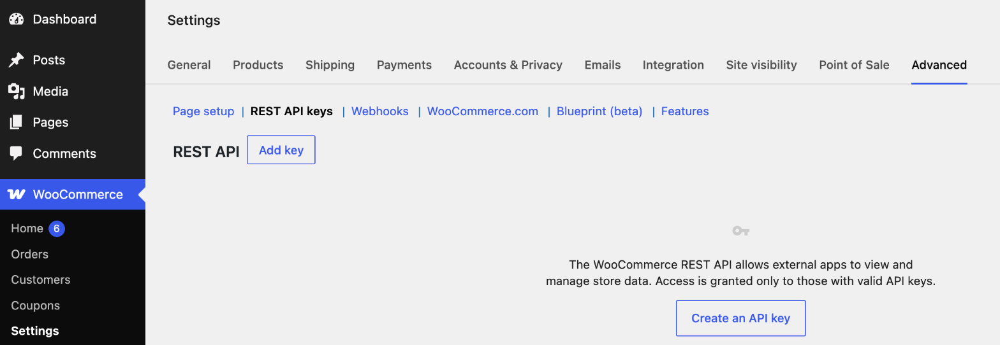
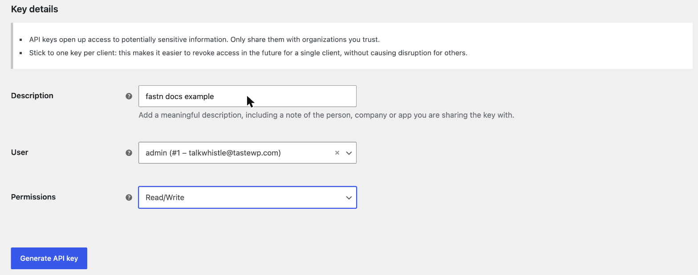
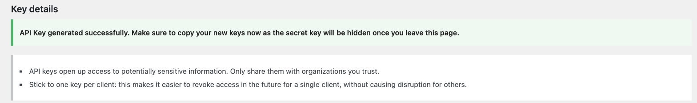

# WooCommerce

WooCommerce is the open-source e-commerce plugin for WordPress. This connector covers the WooCommerce REST API v3 (wp-json/wc/v3) of your own store: products, variations, attributes and terms, categories, tags, shipping classes, reviews, custom fields, orders, order notes, refunds, order actions, coupons, customers, reports, tax rates and classes, webhooks, settings, payment gateways, shipping zones, locations and methods, system status and tools, and store data (continents, countries, currencies).

| | |
| --- | --- |
| **Category** | [E-commerce](README.md) |
| **Website** | [woocommerce.com](https://woocommerce.com) |
| **Authentication** | Basic auth |
| **Slug** | `woocommerce` |

## Setup guide
This guide shows you how to generate WooCommerce REST API keys on your WordPress site and connect your store to fastn with them.

### Before you start
- You need the Owner, Admin or Developer role in fastn.
- You need a WordPress site running WooCommerce, and a WordPress user who can manage WooCommerce settings. Each API key is tied to one WordPress user, and the key stops working if that user is deleted.
- WooCommerce's REST API requires pretty permalinks. In WordPress, check **Settings > Permalinks** and make sure a setting other than the default (Plain) is selected.
- Your store should be served over HTTPS, because the key and secret are sent with every request.

### Get your WooCommerce credentials
fastn asks for three values: **storeUrl**, **username** (the consumer key) and **password** (the consumer secret).

1. Note your store address for **storeUrl**: the HTTPS address of your WordPress site with no trailing slash, for example `https://shop.example.com`.
2. Sign in to your WordPress admin and go to **WooCommerce > Settings > Advanced > REST API keys**.
3. Select **Add key** (or **Create an API key** if the store has no keys yet).

<figure> Settings > Advanced"><figcaption>
The REST API keys page under WooCommerce > Settings > Advanced
</figcaption></figure>

4. Enter a **Description**, such as `fastn`, and choose the **User** the key belongs to.
5. Set **Permissions** to **Read/Write**, so fastn can both read and change store data.
6. Select **Generate API key**.

<figure><figcaption>
Key details with a description, user and Read/Write permissions
</figcaption></figure>

7. Copy the **Consumer key** (it starts with `ck_`). This is the **username** value.
8. Copy the **Consumer secret** (it starts with `cs_`). This is the **password** value. WooCommerce shows it only once, so save it before you leave the page. If you lose it, revoke the key and create a new one.

<figure><figcaption>
WooCommerce confirms the key was generated; copy both values before leaving the page
</figcaption></figure>

### Connect in fastn
Your customers enter the store URL, consumer key and consumer secret when they connect WooCommerce in your widget. You can also enter them yourself under Build → Integrations → Connectors → WooCommerce. In workflow code, call an action as `fastn.connector.woocommerce.<actionSlug>()`.

### Events
fastn supports WooCommerce order, product, customer and coupon events, such as `order.created`, `product.updated` and `customer.deleted`. To start a workflow from one of them, add an App event trigger under Build → Integrations → Triggers → Add trigger → App events; see [App events](../../build/triggers/app-events.md). Contact fastn support to set up events for WooCommerce.

## Actions

<table><thead><tr><th width="240">Action</th><th width="260">Slug</th><th>What it does</th></tr></thead><tbody><tr><td>Add Shipping Zone Method</td><td><code>addShippingZoneMethod</code></td><td>Adds a shipping method (e.g. flat_rate, free_shipping, local_pickup) to a shipping zone.</td></tr><tr><td>Batch Update Coupons</td><td><code>batchUpdateCoupons</code></td><td>Creates, updates and deletes up to 100 coupons in one request.</td></tr><tr><td>Batch Update Customers</td><td><code>batchUpdateCustomers</code></td><td>Creates, updates and deletes up to 100 customers in one request.</td></tr><tr><td>Batch Update Orders</td><td><code>batchUpdateOrders</code></td><td>Creates, updates and deletes up to 100 orders in one request.</td></tr><tr><td>Batch Update Product Attribute Terms</td><td><code>batchUpdateProductAttributeTerms</code></td><td>Creates, updates and deletes up to 100 terms of one global product attribute in a single request.</td></tr><tr><td>Batch Update Product Attributes</td><td><code>batchUpdateProductAttributes</code></td><td>Creates, updates and deletes up to 100 global product attributes in one request.</td></tr><tr><td>Batch Update Product Categories</td><td><code>batchUpdateProductCategories</code></td><td>Creates, updates and deletes up to 100 product categories in one request.</td></tr><tr><td>Batch Update Product Reviews</td><td><code>batchUpdateProductReviews</code></td><td>Creates, updates and deletes up to 100 product reviews in one request.</td></tr><tr><td>Batch Update Product Shipping Classes</td><td><code>batchUpdateProductShippingClasses</code></td><td>Creates, updates and deletes up to 100 product shipping classes in one request.</td></tr><tr><td>Batch Update Product Tags</td><td><code>batchUpdateProductTags</code></td><td>Creates, updates and deletes up to 100 product tags in one request.</td></tr></tbody></table>

View 129 more actions

<table><thead><tr><th width="240">Action</th><th width="260">Slug</th><th>What it does</th></tr></thead><tbody><tr><td>Batch Update Product Variations</td><td><code>batchUpdateProductVariations</code></td><td>Creates, updates and deletes up to 100 variations of one variable product in a single request.</td></tr><tr><td>Batch Update Products</td><td><code>batchUpdateProducts</code></td><td>Creates, updates and deletes up to 100 products in one request.</td></tr><tr><td>Batch Update Setting Options</td><td><code>batchUpdateSettingOptions</code></td><td>Updates several setting options of one settings group in a single request.</td></tr><tr><td>Batch Update Tax Rates</td><td><code>batchUpdateTaxRates</code></td><td>Creates, updates and deletes up to 100 tax rates in one request.</td></tr><tr><td>Batch Update Webhooks</td><td><code>batchUpdateWebhooks</code></td><td>Creates, updates and deletes up to 100 webhooks in one request.</td></tr><tr><td>Create Coupon</td><td><code>createCoupon</code></td><td>Creates a new coupon.</td></tr><tr><td>Create Customer</td><td><code>createCustomer</code></td><td>Creates a new customer with optional billing and shipping addresses.</td></tr><tr><td>Create Order</td><td><code>createOrder</code></td><td>Creates a new order with billing and shipping addresses, line items, shipping, fee and coupon lines. Set set_paid to true to mark it paid (status processing, stock reduced).</td></tr><tr><td>Create Order Note</td><td><code>createOrderNote</code></td><td>Creates a new note on an order. A customer note is shown to the customer and they are notified; otherwise it is for admin reference only.</td></tr><tr><td>Create Order Refund</td><td><code>createOrderRefund</code></td><td>Creates a refund for an order, for a total amount or for specific line items. With api_refund true the payment gateway is asked to refund the money; with api_restock true refunded items go back into stock.</td></tr><tr><td>Create Product</td><td><code>createProduct</code></td><td>Creates a new product (simple, grouped, external or variable) with prices, stock, shipping, categories, tags, images and attributes.</td></tr><tr><td>Create Product Attribute</td><td><code>createProductAttribute</code></td><td>Creates a new global product attribute, such as Color or Size, that products and variations can use.</td></tr><tr><td>Create Product Attribute Term</td><td><code>createProductAttributeTerm</code></td><td>Creates a new term (a value such as Red or XL) for a global product attribute.</td></tr><tr><td>Create Product Category</td><td><code>createProductCategory</code></td><td>Creates a new product category, optionally under a parent category and with an image.</td></tr><tr><td>Create Product Review</td><td><code>createProductReview</code></td><td>Creates a new product review for a product, with reviewer details and an optional 0-5 rating.</td></tr><tr><td>Create Product Shipping Class</td><td><code>createProductShippingClass</code></td><td>Creates a new product shipping class, used to group products for shipping rates.</td></tr><tr><td>Create Product Tag</td><td><code>createProductTag</code></td><td>Creates a new product tag.</td></tr><tr><td>Create Product Variation</td><td><code>createProductVariation</code></td><td>Creates a new variation of a variable product, with its attributes, prices, stock and image.</td></tr><tr><td>Create Shipping Zone</td><td><code>createShippingZone</code></td><td>Creates a new shipping zone. Add locations and methods to it with the zone location and zone method actions.</td></tr><tr><td>Create Tax Class</td><td><code>createTaxClass</code></td><td>Creates a new tax class. WooCommerce makes the slug from the name.</td></tr><tr><td>Create Tax Rate</td><td><code>createTaxRate</code></td><td>Creates a new tax rate for a country, state, postcodes or cities, in a tax class.</td></tr><tr><td>Create Webhook</td><td><code>createWebhook</code></td><td>Creates a new webhook that sends a topic (such as order.created) to a delivery URL.</td></tr><tr><td>Delete Coupon</td><td><code>deleteCoupon</code></td><td>Deletes a coupon. Set force to true to delete it permanently; otherwise it is moved to the trash.</td></tr><tr><td>Delete Customer</td><td><code>deleteCustomer</code></td><td>Permanently deletes a customer. Customers cannot be trashed, so force must be true; reassign moves the customer's posts to another user ID.</td></tr><tr><td>Delete Order</td><td><code>deleteOrder</code></td><td>Deletes an order. Set force to true to delete it permanently; otherwise it is moved to the trash.</td></tr><tr><td>Delete Order Note</td><td><code>deleteOrderNote</code></td><td>Permanently deletes a note from an order. Notes cannot be trashed, so force must be true.</td></tr><tr><td>Delete Order Refund</td><td><code>deleteOrderRefund</code></td><td>Permanently deletes a refund from an order. Refunds cannot be trashed, so force must be true.</td></tr><tr><td>Delete Product</td><td><code>deleteProduct</code></td><td>Deletes a product. Set force to true to delete it permanently; otherwise it is moved to the trash.</td></tr><tr><td>Delete Product Attribute</td><td><code>deleteProductAttribute</code></td><td>Permanently deletes a global product attribute. Attributes cannot be trashed, so force must be true.</td></tr><tr><td>Delete Product Attribute Term</td><td><code>deleteProductAttributeTerm</code></td><td>Permanently deletes a term of a global product attribute. Terms cannot be trashed, so force must be true.</td></tr><tr><td>Delete Product Category</td><td><code>deleteProductCategory</code></td><td>Permanently deletes a product category. Categories cannot be trashed, so force must be true.</td></tr><tr><td>Delete Product Review</td><td><code>deleteProductReview</code></td><td>Deletes a product review. By default it goes to the trash; set force to true to delete it permanently.</td></tr><tr><td>Delete Product Shipping Class</td><td><code>deleteProductShippingClass</code></td><td>Permanently deletes a product shipping class. Shipping classes cannot be trashed, so force must be true.</td></tr><tr><td>Delete Product Tag</td><td><code>deleteProductTag</code></td><td>Permanently deletes a product tag. Tags cannot be trashed, so force must be true.</td></tr><tr><td>Delete Product Variation</td><td><code>deleteProductVariation</code></td><td>Deletes a variation of a variable product. Set force to true to delete it permanently; otherwise it is moved to the trash.</td></tr><tr><td>Delete Shipping Zone</td><td><code>deleteShippingZone</code></td><td>Permanently deletes a shipping zone. Shipping zones cannot be trashed, so force must be true.</td></tr><tr><td>Delete Shipping Zone Method</td><td><code>deleteShippingZoneMethod</code></td><td>Removes a shipping method from a shipping zone. Methods cannot be trashed, so force must be true.</td></tr><tr><td>Delete Tax Class</td><td><code>deleteTaxClass</code></td><td>Permanently deletes a tax class by its slug. Tax classes cannot be trashed, so force must be true.</td></tr><tr><td>Delete Tax Rate</td><td><code>deleteTaxRate</code></td><td>Permanently deletes a tax rate. Tax rates cannot be trashed, so force must be true.</td></tr><tr><td>Delete Webhook</td><td><code>deleteWebhook</code></td><td>Permanently deletes a webhook. Webhooks cannot be trashed, so force must be true.</td></tr><tr><td>Duplicate Product</td><td><code>duplicateProduct</code></td><td>Duplicates an existing product and returns the new copy.</td></tr><tr><td>Get Continent</td><td><code>getContinent</code></td><td>Retrieves one continent by its 2 character code (e.g. EU, NA) with its countries and states.</td></tr><tr><td>Get Country</td><td><code>getCountry</code></td><td>Retrieves one country by its ISO3166 alpha-2 code (e.g. US) with its states.</td></tr><tr><td>Get Coupon</td><td><code>getCoupon</code></td><td>Retrieves a specific coupon by ID.</td></tr><tr><td>Get Coupons Totals</td><td><code>getCouponsTotals</code></td><td>Retrieves the number of coupons per coupon type.</td></tr><tr><td>Get Currency</td><td><code>getCurrency</code></td><td>Retrieves one currency by its ISO4217 code (e.g. USD) with name and symbol.</td></tr><tr><td>Get Current Currency</td><td><code>getCurrentCurrency</code></td><td>Retrieves the store's current currency: its ISO 4217 code, full name and symbol.</td></tr><tr><td>Get Customer</td><td><code>getCustomer</code></td><td>Retrieves a specific customer by ID, including billing and shipping addresses.</td></tr><tr><td>Get Customers Totals</td><td><code>getCustomersTotals</code></td><td>Retrieves the number of customers per customer type (paying and non-paying).</td></tr><tr><td>Get Order</td><td><code>getOrder</code></td><td>Retrieves a specific order by ID, with its addresses, line items, tax, shipping, fee and coupon lines, and refunds.</td></tr><tr><td>Get Order Note</td><td><code>getOrderNote</code></td><td>Retrieves a specific note from an order.</td></tr><tr><td>Get Order Refund</td><td><code>getOrderRefund</code></td><td>Retrieves a specific refund from an order.</td></tr><tr><td>Get Orders Totals</td><td><code>getOrdersTotals</code></td><td>Retrieves the number of orders per order status.</td></tr><tr><td>Get Payment Gateway</td><td><code>getPaymentGateway</code></td><td>Retrieves one payment gateway and its settings, e.g. bacs, cheque or cod.</td></tr><tr><td>Get Product</td><td><code>getProduct</code></td><td>Retrieves a specific product by ID, with prices, stock, shipping, categories, tags, images, attributes and variation IDs.</td></tr><tr><td>Get Product Attribute</td><td><code>getProductAttribute</code></td><td>Retrieves a specific global product attribute by ID.</td></tr><tr><td>Get Product Attribute Term</td><td><code>getProductAttributeTerm</code></td><td>Retrieves a specific term of a global product attribute by ID.</td></tr><tr><td>Get Product Category</td><td><code>getProductCategory</code></td><td>Retrieves a specific product category by ID.</td></tr><tr><td>Get Product Review</td><td><code>getProductReview</code></td><td>Retrieves a specific product review by ID.</td></tr><tr><td>Get Product Shipping Class</td><td><code>getProductShippingClass</code></td><td>Retrieves a specific product shipping class by ID.</td></tr><tr><td>Get Product Tag</td><td><code>getProductTag</code></td><td>Retrieves a specific product tag by ID.</td></tr><tr><td>Get Product Variation</td><td><code>getProductVariation</code></td><td>Retrieves a specific variation of a variable product by ID.</td></tr><tr><td>Get Products Totals</td><td><code>getProductsTotals</code></td><td>Retrieves the number of products per product type.</td></tr><tr><td>Get Reviews Totals</td><td><code>getReviewsTotals</code></td><td>Retrieves the number of product reviews per rating.</td></tr><tr><td>Get Sales Report</td><td><code>getSalesReport</code></td><td>Retrieves the sales report for a period (week, month, last_month, year) or a date range.</td></tr><tr><td>Get Setting Option</td><td><code>getSettingOption</code></td><td>Retrieves one setting option from a settings group, e.g. group general, id woocommerce_currency.</td></tr><tr><td>Get Shipping Method</td><td><code>getShippingMethod</code></td><td>Retrieves one shipping method type available in the store, e.g. flat_rate.</td></tr><tr><td>Get Shipping Zone</td><td><code>getShippingZone</code></td><td>Retrieves a specific shipping zone by ID. Zone 0 is the built-in "Locations not covered by your other zones" zone.</td></tr><tr><td>Get Shipping Zone Method</td><td><code>getShippingZoneMethod</code></td><td>Retrieves one shipping method of a shipping zone by its instance ID.</td></tr><tr><td>Get System Status</td><td><code>getSystemStatus</code></td><td>Retrieves the store's system status report: environment, database, plugins, theme, settings, security, pages and logging.</td></tr><tr><td>Get System Status Tool</td><td><code>getSystemStatusTool</code></td><td>Retrieves one system status tool by ID, e.g. clear_transients.</td></tr><tr><td>Get Tax Rate</td><td><code>getTaxRate</code></td><td>Retrieves a specific tax rate by ID.</td></tr><tr><td>Get Top Sellers Report</td><td><code>getTopSellersReport</code></td><td>Retrieves the top selling products for a period or a date range.</td></tr><tr><td>Get Webhook</td><td><code>getWebhook</code></td><td>Retrieves a specific webhook by ID.</td></tr><tr><td>List Continents</td><td><code>listContinents</code></td><td>Lists all continents with their countries, states and local formats (currency, units, separators).</td></tr><tr><td>List Countries</td><td><code>listCountries</code></td><td>Lists all countries with their states.</td></tr><tr><td>List Coupons</td><td><code>listCoupons</code></td><td>Lists all the coupons that have been created, with paging, search, date, ID and code filters.</td></tr><tr><td>List Currencies</td><td><code>listCurrencies</code></td><td>Lists all currencies WooCommerce supports, with name and symbol.</td></tr><tr><td>List Customer Downloads</td><td><code>listCustomerDownloads</code></td><td>Retrieves a customer's download permissions: the downloadable files they bought, with remaining downloads and expiry.</td></tr><tr><td>List Customers</td><td><code>listCustomers</code></td><td>Lists the store's customers, with paging, search, email and role filters.</td></tr><tr><td>List Data Endpoints</td><td><code>listDataEndpoints</code></td><td>Lists the available store data endpoints (continents, countries, currencies).</td></tr><tr><td>List Order Email Templates</td><td><code>listOrderEmailTemplates</code></td><td>Retrieves the email templates that are available for the given order, to use with Send Order Email To Customer.</td></tr><tr><td>List Order Notes</td><td><code>listOrderNotes</code></td><td>Lists all the notes on an order, optionally only customer or internal notes.</td></tr><tr><td>List Order Refunds</td><td><code>listOrderRefunds</code></td><td>Lists all the refunds of an order, with paging, search and date filters.</td></tr><tr><td>List Orders</td><td><code>listOrders</code></td><td>Lists the store's orders, with paging, search, date, status, customer, product and source filters.</td></tr><tr><td>List Payment Gateways</td><td><code>listPaymentGateways</code></td><td>Lists all payment gateways installed in the store, with their settings.</td></tr><tr><td>List Product Attribute Terms</td><td><code>listProductAttributeTerms</code></td><td>Lists all terms of a global product attribute, with paging, search and sorting.</td></tr><tr><td>List Product Attributes</td><td><code>listProductAttributes</code></td><td>Lists all global product attributes.</td></tr><tr><td>List Product Categories</td><td><code>listProductCategories</code></td><td>Lists all product categories, with paging, search, parent, product and slug filters.</td></tr><tr><td>List Product Custom Field Names</td><td><code>listProductCustomFieldNames</code></td><td>Retrieves the names of custom fields (product meta keys) used on products, with paging and search.</td></tr><tr><td>List Product Reviews</td><td><code>listProductReviews</code></td><td>Lists product reviews, with filters for product, reviewer, status, dates, paging and sorting.</td></tr><tr><td>List Product Shipping Classes</td><td><code>listProductShippingClasses</code></td><td>Lists all product shipping classes, with paging, search and sorting.</td></tr><tr><td>List Product Tags</td><td><code>listProductTags</code></td><td>Lists all product tags, with paging, search, product and slug filters.</td></tr><tr><td>List Product Variations</td><td><code>listProductVariations</code></td><td>Lists the variations of a variable product, with paging, search, SKU, status, price and stock filters.</td></tr><tr><td>List Products</td><td><code>listProducts</code></td><td>Lists the store's products, with paging, search, SKU, status, type, category, tag, attribute, price, stock and other filters.</td></tr><tr><td>List Refunds</td><td><code>listRefunds</code></td><td>Lists refunds from the whole store, regardless of which order they belong to, with date, parent and paging filters.</td></tr><tr><td>List Reports</td><td><code>listReports</code></td><td>Retrieves the list of available reports (slug and description of each).</td></tr><tr><td>List Setting Options</td><td><code>listSettingOptions</code></td><td>Lists all setting options in a settings group, e.g. general.</td></tr><tr><td>List Settings Groups</td><td><code>listSettingsGroups</code></td><td>Lists all settings groups (general, products, tax, shipping, checkout, account, email, advanced and more).</td></tr><tr><td>List Shipping Methods</td><td><code>listShippingMethods</code></td><td>Lists all shipping method types available in the store.</td></tr><tr><td>List Shipping Zone Locations</td><td><code>listShippingZoneLocations</code></td><td>Lists all locations (countries, states, postcodes, continents) of a shipping zone.</td></tr><tr><td>List Shipping Zone Methods</td><td><code>listShippingZoneMethods</code></td><td>Lists all shipping methods of a shipping zone.</td></tr><tr><td>List Shipping Zones</td><td><code>listShippingZones</code></td><td>Lists all shipping zones in the store.</td></tr><tr><td>List System Status Tools</td><td><code>listSystemStatusTools</code></td><td>Lists all system status tools (maintenance tasks such as clearing transients).</td></tr><tr><td>List Tax Classes</td><td><code>listTaxClasses</code></td><td>Lists all tax classes in the store.</td></tr><tr><td>List Tax Rates</td><td><code>listTaxRates</code></td><td>Lists all tax rates, with paging, sorting and a tax class filter.</td></tr><tr><td>List Webhooks</td><td><code>listWebhooks</code></td><td>Lists all webhooks, with status, date, search and paging filters.</td></tr><tr><td>Preview Order Refund</td><td><code>previewOrderRefund</code></td><td>Previews a refund for an order without creating it: returns the product, shipping and fee breakdown and the maximum refundable amount (WooCommerce 11.1.0 or later).</td></tr><tr><td>Run System Status Tool</td><td><code>runSystemStatusTool</code></td><td>Runs a system status tool by ID and returns whether it succeeded and its message.</td></tr><tr><td>Send Order Details To Customer</td><td><code>sendOrderDetailsToCustomer</code></td><td>Triggers an email to the customer with the details of their order. If the order has no billing email you can give one; if it already has one, the call fails unless force_email_update is true.</td></tr><tr><td>Send Order Email To Customer</td><td><code>sendOrderEmailToCustomer</code></td><td>Triggers an email to a customer about the status of their order, using a chosen email template that fits the order (for example customer_on_hold_order). If no template is given, the best one is picked from the order status.</td></tr><tr><td>Update Coupon</td><td><code>updateCoupon</code></td><td>Makes changes to a coupon. Only the fields you send are changed.</td></tr><tr><td>Update Customer</td><td><code>updateCustomer</code></td><td>Makes changes to a customer. Only the fields you send are changed.</td></tr><tr><td>Update Order</td><td><code>updateOrder</code></td><td>Makes changes to an order, such as its status, addresses or lines. Only the fields you send are changed; to change an existing line item, send its id with the new values.</td></tr><tr><td>Update Payment Gateway</td><td><code>updatePaymentGateway</code></td><td>Makes changes to a payment gateway: enable or disable it, change title, description, order or its settings.</td></tr><tr><td>Update Product</td><td><code>updateProduct</code></td><td>Makes changes to a product. Only the fields you send are changed.</td></tr><tr><td>Update Product Attribute</td><td><code>updateProductAttribute</code></td><td>Makes changes to a global product attribute. Only the fields you send are changed.</td></tr><tr><td>Update Product Attribute Term</td><td><code>updateProductAttributeTerm</code></td><td>Makes changes to a term of a global product attribute. Only the fields you send are changed.</td></tr><tr><td>Update Product Category</td><td><code>updateProductCategory</code></td><td>Makes changes to a product category. Only the fields you send are changed.</td></tr><tr><td>Update Product Review</td><td><code>updateProductReview</code></td><td>Makes changes to a product review, such as its status, text or rating. Only the fields you send are changed.</td></tr><tr><td>Update Product Shipping Class</td><td><code>updateProductShippingClass</code></td><td>Makes changes to a product shipping class. Only the fields you send are changed.</td></tr><tr><td>Update Product Tag</td><td><code>updateProductTag</code></td><td>Makes changes to a product tag. Only the fields you send are changed.</td></tr><tr><td>Update Product Variation</td><td><code>updateProductVariation</code></td><td>Makes changes to a variation of a variable product. Only the fields you send are changed.</td></tr><tr><td>Update Setting Option</td><td><code>updateSettingOption</code></td><td>Changes the value of one setting option in a settings group.</td></tr><tr><td>Update Shipping Zone</td><td><code>updateShippingZone</code></td><td>Makes changes to a shipping zone's name or order.</td></tr><tr><td>Update Shipping Zone Locations</td><td><code>updateShippingZoneLocations</code></td><td>Replaces all locations of a shipping zone with the list you send. Send an empty list [] to remove all locations.</td></tr><tr><td>Update Shipping Zone Method</td><td><code>updateShippingZoneMethod</code></td><td>Makes changes to a shipping method of a shipping zone: order, enabled, or settings such as title and cost.</td></tr><tr><td>Update Tax Rate</td><td><code>updateTaxRate</code></td><td>Makes changes to a tax rate. Only the fields you send are changed.</td></tr><tr><td>Update Webhook</td><td><code>updateWebhook</code></td><td>Makes changes to a webhook, such as pausing it or changing its topic. Only the fields you send are changed.</td></tr></tbody></table>

## Events

Start a workflow when one of these happens, with an [app event trigger](../../build/triggers/README.md).

<table><thead><tr><th width="240">Event</th><th width="260">Id</th><th>When it fires</th></tr></thead><tbody><tr><td>Coupon Created</td><td><code>coupon.created</code></td><td>Sent when a coupon is created. The body is the full coupon object, as returned by Get Coupon. Captured from a live WooCommerce 11.3 delivery. Headers carry X-WC-Webhook-Topic (coupon.created) and X-WC-Webhook-Signature.</td></tr><tr><td>Coupon Deleted</td><td><code>coupon.deleted</code></td><td>Sent when a coupon is deleted (trashed or deleted permanently). The body holds only the coupon ID. Captured from a live WooCommerce 11.3 delivery.</td></tr><tr><td>Coupon Restored</td><td><code>coupon.restored</code></td><td>Sent when a coupon is restored from the trash. Per the WooCommerce docs the body is the full coupon object (same fields as coupon.updated). Not captured live in testing.</td></tr><tr><td>Coupon Updated</td><td><code>coupon.updated</code></td><td>Sent when a coupon is updated. The body is the full coupon object, as returned by Get Coupon. Captured from a live WooCommerce 11.3 delivery.</td></tr><tr><td>Customer Created</td><td><code>customer.created</code></td><td>Sent when a customer is created. The body is the full customer object, as returned by Get Customer. Captured from a live WooCommerce 11.3 delivery. Headers carry X-WC-Webhook-Topic (customer.created) and X-WC-Webhook-Signature.</td></tr><tr><td>Customer Deleted</td><td><code>customer.deleted</code></td><td>Sent when a customer is deleted. The body holds only the customer ID. Captured from a live WooCommerce 11.3 delivery.</td></tr><tr><td>Customer Updated</td><td><code>customer.updated</code></td><td>Sent when a customer is updated. The body is the full customer object, as returned by Get Customer. Captured from a live WooCommerce 11.3 delivery.</td></tr><tr><td>Order Created</td><td><code>order.created</code></td><td>Sent when an order is created. The body is the full order object, as returned by Get Order. Captured from a live WooCommerce 11.3 delivery. Headers carry X-WC-Webhook-Topic (order.created) and X-WC-Webhook-Signature (base64 HMAC-SHA256 of the body with the webhook secret).</td></tr><tr><td>Order Deleted</td><td><code>order.deleted</code></td><td>Sent when an order is deleted (trashed or deleted permanently). The body holds only the order ID. Captured from a live WooCommerce 11.3 delivery.</td></tr><tr><td>Order Restored</td><td><code>order.restored</code></td><td>Sent when an order is restored from the trash. Per the WooCommerce docs the body is the full order object (same fields as order.updated). Not captured live in testing.</td></tr></tbody></table>

View 5 more events

<table><thead><tr><th width="240">Event</th><th width="260">Id</th><th>When it fires</th></tr></thead><tbody><tr><td>Order Updated</td><td><code>order.updated</code></td><td>Sent when an order is updated (including status changes and refunds). The body is the full order object, as returned by Get Order. Captured from a live WooCommerce 11.3 delivery. Headers carry X-WC-Webhook-Topic (order.updated) and X-WC-Webhook-Signature.</td></tr><tr><td>Product Created</td><td><code>product.created</code></td><td>Sent when a product is created. The body is the full product object, as returned by Get Product. Captured from a live WooCommerce 11.3 delivery. Headers carry X-WC-Webhook-Topic (product.created) and X-WC-Webhook-Signature (base64 HMAC-SHA256 of the body with the webhook secret).</td></tr><tr><td>Product Deleted</td><td><code>product.deleted</code></td><td>Sent when a product is deleted (trashed or deleted permanently). The body holds only the product ID. Captured from a live WooCommerce 11.3 delivery.</td></tr><tr><td>Product Restored</td><td><code>product.restored</code></td><td>Sent when a product is restored from the trash. Per the WooCommerce docs the body is the full product object (same fields as product.updated). Not captured live in testing.</td></tr><tr><td>Product Updated</td><td><code>product.updated</code></td><td>Sent when a product is updated. The body is the full product object, as returned by Get Product. Captured from a live WooCommerce 11.3 delivery. Headers carry X-WC-Webhook-Topic (product.updated) and X-WC-Webhook-Signature.</td></tr></tbody></table>

