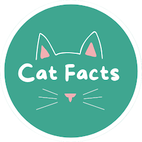
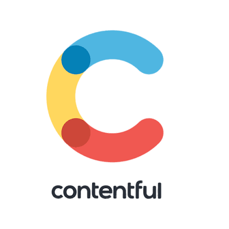
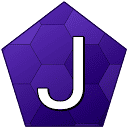
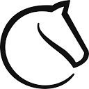
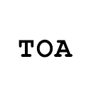
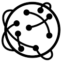

# Entertainment and media

Entertainment and media apps you can connect to with fastn, the most used first. Open a connector to see how it authenticates and every action and event it offers. Back to the [connector catalog](../README.md).

| | Connector | Authentication | About |
| --- | --- | --- | --- |
|  | [Advice Slip API](adviceslip.md) | No authentication | Advice Slip API is a free, public, keyless service that returns short pieces of fortune-cookie style advice. |
|  | [Art Institute of Chicago](art-institute-of-chicago.md) | No authentication | The Art Institute of Chicago public API: free, keyless access to the museum's collection (artworks, artists, places, galleries, exhibitions, images, audio,… |
|  | [Beach Day API](beach-day-api.md) | Bearer token | Beach Day API provides beach data for more than 36,000 beaches in over 100 countries: beach profiles with location and access details, water quality grades,… |
|  | [Bored API](bored-api.md) | No authentication | The Bored API (hosted by The App Brewery) suggests things to do when you are bored: get a random activity, filter activities by type and number of… |
|  | [Cat Facts API](catfactninja.md) | No authentication | A free, public, fully keyless API (catfact.ninja) that returns random cat facts and a list of cat breeds with their attributes. |
|  | [Chess.com Published-Data API](chess-com-pub-api.md) | No authentication | The Chess.com Published-Data API (PubAPI) is a free read-only API with public Chess.com data: player profiles, stats, current and archived games (JSON and… |
|  | [Chuck Norris Jokes](chuck-norris-jokes.md) | No authentication | chucknorris.io is a free JSON API of hand-curated Chuck Norris facts. |
|  | [Cleveland Museum of Art Open Access](cleveland-museum-of-art.md) | No authentication | The Cleveland Museum of Art Open Access API offers CC0 data on over 64,000 artworks and images for over 37,000 of them. |
|  | [College Football Data](college-football-data.md) | Bearer token | CollegeFootballData.com (CFBD) provides historical and advanced college football data. |
|  | [Contentful](contentful.md) | Credentials you enter | Manage and deliver structured content with Contentful. |
|  | [Deck of Cards](deck-of-cards.md) | No authentication | Deck of Cards is a free API that simulates decks of playing cards: create and shuffle decks (single or multiple, partial, with Jokers), draw cards, manage… |
|  | [Dog CEO](dog-ceo.md) | No authentication | Dog CEO's Dog API is a free, open API with 20,000+ dog images from the Stanford Dogs Dataset. |
|  | [icanhazdadjoke](icanhazdadjoke.md) | No authentication | icanhazdadjoke is the largest free collection of dad jokes online. |
|  | [JokeAPI](jokeapi.md) | No authentication | JokeAPI (v2) serves consistently formatted jokes in several languages. |
|  | [Jolpica F1](jolpica-f1.md) | No authentication | Jolpica F1 is the free, open-source successor to the Ergast Formula 1 API, with data from 1950 to today. |
|  | [Kanye Rest](kanye-rest.md) | No authentication | kanye.rest is a free REST API of Kanye West quotes. |
|  | [Lichess](lichess.md) | No authentication | Lichess is a free, open-source chess server. |
|  | [Lorem Picsum](lorem-picsum.md) | No authentication | Lorem Picsum is a free placeholder photo service built on Unsplash images. |
|  | [Lumify](lumify.md) | Credentials you enter | Lumify is an agent-ready sports intelligence API covering MLB, NBA, NFL, NHL, NCAAF, NCAAB, tennis and soccer. |
|  | [Mediastack](mediastack.md) | Credentials you enter | Mediastack by APILayer delivers real-time and historical worldwide news data in JSON format, aggregated from over 7,500 sources across 50 countries. |
|  | [Metropolitan Museum of Art](metropolitan-museum-of-art.md) | No authentication | The Metropolitan Museum of Art Collection API: free, keyless access to 470,000+ open-access artwork records - search the collection, list object ids by… |
|  | [MusicBrainz](musicbrainz.md) | No authentication | MusicBrainz is the open music encyclopedia. |
|  | [NASA Open APIs](nasa.md) | Credentials you enter | NASA Open APIs (api.nasa.gov) give programmatic access to NASA data: the Astronomy Picture of the Day, near-Earth asteroids (NeoWs), DONKI space-weather… |
|  | [NewsAPI](newsapi.md) | Credentials you enter | NewsAPI indexes articles and breaking headlines from over 150,000 news sources and blogs worldwide. |
|  | [Open Trivia DB](open-trivia-db.md) | No authentication | Open Trivia DB is a free, keyless, user-contributed trivia question database: get multiple-choice or true/false questions by category, difficulty and… |
|  | [OpenF1](open-f1.md) | No authentication | OpenF1 is an open-source Formula 1 data API with telemetry, timing and session data from 2023 onward. |
|  | [PokeAPI](pokeapi.md) | No authentication | PokeAPI (pokeapi.co) is a free, fully keyless RESTful API providing comprehensive Pokemon data - species, moves, abilities, types, items, berries, locations,… |
|  | [Rick and Morty API](rick-and-morty-api.md) | No authentication | The Rick and Morty API is a free REST and GraphQL API with every character, location and episode of the Rick and Morty TV show: list with filters and… |
|  | [Sanity](sanity.md) | Credentials you enter | Sanity is a headless content operating system. |
|  | [SWAPI (Star Wars API)](swapi.md) | No authentication | SWAPI, the Star Wars API, is a free read-only API with Star Wars people, films, starships, vehicles, species and planets: list with search and pagination or… |
|  | [The Cat API](thecatapi.md) | API key | The Cat API ("Cat as a Service") gives access to thousands of cat images, cat breed data, and, for authenticated users, the ability to upload images, tag… |
|  | [The Dog API](thedogapi.md) | Credentials you enter | Dog images, breed data, breed facts, health tips, legislation/breed-ban lookups, favourites, votes, and AI-powered pet analysis (portraits, genealogy, body… |
|  | [The Odds API](theoddsapi.md) | Credentials you enter | The Odds API v4 - live and upcoming sports betting odds, scores and fixtures aggregated from bookmakers across the US, UK, Australian and European regions. |
|  | [TheCocktailDB](thecocktaildb.md) | Credentials you enter | TheCocktailDB is an open, crowd-sourced database of drinks and cocktails. |
|  | [TheMealDB](themealdb.md) | Credentials you enter | TheMealDB is an open, crowd-sourced database of recipes from around the world. |
|  | [TheSportsDB](the-sports-db.md) | Credentials you enter | TheSportsDB is an open, crowd-sourced sports database with artwork. |
|  | [TVmaze](tvmaze.md) | No authentication | TVmaze public API: free, keyless TV metadata - search shows and people, TV schedules by country and date (including web/streaming), show details, episodes,… |
|  | [V&A Collections](va-collections.md) | No authentication | The V&A Collections API (v2) is the free public API of the Victoria and Albert Museum, London. |
|  | [Vimeo](vimeo.md) | OAuth 2.0 | Vimeo video platform API. |
|  | [WaniKani](wanikani.md) | API key | WaniKani API v2 — Japanese kanji learning SRS. |
|  | [World News API](world-news-api.md) | Credentials you enter | World News API provides unified access to global news from thousands of sources in 86+ languages and 210+ countries, with full text, summaries, sentiment and… |
|  | [ZenQuotes](zen-quotes.md) | No authentication | Free, keyless public quotes API by ZenQuotes.io. |
