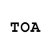

# The Odds API

The Odds API v4 - live and upcoming sports betting odds, scores and fixtures aggregated from bookmakers across the US, UK, Australian and European regions. Provides the sport catalogue, featured and additional betting markets per event, final and in-play scores, event listings, event participants, and (on paid plans) point-in-time historical odds and events snapshots.

| | |
| --- | --- |
| **Category** | [Entertainment and media](README.md) |
| **Website** | [the-odds-api.com](https://the-odds-api.com) |
| **Authentication** | Credentials you enter |
| **Slug** | `theoddsapi` |

## Use it

Add The Odds API from **Build → Integrations → Connectors** and connect an account, as in [Connect a system](../../build/connectors/connect-a-system.md). In workflow code, call an action as `fastn.connector.theoddsapi.<action>()`, with the action's slug from the table below. See [Workflow runtime API](../../reference/workflow-runtime.md).

## Actions

| Action | Slug | What it does |
| --- | --- | --- |
| Get Event Markets | `getEventMarkets` | Returns the list of market keys currently offered by each bookmaker for a single event, without prices, so that a follow-up odds request can be scoped to the markets that actually exist. Costs one credit. |
| Get Event Odds | `getEventOdds` | Returns odds for a single event, including the additional markets such as player props, alternate lines and period markets that are not available from the main odds endpoint. Costs one credit per unique market returned per region requested. |
| Get Historical Event Odds | `getHistoricalEventOdds` | Returns a point-in-time snapshot of the odds for a single event, including additional and player markets, as they stood at a given timestamp. Requires a paid plan; Starter and free keys receive HTTP 401. Costs ten credits per market per region requested. |
| Get Historical Odds | `getHistoricalOdds` | Returns a point-in-time snapshot of games and bookmaker odds for a sport as they stood at a given timestamp. Requires a paid plan; Starter and free keys receive HTTP 401. Costs ten credits per market per region requested. |
| Get Odds | `getOdds` | Returns upcoming and live games for a sport together with bookmaker odds for the requested featured markets and regions. Costs one credit per market per region requested. |
| Get Scores | `getScores` | Returns live and recently completed scores for a sport, and optionally final scores for games completed in the last one to three days. Costs one credit, or two credits when Days From is supplied. |
| List Events | `listEvents` | Returns the upcoming and live games for a sport without any odds attached, which is useful for discovering event IDs. This request does not consume any API credits. |
| List Historical Events | `listHistoricalEvents` | Returns a point-in-time snapshot of the games scheduled for a sport as they stood at a given timestamp, without odds. Requires a paid plan; Starter and free keys receive HTTP 401. Costs one credit when events are returned. |
| List Participants | `listParticipants` | Returns the teams or individual participants that compete in a given sport or competition. Costs one credit. |
| List Sports | `listSports` | Returns the catalogue of sports and competitions covered by The Odds API, including whether each is currently in season. This request does not consume any API credits. |
