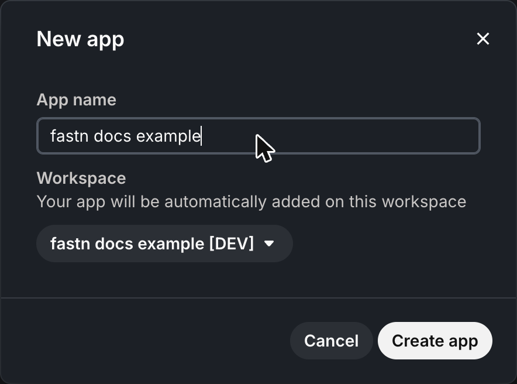
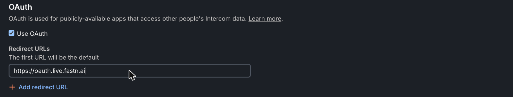
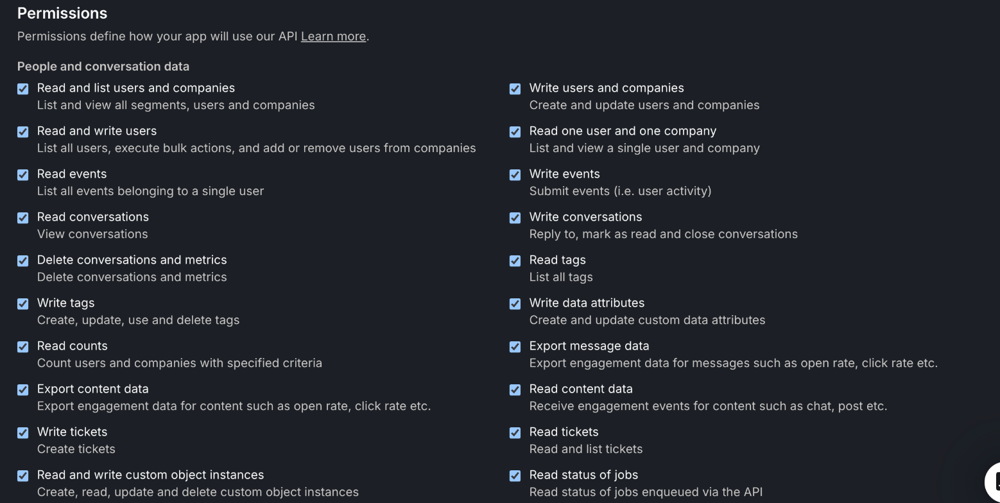
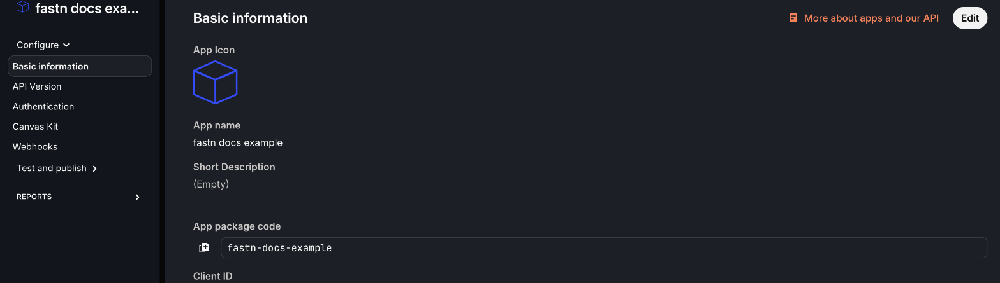

# Intercom

Manage contacts, companies, conversations, messages, admins, tags, segments, notes, data events, articles, tickets, and data attributes via the Intercom REST API (api.intercom.io, Intercom-Version 2.15).

| | |
| --- | --- |
| **Category** | [IT and service management](README.md) |
| **Website** | [intercom.com](https://intercom.com) |
| **Authentication** | Bearer token, OAuth 2.0 |
| **Slug** | `intercom` |

## Setup guide

This guide shows how to create your own Intercom app so your customers sign in to Intercom through it, and how to add that app to fastn.

### Before you start

- You need the Owner, Admin or Developer role in fastn.
- You need access to the Intercom Developer Hub. If you do not have a workspace to build in, Intercom lets you create a free development workspace when you create the app. Development workspaces are for testing only and are US-region only.
- OAuth is for apps that connect to other people's Intercom workspaces. If you only need to connect your own workspace, you can use an access token instead (see the end of this guide).

### Create your Intercom app

1. Sign in to the Intercom Developer Hub and open **Your Apps**.
2. Click **New app**, enter an **App name**, pick the **Workspace** to install it in (or create a development workspace from the same list), and click **Create app**.

<figure><figcaption>
The New app dialog with the app name and workspace
</figcaption></figure>

3. In your app, go to **Configure → Authentication**, click **Edit** and select **Use OAuth**.
4. Under **Redirect URLs**, click **Add redirect URL** and enter `https://oauth.live.fastn.ai` exactly, with no trailing slash.

<figure><figcaption>
Use OAuth selected, with fastn's redirect URL
</figcaption></figure>

5. Under **Permissions** on the same page, select the data your workflows need. Intercom groups them as **People and conversation data** and **Workspace data**, and most are selected by default. fastn does not request extra scopes in the sign-in link, so the permissions you select here are what customers grant. Select only what you need, because Intercom reviews them if you publish the app. Click **Save**.

<figure><figcaption>
The Permissions list on the Authentication page
</figcaption></figure>

6. Open the app's **Basic information** page and copy the **Client ID** and **Client secret**. Until Intercom has reviewed the app, it shows a notice that you must submit the app for review to access other people's Intercom data with OAuth.

<figure><figcaption>
The Basic information page, where the Client ID and Client secret are listed
</figcaption></figure>

### Add your app to fastn

1. In fastn, go to Build → Integrations → Connectors and open Intercom.
2. Open the **Auth** tab and click **Manage providers**.

<figure><figcaption>
Open the connector's Auth tab, then Manage providers.
</figcaption></figure>

3. Click **+ Create Provider**.
4. In the New Auth Provider form, enter a **Name** and an optional **Description**, then paste the **Client ID** and **Client Secret** from Intercom. Leave **Scopes** empty unless you have a reason to set them; Intercom uses the permissions selected on your app.

<figure><figcaption>
The New Auth Provider form: paste your app's Client ID and Client Secret.
</figcaption></figure>

5. Save the provider, then choose **Use this app** so it becomes the Preferred app.
6. In your widget, set Intercom's **Auth provider** setting to your app instead of **Use platform default**.

Customers who skip this setup sign in through fastn's shared Intercom app.

#### Using an access token instead

To connect a single workspace without OAuth, open your app in the Developer Hub, go to **Configure → Authentication**, and copy the access token shown there. Enter it as the **accessToken** when you connect Intercom in your widget, or under Build → Integrations → Connectors → Intercom. The token acts with the access of the teammate who installed the app, so keep it private.

### Events

fastn can start a workflow when something happens in Intercom, such as a new conversation, an admin reply, a contact being created or updated, a company change, an article being published or a ticket being created. Add an App event trigger under Build → Integrations → Triggers → Add trigger → App events, pick Intercom and the event, and choose the workflow to run. See [App event triggers](../../build/triggers/app-events.md).

Intercom sends events to the endpoint set on an app's **Configure → Webhooks** page, and each topic needs the matching permission on the app's **Authentication** page. Contact fastn support to set up events for Intercom when customers connect through your own app.

## Actions

<table><thead><tr><th width="240">Action</th><th width="260">Slug</th><th>What it does</th></tr></thead><tbody><tr><td>Archive Contact</td><td><code>archiveContact</code></td><td>Archive a contact by id.</td></tr><tr><td>Assign Conversation</td><td><code>assignConversation</code></td><td>Assign a conversation to an admin and/or team via the parts endpoint.</td></tr><tr><td>Attach Contact to Company</td><td><code>attachContactToCompany</code></td><td>Attach a contact to a company.</td></tr><tr><td>Attach Contact to Conversation</td><td><code>attachContactToConversation</code></td><td>Add a contact participant to a conversation.</td></tr><tr><td>Close Conversation</td><td><code>closeConversation</code></td><td>Close a conversation via the parts endpoint.</td></tr><tr><td>Convert Conversation to Ticket</td><td><code>convertConversationToTicket</code></td><td>Convert a conversation into a ticket of a given ticket type.</td></tr><tr><td>Create Article</td><td><code>createArticle</code></td><td>Create a help center article.</td></tr><tr><td>Create Contact</td><td><code>createContact</code></td><td>Create a new contact (user or lead) in Intercom.</td></tr><tr><td>Create Conversation</td><td><code>createConversation</code></td><td>Create a conversation initiated by a contact.</td></tr><tr><td>Create Data Attribute</td><td><code>createDataAttribute</code></td><td>Create a custom data attribute.</td></tr></tbody></table>

View 72 more actions

<table><thead><tr><th width="240">Action</th><th width="260">Slug</th><th>What it does</th></tr></thead><tbody><tr><td>Create Help Center Collection</td><td><code>createCollection</code></td><td>Create a help center collection.</td></tr><tr><td>Create Message</td><td><code>createMessage</code></td><td>Send an outbound in-app or email message from an admin to a contact.</td></tr><tr><td>Create Note</td><td><code>createNote</code></td><td>Create a note on a contact.</td></tr><tr><td>Create or Update Company</td><td><code>createOrUpdateCompany</code></td><td>Create a company, or update it if company_id already exists.</td></tr><tr><td>Create or Update Tag</td><td><code>createTag</code></td><td>Create a new tag or update an existing one by passing its id.</td></tr><tr><td>Create Ticket</td><td><code>createTicket</code></td><td>Create a ticket.</td></tr><tr><td>Create Ticket Type</td><td><code>createTicketType</code></td><td>Create a new ticket type.</td></tr><tr><td>Delete Article</td><td><code>deleteArticle</code></td><td>Delete an article by id.</td></tr><tr><td>Delete Company</td><td><code>deleteCompany</code></td><td>Delete a company by id.</td></tr><tr><td>Delete Contact</td><td><code>deleteContact</code></td><td>Permanently delete a contact by id.</td></tr><tr><td>Delete Conversation</td><td><code>deleteConversation</code></td><td>Permanently delete a conversation by id.</td></tr><tr><td>Delete Help Center Collection</td><td><code>deleteCollection</code></td><td>Delete a help center collection by id.</td></tr><tr><td>Delete Tag</td><td><code>deleteTag</code></td><td>Delete a tag by id.</td></tr><tr><td>Find Contact by External ID</td><td><code>findContactByExternalId</code></td><td>Retrieve a contact by its external_id.</td></tr><tr><td>Get Admin</td><td><code>getAdmin</code></td><td>Retrieve a single admin by id.</td></tr><tr><td>Get Article</td><td><code>getArticle</code></td><td>Retrieve an article by id.</td></tr><tr><td>Get Company</td><td><code>getCompany</code></td><td>Retrieve a company by Intercom company id.</td></tr><tr><td>Get Contact</td><td><code>getContact</code></td><td>Retrieve a single contact by Intercom contact id.</td></tr><tr><td>Get Conversation</td><td><code>getConversation</code></td><td>Retrieve a single conversation by id.</td></tr><tr><td>Get Help Center Collection</td><td><code>getCollection</code></td><td>Retrieve a help center collection by id.</td></tr><tr><td>Get Note</td><td><code>getNote</code></td><td>Retrieve a single note by id.</td></tr><tr><td>Get Segment</td><td><code>getSegment</code></td><td>Retrieve a single segment by id.</td></tr><tr><td>Get Team</td><td><code>getTeam</code></td><td>Retrieve a single team by id.</td></tr><tr><td>Get Ticket</td><td><code>getTicket</code></td><td>Retrieve a ticket by id.</td></tr><tr><td>Get Ticket Type</td><td><code>getTicketType</code></td><td>Retrieve a single ticket type by id.</td></tr><tr><td>Identify Admin (Me)</td><td><code>getMe</code></td><td>Identify the admin/workspace that owns the current access token.</td></tr><tr><td>List Admin Activity Logs</td><td><code>listActivityLogs</code></td><td>List admin activity logs within a date range (created_at_after required, unix timestamp).</td></tr><tr><td>List Admins</td><td><code>listAdmins</code></td><td>List all admins in the workspace.</td></tr><tr><td>List Articles</td><td><code>listArticles</code></td><td>List all help center articles with pagination.</td></tr><tr><td>List Attached Contacts</td><td><code>listAttachedContacts</code></td><td>List contacts attached to a company.</td></tr><tr><td>List Away Status Reasons</td><td><code>listAwayStatusReasons</code></td><td>List all away status reasons for the workspace.</td></tr><tr><td>List Companies</td><td><code>listCompanies</code></td><td>List companies with pagination.</td></tr><tr><td>List Company Contacts</td><td><code>listCompanyContacts</code></td><td>List contacts attached to a company.</td></tr><tr><td>List Company Segments</td><td><code>listCompanySegments</code></td><td>List segments associated with a company.</td></tr><tr><td>List Contact Companies</td><td><code>listContactCompanies</code></td><td>List companies attached to a contact.</td></tr><tr><td>List Contact Segments</td><td><code>listContactSegments</code></td><td>List segments a contact belongs to.</td></tr><tr><td>List Contact Subscriptions</td><td><code>listContactSubscriptions</code></td><td>List subscription types a contact is opted into.</td></tr><tr><td>List Contact Tags</td><td><code>listContactTags</code></td><td>List tags attached to a contact.</td></tr><tr><td>List Contacts</td><td><code>listContacts</code></td><td>List all contacts with cursor pagination.</td></tr><tr><td>List Conversations</td><td><code>listConversations</code></td><td>Search conversations. Intercom's GET /conversations list is plan-restricted on some workspaces; this uses the always-available search endpoint. Pass an Intercom search query AST and optional pagination.</td></tr><tr><td>List Data Attributes</td><td><code>listDataAttributes</code></td><td>List data attributes for contacts/companies/conversations.</td></tr><tr><td>List Data Events</td><td><code>listEvents</code></td><td>List data events for a contact.</td></tr><tr><td>List Help Center Collections</td><td><code>listCollections</code></td><td>List all help center collections.</td></tr><tr><td>List News Items</td><td><code>listNewsItems</code></td><td>List all news items.</td></tr><tr><td>List Newsfeeds</td><td><code>listNewsfeeds</code></td><td>List all newsfeeds.</td></tr><tr><td>List Notes</td><td><code>listNotes</code></td><td>List notes for a contact.</td></tr><tr><td>List Segments</td><td><code>listSegments</code></td><td>List all contact/company segments.</td></tr><tr><td>List Subscription Types</td><td><code>listSubscriptionTypes</code></td><td>List all subscription types in the workspace.</td></tr><tr><td>List Tags</td><td><code>listTags</code></td><td>List all tags in the workspace.</td></tr><tr><td>List Teams</td><td><code>listTeams</code></td><td>List all teams in the workspace.</td></tr><tr><td>List Ticket Types</td><td><code>listTicketTypes</code></td><td>List all ticket types for the workspace.</td></tr><tr><td>List Webhook Subscriptions</td><td><code>listWebhookSubscriptions</code></td><td>List webhook subscriptions for the app. Note: topic subscriptions are primarily managed in the Developer Hub; this read endpoint surfaces current subscriptions where supported.</td></tr><tr><td>Merge Contacts</td><td><code>mergeContacts</code></td><td>Merge a lead into a user contact.</td></tr><tr><td>Open Conversation</td><td><code>openConversation</code></td><td>Open (reopen) a snoozed or closed conversation.</td></tr><tr><td>Reply to Conversation</td><td><code>replyConversation</code></td><td>Reply to a conversation as an admin or as a contact/user.</td></tr><tr><td>Search Articles</td><td><code>searchArticles</code></td><td>Search help center articles by phrase or state.</td></tr><tr><td>Search Contacts</td><td><code>searchContacts</code></td><td>Search contacts using a query object with operators and cursor pagination.</td></tr><tr><td>Search Conversations</td><td><code>searchConversations</code></td><td>Search conversations using a query object with cursor pagination (per_page and the starting_after cursor from pages.next).</td></tr><tr><td>Set Admin Away</td><td><code>setAdminAway</code></td><td>Set an admin to away mode.</td></tr><tr><td>Snooze Conversation</td><td><code>snoozeConversation</code></td><td>Snooze a conversation until a future unix timestamp.</td></tr><tr><td>Submit Data Event</td><td><code>submitEvent</code></td><td>Submit a data event for a contact (returns 202 with empty body).</td></tr><tr><td>Tag Contact</td><td><code>tagContact</code></td><td>Add a tag to a contact.</td></tr><tr><td>Tag Conversation</td><td><code>tagConversation</code></td><td>Add a tag to a conversation.</td></tr><tr><td>Unarchive Contact</td><td><code>unarchiveContact</code></td><td>Unarchive a previously archived contact.</td></tr><tr><td>Untag Contact</td><td><code>untagContact</code></td><td>Remove a tag from a contact.</td></tr><tr><td>Untag Conversation</td><td><code>untagConversation</code></td><td>Remove a tag from a conversation.</td></tr><tr><td>Update Article</td><td><code>updateArticle</code></td><td>Update an existing article.</td></tr><tr><td>Update Contact</td><td><code>updateContact</code></td><td>Update an existing contact by id.</td></tr><tr><td>Update Data Attribute</td><td><code>updateDataAttribute</code></td><td>Update a custom data attribute by id.</td></tr><tr><td>Update Help Center Collection</td><td><code>updateCollection</code></td><td>Update a help center collection by id.</td></tr><tr><td>Update Ticket</td><td><code>updateTicket</code></td><td>Update a ticket (state, attributes, assignment).</td></tr><tr><td>Update Ticket Type</td><td><code>updateTicketType</code></td><td>Update an existing ticket type.</td></tr></tbody></table>

## Events

Start a workflow when one of these happens, with an [app event trigger](../../build/triggers/README.md).

<table><thead><tr><th width="240">Event</th><th width="260">Id</th><th>When it fires</th></tr></thead><tbody><tr><td>Admin Added to Workspace</td><td><code>admin.added_to_workspace</code></td><td>An admin was added to the workspace.</td></tr><tr><td>Admin Away Mode Updated</td><td><code>admin.away_mode_updated</code></td><td>An admin's away status changed.</td></tr><tr><td>Admin Created Conversation</td><td><code>conversation.admin.single.created</code></td><td>An admin started a new outbound conversation.</td></tr><tr><td>Admin Replied to Conversation</td><td><code>conversation.admin.replied</code></td><td>An admin replied to a conversation.</td></tr><tr><td>Article Created</td><td><code>article.created</code></td><td>A help center article was created.</td></tr><tr><td>Article Deleted</td><td><code>article.deleted</code></td><td>A help center article was deleted.</td></tr><tr><td>Article Published</td><td><code>article.published</code></td><td>A help center article was published.</td></tr><tr><td>Article Updated</td><td><code>article.updated</code></td><td>A help center article was updated.</td></tr><tr><td>Company Created</td><td><code>company.created</code></td><td>A company was created.</td></tr><tr><td>Company Deleted</td><td><code>company.deleted</code></td><td>A company was deleted.</td></tr></tbody></table>

View 34 more events

<table><thead><tr><th width="240">Event</th><th width="260">Id</th><th>When it fires</th></tr></thead><tbody><tr><td>Company Updated</td><td><code>company.updated</code></td><td>A company was updated.</td></tr><tr><td>Contact Archived</td><td><code>contact.archived</code></td><td>A contact was archived.</td></tr><tr><td>Contact Attached to Company</td><td><code>company.contact.attached</code></td><td>A contact was attached to a company.</td></tr><tr><td>Contact Attached to Conversation</td><td><code>conversation.contact.attached</code></td><td>A contact was added as a participant to a conversation.</td></tr><tr><td>Contact Deleted</td><td><code>contact.deleted</code></td><td>A contact was permanently deleted.</td></tr><tr><td>Contact Detached from Company</td><td><code>company.contact.detached</code></td><td>A contact was detached from a company.</td></tr><tr><td>Contact Detached from Conversation</td><td><code>conversation.contact.detached</code></td><td>A contact was removed from a conversation.</td></tr><tr><td>Contact Email Updated</td><td><code>contact.email.updated</code></td><td>A contact's email address changed.</td></tr><tr><td>Contact Subscribed</td><td><code>contact.subscribed</code></td><td>A contact subscribed to a subscription type.</td></tr><tr><td>Contact Unarchived</td><td><code>contact.unarchive</code></td><td>A contact was unarchived.</td></tr><tr><td>Contact Unsubscribed</td><td><code>contact.unsubscribed</code></td><td>A contact unsubscribed from a subscription type.</td></tr><tr><td>Contacts Merged</td><td><code>contact.merged</code></td><td>A lead was merged into a user contact.</td></tr><tr><td>Conversation Assigned</td><td><code>conversation.admin.assigned</code></td><td>A conversation was assigned to an admin or team.</td></tr><tr><td>Conversation Closed</td><td><code>conversation.admin.closed</code></td><td>An admin closed a conversation.</td></tr><tr><td>Conversation Created by User</td><td><code>conversation.user.created</code></td><td>A user or lead started a new conversation.</td></tr><tr><td>Conversation Opened</td><td><code>conversation.admin.opened</code></td><td>An admin reopened a conversation.</td></tr><tr><td>Conversation Rating Added</td><td><code>conversation.rating.added</code></td><td>A user rated a conversation.</td></tr><tr><td>Conversation Snoozed</td><td><code>conversation.admin.snoozed</code></td><td>An admin snoozed a conversation.</td></tr><tr><td>Conversation Tagged</td><td><code>conversation_part.tag.created</code></td><td>A tag was added to a conversation part.</td></tr><tr><td>Conversation Unsnoozed</td><td><code>conversation.admin.unsnoozed</code></td><td>A snoozed conversation reopened.</td></tr><tr><td>Lead Added Email</td><td><code>contact.lead.added_email</code></td><td>An email was added to a lead.</td></tr><tr><td>Lead Contact Created</td><td><code>contact.lead.created</code></td><td>A new lead-type contact was created.</td></tr><tr><td>Lead Contact Updated</td><td><code>contact.lead.updated</code></td><td>A lead-type contact was updated.</td></tr><tr><td>Lead Signed Up</td><td><code>contact.lead.signed_up</code></td><td>A lead converted/signed up as a user.</td></tr><tr><td>Lead Tagged</td><td><code>contact.lead.tag.created</code></td><td>A tag was added to a lead contact.</td></tr><tr><td>Note Added to Conversation</td><td><code>conversation.admin.noted</code></td><td>An admin added a note to a conversation.</td></tr><tr><td>Ticket Assigned</td><td><code>ticket.admin.assigned</code></td><td>A ticket was assigned to an admin or team.</td></tr><tr><td>Ticket Created</td><td><code>ticket.created</code></td><td>A ticket was created.</td></tr><tr><td>Ticket State Updated</td><td><code>ticket.state.updated</code></td><td>A ticket's state changed.</td></tr><tr><td>User Contact Created</td><td><code>contact.user.created</code></td><td>A new user-type contact was created.</td></tr><tr><td>User Contact Updated</td><td><code>contact.user.updated</code></td><td>A user-type contact was updated.</td></tr><tr><td>User Replied to Conversation</td><td><code>conversation.user.replied</code></td><td>A user or lead replied to a conversation.</td></tr><tr><td>User Tagged</td><td><code>contact.user.tag.created</code></td><td>A tag was added to a user contact.</td></tr><tr><td>User Untagged</td><td><code>contact.user.tag.deleted</code></td><td>A tag was removed from a user contact.</td></tr></tbody></table>

