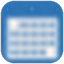

# Nager.Date

Nager.Date is a free, keyless public holiday API covering 100+ countries: public holidays per year, upcoming holidays, long weekends, 'is today a holiday' checks and country information. Uses the free Community API (v4 and v3).

| | |
| --- | --- |
| **Category** | [Productivity](README.md) |
| **Website** | [date.nager.at](https://date.nager.at) |
| **Authentication** | No authentication |
| **Slug** | `nagerDate` |

## Use it

Add Nager.Date from **Build → Integrations → Connectors** and connect an account, as in [Connect a system](../../build/connectors/connect-a-system.md). In workflow code, call an action as `fastn.connector.nagerDate.<action>()`, with the action's slug from the table below. See [Workflow runtime API](../../reference/workflow-runtime.md).

## Actions

<table><thead><tr><th width="240">Action</th><th width="260">Slug</th><th>What it does</th></tr></thead><tbody><tr><td>Check If Today Is a Holiday</td><td><code>checkTodayIsHoliday</code></td><td>Checks whether today is a public holiday in a country or subdivision (e.g. AT or AT-1), optionally shifted by a UTC offset. Answer is the HTTP status only: 200 = holiday, 204 = not a holiday. Docs: https://date.nager.at/Api</td></tr><tr><td>Check If Today Is a Public Holiday (API v3)</td><td><code>checkTodayIsPublicHolidayV3</code></td><td>Checks whether today is a public holiday in a country, optionally for a subdivision and UTC offset. Answer is the HTTP status only: 200 = holiday, 204 = not a holiday. Docs: https://date.nager.at/Api</td></tr><tr><td>Get Country</td><td><code>getCountry</code></td><td>Returns country information (common, native and official names, region and neighbouring countries) for an ISO country code. Docs: https://date.nager.at/Api</td></tr><tr><td>Get Country Info (API v3)</td><td><code>getCountryInfoV3</code></td><td>Returns country information (names, region, borders) using the v3 API. Docs: https://date.nager.at/Api</td></tr><tr><td>Get Version</td><td><code>getVersion</code></td><td>Returns the version of the Nager.Date library running on the server. Docs: https://date.nager.at/Api</td></tr><tr><td>Get Version (API v3)</td><td><code>getVersionV3</code></td><td>Returns the Nager.Date library version using the v3 API. Docs: https://date.nager.at/Api</td></tr><tr><td>List Available Countries</td><td><code>listAvailableCountries</code></td><td>Returns every country for which public holiday data is available, with name and ISO code. Docs: https://date.nager.at/Api</td></tr><tr><td>List Available Countries (API v3)</td><td><code>listAvailableCountriesV3</code></td><td>Returns all supported countries using the v3 API. Docs: https://date.nager.at/Api</td></tr><tr><td>List Long Weekends</td><td><code>listLongWeekends</code></td><td>Returns the long weekends (3+ consecutive days off) of a country for a year, optionally counting bridge days and narrowed to a subdivision. Docs: https://date.nager.at/Api</td></tr><tr><td>List Next Public Holidays</td><td><code>listNextPublicHolidays</code></td><td>Returns the public holidays of a country in the next 365 days. Docs: https://date.nager.at/Api</td></tr></tbody></table>

View 4 more actions

<table><thead><tr><th width="240">Action</th><th width="260">Slug</th><th>What it does</th></tr></thead><tbody><tr><td>List Next Public Holidays (API v3)</td><td><code>listNextPublicHolidaysV3</code></td><td>Returns the public holidays of a country in the next 365 days using the v3 API. Docs: https://date.nager.at/Api</td></tr><tr><td>List Next Public Holidays Worldwide</td><td><code>listNextPublicHolidaysWorldwide</code></td><td>Returns public holidays in all supported countries in the next 7 days. Docs: https://date.nager.at/Api</td></tr><tr><td>List Public Holidays</td><td><code>listPublicHolidays</code></td><td>Returns all public holidays of a country for a year, with local and English names, whether they are national or regional, the subdivisions they apply to and holiday types. Docs: https://date.nager.at/Api</td></tr><tr><td>List Public Holidays (API v3)</td><td><code>listPublicHolidaysV3</code></td><td>Returns all public holidays of a country for a year using the v3 API. Docs: https://date.nager.at/Api</td></tr></tbody></table>

