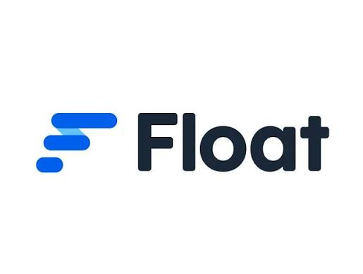
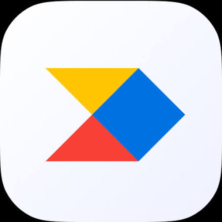
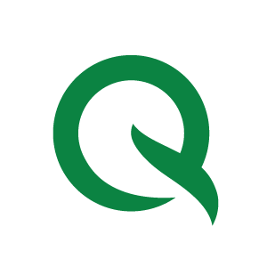
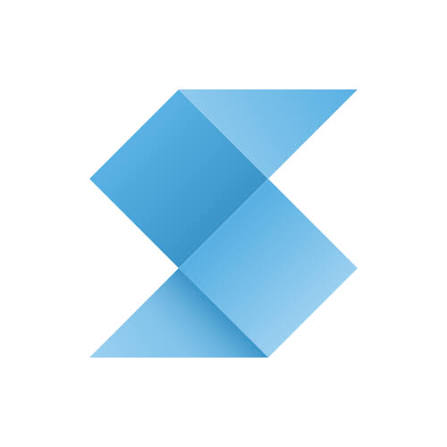

# Project management

Project management apps you can connect to with fastn, the most used first. Open a connector to see how it authenticates and every action and event it offers. Back to the [connector catalog](../README.md).

| | Connector | Authentication | About |
| --- | --- | --- | --- |
|  | [Jira](jira.md) | OAuth 2.0 | Atlassian Jira Cloud connector — Issues (CRUD, JQL search, transitions, bulk ops, comments, worklogs, attachments, links, remote links, watchers, votes),… |
|  | [Aha!](aha.md) | Bearer token | Aha! |
|  | [Asana](asana.md) | Bearer token, OAuth 2.0 | Asana is a work management platform. |
|  | [Azure DevOps](azure-dev-ops.md) | OAuth 2.0 | Azure DevOps — accounts and profile, projects, Git repositories, branches/refs, repository items (content) and commit changes, via the Azure DevOps REST API… |
|  | [Basecamp](basecamp.md) | OAuth 2.0 | Basecamp 4 (Basecamp 3 API / bc3-api) connector. |
|  | [ClickUp](clickup.md) | OAuth 2.0 | ClickUp project management REST API connector for managing workspaces, spaces, folders, lists, tasks, subtasks, comments, members, goals, tags, time tracking,… |
|  | [Dart](dart.md) | Bearer token | Dart (dartai.com) is an AI-native project and task management tool. |
|  | [Dovetail](dovetail.md) | Credentials you enter | Dovetail is a customer research and insights platform. |
|  | [Fibery](fibery.md) | Credentials you enter, OAuth 2.0 | Fibery work-management workspace API. |
|  | [Float](float.md) | Credentials you enter | Float resource scheduling and capacity planning API (v3). |
|  | [GoodDay](goodday.md) | API key | GoodDay work management platform — projects, tasks, users, time reports, events, custom fields, CRM, expenses, attendance, dependencies and documents via the… |
|  | [Hive](hive.md) | Credentials you enter | Hive is a project management and collaboration platform. |
|  | [Linear](linear.md) | API key | Linear issue tracking connector (GraphQL API) — issues (CRUD/search/archive), comments, projects & milestones, initiatives, teams, users, labels, cycles,… |
|  | [MeisterTask](meistertask.md) | Credentials you enter | MeisterTask is a task and project management tool. |
|  | [Microsoft Planner](microsoft-planner.md) | OAuth 2.0 | Microsoft Planner task management via the Microsoft Graph v1.0 API (https://graph.microsoft.com/v1.0/planner). |
|  | [Monday.com](monday.md) | Bearer token | Monday.com Work OS GraphQL API connector. |
|  | [Nifty](nifty.md) | OAuth 2.0 | Nifty project management platform. |
|  | [Ninety](ninety.md) | Bearer token | Ninety is a business operating system for teams running EOS. |
|  | [OneDesk](onedesk.md) | API key | OneDesk combines helpdesk and project management: tickets, tasks, projects, portfolios, timesheets, timers, customers, users, teams, conversations, invoices… |
|  | [Oracle Aconex](oracle-aconex.md) | Basic auth | Oracle Aconex construction project management REST API (XML responses): projects, project and global directory, own user, document register search, document… |
|  | [Perdoo](perdoo.md) | Bearer token | Perdoo OKR platform GraphQL API. |
|  | [Productboard](productboard.md) | Bearer token | Productboard is a product management platform for capturing customer feedback, prioritizing features, and building product roadmaps. |
|  | [Queue](queue.md) | Credentials you enter | Queue (app.usequeue.com) is a client-portal and project-management platform for agencies and productized-service businesses. |
|  | [Quire](quire.md) | OAuth 2.0 | Quire is a collaborative task-management and project-planning tool. |
|  | [Rentman](rentman.md) | Credentials you enter | Rentman is rental and event-production management software covering projects, quotes and invoices, equipment and serial numbers, warehouse stock, crew… |
|  | [Shortcut](shortcut.md) | Credentials you enter | Shortcut (formerly Clubhouse) project management. |
|  | [SmartSuite](smartsuite.md) | Credentials you enter | SmartSuite is a collaborative work management platform where data lives in solutions, applications (tables) and records. |
|  | [Taskade](taskade.md) | Bearer token | Taskade is an AI-native productivity platform for organizing work into workspaces, folders, projects, and tasks, and for building and running AI agents. |
|  | [Teamhood](teamhood.md) | API key | Teamhood public API v1 — work management: items (tasks/issues/projects), item types and fields, comments, attachments, time logs, resource allocations,… |
|  | [Tempo](tempo.md) | Bearer token | Tempo Cloud REST API v4 for Jira Time Tracking, Resourcing and Financial Management. |
|  | [Trello](trello.md) | Credentials you enter, OAuth 2.0 | Trello connector for boards, lists, cards, checklists, labels, members, organizations, actions, search, and webhooks via the Trello REST API (v1). |
|  | [Vikunja](vikunja.md) | Credentials you enter | Vikunja is an open-source, self-hostable to-do and task-management app. |
|  | [Weekdone](weekdone.md) | OAuth 2.0 | Weekdone is a team OKR, weekly progress reporting, and check-in platform. |
|  | [Wrike](wrike.md) | OAuth 2.0 | Wrike work management and project collaboration platform. |
