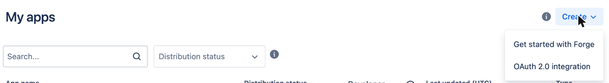
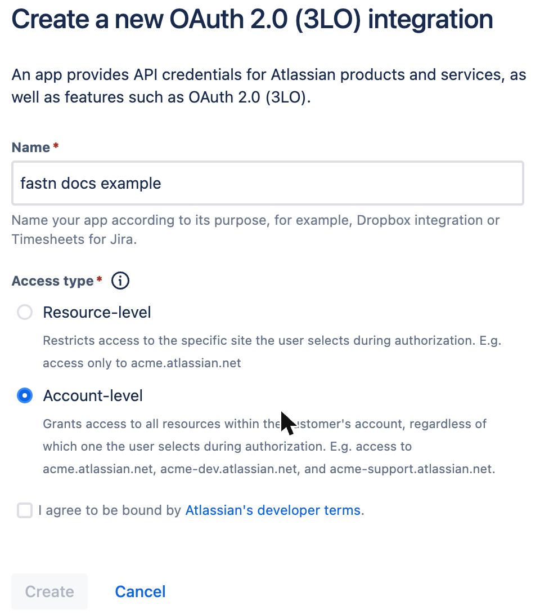
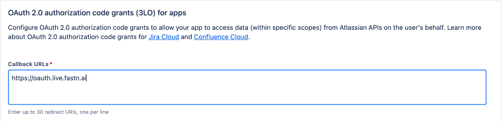
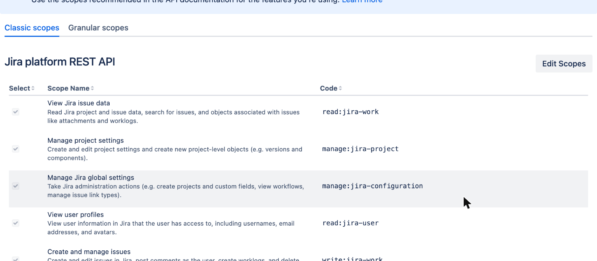
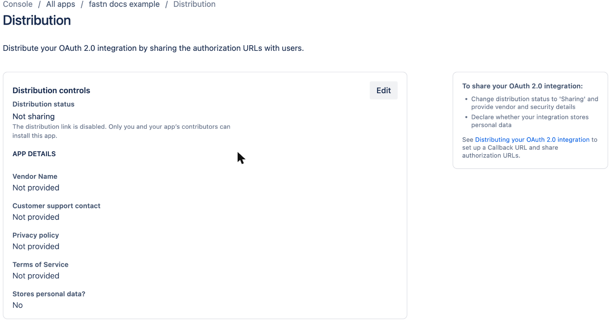
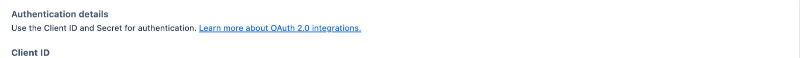

# Jira

Atlassian Jira Cloud connector — Issues (CRUD, JQL search, transitions, bulk ops, comments, worklogs, attachments, links, remote links, watchers, votes), Projects (components, versions, categories, roles, types), Users/Groups/Permissions, Fields & custom field options, Issue types/Statuses/Priorities/Resolutions/Labels, Filters & sharing, Dashboards, Time tracking, dynamic Webhooks, plus the Jira Software Agile API (boards, sprints, epics, backlog). Platform REST v3 + Agile 1.0 via api.atlassian.com (OAuth 2.0 3LO).

| | |
| --- | --- |
| **Category** | [Project management](README.md) |
| **Website** | [atlassian.com](https://atlassian.com) |
| **Authentication** | OAuth 2.0 |
| **Slug** | `jira` |

## Setup guide
This guide shows how to create your own Atlassian OAuth 2.0 app for Jira and add it to fastn, so your customers sign in to Jira through your app.

### Before you start
- You need the Owner, Admin or Developer role in fastn.
- You need an Atlassian account to sign in to the Atlassian developer console.
- Your customers need a Jira Cloud site to connect.

### Create your Jira app
1. Go to https://developer.atlassian.com, select your profile icon in the top right, and choose **Developer console**.
2. Open the **Create** menu and choose **OAuth 2.0 integration**.

<figure><figcaption>
The Create menu in the Atlassian developer console.
</figcaption></figure>

3. Enter a **Name** for the app and choose an **Access type**: **Account-level** (one consent covers every site in the customer's account) or **Resource-level** (only the site the customer picks). Tick the box to agree to Atlassian's developer terms, then select **Create**.

<figure><figcaption>
Name the app and choose its access type.
</figcaption></figure>

4. In the left menu, select **Authorization**. Next to **OAuth 2.0 (3LO)**, select **Add**.
5. In **Callback URLs**, enter `https://oauth.live.fastn.ai` exactly as shown, with no trailing slash, and select **Save changes**.

<figure><figcaption>
fastn's callback URL in the app's Authorization settings.
</figcaption></figure>

6. In the left menu, select **Permissions**. Next to **Jira API**, select **Add**, then **Configure**.
7. On the **Classic scopes** tab, select **Edit Scopes** under **Jira platform REST API**, tick each scope fastn requests, and select **Save**:
   - `read:jira-work`
   - `write:jira-work`
   - `manage:jira-project`
   - `manage:jira-configuration`
   - `read:jira-user`
   - `manage:jira-webhook`

   fastn also asks for `offline_access` when a customer signs in, so Jira returns a refresh token. You do not add it in the developer console.

<figure><figcaption>
The Jira scopes fastn needs, on the Classic scopes tab.
</figcaption></figure>

8. In the left menu, select **Distribution**, then **Edit** under **Distribution controls**. Change the status to **Sharing** and fill in the vendor and privacy details Atlassian asks for. Apps are private by default, so until you share it only you and the app's contributors can authorize it.

<figure><figcaption>
Distribution controls: the app is private until you share it.
</figcaption></figure>

9. In the left menu, select **Settings** and copy the **Client ID** and **Secret** under **Authentication details**.

<figure><figcaption>
Your Client ID and Secret are under Authentication details in Settings.
</figcaption></figure>

### Add your app to fastn
1. Go to **Build** → **Integrations** → **Connectors** and open **Jira**.
2. Open the **Auth** tab and select **Manage providers**.

<figure><figcaption>
Open the connector's Auth tab, then Manage providers.
</figcaption></figure>

3. Select **+ Create Provider**.
4. In the **New Auth Provider** form, enter a **Name** and, if you like, a **Description**. Paste the **Client ID** and **Secret** from Atlassian into **Client ID** and **Client Secret**, and enter the scopes from the list above in **Scopes**.

<figure><figcaption>
The New Auth Provider form: paste your app's Client ID and Client Secret.
</figcaption></figure>

5. Save the provider, then choose **Use this app** so it becomes the Preferred app.
6. In your widget, set the Jira connector's **Auth provider** setting to your app instead of **Use platform default**.

If you skip this section, your customers sign in to Jira through fastn's shared app.

After a customer connects, you can call actions from workflow code, for example `fastn.connector.jira.<actionSlug>()`.

### Events
To run a workflow when an issue or comment is created, updated or deleted in Jira, add an App event trigger under **Build** → **Integrations** → **Triggers** → **Add trigger** → **App events** (see [App events](../../build/triggers/app-events.md)). Contact fastn support to set up events for Jira.

## Actions

<table><thead><tr><th width="240">Action</th><th width="260">Slug</th><th>What it does</th></tr></thead><tbody><tr><td>Add Actors to Project Role</td><td><code>addActorsToProjectRole</code></td><td>Adds actors (users and/or groups) to a project role. Returns the updated project role.</td></tr><tr><td>Add Atlassian Team to Plan</td><td><code>addAtlassianTeamToPlan</code></td><td>Add an Atlassian team to a plan. Returns 204 on success.</td></tr><tr><td>Add Attachment</td><td><code>addAttachment</code></td><td>Add an attachment to an issue. POST /issue/{issueIdOrKey}/attachments. multipart/form-data with X-Atlassian-Token: no-check; the file is sent as form field 'file' (FileRef). NOTE: fastn multipart support is limited — file upload may require the file content be provided as a FileRef input named 'file'; verify behavior at execution time.</td></tr><tr><td>Add Comment</td><td><code>addComment</code></td><td>Add a comment to an issue. The body field is Atlassian Document Format (ADF).</td></tr><tr><td>Add Default Actors to Project Role</td><td><code>addDefaultActorsToProjectRole</code></td><td>Adds default actors (users and/or groups) to a project role. These actors are assigned to all new projects by default.</td></tr><tr><td>Add Field to Default Screen</td><td><code>addFieldToDefaultScreen</code></td><td>Adds a field to the default tab of the default screen.</td></tr><tr><td>Add Filter As Favourite</td><td><code>setFavouriteForFilter</code></td><td>Adds a filter as a favorite for the user. Returns the updated filter.</td></tr><tr><td>Add Gadget To Dashboard</td><td><code>addGadget</code></td><td>Adds a gadget to a dashboard. Provide either moduleKey or uri (not both).</td></tr><tr><td>Add Issue Security Level Members</td><td><code>addIssueSecurityLevelMembers</code></td><td>Adds members to an issue security level. Requires Administer Jira global permission.</td></tr><tr><td>Add Issue Security Levels</td><td><code>addSecurityLevels</code></td><td>Adds levels and levels' members to the issue security scheme. Requires Administer Jira global permission.</td></tr></tbody></table>

View 637 more actions

<table><thead><tr><th width="240">Action</th><th width="260">Slug</th><th>What it does</th></tr></thead><tbody><tr><td>Add Issue Types To Context</td><td><code>addIssueTypesToContext</code></td><td>Adds issue types to a custom field context, making the context apply to those issue types. PUT /rest/api/3/field/{fieldId}/context/{contextId}/issuetype. Returns 204 on success.</td></tr><tr><td>Add Issue Types To Issue Type Scheme</td><td><code>addIssueTypesToIssueTypeScheme</code></td><td>Adds issue types to an issue type scheme. PUT /rest/api/3/issuetypescheme/{issueTypeSchemeId}/issuetype</td></tr><tr><td>Add Notifications to Notification Scheme</td><td><code>addNotificationsToScheme</code></td><td>Adds notifications to a notification scheme. Requires Administer Jira global permission.</td></tr><tr><td>Add Screen Tab Field</td><td><code>addScreenTabField</code></td><td>Adds a field to a screen tab.</td></tr><tr><td>Add Share Permission</td><td><code>addSharePermission</code></td><td>Add a share permission to a filter. Set type and the corresponding id field (e.g. type=group + groupId, type=project + projectId).</td></tr><tr><td>Add User To Group</td><td><code>addUserToGroup</code></td><td>Add a user to a group.</td></tr><tr><td>Add Vote</td><td><code>addVote</code></td><td>Add the calling user's vote to an issue. POST /issue/{issueIdOrKey}/votes. No request body.</td></tr><tr><td>Add Watcher</td><td><code>addWatcher</code></td><td>Add a user as a watcher of an issue. POST /issue/{issueIdOrKey}/watchers. Body is the accountId string of the user to add as a watcher.</td></tr><tr><td>Add Worklog</td><td><code>addWorklog</code></td><td>Add a worklog to an issue. The comment field is Atlassian Document Format (ADF). timeSpentSeconds and started are required.</td></tr><tr><td>Analyse Jira Expression</td><td><code>analyseExpression</code></td><td>Analyses and validates a list of Jira expressions. Returns a list of analysis results, one for each expression. The analyses include type checking, validation of variables, and semantic analysis.</td></tr><tr><td>Append Mappings to Issue Type Screen Scheme</td><td><code>appendMappingsToIssueTypeScreenScheme</code></td><td>Appends issue type to screen scheme mappings to an issue type screen scheme.</td></tr><tr><td>Archive Issues (by ID/Key)</td><td><code>archiveIssues</code></td><td>Archive issues by issue ID/key. PUT /issue/archive.</td></tr><tr><td>Archive Issues Async (by JQL)</td><td><code>archiveIssuesAsync</code></td><td>Archive issues asynchronously by JQL. POST /issue/archive. Returns a task URL string.</td></tr><tr><td>Archive Plan</td><td><code>archivePlan</code></td><td>Archive a plan by ID. Returns 204 on success.</td></tr><tr><td>Archive Project</td><td><code>archiveProject</code></td><td>Archive a project. POST /rest/api/3/project/{projectIdOrKey}/archive. Returns 204 No Content.</td></tr><tr><td>Assign Field Configuration Scheme To Project</td><td><code>assignFieldConfigurationSchemeToProject</code></td><td>Assigns a field configuration scheme to a project. PUT /rest/api/3/fieldconfigurationscheme/project</td></tr><tr><td>Assign Issue</td><td><code>assignIssue</code></td><td>Assign an issue to a user. PUT /issue/{issueIdOrKey}/assignee. Use accountId of the user (null = default assignee, -1 = automatic). Returns 204.</td></tr><tr><td>Assign Issue Type Scheme To Project</td><td><code>assignIssueTypeSchemeToProject</code></td><td>Assigns an issue type scheme to a project. PUT /rest/api/3/issuetypescheme/project</td></tr><tr><td>Assign Issue Type Screen Scheme to Project</td><td><code>assignIssueTypeScreenSchemeToProject</code></td><td>Assigns an issue type screen scheme to a project. Issue type screen schemes can only be assigned to classic projects.</td></tr><tr><td>Assign Issue Types To Field Configurations</td><td><code>assignIssueTypesToFieldConfigurations</code></td><td>Assigns issue types to field configurations for a field configuration scheme. PUT /rest/api/3/fieldconfigurationscheme/{id}/mapping</td></tr><tr><td>Assign Permission Scheme</td><td><code>assignPermissionScheme</code></td><td>Assigns a permission scheme to a project. Requires Administer Projects or Administer Jira permission.</td></tr><tr><td>Assign Projects To Custom Field Context</td><td><code>assignProjectsToCustomFieldContext</code></td><td>Assigns a custom field context to projects. PUT /rest/api/3/field/{fieldId}/context/{contextId}/project. BLOCKED: Instance has only one classic project (FVT/10001); adding it gives 400 'already associated', and the only other project (KAN) is next-gen (404). Action config is correct.</td></tr><tr><td>Assign Workflow Scheme to Project</td><td><code>assignWorkflowSchemeToProject</code></td><td>Assigns a workflow scheme to a project. This operation is performed by project administrators only.</td></tr><tr><td>Associate Security Scheme to Project</td><td><code>associateSecuritySchemeToProject</code></td><td>Associates an issue security scheme with a project. Allows mapping old security levels to new ones. Requires Administer Jira global permission.</td></tr><tr><td>Bulk Create Issues</td><td><code>createIssues</code></td><td>Bulk create issues. POST /issue/bulk. issueUpdates is an array of {fields,...} objects.</td></tr><tr><td>Bulk Create Statuses</td><td><code>createStatuses</code></td><td>Creates statuses for a global or project scope. POST /rest/api/3/statuses. statuses is an array; scope is an object {type, project}.</td></tr><tr><td>Bulk Create Workflows</td><td><code>bulkCreateWorkflows</code></td><td>Creates workflows using the new bulk workflow creation API. Requires statuses and workflow definitions.</td></tr><tr><td>Bulk Delete Issue Property</td><td><code>bulkDeleteIssueProperty</code></td><td>Deletes a property value from multiple issues. Only entities the user has access to are updated. Returns 303 with task progress URL.</td></tr><tr><td>Bulk Delete Issues</td><td><code>submitBulkDelete</code></td><td>Bulk delete a list of issues. Returns a taskId to poll via getBulkOperationProgress.</td></tr><tr><td>Bulk Delete Statuses</td><td><code>deleteStatusesById</code></td><td>Deletes statuses by ID. DELETE /rest/api/3/statuses. id query param (ampersand-separated list) set explicitly.</td></tr><tr><td>Bulk Delete Worklogs</td><td><code>bulkDeleteWorklogs</code></td><td>Delete a list of worklogs from an issue.</td></tr><tr><td>Bulk Edit Dashboards</td><td><code>bulkEditDashboards</code></td><td>Bulk edit dashboards. Apply an action (changeOwner, changePermission, addPermission, removePermission) to multiple dashboards.</td></tr><tr><td>Bulk Edit Issues</td><td><code>submitBulkEdit</code></td><td>Bulk edit field values on a list of issues. Returns a taskId.</td></tr><tr><td>Bulk Fetch Issues</td><td><code>bulkFetchIssues</code></td><td>Bulk fetch issues by IDs or keys. POST /issue/bulkfetch.</td></tr><tr><td>Bulk Get Custom Field Configurations</td><td><code>bulkGetCustomFieldConfigurations</code></td><td>Returns a paginated list of configurations for multiple Connect custom fields. POST /rest/api/3/app/field/context/configuration/list. BLOCKED (business-400): Jira returns 400 'This API works only with fields provided by Forge apps.' — requires a Forge app that provides the custom fields. Cannot be exercised with standard OAuth 3LO or regular custom fields.</td></tr><tr><td>Bulk Get Groups</td><td><code>bulkGetGroups</code></td><td>Get a list of groups matching the supplied ids/names (paginated).</td></tr><tr><td>Bulk Get Statuses</td><td><code>getStatusesById</code></td><td>Returns a list of statuses by ID. GET /rest/api/3/statuses.</td></tr><tr><td>Bulk Get Statuses By Name</td><td><code>getStatusesByName</code></td><td>Returns a list of statuses by name. GET /rest/api/3/statuses/byNames.</td></tr><tr><td>Bulk Get Users</td><td><code>bulkGetUsers</code></td><td>Get a list of users matching the supplied accountIds (paginated).</td></tr><tr><td>Bulk Get Workflow Schemes</td><td><code>bulkGetWorkflowSchemes</code></td><td>Returns a list of workflow schemes by project IDs or workflow scheme IDs using the new bulk read endpoint.</td></tr><tr><td>Bulk Get Workflows (New API)</td><td><code>bulkGetWorkflows</code></td><td>Returns a list of workflows matching the specified criteria using the new workflows API (POST /workflows). Supports filtering by workflow IDs, names, and project/issue type associations.</td></tr><tr><td>Bulk Move Issues</td><td><code>submitBulkMove</code></td><td>Bulk move issues to a destination project/issue type. Returns a taskId.</td></tr><tr><td>Bulk Move Worklogs</td><td><code>bulkMoveWorklogs</code></td><td>Move a list of worklogs from one issue to another.</td></tr><tr><td>Bulk Set Issue Properties By Issue</td><td><code>bulkSetIssuePropertiesByIssue</code></td><td>Sets or updates entity property values on issues. Up to 10 entity properties can be specified for each issue and up to 100 issues included in the request. This is the per-issue variant. Returns 303 with task progress URL.</td></tr><tr><td>Bulk Set Issue Property</td><td><code>bulkSetIssueProperty</code></td><td>Sets a property value on multiple issues. You can specify up to 10,000 issues. Only entities the user has access to are updated. Returns a 303 (See Other) response with task progress URL.</td></tr><tr><td>Bulk Set Issues Properties By List</td><td><code>bulkSetIssuesPropertiesByList</code></td><td>Sets or updates entity property values on issues. Up to 10 entity properties can be specified for each issue and up to 100 issues included in the request. Returns 303 with task progress URL.</td></tr><tr><td>Bulk Transition Issue Statuses</td><td><code>submitBulkTransition</code></td><td>Bulk transition the status of a list of issues. Returns a taskId.</td></tr><tr><td>Bulk Unwatch Issues</td><td><code>submitBulkUnwatch</code></td><td>Bulk unwatch a list of issues. Returns a taskId.</td></tr><tr><td>Bulk Update Statuses</td><td><code>updateStatuses</code></td><td>Updates statuses by ID. PUT /rest/api/3/statuses. statuses is an array of {id, name, statusCategory, description}.</td></tr><tr><td>Bulk Update Workflows</td><td><code>bulkUpdateWorkflows</code></td><td>Updates workflows using the new bulk workflow update API.</td></tr><tr><td>Bulk Watch Issues</td><td><code>submitBulkWatch</code></td><td>Bulk watch a list of issues. Returns a taskId.</td></tr><tr><td>Cancel Task</td><td><code>cancelTask</code></td><td>Cancel a long-running asynchronous task by task ID. Returns 202 on success.</td></tr><tr><td>Change Filter Owner</td><td><code>changeFilterOwner</code></td><td>Changes the owner of a filter.</td></tr><tr><td>Check Dev Info Exists By Properties</td><td><code>checkDevInfoExistsByProperties</code></td><td>Checks if any development information exists for the specified entity properties in Jira devinfo.</td></tr><tr><td>Check Issues Against JQL</td><td><code>matchIssues</code></td><td>Check which issues match a list of JQL queries. POST /jql/match.</td></tr><tr><td>Copy Dashboard</td><td><code>copyDashboard</code></td><td>Copies a dashboard. Any values provided in the body replace those in the copied dashboard.</td></tr><tr><td>Count Issues Using JQL</td><td><code>countIssues</code></td><td>Get an approximate count of issues matching a JQL query. POST /search/approximate-count.</td></tr><tr><td>Create Board</td><td><code>createBoard</code></td><td>BLOCKED: OAuth token lacks Jira Software agile scopes (write:board-scope:jira-software). Creates a new board. Board name, type and filter ID is required. Requires a Jira Software license.</td></tr><tr><td>Create Component</td><td><code>createComponent</code></td><td>Create a project component. POST /rest/api/3/component. Requires name and project. Returns the created component object.</td></tr><tr><td>Create Custom Field</td><td><code>createCustomField</code></td><td>Creates a custom field. POST /rest/api/3/field.</td></tr><tr><td>Create Custom Field Context</td><td><code>createCustomFieldContext</code></td><td>Creates a custom field context. POST /rest/api/3/field/{fieldId}/context. Optionally scope to specific issue types and projects.</td></tr><tr><td>Create Custom Field Options (Context)</td><td><code>createCustomFieldOption</code></td><td>Creates options for a custom field context. POST /rest/api/3/field/{fieldId}/context/{contextId}/option. options is an array of {value, disabled, optionId}.</td></tr><tr><td>Create Dashboard</td><td><code>createDashboard</code></td><td>Creates a dashboard.</td></tr><tr><td>Create Draft Workflow Scheme</td><td><code>createDraftWorkflowScheme</code></td><td>Creates a draft workflow scheme from an active workflow scheme, by copying the active workflow scheme.</td></tr><tr><td>Create Field Configuration</td><td><code>createFieldConfiguration</code></td><td>Creates a new field configuration. POST /rest/api/3/fieldconfiguration</td></tr><tr><td>Create Field Configuration Scheme</td><td><code>createFieldConfigurationScheme</code></td><td>Creates a field configuration scheme. POST /rest/api/3/fieldconfigurationscheme</td></tr><tr><td>Create Filter</td><td><code>createFilter</code></td><td>Create a filter. The filter is shared according to the default share scope and the user becomes the filter owner.</td></tr><tr><td>Create Group</td><td><code>createGroup</code></td><td>Create a group with the supplied name.</td></tr><tr><td>Create Issue</td><td><code>createIssue</code></td><td>Create an issue or subtask. POST /issue. fields is an object containing required fields like project, summary, issuetype, and the ADF description. description is an Atlassian Document Format (ADF) object rendered bare.</td></tr><tr><td>Create Issue (Plain Text)</td><td><code>createIssuePlainText</code></td><td>Create a Jira issue from flat, plain-text inputs. POST /rest/api/3/issue. The plain-text description is wrapped into an Atlassian Document Format (ADF) paragraph, so callers never build ADF. priority and assignee are objects ({name} / {accountId}); optional fields left unset are omitted from the request. Returns the created issue's id, key and self URL.</td></tr><tr><td>Create Issue Link Type</td><td><code>createIssueLinkType</code></td><td>Create a new issue link type. POST /issueLinkType. Provide name, inward, and outward descriptions.</td></tr><tr><td>Create Issue Security Scheme</td><td><code>createIssueSecurityScheme</code></td><td>Creates a security scheme with security scheme levels and levels' members. Requires Administer Jira global permission.</td></tr><tr><td>Create Issue Type</td><td><code>createIssueType</code></td><td>Creates an issue type and adds it to the default issue type scheme. POST /rest/api/3/issuetype.</td></tr><tr><td>Create Issue Type Scheme</td><td><code>createIssueTypeScheme</code></td><td>Creates an issue type scheme. POST /rest/api/3/issuetypescheme</td></tr><tr><td>Create Issue Type Screen Scheme</td><td><code>createIssueTypeScreenScheme</code></td><td>Creates an issue type screen scheme.</td></tr><tr><td>Create Notification Scheme</td><td><code>createNotificationScheme</code></td><td>Creates a notification scheme with notifications. Requires Administer Jira global permission.</td></tr><tr><td>Create or Update Remote Issue Link</td><td><code>createOrUpdateRemoteIssueLink</code></td><td>Create or update a remote issue link from an issue to an item in a remote system. If a globalId is matched it updates, otherwise creates. POST /issue/{issueIdOrKey}/remotelink.</td></tr><tr><td>Create Permission Grant</td><td><code>createPermissionGrant</code></td><td>Creates a permission grant in a permission scheme. Requires Administer Jira global permission.</td></tr><tr><td>Create Permission Scheme</td><td><code>createPermissionScheme</code></td><td>Creates a new permission scheme. Requires Administer Jira global permission.</td></tr><tr><td>Create Plan</td><td><code>createPlan</code></td><td>Create a new Advanced Roadmaps plan. Returns the ID of the created plan.</td></tr><tr><td>Create Plan-Only Team</td><td><code>createPlanOnlyTeam</code></td><td>Create a new plan-only team in a plan. Plan-only teams exist only within the plan and are not Atlassian teams.</td></tr><tr><td>Create Priority</td><td><code>createPriority</code></td><td>Creates an issue priority. POST /rest/api/3/priority.</td></tr><tr><td>Create Priority Scheme</td><td><code>createPriorityScheme</code></td><td>Create a new priority scheme. Returns the scheme ID and optionally a task if async.</td></tr><tr><td>Create Project</td><td><code>createProject</code></td><td>Create a project. POST /rest/api/3/project. Requires key, name and leadAccountId. Returns the created project's id, key and self URL.</td></tr><tr><td>Create Project Avatar</td><td><code>createProjectAvatar</code></td><td>Loads a custom avatar for a project (POST /avatar2). Returns the new Avatar object with its ID.</td></tr><tr><td>Create Project Category</td><td><code>createProjectCategory</code></td><td>Create a project category. POST /rest/api/3/projectCategory. Requires name. Returns the created category object.</td></tr><tr><td>Create Project Role</td><td><code>createProjectRole</code></td><td>Create a new project role. POST /rest/api/3/role. Requires name. Returns the created role object.</td></tr><tr><td>Create Related Work</td><td><code>createRelatedWork</code></td><td>Create a related work item for a version. POST /rest/api/3/version/{id}/relatedwork. Returns the created related work item.</td></tr><tr><td>Create Resolution</td><td><code>createResolution</code></td><td>Creates an issue resolution. POST /rest/api/3/resolution.</td></tr><tr><td>Create Screen</td><td><code>createScreen</code></td><td>Creates a screen with a default field tab.</td></tr><tr><td>Create Screen Scheme</td><td><code>createScreenScheme</code></td><td>Creates a screen scheme.</td></tr><tr><td>Create Screen Tab</td><td><code>createScreenTab</code></td><td>Creates a tab for a screen.</td></tr><tr><td>Create Sprint</td><td><code>createSprint</code></td><td>BLOCKED: OAuth token lacks Jira Software agile scopes (write:sprint:jira-software). Creates a future sprint. Sprint name and origin board id are required. Start date, end date, and goal are optional.</td></tr><tr><td>Create UI Modification</td><td><code>createUiModification</code></td><td>Create a new UI modification for customizing the Jira UI. Returns the ID and self link of the created modification.</td></tr><tr><td>Create User</td><td><code>createUser</code></td><td>Create a user. The user is added to the default groups specified by products. Returns the created user.</td></tr><tr><td>Create Version</td><td><code>createVersion</code></td><td>Create a project version. POST /rest/api/3/version. Requires name and projectId. Returns the created version object.</td></tr><tr><td>Create Workflow Scheme</td><td><code>createWorkflowScheme</code></td><td>Creates a workflow scheme.</td></tr><tr><td>Create Workflow Transition Property</td><td><code>createWorkflowTransitionProperty</code></td><td>Adds a property to a workflow transition. Workflow must be inactive or the transition must be a global transition.</td></tr><tr><td>Delete Actors from Project Role</td><td><code>deleteActorsFromProjectRole</code></td><td>Deletes actors (users/groups) from a project role. Specify user (account ID) or group/groupId query params.</td></tr><tr><td>Delete And Replace Version</td><td><code>deleteAndReplaceVersion</code></td><td>Delete a version and replace its usages on issues/custom fields. POST /rest/api/3/version/{id}/removeAndSwap. Returns 204 No Content.</td></tr><tr><td>Delete Attachment</td><td><code>removeAttachment</code></td><td>Delete an attachment from an issue.</td></tr><tr><td>Delete Board</td><td><code>deleteBoard</code></td><td>BLOCKED: OAuth token lacks Jira Software agile scopes (write:board-scope:jira-software). Deletes the board. Admin without the view permission can still remove the board.</td></tr><tr><td>Delete Board Property</td><td><code>deleteBoardProperty</code></td><td>BLOCKED: OAuth token lacks Jira Software agile scopes (write:board-scope:jira-software). Removes the property from the board identified by the id. The user removing the property is required to have permissions to modify the board.</td></tr><tr><td>Delete Build By Key</td><td><code>deleteBuildByKey</code></td><td>Deletes a specific build from Jira identified by pipeline ID and build number.</td></tr><tr><td>Delete Builds By Properties</td><td><code>deleteBuildsByProperties</code></td><td>Deletes builds from Jira that match the specified entity properties.</td></tr><tr><td>Delete Comment</td><td><code>deleteComment</code></td><td>Delete a comment from an issue.</td></tr><tr><td>Delete Comment Property</td><td><code>deleteCommentProperty</code></td><td>Deletes a property from a comment. Returns 204 if successful. Returns 404 if the comment or property does not exist.</td></tr><tr><td>Delete Component</td><td><code>deleteComponent</code></td><td>Delete a project component. DELETE /rest/api/3/component/{id}. Optionally reassign issues to another component. Returns 204 No Content.</td></tr><tr><td>Delete Custom Field</td><td><code>deleteCustomField</code></td><td>Deletes a custom field (moves it to trash if not already). DELETE /rest/api/3/field/{id}.</td></tr><tr><td>Delete Custom Field Context</td><td><code>deleteCustomFieldContext</code></td><td>Deletes a custom field context. DELETE /rest/api/3/field/{fieldId}/context/{contextId}. Returns 204 on success.</td></tr><tr><td>Delete Custom Field Options (Context)</td><td><code>deleteCustomFieldOption</code></td><td>Deletes a custom field option. DELETE /rest/api/3/field/{fieldId}/context/{contextId}/option/{optionId}.</td></tr><tr><td>Delete Dashboard</td><td><code>deleteDashboard</code></td><td>Deletes a dashboard by ID.</td></tr><tr><td>Delete Dashboard Item Property</td><td><code>deleteDashboardItemProperty</code></td><td>Deletes a dashboard item property.</td></tr><tr><td>Delete Default Actors from Project Role</td><td><code>deleteDefaultActorsFromProjectRole</code></td><td>Deletes default actors from a project role. Returns the updated project role.</td></tr><tr><td>Delete Default Workflow</td><td><code>deleteWorkflowSchemeDefault</code></td><td>Resets the default workflow for a workflow scheme to the default value (jira).</td></tr><tr><td>Delete Deployment By Key</td><td><code>deleteDeploymentByKey</code></td><td>Deletes a specific deployment from Jira identified by pipeline ID, environment ID, and deployment sequence number.</td></tr><tr><td>Delete Deployments By Properties</td><td><code>deleteDeploymentsByProperties</code></td><td>Deletes deployments from Jira that match the specified entity properties. Used to bulk-delete deployments by property value.</td></tr><tr><td>Delete Dev Info By Properties</td><td><code>deleteDevInfoByProperties</code></td><td>Deletes development information stored in Jira that matches the specified entity properties.</td></tr><tr><td>Delete Dev Info Entity</td><td><code>deleteDevInfoEntity</code></td><td>Deletes a specific development information entity (commit, branch, or pull request) from a repository in Jira devinfo.</td></tr><tr><td>Delete Dev Info Repository</td><td><code>deleteDevInfoRepository</code></td><td>Deletes a repository and all its associated development information from Jira devinfo.</td></tr><tr><td>Delete DevOps Component By ID</td><td><code>deleteDevOpsComponentById</code></td><td>Deletes a specific DevOps component from Jira by its ID.</td></tr><tr><td>Delete DevOps Components By Properties</td><td><code>deleteDevOpsComponentsByProperties</code></td><td>Deletes DevOps components from Jira that match the specified entity properties.</td></tr><tr><td>Delete Draft Default Workflow</td><td><code>deleteDraftWorkflowSchemeDefault</code></td><td>Resets the default workflow for a draft workflow scheme to the default value (jira).</td></tr><tr><td>Delete Draft Workflow Scheme</td><td><code>deleteDraftWorkflowScheme</code></td><td>Deletes a draft workflow scheme.</td></tr><tr><td>Delete Feature Flag By ID</td><td><code>deleteFeatureFlagById</code></td><td>Deletes a specific feature flag from Jira by its ID.</td></tr><tr><td>Delete Feature Flags By Properties</td><td><code>deleteFeatureFlagsByProperties</code></td><td>Deletes feature flags from Jira that match the specified entity properties.</td></tr><tr><td>Delete Field Configuration</td><td><code>deleteFieldConfiguration</code></td><td>Deletes a field configuration. DELETE /rest/api/3/fieldconfiguration/{id}</td></tr><tr><td>Delete Field Configuration Scheme</td><td><code>deleteFieldConfigurationScheme</code></td><td>Deletes a field configuration scheme. DELETE /rest/api/3/fieldconfigurationscheme/{id}</td></tr><tr><td>Delete Filter</td><td><code>deleteFilter</code></td><td>Delete a filter by ID.</td></tr><tr><td>Delete Inactive Workflow</td><td><code>deleteInactiveWorkflow</code></td><td>Delete an inactive workflow. Only workflows with no active associations can be deleted.</td></tr><tr><td>Delete Incident By ID</td><td><code>deleteIncidentById</code></td><td>Deletes a specific incident from Jira Operations by its ID.</td></tr><tr><td>Delete Issue</td><td><code>deleteIssue</code></td><td>Delete an issue. DELETE /issue/{issueIdOrKey}. deleteSubtasks must be true to delete an issue that has subtasks.</td></tr><tr><td>Delete Issue Link</td><td><code>deleteIssueLink</code></td><td>Delete an issue link by its ID. DELETE /issueLink/{linkId}.</td></tr><tr><td>Delete Issue Link Type</td><td><code>deleteIssueLinkType</code></td><td>Delete an issue link type by its ID. DELETE /issueLinkType/{issueLinkTypeId}.</td></tr><tr><td>Delete Issue Property</td><td><code>deleteIssueProperty</code></td><td>Deletes an issue's property. Returns a 204 if successful. Returns a 404 if the issue or property does not exist.</td></tr><tr><td>Delete Issue Security Scheme</td><td><code>deleteIssueSecurityScheme</code></td><td>Deletes an issue security scheme. Requires Administer Jira global permission.</td></tr><tr><td>Delete Issue Type</td><td><code>deleteIssueType</code></td><td>Deletes an issue type and reassigns its issues. DELETE /rest/api/3/issuetype/{id}. alternativeIssueTypeId query param set explicitly.</td></tr><tr><td>Delete Issue Type Property</td><td><code>deleteIssueTypeProperty</code></td><td>Deletes the issue type property. Returns 204 if successful. Returns 404 if the issue type or property does not exist.</td></tr><tr><td>Delete Issue Type Scheme</td><td><code>deleteIssueTypeScheme</code></td><td>Deletes an issue type scheme. DELETE /rest/api/3/issuetypescheme/{issueTypeSchemeId}</td></tr><tr><td>Delete Issue Type Screen Scheme</td><td><code>deleteIssueTypeScreenScheme</code></td><td>Deletes an issue type screen scheme.</td></tr><tr><td>Delete Issue Types for Workflow in Draft Scheme</td><td><code>deleteDraftWorkflowSchemeWorkflow</code></td><td>Deletes the workflow-issue type mappings for a specific workflow in the draft workflow scheme.</td></tr><tr><td>Delete Issue Types for Workflow in Scheme</td><td><code>deleteWorkflowSchemeWorkflow</code></td><td>Deletes the workflow-issue type mappings for a specific workflow in a workflow scheme.</td></tr><tr><td>Delete Notification Scheme</td><td><code>deleteNotificationScheme</code></td><td>Deletes a notification scheme. Requires Administer Jira global permission.</td></tr><tr><td>Delete Operations Data By Properties</td><td><code>deleteOperationsDataByProperties</code></td><td>Deletes Operations data (incidents and reviews) from Jira that match the specified entity properties.</td></tr><tr><td>Delete Operations Workspaces</td><td><code>deleteOperationsWorkspaces</code></td><td>Deletes (unlinks) Operations workspace IDs from the Jira site.</td></tr><tr><td>Delete Permission Scheme</td><td><code>deletePermissionScheme</code></td><td>Deletes a permission scheme. Requires Administer Jira global permission.</td></tr><tr><td>Delete Permission Scheme Grant</td><td><code>deletePermissionSchemeGrant</code></td><td>Deletes a permission grant from a permission scheme. Requires Administer Jira global permission.</td></tr><tr><td>Delete Plan-Only Team</td><td><code>deletePlanOnlyTeam</code></td><td>Delete a plan-only team from a plan. Returns 204 on success.</td></tr><tr><td>Delete Post-Incident Review By ID</td><td><code>deletePostIncidentReviewById</code></td><td>Deletes a specific post-incident review from Jira Operations by its ID.</td></tr><tr><td>Delete Preference</td><td><code>removePreference</code></td><td>Delete a preference of the current user by key.</td></tr><tr><td>Delete Priority</td><td><code>deletePriority</code></td><td>Deletes an issue priority (async). DELETE /rest/api/3/priority/{id}. BLOCKED: Jira Cloud automatically adds newly created priorities to the default priority scheme, making them report 409 'Priority is still in use' — the priority must be removed from all priority schemes before deletion. This is a provider account-state constraint. Returns 303 task object on success.</td></tr><tr><td>Delete Priority Scheme</td><td><code>deletePriorityScheme</code></td><td>Delete a priority scheme by ID. Returns 204 on success.</td></tr><tr><td>Delete Project</td><td><code>deleteProject</code></td><td>Delete a project. DELETE /rest/api/3/project/{projectIdOrKey}. Returns 204 No Content.</td></tr><tr><td>Delete Project Asynchronously</td><td><code>deleteProjectAsynchronously</code></td><td>Delete a project asynchronously (long-running task). POST /rest/api/3/project/{projectIdOrKey}/delete. Returns 303 with a task progress location.</td></tr><tr><td>Delete Project Avatar</td><td><code>deleteProjectAvatar</code></td><td>Deletes a custom project avatar. System avatars cannot be deleted.</td></tr><tr><td>Delete Project Category</td><td><code>removeProjectCategory</code></td><td>Delete a project category. DELETE /rest/api/3/projectCategory/{id}. Returns 204 No Content.</td></tr><tr><td>Delete Project Property</td><td><code>deleteProjectProperty</code></td><td>Deletes the property from a project. Returns 204 if successful. Returns 404 if the project or property does not exist.</td></tr><tr><td>Delete Project Role</td><td><code>deleteProjectRole</code></td><td>Delete a project role. DELETE /rest/api/3/role/{id}. Optionally swap to another role. Returns 204 No Content.</td></tr><tr><td>Delete Related Work</td><td><code>deleteRelatedWork</code></td><td>Delete a related work item from a version. DELETE /rest/api/3/version/{versionId}/relatedwork/{relatedWorkId}. Returns 204 No Content.</td></tr><tr><td>Delete Remote Issue Link By Global ID</td><td><code>deleteRemoteIssueLinkByGlobalId</code></td><td>Delete the remote issue link matching the given globalId. DELETE /issue/{issueIdOrKey}/remotelink with globalId query param.</td></tr><tr><td>Delete Remote Issue Link By ID</td><td><code>deleteRemoteIssueLinkById</code></td><td>Delete a remote issue link by its ID. DELETE /issue/{issueIdOrKey}/remotelink/{linkId}.</td></tr><tr><td>Delete Remote Link By ID</td><td><code>deleteRemoteLinkById</code></td><td>Deletes a specific remote link from Jira by its ID.</td></tr><tr><td>Delete Remote Links By Properties</td><td><code>deleteRemoteLinksByProperties</code></td><td>Deletes remote links from Jira that match the specified entity properties.</td></tr><tr><td>Delete Resolution</td><td><code>deleteResolution</code></td><td>Deletes an issue resolution. DELETE /rest/api/3/resolution/{id}. replaceWith query param set explicitly (required).</td></tr><tr><td>Delete Screen</td><td><code>deleteScreen</code></td><td>Deletes a screen.</td></tr><tr><td>Delete Screen Scheme</td><td><code>deleteScreenScheme</code></td><td>Deletes a screen scheme. A screen scheme cannot be deleted if it is used in an issue type screen scheme.</td></tr><tr><td>Delete Screen Tab</td><td><code>deleteScreenTab</code></td><td>Deletes a screen tab.</td></tr><tr><td>Delete Share Permission</td><td><code>deleteSharePermission</code></td><td>Delete a share permission from a filter.</td></tr><tr><td>Delete Sprint</td><td><code>deleteSprint</code></td><td>BLOCKED: OAuth token lacks Jira Software agile scopes (write:sprint:jira-software). Deletes a sprint. Once a sprint is deleted, all issues in the sprint will be moved to the backlog.</td></tr><tr><td>Delete Sprint Property</td><td><code>deleteProperty</code></td><td>Removes the property from the sprint identified by the id. The user removing the property is required to have permissions to modify the sprint.</td></tr><tr><td>Delete UI Modification</td><td><code>deleteUiModification</code></td><td>Delete a UI modification by ID. Returns 204 on success.</td></tr><tr><td>Delete Universal Avatar</td><td><code>deleteUniversalAvatar</code></td><td>Deletes a custom avatar for a project or issue type. System avatars cannot be deleted.</td></tr><tr><td>Delete User</td><td><code>removeUser</code></td><td>Delete a user by accountId.</td></tr><tr><td>Delete User Property</td><td><code>deleteUserProperty</code></td><td>Deletes a property from a user. Returns 204 if successful. Returns 404 if the user or property does not exist.</td></tr><tr><td>Delete Version</td><td><code>deleteVersion</code></td><td>Delete a project version. DELETE /rest/api/3/version/{id}. Optionally move fixVersion/affectedVersion to another version. Returns 204 No Content.</td></tr><tr><td>Delete Webhooks</td><td><code>deleteWebhooks</code></td><td>Delete registered Jira dynamic webhooks by ID. Sends a JSON body { webhookIds: [number] }.</td></tr><tr><td>Delete Workflow for Issue Type in Draft Scheme</td><td><code>deleteDraftWorkflowSchemeIssueType</code></td><td>Deletes the workflow-issue type mapping for the draft workflow scheme.</td></tr><tr><td>Delete Workflow for Issue Type in Scheme</td><td><code>deleteWorkflowSchemeIssueType</code></td><td>Deletes the workflow-issue type mapping for a workflow scheme.</td></tr><tr><td>Delete Workflow Scheme</td><td><code>deleteWorkflowScheme</code></td><td>Deletes a workflow scheme. Note that a workflow scheme cannot be deleted if it is active (that is, being used by at least one project).</td></tr><tr><td>Delete Workflow Transition Property</td><td><code>deleteWorkflowTransitionProperty</code></td><td>Deletes a property from a workflow transition. Workflow must be inactive or the transition must be a global transition.</td></tr><tr><td>Delete Workflow Transition Rule Configurations</td><td><code>deleteWorkflowTransitionRuleConfigs</code></td><td>Deletes workflow transition rules from one or more workflows. Only Atlassian Connect app administrators can use this operation.</td></tr><tr><td>Delete Worklog</td><td><code>deleteWorklog</code></td><td>Delete a worklog from an issue.</td></tr><tr><td>Delete Worklog Property</td><td><code>deleteWorklogProperty</code></td><td>Deletes a worklog's property. Returns 204 if successful. Returns 404 if the issue, worklog, or property does not exist.</td></tr><tr><td>Duplicate Plan</td><td><code>duplicatePlan</code></td><td>Duplicate an existing plan. The new plan name must be provided.</td></tr><tr><td>Edit Issue</td><td><code>editIssue</code></td><td>Edit an issue's fields. PUT /issue/{issueIdOrKey}. fields holds the fields to set/update (description is an ADF object). Returns 204 unless returnIssue=true.</td></tr><tr><td>Estimate Issue For Board</td><td><code>estimateIssueForBoard</code></td><td>BLOCKED: OAuth token lacks Jira Software agile scopes (write:issue:jira-software). Updates the estimation of the issue. The boardId query param is used to determine which field is used for estimation for the board.</td></tr><tr><td>Eval Jira Expression (Legacy)</td><td><code>evalJiraExpression</code></td><td>Legacy endpoint being removed. Evaluates a Jira expression and returns its value. Prefer evaluateExpression which uses the enhanced search API.</td></tr><tr><td>Evaluate Jira Expression</td><td><code>evaluateExpression</code></td><td>Evaluates a Jira expression using the enhanced search API. Returns the value of the expression and optional metadata about the expression complexity.</td></tr><tr><td>Export Archived Issues</td><td><code>exportArchivedIssues</code></td><td>Export archived issues. PUT /issues/archive/export. All body fields are optional filters.</td></tr><tr><td>Find Components For Projects</td><td><code>findComponentsForProjects</code></td><td>Find components across projects, paginated. GET /rest/api/3/component. Returns a paginated page object with values array.</td></tr><tr><td>Find Groups</td><td><code>findGroups</code></td><td>Find groups whose names contain the query string, for use in a group picker.</td></tr><tr><td>Find User Keys By Query</td><td><code>findUserKeysByQuery</code></td><td>Find user keys using a structured JQL-like user search query.</td></tr><tr><td>Find Users</td><td><code>findUsers</code></td><td>Find users matching a query string against displayName and emailAddress.</td></tr><tr><td>Find Users Assignable To Issues</td><td><code>findAssignableUsers</code></td><td>Find users that can be assigned to an issue or project.</td></tr><tr><td>Find Users Assignable To Projects</td><td><code>findBulkAssignableUsers</code></td><td>Find users that can be assigned to issues in one or more projects.</td></tr><tr><td>Find Users By Query</td><td><code>findUsersByQuery</code></td><td>Find users using a structured JQL-like user search query.</td></tr><tr><td>Find Users For Picker</td><td><code>findUsersForPicker</code></td><td>Find users matching a query for use in a user picker.</td></tr><tr><td>Find Users With Browse Permission</td><td><code>findUsersWithBrowsePermission</code></td><td>Find users who can browse a given issue or project.</td></tr><tr><td>Find Users With Permissions</td><td><code>findUsersWithAllPermissions</code></td><td>Find users with all of the supplied permissions for a project or issue.</td></tr><tr><td>Fully Update Project Role</td><td><code>fullyUpdateProjectRole</code></td><td>Fully update a project role's name and description. PUT /role/{id}. Both name and description are replaced. Returns the updated role object {self, name, id, description, actors}.</td></tr><tr><td>Get Accessible Project Type By Key</td><td><code>getAccessibleProjectTypeByKey</code></td><td>Get an accessible project type by its key. GET /project/type/{projectTypeKey}/accessible. Returns the project type {key, formattedKey, descriptionI18nKey, icon, color} if accessible to the current user.</td></tr><tr><td>Get Accessible Resources</td><td><code>getAccessibleResources</code></td><td>List the Jira sites the OAuth token can access. Returns an array of {id,url,name,scopes,avatarUrl}; the id IS the cloudId used by every other action. Call once after connecting.</td></tr><tr><td>Get Account IDs For Users (Migration)</td><td><code>bulkGetUsersMigration</code></td><td>Get account IDs for users based on usernames and/or keys (migration helper).</td></tr><tr><td>Get Agile Issue</td><td><code>getAgileIssue</code></td><td>BLOCKED: OAuth token lacks Jira Software agile scopes (read:issue:jira-software). Returns a single issue, for a given issue ID or issue key, with Agile-specific fields (sprint, closedSprints, flagged, epic). This only includes issues the user has permission to view.</td></tr><tr><td>Get All Accessible Project Types</td><td><code>getAllAccessibleProjectTypes</code></td><td>Get all project types accessible to the current user. GET /project/type/accessible. Returns an array of project types, each {key, formattedKey, descriptionI18nKey, icon, color}.</td></tr><tr><td>Get All Boards</td><td><code>getAllBoards</code></td><td>BLOCKED: OAuth token lacks Jira Software agile scopes (read:board-scope:jira-software). Returns all boards. This only includes boards the user has permission to view. Supports filtering by type, name, project, etc.</td></tr><tr><td>Get All Dashboards</td><td><code>getAllDashboards</code></td><td>Returns a list of dashboards owned by or shared with the user. Optionally filter to my or favourite.</td></tr><tr><td>Get All Issue Types For User</td><td><code>getIssueAllTypes</code></td><td>Returns all issue types. GET /rest/api/3/issuetype.</td></tr><tr><td>Get All Labels</td><td><code>getAllLabels</code></td><td>Returns a paginated list of available labels. GET /rest/api/3/label.</td></tr><tr><td>Get All Permission Schemes</td><td><code>getAllPermissionSchemes</code></td><td>Returns all permission schemes. Requires Administer Jira global permission.</td></tr><tr><td>Get All Permissions</td><td><code>getAllPermissions</code></td><td>Get all permissions, including project and global permissions.</td></tr><tr><td>Get All Project Avatars</td><td><code>getAllProjectAvatars</code></td><td>Returns all project avatars (both system and custom) for a project.</td></tr><tr><td>Get All Project Categories</td><td><code>getAllProjectCategories</code></td><td>Get all project categories. GET /rest/api/3/projectCategory. Returns an array of project category objects.</td></tr><tr><td>Get All Project Roles</td><td><code>getAllProjectRoles</code></td><td>Get all project roles available in Jira. GET /rest/api/3/role. Returns an array of role objects.</td></tr><tr><td>Get All Project Types</td><td><code>getAllProjectTypes</code></td><td>Get all project types for the Jira site. GET /project/type. Returns an array of project types, each {key, formattedKey, descriptionI18nKey, icon, color}.</td></tr><tr><td>Get All Projects</td><td><code>getAllProjects</code></td><td>Get all projects visible to the user. GET /rest/api/3/project. Returns an array of project objects.</td></tr><tr><td>Get All Quick Filters</td><td><code>getAllQuickFilters</code></td><td>Returns all quick filters from a board, for the given board ID.</td></tr><tr><td>Get All Screen Tabs</td><td><code>getAllScreenTabs</code></td><td>Returns the list of tabs for a bulk of screens.</td></tr><tr><td>Get All Sprints</td><td><code>getAllSprints</code></td><td>BLOCKED: OAuth token lacks Jira Software agile scopes (read:sprint:jira-software). Returns all sprints from a board, for the given board ID. This only includes sprints that the user has permission to view.</td></tr><tr><td>Get All Statuses</td><td><code>getStatuses</code></td><td>Returns all statuses associated with active workflows. GET /rest/api/3/status.</td></tr><tr><td>Get All Statuses For Project</td><td><code>getAllStatuses</code></td><td>Get all issue types with their statuses for a project. GET /rest/api/3/project/{projectIdOrKey}/statuses. Returns an array of issue-type/status objects.</td></tr><tr><td>Get All Time Tracking Providers</td><td><code>getAvailableTimeTrackingImplementations</code></td><td>Returns all time tracking providers available in the Jira instance.</td></tr><tr><td>Get All Users</td><td><code>getAllUsers</code></td><td>Get a list of all (active and inactive) users via the users/search endpoint.</td></tr><tr><td>Get All Users Default</td><td><code>getAllUsersDefault</code></td><td>Get a list of all (active and inactive) users.</td></tr><tr><td>Get All Versions</td><td><code>getAllVersions</code></td><td>Returns all versions from a board, for the given board ID. This only includes versions that the user has permission to view.</td></tr><tr><td>Get Alternative Issue Types</td><td><code>getAlternativeIssueTypes</code></td><td>Returns alternative issue types for the given issue type. GET /rest/api/3/issuetype/{id}/alternatives.</td></tr><tr><td>Get Announcement Banner</td><td><code>getAnnouncementBanner</code></td><td>Get the current announcement banner configuration for the Jira instance.</td></tr><tr><td>Get Application License Count</td><td><code>getApplicationLicenseCount</code></td><td>Returns the approximate number of user accounts for a single Jira license. Note that information is cached with a 7-day lifecycle and could be stale at the time of call.</td></tr><tr><td>Get Application Role</td><td><code>getApplicationRole</code></td><td>Returns an application role by its key. In Jira, application roles are managed using the Application access configuration page.</td></tr><tr><td>Get Approximate Issue Count For Backlog</td><td><code>getApproximateIssueCountForBacklog</code></td><td>BLOCKED: OAuth token lacks Jira Software agile scopes (read:board-scope:jira-software). Returns the approximate number of issues that match the JQL search for the board's backlog.</td></tr><tr><td>Get Approximate Issue Count For Board</td><td><code>getApproximateIssueCountForBoard</code></td><td>BLOCKED: OAuth token lacks Jira Software agile scopes (read:board-scope:jira-software). Returns the approximate number of issues that match the JQL search for a board.</td></tr><tr><td>Get Approximate License Count</td><td><code>getApproximateLicenseCount</code></td><td>Returns the approximate number of user accounts across all Jira licenses. Note that information is cached with a 7-day lifecycle and could be stale at the time of call.</td></tr><tr><td>Get Assigned Permission Scheme</td><td><code>getAssignedPermissionScheme</code></td><td>Returns the permission scheme associated with a project. Requires Administer Projects or Administer Jira permission.</td></tr><tr><td>Get Atlassian Team in Plan</td><td><code>getAtlassianTeamInPlan</code></td><td>Get details of a specific Atlassian team in a plan.</td></tr><tr><td>Get Attachment Content</td><td><code>getAttachmentContent</code></td><td>Return the contents of an attachment. By default returns a redirect to the download.</td></tr><tr><td>Get Attachment Metadata</td><td><code>getAttachment</code></td><td>Return the metadata for an attachment. Note this does not return the contents of the attachment.</td></tr><tr><td>Get Attachment Thumbnail</td><td><code>getAttachmentThumbnail</code></td><td>Return the thumbnail of an attachment.</td></tr><tr><td>Get Available Gadgets</td><td><code>getAllAvailableDashboardGadgets</code></td><td>Returns a list of all available gadgets that can be added to a dashboard.</td></tr><tr><td>Get Available Priorities for Scheme</td><td><code>getAvailablePrioritiesForScheme</code></td><td>Get available priorities that can be added to a priority scheme.</td></tr><tr><td>Get Available Screen Fields</td><td><code>getAvailableScreenFields</code></td><td>Returns the fields that can be added to a tab on a screen.</td></tr><tr><td>Get Avatar Image By ID</td><td><code>getAvatarImageById</code></td><td>Returns a project or issue type avatar image by ID.</td></tr><tr><td>Get Avatar Image By Owner</td><td><code>getAvatarImageByOwner</code></td><td>Returns the avatar image for a project or issue type by owner entity ID.</td></tr><tr><td>Get Avatar Image By Type</td><td><code>getAvatarImageByType</code></td><td>Returns the default system avatar image for the specified avatar type. GET /rest/api/3/universal_avatar/view/type/{type}. BLOCKED: Returns binary image (PNG/SVG); fastn platform returns 502 'Body is unusable: Body has already been read' on binary responses.</td></tr><tr><td>Get Board</td><td><code>getBoard</code></td><td>BLOCKED: OAuth token lacks Jira Software agile scopes (read:board-scope:jira-software). Returns the board for the given board ID. This board will only be returned if the user has permission to view it.</td></tr><tr><td>Get Board By Filter ID</td><td><code>getBoardByFilterId</code></td><td>BLOCKED: OAuth token lacks Jira Software agile scopes (read:board-scope:jira-software). Returns any boards which use the provided filter id. This only includes boards the user has permission to view.</td></tr><tr><td>Get Board Configuration</td><td><code>getBoardConfiguration</code></td><td>BLOCKED: OAuth token lacks Jira Software agile scopes (read:board-scope:jira-software). Returns the configuration of a Jira board, including column config, estimation, filter, and ranking settings.</td></tr><tr><td>Get Board Configuration</td><td><code>getConfiguration</code></td><td>Get the board configuration. The response contains the filter, column config, estimation and ranking settings for the board.</td></tr><tr><td>Get Board Issues For Epic</td><td><code>getBoardIssuesForEpic</code></td><td>BLOCKED: OAuth token lacks Jira Software agile scopes (read:board-scope:jira-software). Returns all issues that belong to an epic on the board, for the given epic ID and the board ID.</td></tr><tr><td>Get Board Issues For Epic (Enhanced)</td><td><code>getBoardIssuesForEpicJSIS</code></td><td>Returns all issues that belong to an epic on the board using the enhanced JSIS search (token pagination). Software base path /rest/software/1.0.</td></tr><tr><td>Get Board Issues For Sprint</td><td><code>getBoardIssuesForSprint</code></td><td>BLOCKED: OAuth token lacks Jira Software agile scopes (read:board-scope:jira-software). Returns all issues in a sprint, for a given sprint ID, that belong to the board. This only includes issues that the user has permission to view.</td></tr><tr><td>Get Board Issues For Sprint (Enhanced)</td><td><code>getBoardIssuesForSprintJSIS</code></td><td>Returns all issues in a sprint that belong to the board using the enhanced JSIS search (token pagination). Software base path /rest/software/1.0.</td></tr><tr><td>Get Board Projects</td><td><code>getBoardProjects</code></td><td>BLOCKED: OAuth token lacks Jira Software agile scopes (read:board-scope:jira-software). Returns all projects that are associated with a given board.</td></tr><tr><td>Get Board Projects Full</td><td><code>getBoardProjectsFull</code></td><td>Returns all projects including project category that are associated with a given board.</td></tr><tr><td>Get Board Property</td><td><code>getBoardProperty</code></td><td>BLOCKED: OAuth token lacks Jira Software agile scopes (read:board-scope:jira-software). Returns the value of the property with a given key from the board identified by the id.</td></tr><tr><td>Get Board Property Keys</td><td><code>getBoardPropertyKeys</code></td><td>BLOCKED: OAuth token lacks Jira Software agile scopes (read:board-scope:jira-software). Returns the keys of all properties for the board identified by the id.</td></tr><tr><td>Get Board Versions</td><td><code>getBoardVersions</code></td><td>BLOCKED: OAuth token lacks Jira Software agile scopes (read:board-scope:jira-software). Returns all versions from a date-ordered list of versions associated with a given board.</td></tr><tr><td>Get Build By Key</td><td><code>getBuildByKey</code></td><td>Returns a specific build from Jira identified by pipeline ID and build number.</td></tr><tr><td>Get Bulk Available Transitions</td><td><code>getAvailableTransitions</code></td><td>Get available workflow transitions for a set of issues for bulk transition.</td></tr><tr><td>Get Bulk Changelogs</td><td><code>getBulkChangelogs</code></td><td>Bulk fetch changelogs for multiple issues. POST /changelog/bulkfetch.</td></tr><tr><td>Get Bulk Editable Fields</td><td><code>getBulkEditableFields</code></td><td>Get the fields that can be bulk edited for a set of issues.</td></tr><tr><td>Get Bulk Operation Progress</td><td><code>getBulkOperationProgress</code></td><td>Get the progress of a bulk issue operation by task ID.</td></tr><tr><td>Get Bulk Permissions</td><td><code>getBulkPermissions</code></td><td>Check global and project permissions in bulk for a user. POST /permissions/check. Returns the global permissions and project permissions the user has, given the requested permissions, projects, and issues.</td></tr><tr><td>Get Changelogs</td><td><code>getChangeLogs</code></td><td>Get changelogs for an issue (paginated). GET /issue/{issueIdOrKey}/changelog.</td></tr><tr><td>Get Changelogs by IDs</td><td><code>getChangeLogsByIds</code></td><td>Get changelogs for an issue by changelog IDs. POST /issue/{issueIdOrKey}/changelog/list.</td></tr><tr><td>Get Columns</td><td><code>getColumns</code></td><td>Returns the columns configured for a filter.</td></tr><tr><td>Get Comment</td><td><code>getComment</code></td><td>Return a single comment of an issue.</td></tr><tr><td>Get Comment Property</td><td><code>getCommentProperty</code></td><td>Returns the key and value of a comment's property. Returns 404 if the comment or property does not exist.</td></tr><tr><td>Get Comment Property Keys</td><td><code>getCommentPropertyKeys</code></td><td>Returns the URLs and keys of the properties of a comment. Returns 404 if the comment does not exist.</td></tr><tr><td>Get Comments By IDs</td><td><code>getCommentsByIds</code></td><td>Return comments for a list of comment IDs.</td></tr><tr><td>Get Component</td><td><code>getComponent</code></td><td>Get a project component by ID. GET /rest/api/3/component/{id}. Returns the component object.</td></tr><tr><td>Get Component Issues Count</td><td><code>getComponentRelatedIssues</code></td><td>Get the count of issues assigned to a component. GET /rest/api/3/component/{id}/relatedIssueCounts. Returns the issue count.</td></tr><tr><td>Get Context Default Values</td><td><code>getContextDefaultValues</code></td><td>Returns a paginated list of default values for a custom field context. GET /rest/api/3/field/{fieldId}/context/defaultValue.</td></tr><tr><td>Get Contexts For Field</td><td><code>getContextsForFieldDeprecated</code></td><td>Returns a paginated list of contexts for a custom field. GET /rest/api/3/field/{fieldId}/contexts.</td></tr><tr><td>Get Create Field Metadata for Issue Type</td><td><code>getCreateIssueMetaIssueTypeId</code></td><td>Get field metadata for creating issues of a given type in a project. GET /issue/createmeta/{projectIdOrKey}/issuetypes/{issueTypeId}.</td></tr><tr><td>Get Create Issue Metadata</td><td><code>getCreateIssueMeta</code></td><td>Get metadata for creating issues. GET /issue/createmeta. Filter with projectIds, projectKeys, issuetypeIds, issuetypeNames, expand.</td></tr><tr><td>Get Create Metadata Issue Types</td><td><code>getCreateIssueMetaIssueTypes</code></td><td>Get issue types available for creating issues in a project. GET /issue/createmeta/{projectIdOrKey}/issuetypes.</td></tr><tr><td>Get Current User</td><td><code>getCurrentUser</code></td><td>Get details of the currently authenticated user (the 'myself' endpoint).</td></tr><tr><td>Get Custom Field Configuration</td><td><code>getCustomFieldConfiguration</code></td><td>Returns a paginated list of configurations for a custom field created by a Connect app. GET /rest/api/3/app/field/{fieldIdOrKey}/context/configuration. BLOCKED (business-400): Jira returns 400 'This API works only with fields provided by Forge apps.' — requires a Forge app that provides the custom fields. Cannot be exercised with standard OAuth 3LO or regular custom fields.</td></tr><tr><td>Get Custom Field Contexts</td><td><code>getContextsForField</code></td><td>Returns a paginated list of contexts for a custom field. GET /rest/api/3/field/{fieldId}/context. Optionally filter by isAnyIssueType, isGlobalContext, or specific contextId values.</td></tr><tr><td>Get Custom Field Contexts For Projects And Issue Types</td><td><code>getCustomFieldContextsForProjectsAndIssueTypes</code></td><td>Returns a paginated list of project and issue type mappings and, for each mapping, the ID of a custom field context that applies to the project and issue type. POST /rest/api/3/field/{fieldId}/context/mapping.</td></tr><tr><td>Get Custom Field Option</td><td><code>getCustomFieldOption</code></td><td>Returns a custom field option. GET /rest/api/3/customFieldOption/{id}.</td></tr><tr><td>Get Custom Field Options (Context)</td><td><code>getOptionsForContext</code></td><td>Returns a paginated list of options for a custom field context. GET /rest/api/3/field/{fieldId}/context/{contextId}/option.</td></tr><tr><td>Get Dashboard</td><td><code>getDashboard</code></td><td>Returns a dashboard by ID.</td></tr><tr><td>Get Dashboard Item Property</td><td><code>getDashboardItemProperty</code></td><td>Returns the value of a dashboard item property.</td></tr><tr><td>Get Dashboard Item Property Keys</td><td><code>getDashboardItemPropertyKeys</code></td><td>Returns the keys of all properties for a dashboard item.</td></tr><tr><td>Get Default Actors for Project Role</td><td><code>getDefaultActorsForProjectRole</code></td><td>Returns the default actors for a project role (actors applied to all new projects). Uses the global role ID.</td></tr><tr><td>Get Default Share Scope</td><td><code>getDefaultShareScope</code></td><td>Returns the default sharing settings for new filters and dashboards for the user.</td></tr><tr><td>Get Default Workflow</td><td><code>getWorkflowSchemeDefault</code></td><td>Returns the default workflow for a workflow scheme.</td></tr><tr><td>Get Default Workflow Editor</td><td><code>getDefaultWorkflowEditor</code></td><td>Returns the user's default workflow editor (new or classic).</td></tr><tr><td>Get Deployment By Key</td><td><code>getDeploymentByKey</code></td><td>Returns a specific deployment from Jira identified by pipeline ID, environment ID, and deployment sequence number.</td></tr><tr><td>Get Deployment Gating Status</td><td><code>getDeploymentGatingStatus</code></td><td>Returns the gating status of a specific deployment in Jira, indicating whether it passed deployment gates.</td></tr><tr><td>Get Dev Info Repository</td><td><code>getDevInfoRepository</code></td><td>Returns the development information for a specific repository stored in Jira devinfo.</td></tr><tr><td>Get Dev Status For Issue</td><td><code>getDevStatusForIssue</code></td><td>Returns the development information (commits, branches, pull requests) for a Jira issue via the dev-status API.</td></tr><tr><td>Get DevOps Component By ID</td><td><code>getDevOpsComponentById</code></td><td>Returns a specific DevOps component from Jira by its ID.</td></tr><tr><td>Get Draft Default Workflow</td><td><code>getDraftWorkflowSchemeDefault</code></td><td>Returns the default workflow for the draft workflow scheme.</td></tr><tr><td>Get Draft Workflow Scheme</td><td><code>getDraftWorkflowScheme</code></td><td>Returns the draft workflow scheme for an active workflow scheme.</td></tr><tr><td>Get Edit Issue Metadata</td><td><code>getEditIssueMeta</code></td><td>Get metadata for editing an issue's fields. GET /issue/{issueIdOrKey}/editmeta.</td></tr><tr><td>Get Epic</td><td><code>getEpic</code></td><td>BLOCKED: OAuth token lacks Jira Software agile scopes (read:epic:jira-software). Returns the epic for a given epic ID. This epic will only be returned if the user has permission to view it.</td></tr><tr><td>Get Epics</td><td><code>getEpics</code></td><td>BLOCKED: OAuth token lacks Jira Software agile scopes (read:epic:jira-software). Returns all epics from the board, for the given board ID. This only includes epics that the user has permission to view.</td></tr><tr><td>Get Events</td><td><code>getEvents</code></td><td>Get all issue events configured in Jira. GET /events.</td></tr><tr><td>Get Expanded Attachment Contents Metadata (Raw)</td><td><code>expandAttachmentForMachines</code></td><td>Return the contents metadata for an expanded archive attachment in machine-readable (raw) form.</td></tr><tr><td>Get Expanded Attachment Metadata (Human)</td><td><code>expandAttachmentForHumans</code></td><td>Return all metadata for the contents of an expanded archive attachment in human-readable form.</td></tr><tr><td>Get Failed Webhooks</td><td><code>getFailedWebhooks</code></td><td>Returns webhooks that have recently failed to be delivered to the registered URL for the app, within the last 72 hours.</td></tr><tr><td>Get Favourite Filters</td><td><code>getFavouriteFilters</code></td><td>Returns the visible favorite filters of the user.</td></tr><tr><td>Get Feature Flag By ID</td><td><code>getFeatureFlagById</code></td><td>Returns a specific feature flag from Jira by its ID.</td></tr><tr><td>Get Features For Board</td><td><code>getFeaturesForBoard</code></td><td>BLOCKED: OAuth token lacks Jira Software agile scopes (read:board-scope:jira-software). Returns the features for a board.</td></tr><tr><td>Get Field Configuration Items</td><td><code>getFieldConfigurationItems</code></td><td>Returns a paginated list of all fields for a field configuration. GET /rest/api/3/fieldconfiguration/{id}/fields</td></tr><tr><td>Get Field Configuration Scheme Mapping</td><td><code>getFieldConfigurationSchemeMapping</code></td><td>Returns a paginated list of field configuration issue type items. GET /rest/api/3/fieldconfigurationscheme/mapping</td></tr><tr><td>Get Field Configuration Scheme Project Associations</td><td><code>getFieldConfigurationSchemeProjectAssociations</code></td><td>Returns a paginated list of field configuration schemes and associated projects. GET /rest/api/3/fieldconfigurationscheme/project</td></tr><tr><td>Get Field Project Associations</td><td><code>getFieldProjectAssociations</code></td><td>Returns a paginated list of project associations for a field. GET /rest/api/3/field/{fieldId}/association/project.</td></tr><tr><td>Get Fields</td><td><code>getFields</code></td><td>Returns system and custom issue fields. GET /rest/api/3/field. Returns an array of field objects.</td></tr><tr><td>Get Fields For Projects</td><td><code>getProjectFields</code></td><td>Returns a paginated list of fields for the given projects and work types. GET /rest/api/3/projects/fields.</td></tr><tr><td>Get Fields Paginated</td><td><code>getFieldsPaginated</code></td><td>Returns a paginated list of fields for Classic Jira projects. GET /rest/api/3/field/search.</td></tr><tr><td>Get Filter</td><td><code>getFilter</code></td><td>Returns a filter by ID.</td></tr><tr><td>Get Gadgets</td><td><code>getAllGadgets</code></td><td>Returns a list of gadgets on a dashboard.</td></tr><tr><td>Get Group</td><td><code>getGroup</code></td><td>Get a group, including a paginated list of its members.</td></tr><tr><td>Get IDs Of Deleted Worklogs</td><td><code>getIdsOfWorklogsDeletedSince</code></td><td>Return a list of IDs and delete timestamps for worklogs deleted after a given time.</td></tr><tr><td>Get IDs Of Updated Worklogs</td><td><code>getIdsOfWorklogsModifiedSince</code></td><td>Return a list of IDs and update timestamps for worklogs updated after a given time.</td></tr><tr><td>Get Incident By ID</td><td><code>getIncidentById</code></td><td>Returns a specific incident from Jira Operations by its ID.</td></tr><tr><td>Get Instance License</td><td><code>getInstanceLicense</code></td><td>Returns licensing information about the Jira instance.</td></tr><tr><td>Get Is Watching Issue Bulk</td><td><code>getIsWatchingIssueBulk</code></td><td>Get whether the calling user is watching each of a list of issues. POST /issue/watching.</td></tr><tr><td>Get Issue</td><td><code>getIssue</code></td><td>Get a single issue by ID or key. GET /issue/{issueIdOrKey}.</td></tr><tr><td>Get Issue Comments</td><td><code>getComments</code></td><td>Return all comments for an issue.</td></tr><tr><td>Get Issue Estimation For Board</td><td><code>getIssueEstimationForBoard</code></td><td>BLOCKED: OAuth token lacks Jira Software agile scopes (read:issue:jira-software). Returns the estimation of the issue and a fieldId of the field that is used for it. The boardId param is used to determine which field is used for estimation for the board.</td></tr><tr><td>Get Issue Limit Report</td><td><code>getIssueLimitReport</code></td><td>Get issue limit report (issues approaching/breaching field count limits). GET /issue/limit/report.</td></tr><tr><td>Get Issue Link</td><td><code>getIssueLink</code></td><td>Get a single issue link by its ID. GET /issueLink/{linkId}.</td></tr><tr><td>Get Issue Link Type</td><td><code>getIssueLinkType</code></td><td>Get a single issue link type by its ID. GET /issueLinkType/{issueLinkTypeId}.</td></tr><tr><td>Get Issue Link Types</td><td><code>getIssueLinkTypes</code></td><td>Get the list of all issue link types in the Jira instance. GET /issueLinkType.</td></tr><tr><td>Get Issue Picker Suggestions</td><td><code>getIssuePickerResource</code></td><td>Get issue suggestions for auto-completion. GET /issue/picker.</td></tr><tr><td>Get Issue Property</td><td><code>getIssueProperty</code></td><td>Returns the key and value of an issue's property. Returns a 404 if the issue or property does not exist.</td></tr><tr><td>Get Issue Property Keys</td><td><code>getIssuePropertyKeys</code></td><td>Returns the URLs and keys of an issue's properties. Returns a 404 if the issue does not exist.</td></tr><tr><td>Get Issue Security Level Members</td><td><code>getSecurityLevelMembers</code></td><td>Returns a paginated list of issue security level members. Can filter by member ID, scheme ID, and level ID.</td></tr><tr><td>Get Issue Security Level Members by Scheme</td><td><code>getIssueSecurityLevelMembers</code></td><td>Returns a paginated list of issue security level members for a given issue security scheme.</td></tr><tr><td>Get Issue Security Levels</td><td><code>getSecurityLevels</code></td><td>Returns a paginated list of issue security levels. Can filter by level ID, scheme ID, and whether to return only default levels.</td></tr><tr><td>Get Issue Security Scheme</td><td><code>getIssueSecurityScheme</code></td><td>Returns an issue security scheme along with its security levels. Requires Administer Jira global permission.</td></tr><tr><td>Get Issue Security Schemes</td><td><code>getIssueSecuritySchemes</code></td><td>Returns all issue security schemes. Requires Administer Jira global permission.</td></tr><tr><td>Get Issue Type</td><td><code>getIssueType</code></td><td>Returns an issue type. GET /rest/api/3/issuetype/{id}.</td></tr><tr><td>Get Issue Type Mappings For Contexts</td><td><code>getIssueTypeMappingsForContexts</code></td><td>Returns a paginated list of issue types for the contexts of a custom field. GET /rest/api/3/field/{fieldId}/context/issuetypemapping.</td></tr><tr><td>Get Issue Type Property</td><td><code>getIssueTypeProperty</code></td><td>Returns the key and value of the issue type property. Returns 404 if the issue type or property does not exist.</td></tr><tr><td>Get Issue Type Property Keys</td><td><code>getIssueTypePropertyKeys</code></td><td>Returns all the property keys of the issue type. Returns 404 if the issue type is not found.</td></tr><tr><td>Get Issue Type Scheme Mapping</td><td><code>getIssueTypeSchemeMapping</code></td><td>Returns a paginated list of issue type scheme items. GET /rest/api/3/issuetypescheme/mapping</td></tr><tr><td>Get Issue Type Scheme Project Associations</td><td><code>getIssueTypeSchemeProjectAssociations</code></td><td>Returns a paginated list of issue type schemes and, for each issue type scheme, a list of the projects that use it. GET /rest/api/3/issuetypescheme/project</td></tr><tr><td>Get Issue Type Screen Scheme Mappings</td><td><code>getIssueTypeScreenSchemeMappings</code></td><td>Returns a paginated list of the mappings between issue types and screen schemes for a list of issue type screen schemes.</td></tr><tr><td>Get Issue Type Screen Schemes for Project</td><td><code>getIssueTypeScreenSchemesForProject</code></td><td>Returns a paginated list of issue type screen schemes and, for each issue type screen scheme, a list of the projects that use it.</td></tr><tr><td>Get Issue Type Usages By Status And Project</td><td><code>getProjectIssueTypeUsagesForStatus</code></td><td>Returns issue type usages for a status in a project. GET /rest/api/3/statuses/{statusId}/project/{projectId}/issueTypeUsages.</td></tr><tr><td>Get Issue Types For Project</td><td><code>getIssueTypesForProject</code></td><td>Returns issue types for a project. GET /rest/api/3/issuetype/project.</td></tr><tr><td>Get Issue Types for Workflow in Draft Scheme</td><td><code>getDraftWorkflowSchemeWorkflow</code></td><td>Returns the issue types associated with a workflow in the draft workflow scheme.</td></tr><tr><td>Get Issue Types for Workflow in Scheme</td><td><code>getWorkflowSchemeWorkflow</code></td><td>Returns the issue types associated with a workflow in a workflow scheme.</td></tr><tr><td>Get Issue Watchers</td><td><code>getIssueWatchers</code></td><td>Get the watchers for a Jira issue. GET /issue/{issueIdOrKey}/watchers.</td></tr><tr><td>Get Issue Worklogs</td><td><code>getIssueWorklog</code></td><td>Return the worklogs for an issue.</td></tr><tr><td>Get Issues For Backlog</td><td><code>getIssuesForBacklog</code></td><td>BLOCKED: OAuth token lacks Jira Software agile scopes (read:board-scope:jira-software). Returns all issues from the board's backlog, for the given board ID. This only includes issues that the user has permission to view.</td></tr><tr><td>Get Issues For Backlog (Enhanced)</td><td><code>getIssuesForBacklogJSIS</code></td><td>Returns all issues from the board's backlog using the enhanced JSIS search (token pagination). Software base path /rest/software/1.0.</td></tr><tr><td>Get Issues For Board</td><td><code>getIssuesForBoard</code></td><td>BLOCKED: OAuth token lacks Jira Software agile scopes (read:board-scope:jira-software). Returns all issues from a board, for the given board ID. This only includes issues that the user has permission to view.</td></tr><tr><td>Get Issues For Board (Enhanced)</td><td><code>getIssuesForBoardJSIS</code></td><td>Returns all issues from a board using the enhanced JSIS search (token pagination). Software base path /rest/software/1.0.</td></tr><tr><td>Get Issues For Epic</td><td><code>getIssuesForEpic</code></td><td>BLOCKED: OAuth token lacks Jira Software agile scopes (read:epic:jira-software). Returns all issues that belong to the epic, for the given epic ID. This only includes issues that the user has permission to view.</td></tr><tr><td>Get Issues For Epic (Enhanced)</td><td><code>getIssuesForEpicJSIS</code></td><td>Returns all issues that belong to the epic using the enhanced JSIS search (token pagination). Software base path /rest/software/1.0.</td></tr><tr><td>Get Issues For Sprint</td><td><code>getIssuesForSprint</code></td><td>BLOCKED: OAuth token lacks Jira Software agile scopes (read:sprint:jira-software). Returns all issues in a sprint, for a given sprint ID. This only includes issues that the user has permission to view.</td></tr><tr><td>Get Issues For Sprint (Enhanced)</td><td><code>getIssuesForSprintJSIS</code></td><td>Returns all issues in a sprint using the enhanced JSIS search (token pagination). Software base path /rest/software/1.0.</td></tr><tr><td>Get Issues Without Epic</td><td><code>getIssuesWithoutEpic</code></td><td>BLOCKED: OAuth token lacks Jira Software agile scopes (read:board-scope:jira-software). Returns all issues that do not belong to any epic. This only includes issues that the user has permission to view.</td></tr><tr><td>Get Issues Without Epic (Enhanced)</td><td><code>getIssuesWithoutEpicJSIS</code></td><td>Returns all issues that do not belong to any epic using the enhanced JSIS search (token pagination). Software base path /rest/software/1.0.</td></tr><tr><td>Get Issues Without Epic For Board</td><td><code>getIssuesWithoutEpicForBoard</code></td><td>BLOCKED: OAuth token lacks Jira Software agile scopes (read:board-scope:jira-software). Returns all issues that do not belong to any epic on a board, for the given board ID.</td></tr><tr><td>Get Issues Without Epic For Board (Enhanced)</td><td><code>getIssuesWithoutEpicForBoardJSIS</code></td><td>Returns all issues that do not belong to any epic on a board using the enhanced JSIS search (token pagination). Software base path /rest/software/1.0.</td></tr><tr><td>Get Jira Attachment Settings</td><td><code>getAttachmentMeta</code></td><td>Return the attachment settings (whether attachments are enabled and the maximum upload size).</td></tr><tr><td>Get JQL Autocomplete Data (GET)</td><td><code>getAutoComplete</code></td><td>Get reference data for building JQL queries (fields, functions, reserved words). GET /jql/autocompletedata.</td></tr><tr><td>Get JQL Autocomplete Data (POST)</td><td><code>getAutoCompletePost</code></td><td>Get reference data for building JQL queries, filtered by project. POST /jql/autocompletedata.</td></tr><tr><td>Get JQL Field Autocomplete Suggestions</td><td><code>getFieldAutoCompleteForQueryString</code></td><td>Get autocomplete suggestions for a JQL field value. GET /jql/autocompletedata/suggestions.</td></tr><tr><td>Get Locale</td><td><code>getLocale</code></td><td>Get the locale of the current user.</td></tr><tr><td>Get My Filters</td><td><code>getMyFilters</code></td><td>Returns the filters owned by the user. If includeFavourites is true, the user's favorite filters are also returned.</td></tr><tr><td>Get My Permissions</td><td><code>getMyPermissions</code></td><td>Get a list of permissions indicating which permissions the current user has for a project, issue or comment context.</td></tr><tr><td>Get Notification Scheme</td><td><code>getNotificationScheme</code></td><td>Returns a notification scheme, including the list of events and the recipients who will receive notifications for those events. Requires Administer Jira global permission.</td></tr><tr><td>Get Notification Scheme to Project Mappings</td><td><code>getNotificationSchemeToProjectMappings</code></td><td>Returns a paginated mapping of projects and notification schemes. Can filter by notification scheme ID and project ID.</td></tr><tr><td>Get Notification Schemes</td><td><code>getNotificationSchemes</code></td><td>Returns a paginated list of notification schemes. Can filter by scheme ID, project ID, and whether to return only default schemes.</td></tr><tr><td>Get Operations Workspaces</td><td><code>getOperationsWorkspaces</code></td><td>Returns all Operations workspace IDs or a specific Operations workspace linked to the Jira site.</td></tr><tr><td>Get Permission Scheme</td><td><code>getPermissionScheme</code></td><td>Returns a permission scheme. Requires Administer Jira global permission.</td></tr><tr><td>Get Permission Scheme Grant</td><td><code>getPermissionSchemeGrant</code></td><td>Returns a permission grant. Requires Administer Jira global permission.</td></tr><tr><td>Get Permission Scheme Grants</td><td><code>getPermissionSchemeGrants</code></td><td>Returns all permission grants for a permission scheme. Requires Administer Jira global permission.</td></tr><tr><td>Get Permitted Projects</td><td><code>getPermittedProjects</code></td><td>Get the projects where the user has the given project permissions. POST /permissions/project. Returns the list of projects {id, key} for which the user holds all the requested permissions.</td></tr><tr><td>Get Plan</td><td><code>getPlan</code></td><td>Get a single plan by ID. Returns full plan details including issueSources, exclusionRules, permissions and scheduling.</td></tr><tr><td>Get Plan-Only Team</td><td><code>getPlanOnlyTeam</code></td><td>Get details of a specific plan-only team in a plan.</td></tr><tr><td>Get Post-Incident Review By ID</td><td><code>getPostIncidentReviewById</code></td><td>Returns a specific post-incident review from Jira Operations by its ID.</td></tr><tr><td>Get Preference</td><td><code>getPreference</code></td><td>Get the value of a preference of the current user by key.</td></tr><tr><td>Get Priorities</td><td><code>getPriorities</code></td><td>Returns the list of all issue priorities. GET /rest/api/3/priority.</td></tr><tr><td>Get Priorities by Priority Scheme</td><td><code>listPrioritiesByScheme</code></td><td>Get all priorities associated with a given priority scheme.</td></tr><tr><td>Get Priority</td><td><code>getPriority</code></td><td>Returns an issue priority. GET /rest/api/3/priority/{id}.</td></tr><tr><td>Get Priority Scheme</td><td><code>getPriorityScheme</code></td><td>Get a specific priority scheme by scheme ID.</td></tr><tr><td>Get Priority Scheme Mappings</td><td><code>getPrioritySchemeMappings</code></td><td>Get suggested priority mappings for migrating issues between priority schemes.</td></tr><tr><td>Get Project</td><td><code>getProject</code></td><td>Get a project by ID or key. GET /rest/api/3/project/{projectIdOrKey}. Returns the full project object.</td></tr><tr><td>Get Project Category By ID</td><td><code>getProjectCategoryById</code></td><td>Get a project category by ID. GET /rest/api/3/projectCategory/{id}. Returns the category object.</td></tr><tr><td>Get Project Components</td><td><code>getProjectComponents</code></td><td>Get all components in a project. GET /rest/api/3/project/{projectIdOrKey}/components. Returns an array of component objects.</td></tr><tr><td>Get Project Components Paginated</td><td><code>getProjectComponentsPaginated</code></td><td>Get a paginated list of components in a project. GET /rest/api/3/project/{projectIdOrKey}/component. Returns a paginated page object.</td></tr><tr><td>Get Project Context Mapping</td><td><code>getProjectContextMapping</code></td><td>Returns a paginated list of context to project mappings for a custom field. GET /rest/api/3/field/{fieldId}/context/projectmapping.</td></tr><tr><td>Get Project Features</td><td><code>getProjectFeatures</code></td><td>Returns the features enabled for a project, including their state (ENABLED, DISABLED, COMING_SOON).</td></tr><tr><td>Get Project Issue Type Hierarchy</td><td><code>getHierarchy</code></td><td>Get the issue type hierarchy for a project. GET /rest/api/3/project/{projectId}/hierarchy. Returns the hierarchy levels.</td></tr><tr><td>Get Project Notification Scheme</td><td><code>getNotificationSchemeForProject</code></td><td>Get the notification scheme associated with a project. GET /rest/api/3/project/{projectKeyOrId}/notificationscheme. Returns the notification scheme object.</td></tr><tr><td>Get Project Property</td><td><code>getProjectProperty</code></td><td>Returns the value of a project property. Returns 404 if the project or property does not exist.</td></tr><tr><td>Get Project Property Keys</td><td><code>getProjectPropertyKeys</code></td><td>Returns all project property keys for the project. Returns 404 if the project is not found.</td></tr><tr><td>Get Project Role By ID</td><td><code>getProjectRoleById</code></td><td>Get a project role by ID (definition only, no actors). GET /rest/api/3/role/{id}. Returns the role object.</td></tr><tr><td>Get Project Role Details</td><td><code>getProjectRoleDetails</code></td><td>Get all project roles and their details for a project. GET /rest/api/3/project/{projectIdOrKey}/roledetails. Returns an array of role detail objects.</td></tr><tr><td>Get Project Role For Project</td><td><code>getProjectRole</code></td><td>Get details of a specific project role for a project. GET /rest/api/3/project/{projectIdOrKey}/role/{id}. Returns the role with its actors.</td></tr><tr><td>Get Project Role for Project</td><td><code>getProjectRoleForProject</code></td><td>Returns a project role's details and actors (users and groups) assigned to the role. Use this to see who is in a role on a specific project.</td></tr><tr><td>Get Project Roles For Project</td><td><code>getProjectRoles</code></td><td>Get the project roles available for a project, as a map of role name to role URL. GET /rest/api/3/project/{projectIdOrKey}/role.</td></tr><tr><td>Get Project Type By Key</td><td><code>getProjectTypeByKey</code></td><td>Get a project type by its key. GET /project/type/{projectTypeKey}. Returns the project type {key, formattedKey, descriptionI18nKey, icon, color}.</td></tr><tr><td>Get Project Usages By Status</td><td><code>getProjectUsagesForStatus</code></td><td>Returns projects that use a status. GET /rest/api/3/statuses/{statusId}/projectUsages.</td></tr><tr><td>Get Project Versions</td><td><code>getProjectVersions</code></td><td>Get all versions in a project. GET /rest/api/3/project/{projectIdOrKey}/versions. Returns an array of version objects.</td></tr><tr><td>Get Project Versions Paginated</td><td><code>getProjectVersionsPaginated</code></td><td>Get a paginated list of versions in a project. GET /rest/api/3/project/{projectIdOrKey}/version. Returns a paginated page object.</td></tr><tr><td>Get Projects</td><td><code>getProjects</code></td><td>Returns all projects associated with a board (Jira Software agile endpoint). BLOCKED: requires Jira Software scopes (read:board-scope:jira-software) not available in the current OAuth token.</td></tr><tr><td>Get Projects by Priority Scheme</td><td><code>listProjectsByPriorityScheme</code></td><td>Get all projects associated with a given priority scheme.</td></tr><tr><td>Get Projects for Issue Type Screen Scheme</td><td><code>getProjectsForIssueTypeScreenScheme</code></td><td>Returns a paginated list of projects associated with an issue type screen scheme.</td></tr><tr><td>Get Projects Full</td><td><code>getProjectsFull</code></td><td>Returns all projects statically associated with a board with full project details (Jira Software agile endpoint). BLOCKED: requires Jira Software scopes (read:board-scope:jira-software) not available in the current OAuth token.</td></tr><tr><td>Get Projects Using Issue Security Schemes</td><td><code>getProjectsUsingSecuritySchemes</code></td><td>Returns a paginated mapping of issue security schemes to projects. Can filter by scheme ID and project ID.</td></tr><tr><td>Get Quick Filter</td><td><code>getQuickFilter</code></td><td>Returns the quick filter for a given quick filter ID. The board that the quick filter belongs to can be determined from the response.</td></tr><tr><td>Get Recent Projects</td><td><code>getRecent</code></td><td>Get the user's most recently accessed projects. GET /rest/api/3/project/recent. Returns an array of project objects.</td></tr><tr><td>Get Related Work</td><td><code>getRelatedWork</code></td><td>Get related work items for a version. GET /rest/api/3/version/{id}/relatedwork. Returns an array of related work items.</td></tr><tr><td>Get Remote Issue Link By ID</td><td><code>getRemoteIssueLinkById</code></td><td>Get a single remote issue link by its ID. GET /issue/{issueIdOrKey}/remotelink/{linkId}.</td></tr><tr><td>Get Remote Issue Links</td><td><code>getRemoteIssueLinks</code></td><td>Get the remote issue links for a Jira issue. Optionally filter by globalId. GET /issue/{issueIdOrKey}/remotelink. Response is an array of remote link objects.</td></tr><tr><td>Get Remote Link By ID</td><td><code>getRemoteLinkById</code></td><td>Returns a specific remote link from Jira by its ID.</td></tr><tr><td>Get Reports For Board</td><td><code>getReportsForBoard</code></td><td>BLOCKED: OAuth token lacks Jira Software agile scopes (read:board-scope:jira-software). Returns a list of all the reports available on the specified board.</td></tr><tr><td>Get Required Status Mappings for Workflow Scheme Update</td><td><code>getRequiredStatusMappingsForWorkflowSchemeUpdate</code></td><td>Returns the required status mappings for the passed new workflow scheme for a project when using the new workflow scheme update API.</td></tr><tr><td>Get Resolution</td><td><code>getResolution</code></td><td>Returns an issue resolution value. GET /rest/api/3/resolution/{id}.</td></tr><tr><td>Get Resolutions</td><td><code>getResolutions</code></td><td>Returns a list of all issue resolution values. GET /rest/api/3/resolution.</td></tr><tr><td>Get Selected Time Tracking Provider</td><td><code>getSelectedTimeTrackingImplementation</code></td><td>Returns the time tracking provider that is currently selected for the Jira instance. Returns an empty body (204) if time tracking is disabled.</td></tr><tr><td>Get Server Info</td><td><code>getServerInfo</code></td><td>Returns information about the Jira instance (version, build, deployment type, server time, timezone).</td></tr><tr><td>Get Share Permission</td><td><code>getSharePermission</code></td><td>Returns a single share permission for a filter.</td></tr><tr><td>Get Share Permissions</td><td><code>getSharePermissions</code></td><td>Returns the share permissions for a filter.</td></tr><tr><td>Get Sprint</td><td><code>getSprint</code></td><td>BLOCKED: OAuth token lacks Jira Software agile scopes (read:sprint:jira-software). Returns the sprint for a given sprint ID. The sprint will only be returned if the user can view the board that the sprint was created on.</td></tr><tr><td>Get Sprint Property</td><td><code>getProperty</code></td><td>Returns the value of the property with a given key from the sprint identified by the id.</td></tr><tr><td>Get Sprint Property Keys</td><td><code>getPropertiesKeys</code></td><td>Returns the keys of all properties for the sprint identified by the id.</td></tr><tr><td>Get Status</td><td><code>getStatus</code></td><td>Returns a status by ID or name. GET /rest/api/3/status/{idOrName}.</td></tr><tr><td>Get Status Category</td><td><code>getStatusCategory</code></td><td>Get a single status category by ID or key.</td></tr><tr><td>Get Status Transitions</td><td><code>getStatusTransitions</code></td><td>Returns a list of all status transitions and their sub-tasks. GET /rest/api/3/statustransitions. BLOCKED: Returns 401 'scope does not match' — endpoint requires additional OAuth scope not available in current connection.</td></tr><tr><td>Get Task</td><td><code>getTask</code></td><td>Get the status and progress of a long-running asynchronous task by task ID.</td></tr><tr><td>Get Time Tracking Settings</td><td><code>getSharedTimeTrackingConfiguration</code></td><td>Returns the time tracking settings (default unit, time format, working days/hours).</td></tr><tr><td>Get Transitions</td><td><code>getTransitions</code></td><td>Get the transitions available on an issue from its current status. GET /issue/{issueIdOrKey}/transitions.</td></tr><tr><td>Get Trashed Fields Paginated</td><td><code>getTrashedFieldsPaginated</code></td><td>Returns a paginated list of fields in the trash. GET /rest/api/3/field/search/trashed.</td></tr><tr><td>Get Universal Avatars</td><td><code>getUniversalAvatars</code></td><td>Returns the system and custom avatars for a project or issue type. Supply 'type' as 'project' or 'issuetype', and 'entityId' as the project/issue-type ID.</td></tr><tr><td>Get User</td><td><code>getUser</code></td><td>Get a user by accountId. Returns the user's details including accountId, displayName, email, groups and avatars.</td></tr><tr><td>Get User Default Columns</td><td><code>getUserDefaultColumns</code></td><td>Get the default issue table columns for the user.</td></tr><tr><td>Get User Email</td><td><code>getUserEmail</code></td><td>Get the email of a user by accountId (subject to privacy settings). BLOCKED: Requires 'read:email-address:jira' Beta OAuth scope restricted to Atlassian-approved Connect apps and Forge apps using asApp() — not available via standard OAuth 2.0 tokens. Returns 401 'Unauthorized; scope does not match'.</td></tr><tr><td>Get User Email Bulk</td><td><code>getUserEmailBulk</code></td><td>Get the emails for a list of users by accountId (subject to privacy settings). BLOCKED: Requires 'read:email-address:jira' Beta OAuth scope restricted to Atlassian-approved Connect apps and Forge apps using asApp() — not available via standard OAuth 2.0 tokens. Returns 401 'Unauthorized; scope does not match'.</td></tr><tr><td>Get User Groups</td><td><code>getUserGroups</code></td><td>Get the groups a user belongs to by accountId.</td></tr><tr><td>Get User Property</td><td><code>getUserProperty</code></td><td>Returns the value of a user property. Returns 404 if the user or property does not exist.</td></tr><tr><td>Get User Property Keys</td><td><code>getUserPropertyKeys</code></td><td>Returns the keys of all properties for a user. Note: This operation does not access the user's profile properties. Returns 404 if the user is not found.</td></tr><tr><td>Get Users From Group</td><td><code>getUsersFromGroup</code></td><td>Get a paginated list of the users that are members of a group.</td></tr><tr><td>Get Version</td><td><code>getVersion</code></td><td>Get a project version by ID. GET /rest/api/3/version/{id}. Returns the version object.</td></tr><tr><td>Get Version Related Issues Count</td><td><code>getVersionRelatedIssues</code></td><td>Get counts of issues related to a version. GET /rest/api/3/version/{id}/relatedIssueCounts. Returns affected/fixed counts.</td></tr><tr><td>Get Version Unresolved Issues Count</td><td><code>getVersionUnresolvedIssues</code></td><td>Get counts of unresolved issues for a version. GET /rest/api/3/version/{id}/unresolvedIssueCount. Returns issue counts.</td></tr><tr><td>Get Votes</td><td><code>getVotes</code></td><td>Get the votes on a Jira issue. GET /issue/{issueIdOrKey}/votes.</td></tr><tr><td>Get Workflow Capabilities</td><td><code>getWorkflowCapabilities</code></td><td>Returns the list of workflow capabilities. You MUST supply either workflowId, or BOTH projectId and issueTypeId - otherwise Jira returns 400 "You must provide either a workflow ID, or both project and issue type IDs."</td></tr><tr><td>Get Workflow for Issue Type in Draft Scheme</td><td><code>getDraftWorkflowSchemeIssueType</code></td><td>Returns the workflow associated with an issue type in the draft workflow scheme. BLOCKED: Returns 404 'The workflow scheme does not have a draft.' — requires a draft workflow scheme to exist, which only occurs during active workflow updates.</td></tr><tr><td>Get Workflow for Issue Type in Scheme</td><td><code>getWorkflowSchemeIssueType</code></td><td>Returns the workflow associated with an issue type in a workflow scheme.</td></tr><tr><td>Get Workflow Project Issue Type Usages</td><td><code>getWorkflowProjectIssueTypeUsages</code></td><td>Returns a list of issue types in a project that are using a given workflow.</td></tr><tr><td>Get Workflow Project Usages</td><td><code>getWorkflowProjectUsages</code></td><td>Returns a list of projects that are using a given workflow.</td></tr><tr><td>Get Workflow Scheme</td><td><code>getWorkflowScheme</code></td><td>Returns a workflow scheme by its ID.</td></tr><tr><td>Get Workflow Scheme Project Associations</td><td><code>getWorkflowSchemeProjectAssociations</code></td><td>Returns a list of the workflow schemes associated with a list of projects. Each returned workflow scheme includes a list of the requested projects associated with it.</td></tr><tr><td>Get Workflow Scheme Project Usages</td><td><code>getWorkflowSchemeProjectUsages</code></td><td>Returns the projects that are using a given workflow scheme.</td></tr><tr><td>Get Workflow Scheme Usages for Workflow</td><td><code>getWorkflowSchemeUsagesForWorkflow</code></td><td>Returns a list of workflow schemes that are using a given workflow.</td></tr><tr><td>Get Workflow Transition Properties</td><td><code>getWorkflowTransitionProperties</code></td><td>Returns the properties associated with a workflow transition. Workflow and transition must be specified.</td></tr><tr><td>Get Workflow Transition Rule Configurations</td><td><code>getWorkflowTransitionRuleConfigs</code></td><td>Returns a paginated list of workflows with transition rules. The workflows can be filtered to return only those containing workflow transition rules of a specific type.</td></tr><tr><td>Get Workflow Usages By Status</td><td><code>getWorkflowUsagesForStatus</code></td><td>Returns workflows that use a status. GET /rest/api/3/statuses/{statusId}/workflowUsages.</td></tr><tr><td>Get Worklog</td><td><code>getWorklog</code></td><td>Return a worklog of an issue.</td></tr><tr><td>Get Worklog Property</td><td><code>getWorklogProperty</code></td><td>Returns the key and value of a worklog's property. Returns 404 if the issue, worklog, or property does not exist.</td></tr><tr><td>Get Worklog Property Keys</td><td><code>getWorklogPropertyKeys</code></td><td>Returns the URLs and keys of the properties of a worklog. Returns 404 if the issue or worklog does not exist.</td></tr><tr><td>Get Worklogs For IDs</td><td><code>getWorklogsForIds</code></td><td>Return worklog details for a list of worklog IDs. Response is a JSON array of worklog objects.</td></tr><tr><td>Link Issues</td><td><code>linkIssues</code></td><td>Create a link between two issues. POST /issueLink. Provide type, inwardIssue, outwardIssue, and optionally a comment.</td></tr><tr><td>List Application Roles</td><td><code>listApplicationRoles</code></td><td>Returns all application roles. In Jira, application roles are managed using the Application access configuration page.</td></tr><tr><td>List Classification Levels</td><td><code>listClassificationLevels</code></td><td>Get all data classification levels available for the Jira instance.</td></tr><tr><td>List Field Configuration Schemes</td><td><code>listFieldConfigurationSchemes</code></td><td>Returns a paginated list of field configuration schemes. GET /rest/api/3/fieldconfigurationscheme</td></tr><tr><td>List Field Configurations</td><td><code>listFieldConfigurations</code></td><td>Returns a paginated list of all field configurations. GET /rest/api/3/fieldconfiguration</td></tr><tr><td>List Issue Type Schemes</td><td><code>listIssueTypeSchemes</code></td><td>Returns a paginated list of issue type schemes. GET /rest/api/3/issuetypescheme</td></tr><tr><td>List Issue Type Screen Schemes</td><td><code>listIssueTypeScreenSchemes</code></td><td>Returns a paginated list of issue type screen schemes. Only issue type screen schemes used in classic projects are returned.</td></tr><tr><td>List Plan Teams</td><td><code>listPlanTeams</code></td><td>Get all teams in a plan (paginated). Returns both Atlassian teams and plan-only teams.</td></tr><tr><td>List Plans</td><td><code>listPlans</code></td><td>Get all plans (Advanced Roadmaps) paginated. Returns plans with cursor-based pagination.</td></tr><tr><td>List Priority Schemes</td><td><code>listPrioritySchemes</code></td><td>Get all priority schemes with pagination. Supports filtering by priority ID, scheme ID, scheme name, and ordering.</td></tr><tr><td>List Registered Webhooks</td><td><code>listRegisteredWebhooks</code></td><td>List the Jira dynamic webhooks currently registered for the calling OAuth app (paginated).</td></tr><tr><td>List Screen Schemes</td><td><code>listScreenSchemes</code></td><td>Returns a paginated list of screen schemes. Only screen schemes used in classic projects are returned.</td></tr><tr><td>List Screen Tab Fields</td><td><code>listScreenTabFields</code></td><td>Returns all fields for a screen tab.</td></tr><tr><td>List Screen Tabs</td><td><code>listScreenTabs</code></td><td>Returns the list of tabs for a screen.</td></tr><tr><td>List Screens</td><td><code>listScreens</code></td><td>Returns a paginated list of all screens or those specified by one or more screen IDs.</td></tr><tr><td>List Status Categories</td><td><code>listStatusCategories</code></td><td>Get all status categories. Status categories are the high-level groupings of statuses (e.g., To Do, In Progress, Done).</td></tr><tr><td>List UI Modifications</td><td><code>listUiModifications</code></td><td>Get all UI modifications for the Jira instance. UI modifications allow customizing the Jira UI.</td></tr><tr><td>List Workflow History Entries</td><td><code>listWorkflowHistory</code></td><td>Returns a list of history entries for a specific workflow identified by its ID.</td></tr><tr><td>List Workflow Schemes</td><td><code>listWorkflowSchemes</code></td><td>Returns a paginated list of all workflow schemes, not including draft workflow schemes.</td></tr><tr><td>Load Issue Type Avatar</td><td><code>createIssueTypeAvatar</code></td><td>Load an avatar for the issue type. POST /rest/api/3/issuetype/{id}/avatar2. BLOCKED: fastn platform cannot stream raw binary image uploads — the bodyType:binary bodyTemplate path corrupts image bytes before they reach Jira (400 image could not be read). Classified business-400: platform binary upload limitation.</td></tr><tr><td>Load Universal Avatar</td><td><code>loadUniversalAvatar</code></td><td>Loads a custom avatar for a project or issue type from a supplied image. The image must be supplied as a multipart/form-data or binary body. Returns the cropped avatar.</td></tr><tr><td>Merge Versions</td><td><code>mergeVersions</code></td><td>Merge a version into another version. PUT /rest/api/3/version/{id}/mergeto/{moveIssuesTo}. The source version is deleted and its issues moved. Returns 204 No Content.</td></tr><tr><td>Migrate JQL Queries (user IDs to account IDs)</td><td><code>migrateQueries</code></td><td>Convert user identifiers to account IDs in JQL queries. POST /jql/pdcleaner.</td></tr><tr><td>Move Custom Field To Trash</td><td><code>trashCustomField</code></td><td>Moves a custom field to trash. POST /rest/api/3/field/{id}/trash.</td></tr><tr><td>Move Issue Types In Issue Type Scheme</td><td><code>moveIssueTypesInIssueTypeScheme</code></td><td>Changes the order of issue types in an issue type scheme. PUT /rest/api/3/issuetypescheme/{issueTypeSchemeId}/issuetype/move</td></tr><tr><td>Move Issues To Backlog</td><td><code>moveIssuesToBacklog</code></td><td>BLOCKED: OAuth token lacks Jira Software agile scopes (write:sprint:jira-software). Move issues to the backlog. Removes issues from all sprints if they are assigned. Max 50 issues per call.</td></tr><tr><td>Move Issues To Backlog For Board</td><td><code>moveIssuesToBacklogForBoard</code></td><td>BLOCKED: OAuth token lacks Jira Software agile scopes (write:board-scope:jira-software). Move issues to the backlog of a particular board (if they are already on that board). Optionally rank and place the issues. Max 50 issues per call.</td></tr><tr><td>Move Issues To Board</td><td><code>moveIssuesToBoard</code></td><td>BLOCKED: OAuth token lacks Jira Software agile scopes (write:board-scope:jira-software). Move issues from the backlog to the board (if they are not already in the backlog of that board). Optionally rank and place the issues. Max 50 issues per call.</td></tr><tr><td>Move Issues To Epic</td><td><code>moveIssuesToEpic</code></td><td>BLOCKED: OAuth token lacks Jira Software agile scopes (write:epic:jira-software). Moves issues to an epic, for a given epic id. Issues can be only in a single epic at the same time. Max 50 issues per call.</td></tr><tr><td>Move Issues To Sprint And Rank</td><td><code>moveIssuesToSprintAndRank</code></td><td>BLOCKED: OAuth token lacks Jira Software agile scopes (write:sprint:jira-software). Moves issues to a sprint, for a given sprint ID. Issues can only be moved to open or active sprints. Max 50 issues per call. Optionally rank.</td></tr><tr><td>Move Priorities</td><td><code>movePriorities</code></td><td>Changes the order of issue priorities. PUT /rest/api/3/priority/move.</td></tr><tr><td>Move Resolutions</td><td><code>moveResolutions</code></td><td>Changes the order of issue resolutions. PUT /rest/api/3/resolution/move.</td></tr><tr><td>Move Screen Tab</td><td><code>moveScreenTab</code></td><td>Moves a screen tab.</td></tr><tr><td>Move Screen Tab Field</td><td><code>moveScreenTabField</code></td><td>Moves a screen tab field. If after and position are provided in the request, position is ignored.</td></tr><tr><td>Move Version</td><td><code>moveVersion</code></td><td>Move (reorder) a version within a project. POST /rest/api/3/version/{id}/move. Provide either after or position. Returns the moved version object.</td></tr><tr><td>Parse JQL Queries</td><td><code>parseJqlQueries</code></td><td>Parse and validate JQL queries into structured form. POST /jql/parse. validation query param is required.</td></tr><tr><td>Partial Update Project Role</td><td><code>partialUpdateProjectRole</code></td><td>Partially update a project role's name and/or description. POST /rest/api/3/role/{id}. Returns the updated role object.</td></tr><tr><td>Partially Update Epic</td><td><code>partiallyUpdateEpic</code></td><td>BLOCKED: OAuth token lacks Jira Software agile scopes (write:epic:jira-software). Performs a partial update of the epic. A partial update means that fields not present in the request body are not updated.</td></tr><tr><td>Partially Update Sprint</td><td><code>partiallyUpdateSprint</code></td><td>BLOCKED: OAuth token lacks Jira Software agile scopes (write:sprint:jira-software). Performs a partial update of a sprint. A partial update means that fields not present in the request body are not updated. Sprint state can be set to active only if board has at most one active sprint already.</td></tr><tr><td>Preview Workflow</td><td><code>previewWorkflow</code></td><td>Returns a preview of a workflow, showing its layout and structure based on project and issue type filters.</td></tr><tr><td>Publish Draft Workflow Scheme</td><td><code>publishDraftWorkflowScheme</code></td><td>Publishes a draft workflow scheme. After publishing the active workflow scheme is updated with the status mappings from the draft. Optionally validates the draft before publishing.</td></tr><tr><td>Rank Epics</td><td><code>rankEpics</code></td><td>BLOCKED: OAuth token lacks Jira Software agile scopes (write:epic:jira-software). Moves (ranks) an epic before or after a given epic. If rankCustomFieldId is not defined, the default rank field will be used.</td></tr><tr><td>Rank Issues</td><td><code>rankIssues</code></td><td>Moves (ranks) issues before or after a given issue. At most 50 issues may be ranked at once. This operation may fail for some issues if the user lacks permission.</td></tr><tr><td>Read Workflow Version from History</td><td><code>readWorkflowHistory</code></td><td>Returns a specific version of a workflow from its history using the workflow ID and version number.</td></tr><tr><td>Refresh Webhooks</td><td><code>refreshWebhooks</code></td><td>Extend the life of the supplied Jira dynamic webhooks by 30 days. Sends a JSON body { webhookIds: [number] }.</td></tr><tr><td>Register Webhooks</td><td><code>registerWebhooks</code></td><td>Register Jira dynamic webhooks (OAuth-app-only). POSTs an array of webhook definitions (events + jqlFilter) and a callback URL; returns webhookRegistrationResult with createdWebhookId per entry.</td></tr><tr><td>Remove Atlassian Team from Plan</td><td><code>removeAtlassianTeamFromPlan</code></td><td>Remove an Atlassian team from a plan. Returns 204 on success.</td></tr><tr><td>Remove Custom Field Context From Projects</td><td><code>removeCustomFieldContextFromProjects</code></td><td>Removes a custom field context from projects. POST /rest/api/3/field/{fieldId}/context/{contextId}/project/remove. BLOCKED: Removing all projects from a context would make it global, but a global context already exists per Jira's 'one global context' rule. Action config is correct.</td></tr><tr><td>Remove Filter As Favourite</td><td><code>deleteFavouriteForFilter</code></td><td>Removes a filter as a favorite for the user. Returns the updated filter.</td></tr><tr><td>Remove Gadget From Dashboard</td><td><code>removeGadget</code></td><td>Removes a gadget from a dashboard. The remaining gadgets are moved up to fill the gap.</td></tr><tr><td>Remove Group</td><td><code>removeGroup</code></td><td>Delete a group. Optionally transfer comment/worklog restrictions to a swap group.</td></tr><tr><td>Remove Issue Security Level</td><td><code>removeIssueSecurityLevel</code></td><td>Deletes an issue security level. Issues using this level are migrated to another level if specified. Requires Administer Jira global permission.</td></tr><tr><td>Remove Issue Type From Issue Type Scheme</td><td><code>removeIssueTypeFromIssueTypeScheme</code></td><td>Removes an issue type from an issue type scheme. DELETE /rest/api/3/issuetypescheme/{issueTypeSchemeId}/issuetype/{issueTypeId}</td></tr><tr><td>Remove Issue Types From Context</td><td><code>removeIssueTypesFromContext</code></td><td>Removes issue types from a custom field context. POST /rest/api/3/field/{fieldId}/context/{contextId}/issuetype/remove. Returns 204 on success.</td></tr><tr><td>Remove Issue Types From Field Configuration Scheme</td><td><code>removeIssueTypesFromFieldConfigurationScheme</code></td><td>Removes issue types from the field configuration scheme's issue type mappings. POST /rest/api/3/fieldconfigurationscheme/{id}/mapping/delete</td></tr><tr><td>Remove Issues From Epic</td><td><code>removeIssuesFromEpic</code></td><td>BLOCKED: OAuth token lacks Jira Software agile scopes (write:epic:jira-software). Removes issues from epics. The user needs Edit Issue permission. Max 50 issues per call.</td></tr><tr><td>Remove Mappings from Issue Type Screen Scheme</td><td><code>removeMappingsFromIssueTypeScreenScheme</code></td><td>Removes issue type to screen scheme mappings from an issue type screen scheme.</td></tr><tr><td>Remove Member from Issue Security Level</td><td><code>removeMemberFromSecurityLevel</code></td><td>Removes a member from an issue security level. Requires Administer Jira global permission.</td></tr><tr><td>Remove Notification from Notification Scheme</td><td><code>removeNotificationFromScheme</code></td><td>Removes a notification from a notification scheme. Requires Administer Jira global permission.</td></tr><tr><td>Remove Screen Tab Field</td><td><code>removeScreenTabField</code></td><td>Removes a field from a screen tab.</td></tr><tr><td>Remove User From Group</td><td><code>removeUserFromGroup</code></td><td>Remove a user from a group.</td></tr><tr><td>Remove Vote</td><td><code>removeVote</code></td><td>Remove the calling user's vote from an issue. DELETE /issue/{issueIdOrKey}/votes.</td></tr><tr><td>Remove Watcher</td><td><code>removeWatcher</code></td><td>Remove a user as a watcher of an issue. DELETE /issue/{issueIdOrKey}/watchers with accountId query param.</td></tr><tr><td>Reorder Custom Field Options (Context)</td><td><code>reorderCustomFieldOptions</code></td><td>Changes the order of custom field options or cascading options in a context. PUT /rest/api/3/field/{fieldId}/context/{contextId}/option/move.</td></tr><tr><td>Replace Custom Field Options</td><td><code>replaceCustomFieldOption</code></td><td>Replaces a custom field option in issues and deletes it. DELETE /rest/api/3/field/{fieldId}/context/{contextId}/option/{optionId}/issue. Query params replaceWith and jql set explicitly.</td></tr><tr><td>Reset Columns</td><td><code>resetColumns</code></td><td>Reset the columns of a filter to the default columns.</td></tr><tr><td>Reset User Default Columns</td><td><code>resetUserColumns</code></td><td>Reset the default issue table columns for the user to the system default.</td></tr><tr><td>Restore Custom Field From Trash</td><td><code>restoreCustomField</code></td><td>Restores a custom field from trash. POST /rest/api/3/field/{id}/restore.</td></tr><tr><td>Restore Project</td><td><code>restoreProject</code></td><td>Restore a deleted or archived project. POST /rest/api/3/project/{projectIdOrKey}/restore. Returns the restored project object.</td></tr><tr><td>Sanitize JQL Queries</td><td><code>sanitiseJqlQueries</code></td><td>Sanitize JQL queries (remove info the account cannot view). POST /jql/sanitize.</td></tr><tr><td>Search For Dashboards</td><td><code>getDashboardsPaginated</code></td><td>Returns a paginated list of dashboards. Search by name, account, group, project, or status.</td></tr><tr><td>Search For Filters</td><td><code>getFiltersPaginated</code></td><td>Returns a paginated list of filters. Use this to search for filters by name, account, group, project, or ID.</td></tr><tr><td>Search Issue Security Schemes</td><td><code>searchSecuritySchemes</code></td><td>Returns a paginated list of issue security schemes. Supports filtering by scheme ID and project ID.</td></tr><tr><td>Search Issues by JQL (GET)</td><td><code>searchAndReconsileIssuesUsingJql</code></td><td>Search for issues using JQL enhanced search (GET /search/jql). Token-paginated via nextPageToken. This is the NEW search endpoint (legacy /search was removed).</td></tr><tr><td>Search Issues by JQL (POST)</td><td><code>searchAndReconsileIssuesUsingJqlPost</code></td><td>Search for issues using JQL enhanced search (POST /search/jql). Token-paginated. This is the NEW search endpoint (legacy /search was removed).</td></tr><tr><td>Search Priorities</td><td><code>searchPriorities</code></td><td>Returns a paginated list of priorities. GET /rest/api/3/priority/search.</td></tr><tr><td>Search Projects</td><td><code>searchProjects</code></td><td>Get projects paginated, with filtering/ordering. GET /rest/api/3/project/search. Returns a paginated page object with values array.</td></tr><tr><td>Search Resolutions</td><td><code>searchResolutions</code></td><td>Returns a paginated list of resolutions. GET /rest/api/3/resolution/search.</td></tr><tr><td>Search Statuses Paginated</td><td><code>searchStatuses</code></td><td>Returns a paginated list of statuses that match a search. GET /rest/api/3/statuses/search.</td></tr><tr><td>Search Workflows (Classic)</td><td><code>searchWorkflows</code></td><td>Get a paginated list of classic workflows using the GET /workflow/search endpoint. Supports filtering by name, activity status, and ordering.</td></tr><tr><td>Search Workflows (New API)</td><td><code>searchWorkflowsNew</code></td><td>Search for workflows using the new workflows API. Returns a paginated list of workflows with expanded information.</td></tr><tr><td>Select Time Tracking Provider</td><td><code>selectTimeTrackingImplementation</code></td><td>Selects a time tracking provider for the Jira instance.</td></tr><tr><td>Send Notification for Issue</td><td><code>notify</code></td><td>Send an email notification for an issue. POST /issue/{issueIdOrKey}/notify. Returns 204.</td></tr><tr><td>Set Actors for Project Role</td><td><code>setActorsForProjectRole</code></td><td>Sets actors (users and groups) for a project role, replacing any existing actors. Returns the updated project role.</td></tr><tr><td>Set Board Property</td><td><code>setBoardProperty</code></td><td>BLOCKED: OAuth token lacks Jira Software agile scopes (write:board-scope:jira-software). Sets the value of the specified board's property. The value is an arbitrary JSON object passed in the body.</td></tr><tr><td>Set Columns</td><td><code>setColumns</code></td><td>Set the columns for a filter. The columns are an array of field IDs.</td></tr><tr><td>Set Comment Property</td><td><code>setCommentProperty</code></td><td>Creates or updates the value of a property for a comment. A new property is created or the value of an existing property is updated.</td></tr><tr><td>Set Context Default Values</td><td><code>setContextDefaultValues</code></td><td>Sets default values for a custom field context. PUT /rest/api/3/field/{fieldId}/context/defaultValue. Returns 204 on success.</td></tr><tr><td>Set Custom Field Value</td><td><code>setCustomFieldValue</code></td><td>Sets the value of a custom field on one or more issues. PUT /rest/api/3/app/field/{fieldIdOrKey}/value. BLOCKED: This API works only with fields provided by Forge apps — not usable with standard Jira custom fields."</td></tr><tr><td>Set Dashboard Item Property</td><td><code>setDashboardItemProperty</code></td><td>Sets the value of a dashboard item property. The value is an arbitrary JSON object.</td></tr><tr><td>Set Default Issue Security Levels</td><td><code>setDefaultSecurityLevels</code></td><td>Sets default issue security levels for schemes. Each entry maps a scheme ID to its default security level ID.</td></tr><tr><td>Set Default Priority</td><td><code>setDefaultPriority</code></td><td>Sets default issue priority. PUT /rest/api/3/priority/default.</td></tr><tr><td>Set Default Resolution</td><td><code>setDefaultResolution</code></td><td>Sets default issue resolution. PUT /rest/api/3/resolution/default.</td></tr><tr><td>Set Default Share Scope</td><td><code>setDefaultShareScope</code></td><td>Sets the default sharing settings for new filters and dashboards for the user.</td></tr><tr><td>Set Issue Property</td><td><code>setIssueProperty</code></td><td>Sets the value of an issue's property. Use this resource to store custom data against an issue. A new property is created or the value of an existing property is overwritten.</td></tr><tr><td>Set Issue Type Property</td><td><code>setIssueTypeProperty</code></td><td>Creates or updates the value of the issue type property. A new property is created or the value of an existing property is updated.</td></tr><tr><td>Set Issue Types for Workflow in Draft Scheme</td><td><code>setDraftWorkflowSchemeWorkflow</code></td><td>Sets the issue types for a workflow in the draft workflow scheme.</td></tr><tr><td>Set Issue Types for Workflow in Scheme</td><td><code>setWorkflowSchemeWorkflow</code></td><td>Sets the issue types for a workflow in a workflow scheme. The workflow can also be set as the default workflow for the workflow scheme.</td></tr><tr><td>Set Locale</td><td><code>setLocale</code></td><td>Set the locale of the current user (deprecated by Atlassian but still supported).</td></tr><tr><td>Set Preference</td><td><code>setPreference</code></td><td>Set the value of a preference of the current user by key. The value is sent as the raw request body.</td></tr><tr><td>Set Project Avatar</td><td><code>setProjectAvatar</code></td><td>Sets the project avatar. Use the avatar ID from getAllProjectAvatars or createProjectAvatar.</td></tr><tr><td>Set Project Property</td><td><code>setProjectProperty</code></td><td>Sets the value of the project property. A new property is created or the value of an existing property is updated.</td></tr><tr><td>Set Sprint Property</td><td><code>setProperty</code></td><td>Sets the value of the specified sprint's property. The value is an arbitrary JSON object passed in the body.</td></tr><tr><td>Set Time Tracking Settings</td><td><code>setSharedTimeTrackingConfiguration</code></td><td>Sets the time tracking settings (default unit, time format, working days/hours).</td></tr><tr><td>Set User Default Columns</td><td><code>setUserColumns</code></td><td>Set the default issue table columns for the user. The columns are passed as form-encoded 'columns' values; pass column ids via the columns array.</td></tr><tr><td>Set User Property</td><td><code>setUserProperty</code></td><td>Sets the value of a user's property. A new property is created or the value of an existing property is updated. Use this to store custom data against a Jira user.</td></tr><tr><td>Set Workflow for Issue Type in Draft Scheme</td><td><code>setDraftWorkflowSchemeIssueType</code></td><td>Sets the workflow for an issue type in the draft workflow scheme.</td></tr><tr><td>Set Workflow for Issue Type in Scheme</td><td><code>setWorkflowSchemeIssueType</code></td><td>Sets the workflow for an issue type in a workflow scheme.</td></tr><tr><td>Set Worklog Property</td><td><code>setWorklogProperty</code></td><td>Sets the value of a worklog's property. A new property is created or the value of an existing property is updated.</td></tr><tr><td>Store Development Information</td><td><code>storeDevelopmentInformation</code></td><td>Stores development information (repositories, commits, branches, PRs) linked to Jira issues via the devinfo API.</td></tr><tr><td>Submit Builds</td><td><code>submitBuilds</code></td><td>Submits build data for one or more Jira issues. Builds are linked to issues and shown in the Jira issue view.</td></tr><tr><td>Submit Deployments</td><td><code>submitDeployments</code></td><td>Submits deployment data for one or more Jira issues. Deployments are linked to issues and shown in the Jira issue view.</td></tr><tr><td>Submit DevOps Components</td><td><code>submitDevOpsComponents</code></td><td>Submits DevOps component data to Jira to associate CI/CD components with Jira projects.</td></tr><tr><td>Submit Feature Flags</td><td><code>submitFeatureFlags</code></td><td>Submits feature flag data for one or more Jira issues. Feature flags are linked to issues and shown in the Jira issue view.</td></tr><tr><td>Submit Operations Data</td><td><code>submitOperationsData</code></td><td>Submits Operations data (incidents and post-incident reviews) to Jira for display in DevOps views.</td></tr><tr><td>Submit Operations Workspaces</td><td><code>submitOperationsWorkspaces</code></td><td>Submits (links) Operations workspace IDs to the Jira site.</td></tr><tr><td>Submit Remote Links</td><td><code>submitRemoteLinks</code></td><td>Submits remote link data to associate external resources with Jira issues.</td></tr><tr><td>Swap Sprint</td><td><code>swapSprint</code></td><td>BLOCKED: OAuth token lacks Jira Software agile scopes (write:sprint:jira-software). Swaps the position of a sprint with another sprint.</td></tr><tr><td>Switch Workflow Scheme for Project</td><td><code>switchWorkflowSchemeForProject</code></td><td>Switches the workflow scheme for a project. Allows migrating statuses between workflow schemes.</td></tr><tr><td>Toggle Features</td><td><code>toggleFeatures</code></td><td>Enables or disables a board feature.</td></tr><tr><td>Toggle Project Feature</td><td><code>toggleProjectFeature</code></td><td>Sets the state (ENABLED or DISABLED) of a project feature identified by featureKey. Returns all project features.</td></tr><tr><td>Transition Issue</td><td><code>transitionIssue</code></td><td>Perform a transition on an issue (e.g. move to Done). POST /issue/{issueIdOrKey}/transitions. transition is {"id":"&lt;transitionId&gt;"} from getTransitions. Returns 204.</td></tr><tr><td>Trash Plan</td><td><code>trashPlan</code></td><td>Move a plan to trash by ID. Returns 204 on success.</td></tr><tr><td>Unarchive Issues (by ID/Key)</td><td><code>unarchiveIssues</code></td><td>Unarchive issues by issue keys/ID. PUT /issue/unarchive.</td></tr><tr><td>Update Announcement Banner</td><td><code>updateAnnouncementBanner</code></td><td>Update the announcement banner configuration. Returns 204 on success.</td></tr><tr><td>Update Atlassian Team in Plan</td><td><code>updateAtlassianTeamInPlan</code></td><td>Update an Atlassian team's settings in a plan using JSON Patch operations.</td></tr><tr><td>Update Comment</td><td><code>updateComment</code></td><td>Update a comment on an issue. The body field is Atlassian Document Format (ADF).</td></tr><tr><td>Update Component</td><td><code>updateComponent</code></td><td>Update a project component. PUT /rest/api/3/component/{id}. Returns the updated component object.</td></tr><tr><td>Update Custom Field</td><td><code>updateCustomField</code></td><td>Updates a custom field. PUT /rest/api/3/field/{fieldId}.</td></tr><tr><td>Update Custom Field Configuration</td><td><code>updateCustomFieldConfiguration</code></td><td>Updates the configuration of a custom field created by a Connect or Forge app. PUT /rest/api/3/app/field/{fieldIdOrKey}/context/configuration. BLOCKED: This API works only with fields provided by Forge apps — not usable with standard Jira custom fields.</td></tr><tr><td>Update Custom Field Context</td><td><code>updateCustomFieldContext</code></td><td>Updates a custom field context. PUT /rest/api/3/field/{fieldId}/context/{contextId}. Returns 204 on success.</td></tr><tr><td>Update Custom Field Options (Context)</td><td><code>updateCustomFieldOption</code></td><td>Updates options for a custom field context. PUT /rest/api/3/field/{fieldId}/context/{contextId}/option.</td></tr><tr><td>Update Dashboard</td><td><code>updateDashboard</code></td><td>Updates a dashboard, replacing all the dashboard details with the supplied values. The user must be the owner.</td></tr><tr><td>Update Default Screen Scheme for Issue Type Screen Scheme</td><td><code>updateDefaultScreenSchemeForIssueTypeScreenScheme</code></td><td>Updates the default screen scheme of an issue type screen scheme. The default screen scheme is used for all unmapped issue types.</td></tr><tr><td>Update Default Workflow</td><td><code>updateWorkflowSchemeDefault</code></td><td>Sets the default workflow for a workflow scheme. Optionally updates the default workflow for the scheme's draft.</td></tr><tr><td>Update Draft Default Workflow</td><td><code>updateDraftWorkflowSchemeDefault</code></td><td>Sets the default workflow for a draft workflow scheme.</td></tr><tr><td>Update Draft Workflow Scheme</td><td><code>updateDraftWorkflowScheme</code></td><td>Updates a draft workflow scheme. If a draft workflow scheme does not exist for the active workflow scheme, then a draft is created.</td></tr><tr><td>Update Field Configuration</td><td><code>updateFieldConfiguration</code></td><td>Updates a field configuration. PUT /rest/api/3/fieldconfiguration/{id}</td></tr><tr><td>Update Field Configuration Items</td><td><code>updateFieldConfigurationItems</code></td><td>Updates fields in a field configuration. PUT /rest/api/3/fieldconfiguration/{id}/fields</td></tr><tr><td>Update Field Configuration Scheme</td><td><code>updateFieldConfigurationScheme</code></td><td>Updates a field configuration scheme. PUT /rest/api/3/fieldconfigurationscheme/{id}</td></tr><tr><td>Update Filter</td><td><code>updateFilter</code></td><td>Update an existing filter by ID. Only the owner or an admin can update a filter.</td></tr><tr><td>Update Gadget On Dashboard</td><td><code>updateGadget</code></td><td>Changes the title, position, and color of a gadget on a dashboard.</td></tr><tr><td>Update Issue (Plain Text)</td><td><code>updateIssuePlainText</code></td><td>Partially update a Jira issue from flat inputs: PUT /rest/api/2/issue/{issueIdOrKey}?returnIssue=true (v2 accepts a plain-text description, so no ADF is needed). Only the fields provided are sent; others are unchanged. priority and assignee are objects ({name} / {accountId}). Status changes need a workflow transition and are not done here. Returns the updated issue.</td></tr><tr><td>Update Issue Link Type</td><td><code>updateIssueLinkType</code></td><td>Update an issue link type by its ID. PUT /issueLinkType/{issueLinkTypeId}.</td></tr><tr><td>Update Issue Security Level</td><td><code>updateIssueSecurityLevel</code></td><td>Updates the name and description of an issue security level. Requires Administer Jira global permission.</td></tr><tr><td>Update Issue Security Scheme</td><td><code>updateIssueSecurityScheme</code></td><td>Updates the issue security scheme. Requires Administer Jira global permission.</td></tr><tr><td>Update Issue Type</td><td><code>updateIssueType</code></td><td>Updates an issue type. PUT /rest/api/3/issuetype/{id}.</td></tr><tr><td>Update Issue Type Scheme</td><td><code>updateIssueTypeScheme</code></td><td>Updates an issue type scheme. PUT /rest/api/3/issuetypescheme/{issueTypeSchemeId}</td></tr><tr><td>Update Issue Type Screen Scheme</td><td><code>updateIssueTypeScreenScheme</code></td><td>Updates an issue type screen scheme.</td></tr><tr><td>Update Multiple Custom Field Values</td><td><code>updateMultipleCustomFieldValues</code></td><td>Updates the value of one or more custom fields added by Connect or Forge apps on one or more issues. POST /rest/api/3/app/field/value. Returns 204 on success.</td></tr><tr><td>Update Notification Scheme</td><td><code>updateNotificationScheme</code></td><td>Updates a notification scheme. Requires Administer Jira global permission.</td></tr><tr><td>Update Permission Scheme</td><td><code>updatePermissionScheme</code></td><td>Updates a permission scheme. Requires Administer Jira global permission.</td></tr><tr><td>Update Plan</td><td><code>updatePlan</code></td><td>Update an existing plan using JSON Patch format. Accepts an array of patch operations to update plan fields.</td></tr><tr><td>Update Plan-Only Team</td><td><code>updatePlanOnlyTeam</code></td><td>Update a plan-only team's settings in a plan using JSON Patch operations.</td></tr><tr><td>Update Priority</td><td><code>updatePriority</code></td><td>Updates an issue priority. PUT /rest/api/3/priority/{id}.</td></tr><tr><td>Update Priority Scheme</td><td><code>updatePriorityScheme</code></td><td>Update an existing priority scheme. Returns 202 with a task for async processing.</td></tr><tr><td>Update Project</td><td><code>updateProject</code></td><td>Update a project. PUT /rest/api/3/project/{projectIdOrKey}. Only the fields provided are changed. Returns the updated project object.</td></tr><tr><td>Update Project Category</td><td><code>updateProjectCategory</code></td><td>Update a project category. PUT /rest/api/3/projectCategory/{id}. Returns the updated category object.</td></tr><tr><td>Update Related Work</td><td><code>updateRelatedWork</code></td><td>Update a related work item for a version. PUT /rest/api/3/version/{id}/relatedwork. Pass relatedWorkId in the body. Returns the updated related work item.</td></tr><tr><td>Update Remote Issue Link</td><td><code>updateRemoteIssueLink</code></td><td>Update a remote issue link by its ID. PUT /issue/{issueIdOrKey}/remotelink/{linkId}.</td></tr><tr><td>Update Resolution</td><td><code>updateResolution</code></td><td>Updates an issue resolution. PUT /rest/api/3/resolution/{id}.</td></tr><tr><td>Update Screen</td><td><code>updateScreen</code></td><td>Updates a screen.</td></tr><tr><td>Update Screen Scheme</td><td><code>updateScreenScheme</code></td><td>Updates a screen scheme. Only screen schemes used in classic projects can be updated.</td></tr><tr><td>Update Screen Tab</td><td><code>updateScreenTab</code></td><td>Updates the name of a screen tab.</td></tr><tr><td>Update Sprint</td><td><code>updateSprint</code></td><td>BLOCKED: OAuth token lacks Jira Software agile scopes (write:sprint:jira-software). Performs a full update of a sprint. A full update means that the result will be exactly the same as the request body. Any fields not present in the request will be set to null.</td></tr><tr><td>Update UI Modification</td><td><code>updateUiModification</code></td><td>Update an existing UI modification. Returns 204 on success.</td></tr><tr><td>Update Version</td><td><code>updateVersion</code></td><td>Update a project version. PUT /rest/api/3/version/{id}. Returns the updated version object.</td></tr><tr><td>Update Workflow Scheme</td><td><code>updateWorkflowScheme</code></td><td>Updates a workflow scheme, including the name, default workflow, issue type to project mappings, and more. If the workflow scheme is active (that is, being used by at least one project), then a draft workflow scheme is created or updated instead.</td></tr><tr><td>Update Workflow Scheme (New API)</td><td><code>updateWorkflowSchemeNew</code></td><td>Updates a workflow scheme using the new API. Allows updating the scheme's name, description, default workflow, and issue type mappings.</td></tr><tr><td>Update Workflow Transition Property</td><td><code>updateWorkflowTransitionProperty</code></td><td>Updates a workflow transition by changing the property value. Workflow must be inactive or the transition must be a global transition.</td></tr><tr><td>Update Workflow Transition Rule Configurations</td><td><code>updateWorkflowTransitionRuleConfigs</code></td><td>Updates configuration of workflow transition rules. Only Atlassian Connect app administrators can use this operation.</td></tr><tr><td>Update Worklog</td><td><code>updateWorklog</code></td><td>Update a worklog on an issue. The comment field is Atlassian Document Format (ADF).</td></tr><tr><td>Validate Create Workflows</td><td><code>validateCreateWorkflows</code></td><td>Validates a workflow creation request without executing it. Returns validation errors if any.</td></tr><tr><td>Validate Update Workflows</td><td><code>validateUpdateWorkflows</code></td><td>Validates a workflow update request without executing it.</td></tr></tbody></table>

## Events

Start a workflow when one of these happens, with an [app event trigger](../../build/triggers/README.md).

<table><thead><tr><th width="240">Event</th><th width="260">Id</th><th>When it fires</th></tr></thead><tbody><tr><td>Comment Created</td><td><code>comment_created</code></td><td>Triggered when a comment is added to an issue.</td></tr><tr><td>Comment Deleted</td><td><code>comment_deleted</code></td><td>Triggered when an issue comment is deleted.</td></tr><tr><td>Comment Updated</td><td><code>comment_updated</code></td><td>Triggered when an issue comment is updated.</td></tr><tr><td>Issue Created</td><td><code>jira:issue_created</code></td><td>Triggered when an issue is created.</td></tr><tr><td>Issue Deleted</td><td><code>jira:issue_deleted</code></td><td>Triggered when an issue is deleted.</td></tr><tr><td>Issue Property Deleted</td><td><code>issue_property_deleted</code></td><td>Triggered when an issue entity property is deleted.</td></tr><tr><td>Issue Property Set</td><td><code>issue_property_set</code></td><td>Triggered when an issue entity property is set.</td></tr><tr><td>Issue Updated</td><td><code>jira:issue_updated</code></td><td>Triggered when an issue is updated.</td></tr></tbody></table>
