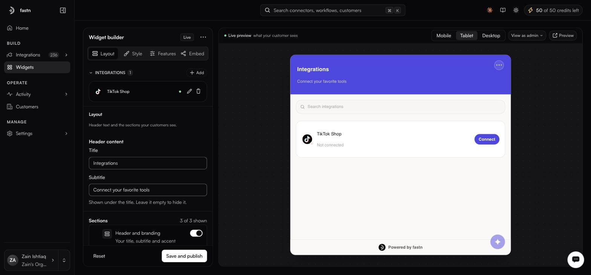

# Embed

<figure><figcaption>Where Embed fits in the integration lifecycle</figcaption></figure>

## What does it do?

Embed puts one widget inside your product. Your customers browse the integrations you offer, sign in to their own accounts, and adapt each integration to how they work, under your branding and without a fastn account. Each session is scoped to one customer by a token your backend issues, so customers only ever see their own connections.

## Who is it for?

| Role | What they use Embed for |
| --- | --- |
| **App developer** | Add the widget to the product and issue a token per customer from the backend |
| **Product owner** | Choose which integrations customers see, what they may change, and how the widget looks |
| **Customer success** | Send a share link so a customer can connect before the embed ships |

## How do I use it?



One HTML tag, with a token minted by your backend for the signed-in customer.

```html
<iframe
  src="https://api.fastn.dev/api/v1/embed/iframe?token=YOUR_EMBED_TOKEN"
  style="width:100%; height:600px; border:none"
  allow="clipboard-write"
></iframe>
```

[Iframe](embedding/iframe.md) · [Token API](embedding/token-api.md) · [Embedding quickstart](../tutorials/developer/embedding-quickstart.md)



The SDK mounts the same widget and adds events when a customer connects an app, silent token refresh, live theming and modal mode.

[SDK](embedding/sdk.md) · [SDK reference](../reference/sdk/README.md)



No code. In **Embed → Widget → Embed**, pick a customer and create a share link with an expiry. Right for pilots and for customers who are waiting on your embed. Treat the link as a secret.

[Shareable links](embedding/README.md)



## Before you go live

Mint tokens per customer on your backend, brand the OAuth consent screen with your own OAuth app, and test as a real customer. The full list is in [Embedding in production](embedding/production-checklist.md).

## Example prompts

Your AI tool can set up the customer-facing side too:

| Job | Prompt |
| --- | --- |
| Create the widget | *Create a widget offering the HubSpot and Stripe integrations, and give me the embed snippet.* |
| Add a test customer | *Create a test customer called Acme so I can try the widget as them.* |
| Check what customers see | *Which integrations does the widget offer, and which can customers change?* |

## Questions?

* Who can see what: [Customers and tenancy](../tutorials/developer/understanding-tenancy.md).
* Keys and headers: [API keys and MCP](../manage/api-keys.md).
* What your customers see: [Using integrations in the widget](../tutorials/end-user/README.md).

## Works with

* [Build](../build/README.md): the integrations the widget offers.
* [Operate](../operate/overview.md): each customer's health once they connect.

## The widget screen

**Widgets**

Everything under Build exists so that this screen can do its job. The widget is the only part of fastn your customers ever touch: they browse the integrations you offer, authorise their own accounts, and configure what syncs: inside your product, under your branding.

<figure><figcaption>Configure on the left, see exactly what the customer sees on the right.</figcaption></figure>

Two pages cover it:

[Widget builder](widget-builder/README.md)

[Embedding the widget](embedding/README.md)

### There is no widget list

**Widgets** in the sidebar opens `/widgets`, which *is* the builder. There is no separate list page: the **INTEGRATIONS** panel inside the builder is the list of what your widget offers. A **Live** badge appears in the builder header once the widget has been saved.

### The preview

The preview renders the widget at **Mobile**, **Tablet** and **Desktop** widths, with **Tablet** selected by default. The tenant selector at the top right, defaulting to **View as admin**, renders the widget as any one of your customers, so you can see their actual connection states rather than a mock-up.

**Preview** opens the widget on its own page, away from the builder panel, at `/widgets/preview`. Use it to see the widget at full size, or to check it without the configuration panel beside it.


**The preview is not a link you can send to a customer.** It is a page inside your own dashboard and it needs a fastn login, so a customer opening it sees nothing. To put the widget in front of someone who has no fastn account, create a [shareable link](embedding/README.md#shareable-links) instead - that is the one that works for them.


### Saving, and the two Resets

**Save and publish** in the sticky footer pushes changes to the live widget.


The two Resets do different things. **Reset**, beside Save and publish in the footer, discards changes you have not saved. **Widget actions** ⋯ → **Reset to defaults** throws the whole configuration back to its defaults. Check which one you are clicking.

