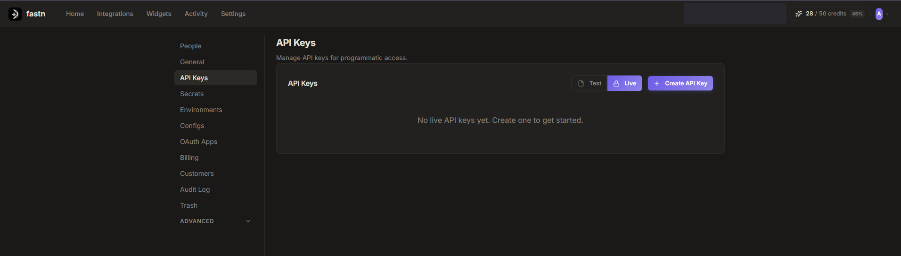
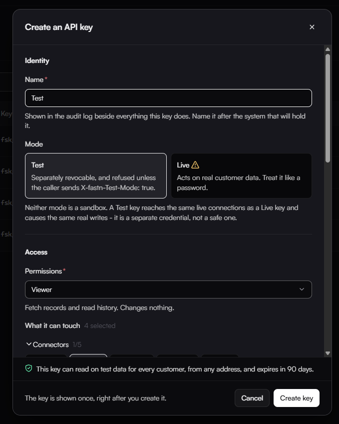
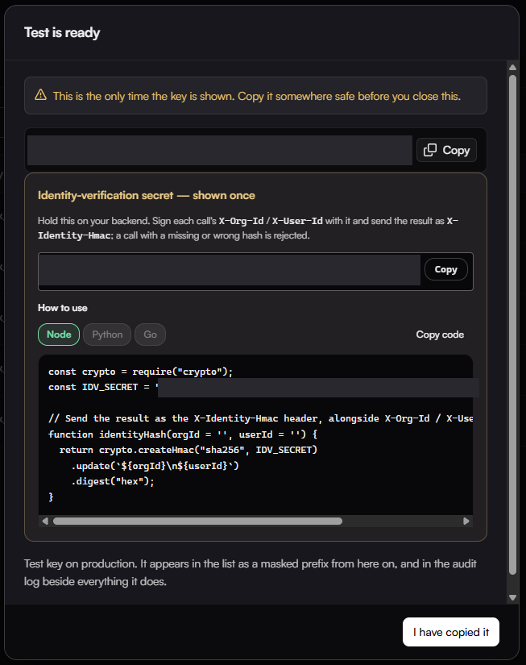

# Integration flow

Terms used on this page are defined in the [Glossary](../../reference/glossary.md).

### Pre-requisites

Before you start, you need an API key. We also recommend two optional security measures:

* Enable caller identity verification (HMAC) on the API key.
* Compute an identity hash on your backend and send it with every tenant-specific request.

#### Creating an API key

1. Go to your **Fastn dashboard** → **Settings** → **API Keys**.

<figure><figcaption></figcaption></figure>

2. Click **+ Create API Key**.
3. In the dialog:
   * **Name**: give it something identifiable.
   * **Mode**: select **Live** for production use or **Test** for development.
   * Set **scopes**, **IP whitelisting**, **rate limits**, and **expiry** as needed.
   * Enable **caller identity verification (HMAC)**. This is optional but recommended for security.
4. Click **Create Key**.

<figure><figcaption></figcaption></figure>

#### Creating an identity hash (recommended)

Sending an identity hash with tenant-specific requests is optional, but we recommend it for security. The hash confirms that the org ID and user ID you're sending are ones your backend actually authorized.

If you skip this section, omit the `x-identity-hmac` header from your requests and don't enable HMAC on your API key.

**1. Get your identity-verification secret**

When you create an API key with HMAC enabled, a dialog appears showing the secret along with code snippets for generating the hash.

<figure><figcaption></figcaption></figure>

**Safety precautions:**

* The secret is shown only once. If you lose it, you'll need to generate a new one.
* Never ship the secret to the client. It must live only on your backend. If it appears in frontend code, anyone can forge a valid hash for any org or user.

**2. Compute the hash**

The hash is an HMAC-SHA256 of the org ID and user ID, joined with a newline and signed with your secret:

```js
const crypto = require("crypto");
const IDV_SECRET = process.env.IDV_SECRET;

function identityHash(orgId = '', userId = '') {
  return crypto.createHmac("sha256", IDV_SECRET)
    .update(`${orgId}\n${userId}`)
    .digest("hex");
}
```

**3. Send it with the identity headers**

Attach the result as `x-identity-hmac`, alongside the plaintext `x-org-id` header and, if you use it, the optional `x-user-id` header:

```
x-org-id: <org-id>
x-user-id: <user-id>  // optional
x-identity-hmac: <identityHash(orgId, userId)>  // optional, recommended
```

The user ID is optional. If you don't send `x-user-id`, call `identityHash(orgId)` so the user ID defaults to an empty string.

The plaintext headers tell the gateway which identity is being claimed, and the hash proves that your backend authorized that specific claim. The gateway rejects any call whose hash doesn't match the one it recomputes from the plaintext values. If your API key is set to enforce HMAC verification, it also rejects calls where the hash is missing.

### Integration steps

#### Sign up a customer

**1. Register the customer organization**

From your backend server, call Create a Customer Organization to register the customer org in Fastn. See [API Reference: Create a Customer Organization](#create-a-customer-organization).

#### Integrate the widget

**2. Retrieve an embed token**

From your backend server, call Generate Embed Token to get the authentication token for the tenant. See [API Reference: Generate Embed Token](#generate-embed-token).

**3. Load the widget**

Pass the token to your frontend and embed the iframe:

```html
<iframe
  src="https://api.fastn.dev/api/v1/embed/iframe?token=<token>"
  style="width:100%;height:600px;border:none"
  allow="clipboard-write">
</iframe>
```

### API Reference

#### Create a Customer Organization

**Endpoint**

```
POST https://api.fastn.dev/api/v1/orgs
```

**Headers**

```
authorization: Bearer <YOUR_API_KEY>
content-type: application/json
```

**Body**

```json
{
  "name": "<ORG_NAME>",
  "orgId": "<ORG_ID>",
  "tier": "<TIER_NAME>", //optional
  "limits": { //optional
    "connections": <MAX_CONNECTION_COUNT>
  }
}
```

#### Generate Embed Token

**Endpoint**

```
POST https://api.fastn.dev/api/v1/embed/token
```

**Headers**

```
authorization: Bearer <YOUR_API_KEY>
content-type: application/json
x-org-id: <ORG_ID>
x-user-id: <USER_ID>  // optional
x-identity-hmac: <IDENTITY_HASH>  // optional, recommended for security
```

**Body**

```json
{ }
```

#### Create a SaaS Connection (optional)

**Note:** You only need this if Fastn must access your product's APIs.

**Endpoint**

```
POST https://api.fastn.dev/api/v1/connections
```

**Headers**

```
authorization: Bearer <YOUR_API_KEY>
content-type: application/json
accept: application/json
x-org-id: <ORG_ID>
x-user-id: <USER_ID>  // optional
x-identity-hmac: <IDENTITY_HASH>  // optional, recommended for security
```

**Body**

```json
{
  "connectorId": "<CONNECTOR_ID>",
  "authMethodId": "<AUTH_METHOD_ID>",
  "credentials": {
    "access_token": "<YOUR_API_KEY>"
  },
  "name": "<CONNECTION_NAME>",
  "connectionScope": "<CONNECTION_SCOPE_NAME>"
}
```
