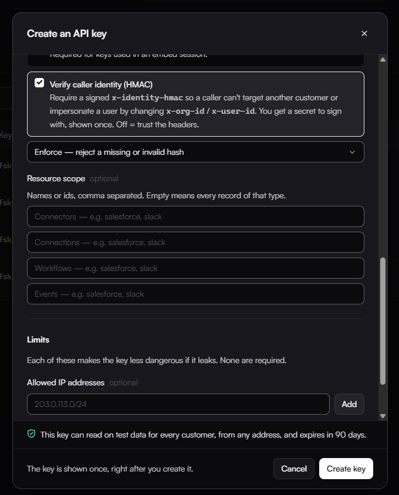

# Integration flow

Before you start, complete the [Pre-requisites](#pre-requisites): an API key with identity verification, and an identity hash for each tenant-specific request. Terms used on this page are defined in the [Glossary](../../reference/glossary.md).

## User Sign-up

### 1. Register the tenant

Call Create a Customer Organization (see [API Reference: Create a Customer Organization](#create-a-customer-organization)) from your backend server to register the customer org in Fastn.

## Widget Integration

### 2. Retrieve a token

Call Generate Embed Token (see [API Reference: *Generate Embed Token*](#generate-embed-token)), from your backend server to get the authentication token for the tenant.

### 3. Load the widget

Pass the token to your frontend and embed the iframe:

```html
<iframe
  src="https://api.fastn.dev/api/v1/embed/iframe?token=<token>"
  style="width:100%;height:600px;border:none"
  allow="clipboard-write">
</iframe>
```

## API Reference

### Generate Embed Token

**Endpoint**

```
POST https://api.fastn.dev/api/v1/embed/token
```

**Headers**

```
authorization: Bearer <YOUR_API_KEY>
content-type: application/json
x-org-id: <ORG_ID>
x-user-id: <USER_ID>  //optional
x-identity-hmac: <IDENTITY_HASH>
```

**Body**

```json
{ }
```

### Create a Customer Organization

**Endpoint**

```
POST https://api.fastn.dev/api/v1/orgs
```

**Headers**

```
authorization: Bearer <YOUR_API_KEY>
content-type: application/json
```

**Body**

```json
{
  "name": "<ORG_NAME>",
  "orgId": "<ORG_ID>",
  "tier": "<TIER_NAME>",
  "limits": {
    "connections": <MAX_CONNECTION_COUNT>
  }
}
```

## Pre-requisites

### Creating an API key

Here's how to generate one:

1. Go to your **Fastn dashboard** → **Settings** → **API Keys**.

<figure><figcaption></figcaption></figure>

2. Click **+ Create API Key**.
3. In the dialog:
    * **Name**: give it something identifiable
    * **Mode**: select **Live** for production use or test for dev use.
    * Set **scopes**, **IP whitelisting**, **rate Limits**, and **expiry** as needed.
    * Enable caller identity verification (HMAC).
4. Click **Create Key**.

<figure><figcaption></figcaption></figure>

<figure><figcaption></figcaption></figure>

### Creating an Identity Hash

Every tenant specific request needs to provide an identity hash to confirm that the org-id and user-id you're sending are ones your backend actually authorized.

#### 1. Get your identity-verification secret

Once you create an API key with HMAC enabled the following dialog will appear. Which contains the secret and code snippets to generate the HMAC key.

<figure><figcaption>The key and the secret are shown once. They are blanked out in this screenshot.</figcaption></figure>

**Safety pre-cautions:**

* If the secret is lost, you'll need to generate a new one.
* Never ship this secret to the client. It only ever lives on your backend. If it appears in frontend code, anyone can forge a valid hash for any org or user.

#### 2. Compute the hash

The hash is an HMAC-SHA256 of the org ID and user ID, newline-joined, signed with your secret:

```js
const crypto = require("crypto");
const IDV_SECRET = process.env.IDV_SECRET;

function identityHash(orgId = '', userId = '') {
  return crypto.createHmac("sha256", IDV_SECRET)
    .update(`${orgId}\n${userId}`)
    .digest("hex");
}
```

#### 3. Send it alongside the identity headers

Attach the result as `x-identity-hmac`, sent together with the plaintext `x-org-id` and `x-user-id`.

```
x-org-id: <org-id>
x-user-id: <user-id>
x-identity-hmac: <identityHash(orgId, userId)>
```

The plaintext headers tell the gateway which identity is being claimed; the hash proves your backend authorized that specific claim. The gateway rejects a call whose hash is missing or doesn't match what it recomputes from the plaintext values.

### Create a SaaS Connection (Optional)

**Note:** Only needed if access to your product APIs from Fastn is required.

**Endpoint**

```
POST https://api.fastn.dev/api/v1/connections
```

**Headers**

```
authorization: Bearer <YOUR_API_KEY>
content-type: application/json
accept: application/json
x-org-id: <ORG_ID>
x-user-id: <USER_ID>  //optional
x-identity-hmac: <IDENTITY_HASH>
```

**Body**

```json
{
  "connectorId": "<CONNECTOR_ID>",
  "authMethodId": "<AUTH_METHOD_ID>",
  "credentials": {
    "access_token": "<YOUR_API_KEY>"
  },
  "name": "<CONNECTION_NAME>",
  "connectionScope": "<CONNECTION_SCOPE_NAME>"
}
```
