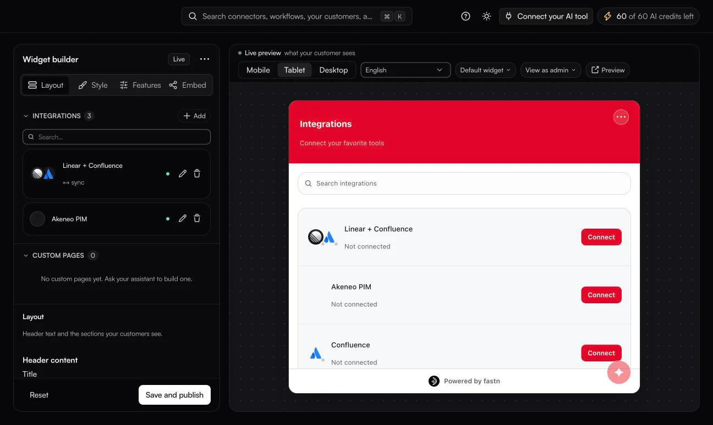

# Widget builder

**Embed → Widget** · [Open in Fastn](https://app.fastn.dev/widgets)

The **widget** is a ready-made integrations page that you embed in your product, styled to match your brand. Your customers use it to browse the integrations you offer, sign in to their own apps and turn integrations on, without leaving your product or creating a Fastn account. For example, a project management tool can put the widget on its Settings page, so each customer connects their own Slack workspace and turns on an integration that posts new tasks to a Slack channel.

You set up the widget in the **widget builder**: which integrations it offers, how it looks and what customers can do in it. Your developers then put it in your product using the **Embed** tab, which has its [own page](../embedding/README.md).

<figure><figcaption>
Where this fits: stage 2 of the integration lifecycle
</figcaption></figure>


**Do this from your AI tool.** Fastn recommends connecting your preferred AI agent, such as Claude, Cursor or VS Code, to the [Fastn MCP server](../../build/mcp-gateway/README.md) and using its tools to create and update your widget. For example, ask it: *"Add the HubSpot contact sync integration to my widget."* To connect your AI agent, see [Connect your AI tool](../../build/mcp-gateway/README.md#open-the-connect-dialog), or the setup guide for [Claude](../../build/mcp-gateway/claude.md), [Claude Code](../../build/mcp-gateway/claude-code.md), [Cursor](../../build/mcp-gateway/cursor.md), [VS Code](../../build/mcp-gateway/vscode.md) or [any other MCP client](../../build/mcp-gateway/README.md#how-your-ai-tool-connects).


### The builder

Opening **Embed → Widget** takes you straight into the builder. There is no list of widgets.

<figure><figcaption>The builder on the left, a live preview of what your customer sees on the right.</figcaption></figure>

The left panel has four tabs:

* **Layout:** the header text and which sections show. See [Layout](layout.md).
* **Style:** colors, fonts and shapes, to match your brand. See [Style](style.md).
* **Features:** optional things your customers can do in the widget, and who can do what. See [Features](features.md).
* **Embed:** the code your developers use to put the widget in your product. See [Embed the widget](../embedding/README.md).

Below the tabs is the list of [integrations](#integrations) the widget offers. The right panel is the [live preview](#live-preview), which updates as you make changes.

### Integrations

The **INTEGRATIONS** panel lists what the widget offers, with a count. This list is what your customers browse. Everything else in the builder changes how the widget looks and behaves, not what it offers.

Each row shows:

* **Logos and name:** the apps the integration uses. An integration that moves data between two apps shows both logos and a direction marker, such as `Dynamics 365 F&O → BigCommerce B2B  outbound →`.
* **Status dot:** **draft** or **active**.
* **Pencil:** opens **Edit Integration**, where most of an integration's setup lives. See [Edit integration](edit-integration.md).
* **Trash:** deletes the integration from every customer's widget at once. See [Delete an integration](edit-integration.md#delete-an-integration).

#### Add integrations

**Add** opens the **Add Integrations** dialog, with two tabs:

* **Apps:** **Select connectors**, to add individual apps from your catalog.
* **Unified:** add a [unified API](../../build/unified-apis/README.md) category instead of one connector at a time.

On the **Apps** tab, **Scope:** offers **Organization level** (the default, captioned "Shared connections") or **User level** ("Per-customer connections"). The choice is saved on each integration you create, where it sets the integration's sync direction and the context given to AI agents. It does not share or separate connections. Which customer's connections an integration uses comes from the token the widget runs with. See [Embed the widget](../embedding/README.md).

### Live preview

The right panel shows what your customers see. The toolbar reads **Live preview** · *what your customer sees*, and has these controls:

* **Mobile / Tablet / Desktop:** switches the preview width. **Tablet** is selected by default.
* **Customer selector:** reads **View as admin** until you pick a customer. Pick one to show the widget with that customer's real connections instead of a mock-up. The assistant launcher stays disabled until you pick a customer.
* **Preview:** opens the widget full page in a new tab (`/widgets/hub`), for the customer you picked. It needs a Fastn login, so it is for you and your team, not a link to send to a customer.

In the preview, each integration shows its app icons and name, its connection status, and one action: **Connect** if the customer has not set it up yet, or **Manage** once they have. When the apps list is the only tab, the tab bar is hidden. At the bottom, the **Powered by fastn** footer shows unless you turned it off on the [Tokens](style.md#tokens) sub-tab.

### Save, discard and reset

The badge in the builder header reads **Live** when everything is saved, and **Unsaved changes** while you have edits pending. The footer at the bottom of the builder has three buttons:

* **Save and publish:** publishes your changes to the live widget.
* **Discard changes:** shown only while you have unsaved edits. It puts the builder back to the configuration that is published now. Nothing your customers see changes.
* **Reset:** replaces the whole widget with the defaults. It is not undo. **Widget actions** ⋯ → **Reset to defaults** in the builder header does the same thing.


**Reset replaces your widget with the defaults for every customer, immediately.** **Reset** and **Reset to defaults** both open the **Reset widget to defaults?** dialog. After you type `RESET`, they throw away the whole configuration (sections, integrations, templates and theme) and publish the defaults to every customer using the widget. It cannot be undone. To drop edits you have not saved, use **Discard changes** instead.


### In this section

* [Build your widget](../../tutorials/saas-admin/building-your-widget.md): set up the widget step by step.
* [Edit integration](edit-integration.md): every setting in the **Edit Integration** dialog.
* [Layout](layout.md): the header text and the sections customers see.
* [Style](style.md): theme, colors, type, shape and design tokens.
* [Features](features.md): optional features and customer access rules.
