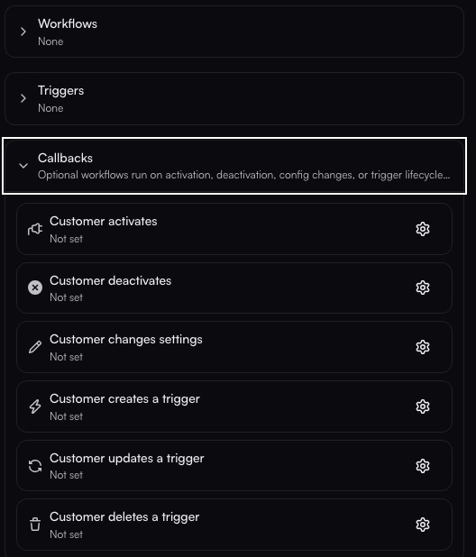

# Edit Integration

**Embed → Widget → INTEGRATIONS → pencil on a row**

Each row in the INTEGRATIONS panel carries a status dot, a **pencil** and a **trash**. The pencil opens **Edit Integration**, and this dialog is where most of an integration's behavior is configured. The trash deletes the integration.


**Deleting an integration takes effect immediately.** It disappears from every customer's widget at once, with no draft or publish step, and it cannot be undone. Customers running it have their installations stopped and archived; customers who made their own customized version keep that version working.


## Identity and template

| Field | What it does |
| ----- | ------------ |
| **NAME** | What the customer sees on the card |
| **CONFIGURATION TEMPLATE** | **Edit field mappings & sync rules**, described in the dialog as *The shared template every installation clones from.* Each customer's setup starts as a copy of this, so editing the template changes the starting point for new setups, not the ones already created |

## Status

**Widget enabled** is a switch: *Globally visible to customers. Disabling hides the widget without affecting existing installations.* Customers who already activated it keep running; new ones simply do not see it.

A draft integration shows a **Draft.** notice here: new customers do not see it until it is published, and customers already running it keep it.

## Activation mode

How many times one customer may activate this integration.

| Mode | Meaning |
| ---- | ------- |
| **Single activation** | *Each customer has one connected instance.* |
| **Multi-connection** | *Customers can activate it more than once, each time with its own set of connections.* |

Pick **Multi-connection** when one customer legitimately has several accounts on the same app, such as two TikTok Shop storefronts.

## Customer visibility

| Option | Meaning |
| ------ | ------- |
| **All customers** | Every customer under this account sees this widget |
| **Specific customers** | Only the customers you pick below can see it |

**Specific customers** is how you pilot an integration with a few accounts before opening it to everyone.

## Connectors

The apps this integration connects. Search the catalog and add them; each selected connector becomes a chip carrying a **gear** and an **X**.

### Per-connector settings

The gear on a connector chip opens **&lt;Connector&gt; settings**, which *override only what differs from the connector defaults*.

| Setting | What it does |
| ------- | ------------ |
| **AUTH PROVIDER** | **Use platform default**, or pick a custom OAuth app so customers sign in via your provider instead of the platform's. **+ Add your own app** registers a new one from here. This is what puts your own brand on the consent screen |
| **Show logo** | Includes that connector's logo in the integration's logo stack. Turning it off **only hides the icon**. The app stays part of the integration and still connects |
| **Connection scope** | Shown only when the connector has registered scopes. With a scope set, activation pins the customer's connection provisioned under that scope and hides the connector from their connect flow. *A customer without that connection cannot activate.* Leave it on **None** for a normal connect |
| **Delete on deactivate** | When a setup is deleted, also delete this connector's connection, but only if no other active setup shares it |

**Reset overrides** returns the connector to the defaults; **Done** closes the panel.


**Delete on deactivate is destructive.** Deleting a connection is permanent. Any workflow, trigger or other integration using that connector for that customer stops working until the customer reconnects. Leave it off if connections are shared across more than one integration.


## Unified APIs

Instead of naming connectors one at a time, attach a **unified** category and the integration serves whichever provider each customer connected. The picker shows each category with how many entities it carries, for example **CRM** with 10 entities, **Documents** with 2, **Knowledge Base** with 1, **Messaging** with 2, and **Project Management**. See [Unified APIs](../../build/unified-apis/README.md).

## Workflows

**Selected workflows auto-bind to every customer with an active connection when you Save & Publish.**

This is the binding people look for: rather than wiring a workflow per customer, you pick it once here and every customer who has connected gets it. The panel shows how many are bound, a chip per selection, and a search listing each workflow with its slug, such as `fulfilment-dry-run-cin7-to-tiktok-read-only` or `cin7_connection_test`.

Binding happens **on Save & Publish**, not when you tick the box.

## Triggers

Triggers the customer gets with this integration. Each has a gear for its template defaults and for *what customers may edit*. A fresh integration reads **None**.

### Trigger categories

**Add category** (up to 20) creates optional groups, for example sync directions, that customers choose between when they install. Once you have a category, a **Selection title** field sets the question customers see (the placeholder is *What do you want to sync?*). Tag each trigger with its categories through its gear; untagged triggers are always created.

<figure><figcaption>The lifecycle events. Each one runs a workflow you choose with the gear.</figcaption></figure>

## Callbacks

**Optional workflows run when a customer installs or uninstalls, on config changes, or on trigger lifecycle events**

A callback runs one of your **workflows** when a customer does something in the widget. Each row has a toggle and a gear to choose the workflow; an unset row reads **Not set**, and a set one names the workflow and how it runs, for example *TikTok Shop Connection Test · background*.

| Callback | Fires when |
| -------- | ---------- |
| **Customer activates** | A customer turns the integration on |
| **Customer deactivates** | A customer turns it off |
| **Customer changes settings** | A customer edits its configuration |
| **Customer finishes a setup link** | A customer completes a setup link you sent |
| **Customer adds another account by link** | A customer connects another account through a link |
| **Customer removes an account** | A customer removes one of their connected accounts |
| **Customer creates a trigger** | A customer adds a trigger |
| **Customer updates a trigger** | A customer edits one |
| **Customer deletes a trigger** | A customer removes one |

**Customer activates** is the one most teams set first: it runs a connection test the moment a customer connects, so a broken credential surfaces immediately rather than on the first real sync.

Each callback runs as **Blocking** (the default: *Runs first and can stop the action.*) or **Background** (*Runs after; never blocks the customer.*). The three account events (finishes a setup link, adds another account, removes an account) are reported after the fact, so they always run in the background.


A callback marked **background** does not hold up the customer. The widget completes the activation and the workflow runs behind it, so a slow check never blocks the person in front of the screen.


## Saving

**Save & Publish** applies everything, including binding the selected workflows, and offers the integration to every allowed customer. On a draft integration, **Save draft** saves your changes and keeps it a draft, so new customers still do not see it. **Cancel** discards the dialog.
