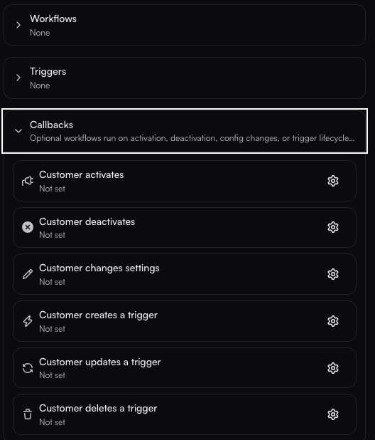

# Edit integration

**Embed → Widget** → the pencil on an integration · [Open in Fastn](https://app.fastn.dev/widgets)

An integration in the widget is what your customers turn on. The **Edit Integration** dialog is where you decide what it does for them: which apps it connects, which workflows run for each customer, which triggers they get, and which of your workflows run when they turn it on, off or change it.

To open it, select the **pencil** on a row of the **INTEGRATIONS** panel in the [widget builder](README.md#integrations).

### Identity and template

| Field | What it does |
| ----- | ------------ |
| **NAME** | What the customer sees on the card. |
| **CONFIGURATION TEMPLATE** | **Edit field mappings & sync rules**, described in the dialog as *The shared template every installation clones from.* Each customer's setup starts as a copy of this, so editing the template changes the starting point for new setups, not the ones already created. |

### Status

**Widget enabled** is a switch: *Globally visible to customers. Disabling hides the widget without affecting existing installations.* Customers who already turned the integration on keep running it; new customers don't see it.

A draft integration shows a **Draft.** notice here. New customers don't see it until it is published, and customers already running it keep it.

### Activation mode

How many times one customer can turn this integration on.

* **Single activation:** *Each customer has one connected instance.*
* **Multi-connection:** *Customers can activate it more than once, each time with its own set of connections.* Pick it when one customer has several accounts on the same app, such as two TikTok Shop storefronts.

### Customer visibility

* **All customers:** every customer under your organization sees this integration.
* **Specific customers:** only the customers you pick can see it. Use it to try an integration with a few customers before you offer it to everyone.

### Connectors

The apps this integration connects. Search the catalog and add them. Each connector you add becomes a chip with a **gear** and an **X**.

#### Per-connector settings

The gear on a connector chip opens **&lt;Connector&gt; settings**, which *override only what differs from the connector defaults*.

| Setting | What it does |
| ------- | ------------ |
| **AUTH PROVIDER** | **Use platform default**, or pick your own OAuth app so customers sign in through it instead of Fastn's. This is what puts your own brand on the consent screen. **+ Add your own app** registers a new one from here. |
| **Show logo** | Includes that connector's logo in the integration's logos. Turning it off **only hides the icon**. The app stays part of the integration and still connects. |
| **Connection scope** | Shown only when the connector has registered scopes. With a scope set, turning the integration on uses the customer's connection created under that scope, and hides the connector from their connect flow. *A customer without that connection cannot activate.* Leave it on **None** for a normal connect. |
| **Delete on deactivate** | When a setup is deleted, also delete this connector's connection, but only if no other active setup uses it. |

**Reset overrides** returns the connector to its defaults. **Done** closes the panel.


**Delete on deactivate deletes the customer's connection permanently.** Any workflow, trigger or other integration using that connector for that customer stops working until the customer connects again. Leave it off if more than one integration shares the connection.


### Unified APIs

Instead of adding connectors one at a time, add a **unified** category. The integration then works with whichever app in that category each customer connected. The picker shows each category with how many entities it has, for example **CRM** with 10 entities, **Documents** with 2, **Knowledge Base** with 1, **Messaging** with 2, and **Project Management**. See [Unified APIs](../../build/unified-apis/README.md).

### Workflows

**Selected workflows auto-bind to every customer with an active connection when you Save & Publish.**

You pick a workflow once here, and every customer who has connected gets it, so you don't set it up customer by customer. The panel shows how many workflows are selected, a chip for each, and a search that lists each workflow with its slug, such as `fulfilment-dry-run-cin7-to-tiktok-read-only` or `cin7_connection_test`.

Customers get the selected workflows when you select **Save & Publish**, not when you tick the box.

### Triggers

The triggers each customer gets with this integration. Each has a gear for its default settings and for *what customers may edit*. A new integration reads **None**.

#### Trigger categories

**Add category** (up to 20) creates optional groups, such as sync directions, that customers choose between when they turn the integration on. Once you have a category, a **Selection title** field sets the question customers see (the placeholder is *What do you want to sync?*). Tag each trigger with its categories through its gear. Triggers without a category are always created.

<figure><figcaption>The callback events. Each one runs a workflow you choose with the gear.</figcaption></figure>

### Callbacks

**Optional workflows run when a customer installs or uninstalls, on config changes, or on trigger lifecycle events**

A callback runs one of your workflows when a customer does something in the widget. Each row has a toggle and a gear to choose the workflow. A row with no workflow reads **Not set**. A row with one names the workflow and how it runs, for example *TikTok Shop Connection Test · background*.

| Callback | Runs when |
| -------- | ---------- |
| **Customer activates** | A customer turns the integration on. |
| **Customer deactivates** | A customer turns it off. |
| **Customer changes settings** | A customer edits its configuration. |
| **Customer finishes a setup link** | A customer completes a setup link you sent. |
| **Customer adds another account by link** | A customer connects another account through a link. |
| **Customer removes an account** | A customer removes one of their connected accounts. |
| **Customer creates a trigger** | A customer adds a trigger. |
| **Customer updates a trigger** | A customer edits one. |
| **Customer deletes a trigger** | A customer removes one. |

Most teams set **Customer activates** first. It can run a connection test the moment a customer connects, so a broken credential shows up straight away instead of on the first real sync.

Each callback runs in one of two ways:

* **Blocking:** the default. *Runs first and can stop the action.*
* **Background:** *Runs after; never blocks the customer.* The widget finishes the customer's action and the workflow runs after it, so a slow check never keeps the customer waiting.

The three account events (finishes a setup link, adds another account, removes an account) are reported after they happen, so they always run in the background.

[Widget callbacks](../../reference/widget-callbacks.md) lists what each workflow receives in `ctx.input` and what it can return.

### Localization

The integration's text in other languages. Pick a language from the list, or enter its code under **Other code**, then translate the text customers see. The widget builder's **Preview language** switch shows the result.

### Saving

* **Save & Publish:** applies everything, including giving the selected workflows to customers, and offers the integration to every customer allowed to see it.
* **Save draft:** shown on a draft integration. It saves your changes and keeps the integration a draft, so new customers still don't see it.
* **Cancel:** closes the dialog without saving.

### Delete an integration

The **trash** on a row of the **INTEGRATIONS** panel deletes the integration.


**Deleting an integration takes effect immediately, for every customer.** It disappears from every customer's widget at once, with no draft or publish step, and it cannot be undone. Customers running it have their installations stopped and archived. Customers who made their own customized version keep that version working.

