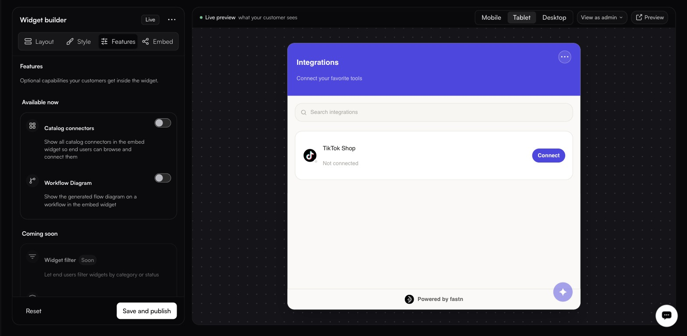

# Features

<figure><figcaption>The live preview keeps rendering the customer's view while you flip these.</figcaption></figure>

Optional capabilities your customers get inside the widget.

**Available now**: **Catalog connectors** and **Workflow Diagram** are off by default; **Generate MCP URL** is on by default.

| Feature                | What it does                                                                         |
| ---------------------- | -------------------------------------------------------------------------------------- |
| **Catalog connectors** | Show all catalog connectors in the widget so customers can browse and connect them.   |
| **Workflow Diagram**   | Shows the generated flow diagram on a workflow inside the widget.                     |
| **Generate MCP URL**   | Lets a customer generate a one-time URL from the header menu that connects an MCP client (Claude, ChatGPT, Cursor and others) to their integrations, with no account. You can disconnect it from the Embed tab. |

**Coming soon**

| Feature                | What it will do                                        |
| ---------------------- | -------------------------------------------------------- |
| **Widget filter**      | Let customers filter widgets by category or status.     |
| **Role based access**  | Role-based access control per widget.                   |


**Catalog connectors** widens the offer from the integrations you curated to everything public in your catalog. Useful for self-serve products, too broad for most. Decide deliberately.

