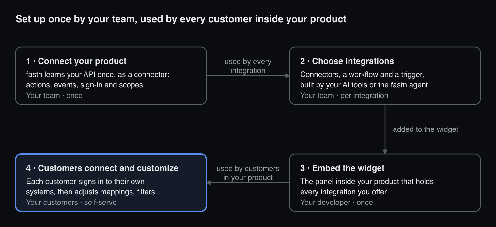

# Onboarding

Onboarding takes you through the four steps a SaaS company takes to offer integrations inside its product with fastn. Each step has its own page: what it's for and why, how it's done without and with fastn, what it's made of, the ways to do it, use cases, and how onboarding does it with you. Terms are defined in the [Glossary](../../reference/glossary.md).

| Step | What you do | Time | Needed to go live |
| --- | --- | --- | --- |
| [1 · Connect your product](connect-your-product.md) | Connect your product's API to fastn as a connector | Depends on your API and use case; about 25 min with your AI tools | Yes |
| [2 · Choose integrations](choose-integrations.md) | Build your first integration, or offer the whole catalog | 2–5 min, plus about 20 if a connector needs building | No |
| [3 · Embed the widget](embed-the-widget.md) | Add the widget to your product | Usually the same day as building your use case | Yes |
| [4 · Customers connect and customize](customers-connect-and-customize.md) | Connect and customize as a test customer, in your product | A few minutes | Yes |

<figure><figcaption>How the four steps fit together.</figcaption></figure>

Your team connects your product and builds integrations once; the widget carries them into your product, where each customer connects and customizes on their own.

**AI credits:** finishing onboarding earns you 50 AI credits on top of your plan's monthly allowance: 20 for step 1 and 10 for each other step. Building with your AI tools uses no AI credits.

Screenshots on these pages come from the onboarding screens, so the live app may differ slightly.

To build a first integration outside onboarding, see [Quickstart: your first integration](../quickstart.md).

**Get help:** ask the fastn agent (**Integrations** → **Agent** → **New session**), or contact the fastn team from the help menu in fastn.

### In this section

* [Connect your product](connect-your-product.md)
* [Choose integrations](choose-integrations.md)
* [Embed the widget](embed-the-widget.md)
* [Customers connect and customize](customers-connect-and-customize.md)
