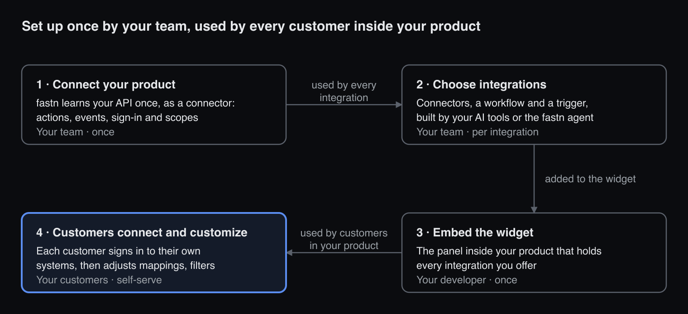

# Onboarding

Each step has its own page explaining what the step is for, how to do it, and how onboarding helps. Terms are defined in the [Glossary](../../reference/glossary.md).

| Step | What you do | Time | Required |
| --- | --- | --- | --- |
| [1 · Connect your product](connect-your-product.md) | Connect your product's API to fastn as a connector | Depends on your API and use case; about 25 min with your AI tools | Yes |
| [2 · Choose integrations](choose-integrations.md) | Build your first integration, or offer the whole catalog | Depends on the integration, plus the build time onboarding estimates if a connector needs building | No |
| [3 · Embed the widget](embed-the-widget.md) | Add the widget to your product | Depends on your product's codebase | Yes |
| [4 · Customers connect and customize](customers-connect-and-customize.md) | Connect and customize as a test customer, in your product | Depends on the integration | Yes |

Step 2 is optional because you do not have to build an integration to go live: you can offer the fastn catalog in your widget instead, with **Enable the whole fastn catalog** on the step or **Catalog connectors** in the **Features** tab of **Embed → Widget**. Step 4 is required because setup is complete only when a customer has connected an app in your widget; connecting once yourself as a test customer counts.

<figure><figcaption>How the four steps fit together.</figcaption></figure>

Your team connects your product and builds integrations once; the widget carries them into your product, where each customer connects and customizes on their own.

**AI credits:** finishing onboarding earns you 50 AI credits on top of your plan's monthly allowance: 20 for step 1 and 10 for each other step. Building with your AI tools uses no AI credits.

Screenshots on these pages come from the onboarding screens, so the live app may differ slightly.

To build a first integration outside onboarding, see [Quickstart: your first integration](../quickstart.md).

**Get help:** ask fastn's agent (**Build → Build with AI**), or contact the fastn team from the help menu in fastn.

### In this section

* [Connect your product](connect-your-product.md)
* [Choose integrations](choose-integrations.md)
* [Embed the widget](embed-the-widget.md)
* [Customers connect and customize](customers-connect-and-customize.md)
