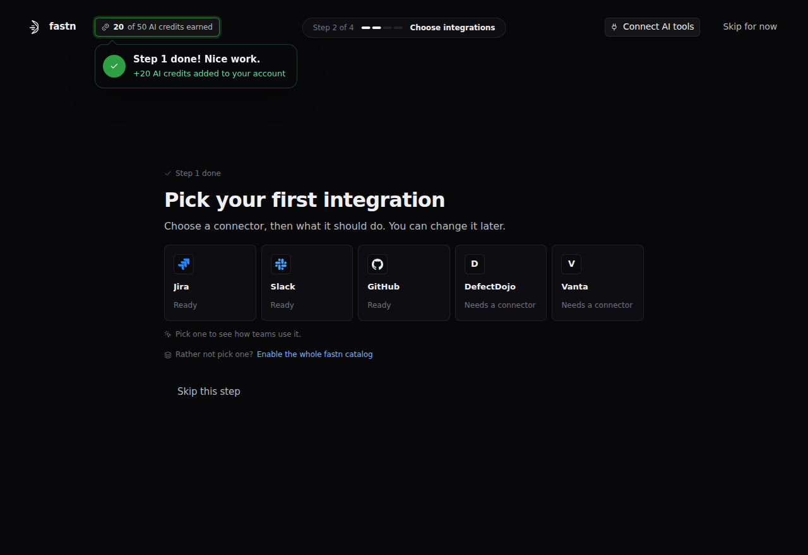

# Choose integrations

This step is for choosing the integrations your customers get inside your product, and building the first one. You pick a system your customers use and say what the integration should do; the fastn agent builds it. An integration is connectors plus a workflow: it moves data between your product and the customer's system and does a job there.

**Why:** customers ask for integrations as jobs, not connectors. Not "a HubSpot connector", but "when a shipment is created, add it to our HubSpot". What you choose here is what they find in your widget.

### Without fastn and with fastn

|  | Without fastn | With fastn |
| --- | --- | --- |
| Building it | Engineers learn the other system's API, then write the sync, sign-in, retries and field mapping | Describe the job in a sentence; the fastn agent or your AI tools build and test it |
| Another system | A new engineering project | Pick it from the catalog, or have its connector built as in [step 1](connect-your-product.md) |
| Running it | Your own queues, schedules and logs | fastn runs and logs every workflow, per customer |
| Different needs per customer | Custom code per customer | Each customer adjusts mappings and filters in the widget ([step 4](customers-connect-and-customize.md)) |

### What it's made of

| Component | What it is | Example |
| --- | --- | --- |
| Connectors | Your product's connector and the customer's system's connector | Your product and HubSpot |
| Workflow | The code that reads, transforms and writes data | Turn a shipment into a HubSpot deal |
| Trigger | What starts the workflow: an event in a connected system, a webhook, or a schedule | A shipment is created |
| Configuration template | The default field mappings and rules each customer starts from | Shipment status → deal stage |
| Test cases | Checks the fastn agent runs before publishing | One deal per shipment |
| Versions | Publishing saves a numbered copy you can go back to; deploying sends it to Test (to try it) or Live (where it runs for customers) | v3 in Live |

### Ways to do it

| Way | Best when | What you do |
| --- | --- | --- |
| The fastn agent | You want it built and tested for you | Describe the job, or pick a suggested use case. Review the plan, answer its questions, approve the mappings and tests. Uses AI credits |
| Your AI tools | Your team works in Claude, ChatGPT, Cursor or similar | Describe the job in your AI tool through fastn's MCP server, and approve each step in the chat |
| Connectors only | Customers only need to connect a system your own code or agents use | Add the connector to the widget, with no workflow |
| Unified API | Customers use different systems for the same job | Add a category such as CRM: one "create contact" call works with HubSpot, Salesforce or another CRM |
| Whole catalog | Self-serve products, or you don't know yet what customers need | Turn on **Catalog connectors** in the widget builder, and build integrations later |
| By hand | You want full control | Create the workflow and trigger, then add it to the widget. Code editing is off in most workspaces, so you change code by asking the fastn agent |

### Use cases and scenarios

| Use case | Example | Trigger | Scope |
| --- | --- | --- | --- |
| Push events out | A shipment created in your product is added to the customer's HubSpot | Event from your product | Org level |
| Pull data in | The customer's Jira issues are imported into your product | Schedule | Org level |
| Notifications | A message goes to the customer's Slack when something critical happens | Event from your product | Org level |
| Personal systems | Meetings booked in your product go to each user's own Google Calendar | Event from your product | User level |

### Scope: shared or per user

Each integration has a **Scope** setting: who shares a connection inside one customer. Either way, each customer's connections stay separate, as long as each embed token is minted for that customer.

|  | Org level | User level |
| --- | --- | --- |
| One connection for | The whole customer, shared by its users | Each user at a customer |
| Typical systems | CRM, project tool, data warehouse, shared channels | Their own email or calendar |

### In the onboarding

Onboarding suggests systems for your product, each marked **Ready** or **Needs a connector** (fastn has none for that system yet, so one is built first). Pick one, then a suggested use case or your own in a sentence, and watch the fastn agent build the connector, workflow, trigger, widget entry and connection. It answers its own questions with assumptions you confirm. Or enable the whole catalog and build later. Finishing the step earns 10 AI credits.

<figure><figcaption>Step 2: Pick your first integration.</figcaption></figure>

### Related docs

[Agent](../../build/agent/README.md) · [Creating a workflow via AI](../../tutorials/saas-admin/creating-a-workflow-via-ai.md) · [Workflows](../../build/workflows/README.md) · [Triggers](../../build/triggers/README.md) · [Unified APIs](../../build/unified-apis/README.md) · [Understanding tenancy](../../tutorials/developer/understanding-tenancy.md)
