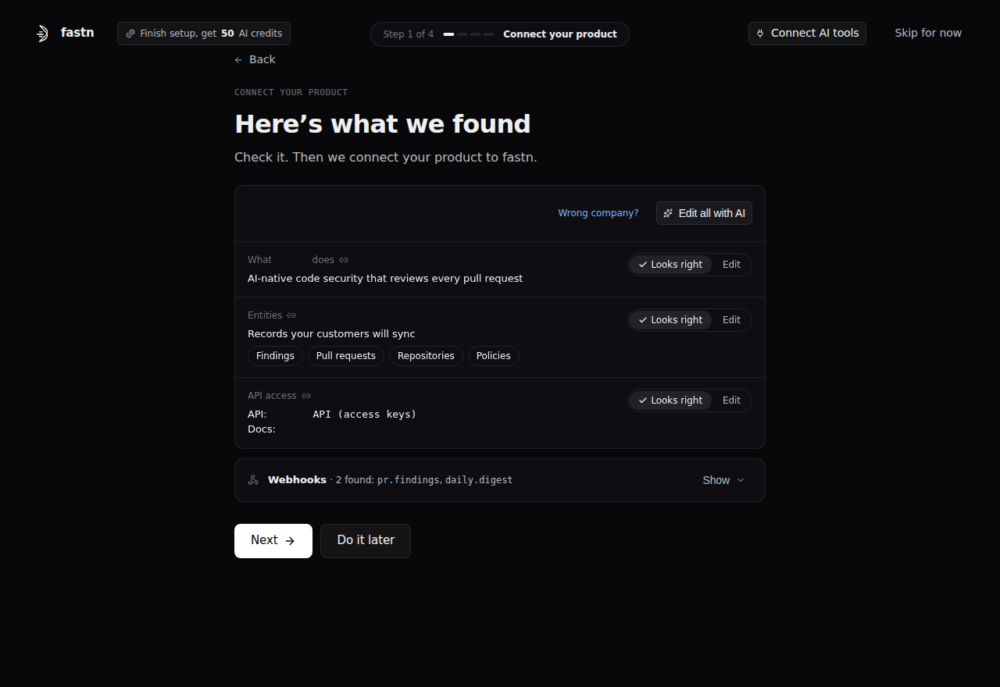

# Connect your product

This step is for connecting your product to fastn. fastn learns your product's API once, as a connector, and you register it as your SaaS connector. Every integration then reads from and writes to your product through that connector, for each customer.

**Why:** every integration your customers ask for has two ends, and one is always your product. Connecting it once means every integration reuses it, and each customer gets their own connection to your product. You can skip this step to explore fastn, but you need it to go live.

### Without fastn and with fastn

|  | Without fastn | With fastn |
| --- | --- | --- |
| Your API | Each integration hard-codes its own calls to it | Described once as a connector; every integration reuses its actions |
| Sign-in | You store and refresh each customer's credentials, per integration | Each customer's connection holds their own credential |
| Events | Custom webhook code for each integration | The connector's webhook config lets your product's events start workflows |
| API changes | Fix every integration that uses the changed endpoint | Update the connector once and publish a new version |

### What it's made of

| Component | What it is |
| --- | --- |
| Connector | The definition of your API in fastn: its actions, auth methods and webhook config. It holds no credentials |
| Actions | One operation each, such as list, get or create a record. Workflows, the fastn agent and AI tools call actions, never your API directly |
| Auth methods | How a customer signs in to your product: API key, OAuth 2.0, Basic, Bearer, Custom fields and more. An optional verification action checks that the credential works |
| Webhook config (optional) | How fastn subscribes to your product's events, so they can start workflows |
| Versions | Every change is saved as a Test version. Customers run the Live version until you publish |
| SaaS connector and connection scopes | Your connector, registered as your product. A connection scope is one capability of your API, such as `billing`; each customer holds one connection per connection scope |

### Ways to do it

| Way | Best when | What you get |
| --- | --- | --- |
| Catalog connector | Your product is already in fastn's catalog | A connector fastn maintains. Nothing to build |
| Your AI tools | Your team works in Claude, ChatGPT, Gemini, Cursor or similar | The connector built and tested from your chat, through fastn's MCP server. Uses no AI credits |
| The fastn agent | You want fastn to build it from your API docs or OpenAPI file | The connector built and tested by the fastn agent. Uses AI credits |
| By hand | You want full control | An empty connector you fill in action by action (you can paste a curl command) |
| Import | You have a connector exported from another fastn workspace | The connector from a fastn .json bundle, without connections |
| Request | You want fastn's team to build it | A connector built by fastn's team, with no committed date |

No public REST API? A connector can also use MCP (your MCP server's URL), a database (Postgres, MySQL, MSSQL, Redshift, MongoDB) or file transfer (SFTP, FTP, FTPS). If fastn can't reach your data at all yet, it tells you what it needs.

### Use cases and scenarios

| Use case | Example | What your connector needs |
| --- | --- | --- |
| Data into your product | A customer's CRM deals appear in your product | Create and update actions |
| Data out of your product | A new record in your product becomes a Jira ticket | Read actions and events |
| Two-way sync | Contacts stay in step with the customer's CRM | Read and write actions, events, and a key to match records, such as email |
| AI agents in your product | A customer's AI tool reads and updates records in your product | Clear action names and descriptions: agents pick actions by them |

### Before you go live

1. **Test it.** Connect your own test account and run each action until it shows Live tested.
2. **Publish it to Live.** **Integrations** → **Connectors** → your connector → **Overview** → **Versions** → **Publish to live**. Customers only run the Live version.
3. **Register it as your SaaS connector.** **Settings** → **SaaS Connectors** → **Add**, pick your connector, add its connection scopes, then **Add SaaS Connector**.

### In the onboarding

fastn checks your domain, researches your product and shows the result on the "Here's what we found" screen. You click **Looks right** or **Edit** on each row, then pick who builds the connector: your AI tools (recommended, no AI credits) or the fastn agent. If your product is already in the catalog, there's nothing to build. Finishing the step earns 20 AI credits.

<figure><figcaption>Step 1: Here's what we found.</figcaption></figure>

### Related docs

[Connectors](../../build/connectors/README.md) · [SaaS connectors](../../manage/saas-connectors.md) · [Adding fastn to Claude](../../build/mcp-gateway/claude.md) · [Building from your AI agent](../../build/building-from-your-ai-agent.md) · [Agent](../../build/agent/README.md)
