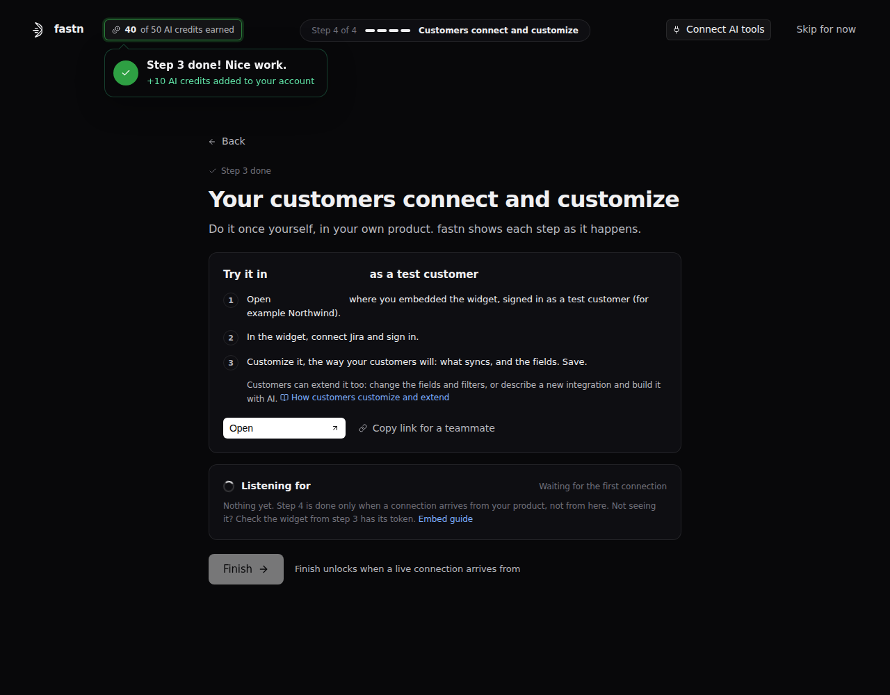

# Customers connect and customize

This step is for what your customers do: connect their own accounts in the widget and adjust each integration to how they work. Integrations then run for each customer with that customer's own connections and settings.

**Why:** every customer's data is different. When customers customize integrations themselves, you don't build a version per customer. Doing it once yourself, as a test customer inside your product, proves the whole chain works: your product, the widget, the connection and the workflow.

### Without fastn and with fastn

|  | Without fastn | With fastn |
| --- | --- | --- |
| Connecting | Customers send credentials to your support team, or you build a connect flow per system | Customers sign in to each system in the widget; their credentials stay theirs |
| Customizing | Feature requests and custom code per customer | Customers change mappings, filters and direction in **Configure**, or with **Build with AI** |
| Knowing it works | Customers report what broke | **Insights** shows runs and connection health, with alerts by email, Slack, Teams or webhook |
| Supporting customers | Search your own logs | You see each customer's connections, runs and events, and can replay a failed delivery |

### What it's made of

| Component | What it is |
| --- | --- |
| Customer | One of your customers. It must be Active before its integrations run |
| Connection | A customer's signed-in account on one system |
| Configuration | A customer's own direction, field mappings and filters, copied from the integration's configuration template |
| Build with AI | The customer describes a change in plain words and reviews it before saving |
| Insights and alerts | Runs, records, errors and connection health, with failure and threshold alerts |

### Ways to do it

| Way | How the customer connects |
| --- | --- |
| In the widget | **Connect**, sign in on the system's own page, then **Authorize** |
| Shareable link | Opens a link you send |
| Created for them | Your backend creates the connection with credentials you already hold ([step 3](embed-the-widget.md)) |
| A second account | **Add another connection**, where the integration allows it |

### Use cases and scenarios

| Use case | What the customer does |
| --- | --- |
| Different field names | Maps their "Region" field to your "Territory" |
| Only some records | Adds a filter, for example only deals above a value |
| One way instead of two | Turns off one direction of a two-way sync |
| A change in plain words | Asks **Build with AI**, then reviews each labelled change |
| Something broke | Sees it in **Insights**, or reconnects an expired connection |

### What to know

* **Activate customers.** A customer in **Pending admin activation** can't run integrations until an admin activates it.
* **First-time setup.** A configurable integration needs its first configuration made once by your team (Operator role or higher). Until then, the customer's **Configure** shows "No configuration found for this widget".
* **Changes apply on the next run.** Records already synced keep their old values.
* **Build with AI** sits at the bottom of the widget's **Apps** tab. It can add or remove fields, narrow which records sync, fix field pairings and change direction. It can't add a system you don't offer, re-sync old records, change the schedule or add custom logic.
* **Limits.** Customers share your plan's limits. Change one customer's in **Settings** → **Billing** → **Customize Customer Limits**.

### In the onboarding

You open your product where the widget is embedded, as a test customer, then connect and customize the integration from [step 2](choose-integrations.md). Onboarding lists each real event from your product (widget loaded, connected, customized, first run) and unlocks **Finish** on a live connection. Finishing the step earns 10 AI credits.

<figure><figcaption>Step 4: try it in your product as a test customer.</figcaption></figure>

### Related docs

[Customers](../../operate/customers.md) · [Managing customers](../../tutorials/saas-admin/managing-customers.md) · [Connection statuses](../../build/connections/statuses.md) · [Customizing your integrations](../../tutorials/end-user/customizing-your-integrations.md) · [Extending a pre-built integration](../../tutorials/end-user/extending-a-prebuilt-integration.md) · [Getting alerted](../../tutorials/end-user/getting-alerted.md) · [Troubleshooting](../../operate/troubleshooting.md)
