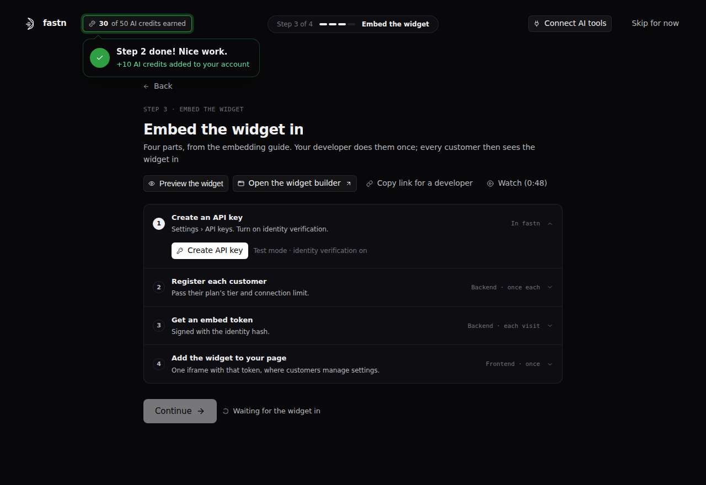

# Embed the widget

This step is for putting your integrations inside your product. The widget is the panel where your customers find, connect and customize integrations, under your brand, without signing in to fastn. It holds your connectors, the workflows behind them, and the AI your customers use to adjust them.

**Why:** customers can only use integrations they can turn on themselves. You embed the widget once; after that, new integrations and widget changes reach customers without a release on your side.

### Without fastn and with fastn

|  | Without fastn | With fastn |
| --- | --- | --- |
| Integrations page | Build your own marketplace and settings screens | The widget, styled to your product in the widget builder |
| Customer sign-in | OAuth flows and token refresh for every system | The widget opens each system's own sign-in; fastn stores and refreshes the credentials |
| Keeping customers apart | Your code keeps every token and record separate per customer | Your backend gets a short-lived embed token per customer; the widget shows only that customer's data |
| New integrations | A frontend and backend release | Add it in fastn and it appears in the widget |

### What it's made of

| Component | Where it lives | What it does |
| --- | --- | --- |
| Widget | Inside your product | The panel your customers use to connect and customize integrations |
| Widget builder | fastn | Sets the widget's look, features and **Allowed Origins** (which sites can show it) |
| API key and identity secret | Your backend | Authenticate your server, and sign which customer and user each call is for |
| Customer | fastn, registered by your backend | One of your customers; their connections and data stay separate |
| Embed token | Your backend, then your page | Short-lived and for one customer; a new one on every page load |
| Iframe or SDK | Your frontend | Shows the widget with the embed token |

### Ways to do it

| Way | Best when |
| --- | --- |
| Iframe | Anywhere you control HTML: one tag with the embed token |
| SDK | You want events, token refresh, live theming or your own UI (check the docs for availability) |
| Shareable link | No developer yet: send a customer a link, and revoke it when done |
| MCP URL | Customers want their own AI tools to use their connections |

### Use cases and scenarios

| Use case | How you set it up |
| --- | --- |
| Settings page in a B2B product | The iframe on your settings page, with Org level Scope so one admin connects for the whole customer |
| Each user connects their own systems | User level Scope |
| Plans and tiers | Register each customer with a tier and connection limit; show some integrations to specific customers only |
| Integrations that start from your product | Your backend calls a webhook trigger on each event (part 5 below) |

### Developer setup

Five parts, each done once; part 5 is optional. Keep the API key and identity secret on your backend: only the embed token reaches the browser.

**1 · Create an API key.** In **Settings** → **API keys**, create a key with **Full access** permissions that can reach **Every customer**, and turn on **Verify caller identity (HMAC)**. You get an API key and an identity secret (shown once). Don't limit the key to specific customers: your backend uses this one key for every customer, including ones it registers later, and the identity hash says which customer each call is for. A key limited to specific customers can't register customers, or get embed tokens for customers it doesn't list. See [API keys](../../manage/api-keys.md).

**2 · Register each customer** (backend, once per customer), with your own ID for them, their tier and connection limit:

```bash
curl -X POST https://api.fastn.dev/api/v1/orgs \
  -H "Authorization: Bearer $FASTN_API_KEY" \
  -H "Content-Type: application/json" \
  -d '{"name": "Northwind", "orgId": "northwind", "tier": "pro", "limits": {"connections": 3}}'
```

Already hold a customer's credentials? Create the connection for them with `POST /api/v1/connections`.

**3 · Get an embed token** (backend, every page load). Name the customer and user in the `x-org-id` and `x-user-id` headers, and sign them with your identity secret in `x-identity-hmac`. The key from part 1 refuses the call without them, and no body is needed. [Generating embed tokens](../../tutorials/developer/generating-embed-tokens.md) is the full reference: every field and error, and the request for a key without identity verification, which names the customer in the body instead.

```javascript
const hmac = crypto.createHmac("sha256", process.env.FASTN_IDENTITY_SECRET)
  .update(`${orgId}\n${userId}`).digest("hex");   // orgId + "\n" + userId

const res = await fetch("https://api.fastn.dev/api/v1/embed/token", {
  method: "POST",
  headers: {
    Authorization: `Bearer ${process.env.FASTN_API_KEY}`,
    "x-org-id": orgId,     // the orgId you registered in part 2
    "x-user-id": userId,
    "x-identity-hmac": hmac,
  },
});
const json = await res.json();
const token = json.data.token;
```

**4 · Add the widget** (frontend, once) on the page where customers manage settings:

```html
<iframe
  src="https://api.fastn.dev/api/v1/embed/iframe?token=<token>"
  style="width:100%;height:600px;border:none"
  allow="clipboard-write">
</iframe>
```

**5 · Send your product's events (optional).** For an integration that starts when something happens in your product, call its webhook trigger on each event. Copy the URL from the trigger's row menu (**Copy URL**) and send the same identity headers as part 3, with the event as the JSON body. On a webhook URL the API key goes in `x-api-key`, not in `Authorization`:

```bash
curl --location 'https://webhooks.fastn.dev/prod/triggers/<WORKSPACE_ID>/webhooks/<WEBHOOK_ID>' \
--header 'Content-Type: application/json' \
--header 'x-api-key: <YOUR_API_KEY>' \
--header 'x-org-id: <ORG_ID>' \
--header 'x-user-id: <USER_ID>' \
--header 'x-identity-hmac: <IDENTITY_HASH>' \
--data '{
}'
```

See [Using a webhook trigger](../../operate/triggers/using-a-webhook-trigger.md). Before going live, set **Allowed Origins** in the widget builder to your product's domains.

### In the onboarding

Onboarding shows parts 1 to 4 with their code, plus **Preview the widget** and **Copy link for a developer**. It shows "Widget found" once the widget loads on your domain. Finishing the step earns 10 AI credits.

<figure><figcaption>Step 3: Embed the widget, in four parts.</figcaption></figure>

### Related docs

[How embedding works](../../tutorials/developer/how-embedding-works.md) · [API keys](../../manage/api-keys.md) · [Understanding tenancy](../../tutorials/developer/understanding-tenancy.md) · [Widget builder](../../embed/widget-builder/README.md) · [Webhook triggers](../../build/triggers/webhooks.md)
