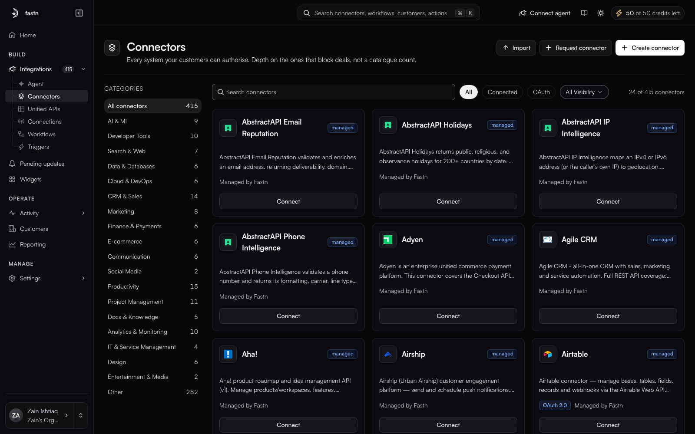
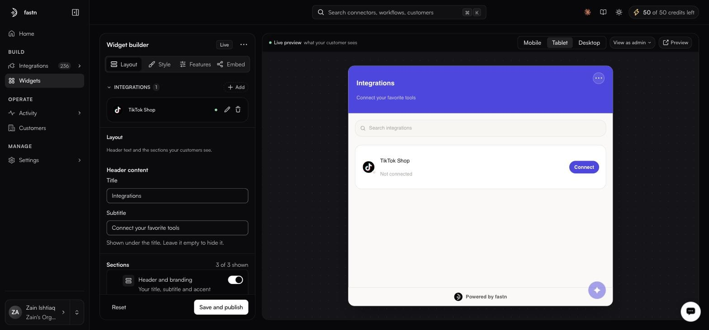
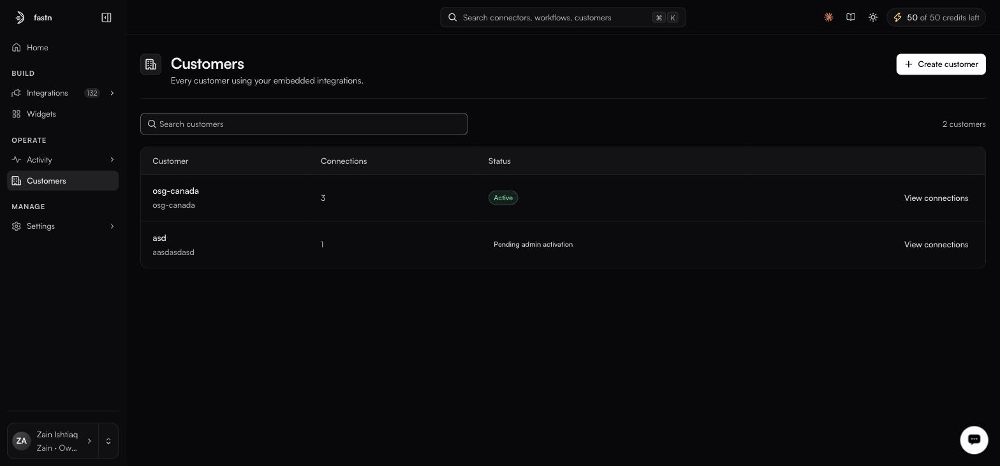
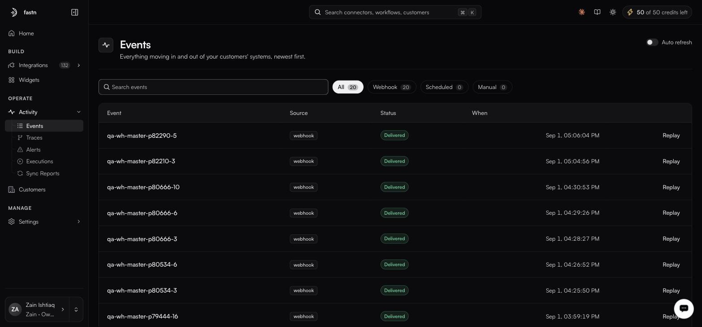
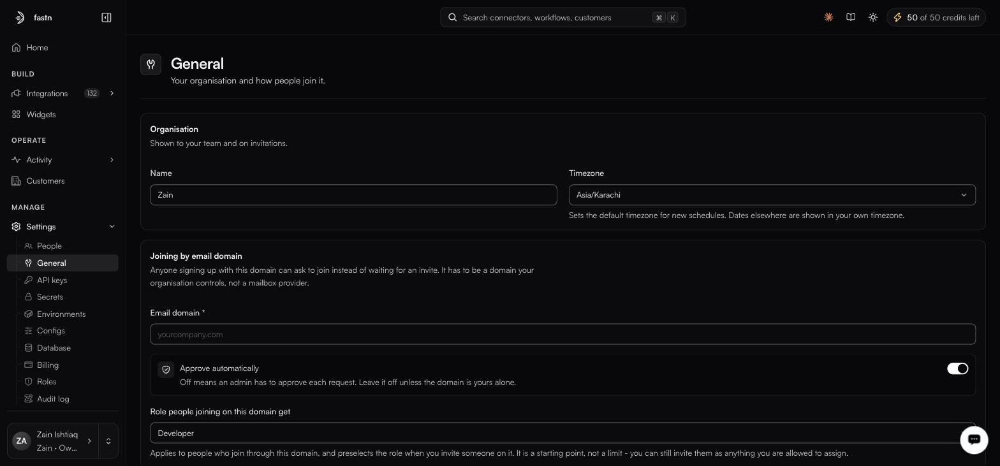

# Platform tour

### The top bar

The top bar carries the same controls on every screen.

| Element | What it does |
| --- | --- |
| **Search** (⌘K / Ctrl+K) | Finds connectors, workflows and customers. Results are grouped by type. The action **Use fastn from Claude or any MCP client** is here too. |
| **Help** (?) | **Take a tour** of the current page, **Documentation** (these docs) and **Contact support**. |
| **Theme** | Switches the dashboard between light and dark. |
| **Credits** | Your AI credits left this month. Click it for a breakdown by agent and the org total. Credits reset at the start of each calendar month, UTC. |

The account card at the bottom-left switches organisation and opens your profile.


**New to a page?** Most pages offer a short guided tour the first time you open them. You can replay it any time from **Help → Take a tour**.


### Where everything lives

The sidebar follows the three steps of putting fastn in your product: **Build**, **Embed** and **Operate**, then **Settings**. Every item in a step group is a page; the sections inside a page are its tabs. What you see depends on your [role](../manage/roles.md).

| Group | Item | Route | Docs |
| --- | --- | --- | --- |
| | Home | `/` | [Quickstart](quickstart.md) |
| Build | Build with AI | `/agent` | [Build with the agent](../build/agent/README.md) |
| | Connect your product | `/your-product` | [Connect your product](../manage/saas-connectors.md) |
| | Integrations → Connectors | `/integrations?tab=connectors` | [Connectors](../build/connectors/README.md) |
| | Integrations → Workflows | `/integrations?tab=workflows` | [Workflows](../build/workflows/README.md) |
| | Integrations → Triggers | `/integrations?tab=triggers` | [Triggers](../build/triggers/README.md) |
| | Integrations → Unified APIs | `/integrations?tab=unified` | [Unified APIs](../build/unified-apis/README.md) |
| Embed | Widget | `/widgets` | [Widget](../embed/README.md) |
| | API keys and MCP → API keys | `/access?tab=api-keys` | [API keys](../manage/api-keys.md) |
| | API keys and MCP → MCP server | `/access?tab=mcp` | [Build from Claude, Cursor or any agent](../build/mcp-gateway.md) |
| Operate | Customers | `/customers` | [Customers](../operate/customers.md) |
| | Connections | `/connections` | [Connections](../build/connections/README.md) |
| | Health → Needs attention, Overview, Updates, Alerts | `/health` | [Operate](../operate/README.md), [Pending connector updates](../build/connector-updates.md), [Alerts](../operate/alerts.md) |
| | Activity → Events, Executions, Sync reports | `/activity/*` | [Activity](../operate/README.md) |
| | Settings | `/settings/*` | [Settings](../manage/README.md) |


**Build with AI** in the sidebar and the **What should your customers be able to do?** prompt on Home open the same builder at `/agent`. See [Build with the agent](../build/agent/README.md).


### Home

Home opens with your greeting and, under it, one small line: **Launch your first integration**, with how many of the four steps are done. Click it to open the checklist. Below it, a switch picks who builds:

- **Your AI tool** (the default): **Connect fastn to your AI tool** connects Claude, Cursor, Codex or any MCP client once. Then, from your AI tool: select integrations, or build new ones in plain words, and embed the fastn widget in your product. Your customers select, connect and customize them, and fastn keeps them working. No AI credits needed. **Try asking it** offers starting prompts: click one to copy it, then paste it into your AI tool.
- **fastn agent**: the prompt box, *What do you want to build?*, where fastn's agent builds it for you using AI credits, with suggestion chips under it.

The checklist has four steps. Testing is part of each step rather than a step of its own. Each step is marked done, current or not started from what actually exists in your account. A line at the top lets you connect your AI tool once for every step, and the current step carries one action:

| Step | Done when |
| --- | --- |
| **1. Connect your product** | Your own product is connected (Build → Connect your product). Admin work: a developer sees it waiting on an admin and carries on with step 2. |
| **2. Build your first integration** | Your widget offers at least one connector, or a workflow exists. |
| **3. Embed the widget** | The widget exists and an API key or an installation does. |
| **4. Connect a customer** | A customer has made a connection, or an installation is active. |

Inside step 2, **How an integration is built** opens the five parts every integration is made of: the connector, the workflow, the trigger, the connection and the widget, each linking to where you manage it.

The current step shows what it's waiting for, such as *Waiting for your product to be connected*. The checklist checks again every few seconds while it's open, so when you finish a step, here or from your AI tool, it ticks over without a reload.

You don't have to come back to Home to see the checklist. A **Your first integration** pill at the bottom of the left rail opens it on any page. Once you're set up, the pill becomes **How fastn works** and stays there, so the five parts are always one click away. **Connect your AI tool** also sits in the top bar, next to your AI credits, on every page.

### Build → Connect your product

Your own product, through its API or webhooks, registered as a connector so your customers' connections to it can be scoped (for example per store or per warehouse). Required before any integration goes live. One-time setup, admin only. See [Connect your product](../manage/saas-connectors.md).

### Build → Integrations

Integrations is the third-party catalogue and opens on **Connectors**: an integration starts from the app your customers use. Your own product is not here; it has its own row, **Connect your product**.

<figure><figcaption>Integrations → Connectors, filtered by connection state, auth type and visibility.</figcaption></figure>

| Tab                   | Purpose                                                                                          |
| --------------------- | ------------------------------------------------------------------------------------------------ |
| **Connectors**        | Every system your customers can authorise. **Create connector** opens one menu: from scratch, Build with AI, build from Claude or any MCP client, or import from a file. **Request connector** asks fastn to add one. |
| **Workflows**         | The JavaScript that runs, with editor, tests, executions and API details.                        |
| **Triggers**          | Webhooks, schedules and app events that start workflows.                                         |
| **Unified APIs**      | One canonical endpoint per business entity, backed by whichever providers you connect.           |

### Embed → Widget

<figure><figcaption>Left: what you configure. Right: exactly what your customer sees.</figcaption></figure>

The widget builder has four tabs (Layout, Style, Features, Embed) and a live preview that renders at mobile, tablet and desktop widths. A sticky footer carries **Reset** and **Save and publish**; a **Live** badge appears once the widget is saved, and **Widget actions** offers **Reset to defaults**.

### Embed → API keys and MCP

Two tabs. **API keys** are what your backend uses to mint embed tokens and call the API. **MCP server** adds fastn's integrations to Claude, Cursor, Codex or any MCP client. See [Build from Claude, Cursor or any agent](../build/mcp-gateway.md).

### Operate → Customers

<figure><figcaption>Every customer using your embedded integrations; this workspace has only a test one.</figcaption></figure>

**Customers** lists everyone using your embedded integrations, with columns *Customer*, *Connections* and *Status* (`Active` or `Pending admin activation`), plus **Create customer**, a search box, and **View connections** on each row. Documented with [Operate](../operate/customers.md).

### Operate → Connections

Every connection your customers have made on your connectors, across every customer, with its status. The **My organisation** view shows the connections your own organisation holds, which your workflows act through. Documented under [Connections](../build/connections/README.md).

### Operate → Health

First under Operate. The maintainer agent watches the apps you connect to, your customers' connections and your workflows; what it finds, with the fix it proposes, is here. The number on **Health** in the left rail is how many vendor changes are waiting on you.

| Tab | Answers |
| --- | --- |
| **Needs attention** | Opens first. Every vendor change waiting for review, every customer connection that expired or failed, and every workflow that failed today, each with its action: **Review patch**, **Open connection**, or **Runs** and **Fix with AI**. |
| **Overview** | Every customer's integration health in one place: who needs attention, runs and records over time, connection health, what is failing and why. See [Operate](../operate/README.md). |
| **Updates** | The full review of each vendor patch the maintainer agent proposes: the diff, accept or refuse. Nothing is applied until you accept it. See [Pending connector updates](../build/connector-updates.md). |
| **Alerts** | What should page us, and where. See [Alerts](../operate/alerts.md). |

### Operate → Activity

<figure><figcaption>Activity → Events, the inbound and outbound record.</figcaption></figure>

| Tab              | Answers                                                        |
| ---------------- | -------------------------------------------------------------- |
| **Events**       | What arrived, from where, and was it delivered?                |
| **Executions**   | Which runs happened, and how did they end?                      |
| **Sync reports** | What actually changed, record by record?                        |
| **Traces**       | Which connected systems did a run call, and how slow were they? Opened from a run, not the tab strip. |

### Settings

**The Settings navigation is scoped to your role.** Each item has a minimum role:

| Minimum role | Settings pages |
| --- | --- |
| **Admin** (and Owner) | People, General, Billing, Roles, Audit log |
| **Developer** and above | Environments, Secrets, Configs, Database, Workflow tags, Trash |

Two capabilities are gated by role rather than by permission: using the builder, and reading the audit log. Each screen has its own page under [Settings](../manage/README.md).

<figure><figcaption>General is where Settings opens for an Owner: organisation identity first, joining rules second.</figcaption></figure>

### The account card

Bottom-left. It shows who you are and which organisation you are in. The chevron opens [your profile](../manage/profile.md); the up-down arrows open **SWITCH ORGANISATION**, which lists every organisation you belong to with your role in each: Platform Admin, Owner, Admin, Developer or Operator. Everything else in the dashboard is scoped to whichever organisation is selected, so check this first when something you expected to find is missing.
