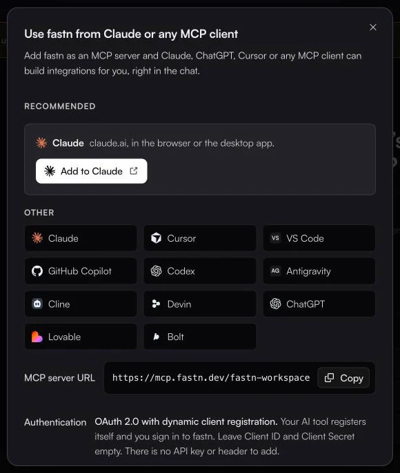

# Quickstart: build your first integration

### Overview

In this quickstart, your AI tool builds an integration that posts each new HubSpot contact to a Slack channel. Then you test it without touching real data. It takes about five minutes and needs no code.

You will:

1. [Connect your AI tool to Fastn](#step-1-connect-your-ai-tool-to-fastn).
2. [Describe the integration](#step-2-describe-the-integration).
3. [Sign in to HubSpot and Slack](#step-3-sign-in-to-hubspot-and-slack).
4. [Find the workflow the agent built](#step-4-find-the-workflow-the-agent-built).
5. [Run a test without touching real data](#step-5-run-a-test-without-touching-real-data).

This quickstart is for anyone on your team who builds integrations. It helps to know what [connectors and workflows](concepts.md) are, but you don't need to.

### Before you start

* **A Fastn account.** Sign up at [app.fastn.dev](https://app.fastn.dev/?signup=1). The free Launch plan is enough.
* **An AI tool that supports MCP,** such as Claude, Cursor or VS Code.
* **A HubSpot account and a Slack workspace** you can sign in to.

### Step 1: Connect your AI tool to Fastn

Your AI tool builds the integration through the Fastn MCP server, a connection that gives it Fastn's tools.

1. In the Fastn dashboard, click **Connect your AI tool** in the top bar.
2. Choose your AI tool and follow the steps shown for it.
3. Sign in with your Fastn account when your AI tool asks. No API key is needed.

<figure><figcaption>The <strong>Connect your AI tool</strong> dialog.</figcaption></figure>

**You should see:** Fastn's tools listed in your AI tool.

### Step 2: Describe the integration

Open a new chat in your AI tool and send this message:

> Using Fastn, when a new contact is created in HubSpot, post their name and email in our #sales Slack channel.

**You should see:** the agent replies with a plan: the connectors it will use and the workflow it will write.

### Step 3: Sign in to HubSpot and Slack

The agent needs your permission to use each app. For each app, it gives you a sign-in link.

1. Open the link.
2. Sign in to the app in your browser, and approve access.

Never paste passwords or API keys into the chat.

**You should see:** the agent confirms that each app is connected, and starts building.

### Step 4: Find the workflow the agent built

The agent writes the workflow, creates test cases for it and runs them. If your AI tool asks you to approve the field mappings or test cases, approve them.

When the agent says it's done, open **Build → Integrations → Workflows** ([Open in Fastn](https://app.fastn.dev/integrations?tab=workflows)) and click the new workflow.

**You should see:** the workflow's code, with its test cases listed.

### Step 5: Run a test without touching real data

A **Fully Mock** run uses stored sample responses instead of calling HubSpot and Slack, so nothing is written to either app.

1. Click the **Test** tab.
2. Click **Use contract** to fill in a sample input.
3. In the list next to the run button, select **Fully Mock**.
4. Click **Run Fully Mock**.

**You should see:** the run's output, with each step and its result.

You've built and tested your first integration. It doesn't run on real events until you publish it and add a trigger.

### Next steps

* [Test and release](../build/workflows/lifecycle.md): publish the workflow and deploy it to live.
* [Triggers](../build/triggers/README.md): run it when a contact is created in HubSpot.
* [Embedding quickstart](../tutorials/developer/embedding-quickstart.md): offer the integration to your customers inside your product.
