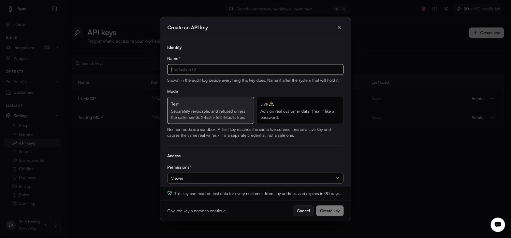

# API keys

**Embed → API keys and MCP → API keys** · `/access`

| Column        | Notes                                              |
| ------------- | ---------------------------------------------------- |
| **Name**      | What you called it.                                |
| **Key**       | Prefix and last four characters, with a copy icon. |
| **Mode**      | Live or Test.                                      |
| **Scope**     | The permissions it carries.                        |
| **Last used** | Timestamp, or Never.                               |

**Search keys** narrows the list, and the filters are **All** / **Live** / **Test**.

**Rotate** issues a new secret for the same key. The **…** menu holds **Edit**, **Identity verification** and **Revoke**; **Identity verification** is hidden on a key pinned to exactly one customer, because that key already is the customer. Revoking is how an active key ends. Once a key is revoked or expired, its row offers **Delete** (a trash icon) instead, which removes it permanently.

### Creating a key

<figure><figcaption>The Create an API key dialog, with Test selected.</figcaption></figure>

The dialog runs in three sections: **Identity**, **Access** and **Limits**.

#### Quick steps

1. Go to **Embed → API keys and MCP → API keys** (`/access`).
2. Click **Create key**. The **Create an API key** dialog opens.
3. In the dialog:
    * **Name**: give it something identifiable.
    * **Mode**: select **Live** for production use or **Test** for dev use. A live key also needs an **Environment**.
    * Set permissions, customers, allowed IP addresses, rate limit and expiry as needed.
    * Optionally turn on **Verify caller identity (HMAC)**. See [Verify caller identity](identity-verification.md).
4. Click **Create key**.

#### Identity

**Name \***: shown in the audit log beside everything this key does. Name it after the system that will hold it, not after a person.

**Mode**: **Test** or **Live**, defaulting to **Test**.

| Mode     | Behavior                                                                           |
| -------- | ------------------------------------------------------------------------------------ |
| **Test** | Runs the latest published version of your workflows, never a deployed environment. Refused unless the caller sends `X-fastn-Test-Mode: true`. |
| **Live** | Runs the workflows deployed to one **Environment** you pick in the dialog. Acts on real customer data. Treat it like a password. |

A live key is pinned to its environment: it runs what is deployed there, can also run the latest published version by sending `x-fastn-env: test`, and is refused (403) for any other environment. To run a workflow from your code, use a key for the environment it is deployed to.


Neither mode is a sandbox. A Test key reaches the same live connections as a Live key and causes the same real writes in your customers' systems. It is a separate credential, not a safe one. To test without touching real systems, run the workflow with **Fully Mock** in the editor instead.


#### Access

**Permissions \*** takes one preset. Under **Roles**: **Admin** (offered only to callers who can grant full access, that is an owner, admin or platform admin), **Developer**, **Operator**, **Viewer** (the default) and **End User**. Under **Key presets**: **Embed backend** (for your server: mints embed tokens and registers customers on first use; the right choice for a backend behind `@fastn-ai/embed`) and **Custom** (only the permissions you tick). The role presets borrow the names of the people roles on [Roles](roles.md). Choose the narrowest that works: a key that only reads should stay on Viewer.

For every preset except **Admin**, the **What it can touch** matrix below shows exactly what it grants, and **Custom** lets you set each box yourself. **Admin** grants full access, so the matrix is hidden. Eleven resource groups:

| Resource        | Permissions                                                     |
| --------------- | ----------------------------------------------------------------- |
| **Connectors**  | create, read, update, delete, write                              |
| **Connections** | create, read, update, delete, share, decrypt                     |
| **Workflows**   | create, read, update, delete, execute, deploy_test, deploy_prod  |
| **Users**       | create, read, update, invite, remove                             |
| **Settings**    | read, update, manage                                             |
| **Events**      | create, read, update, delete, replay                             |
| **Secrets**     | read, write, delete                                              |
| **Executions**  | create, read                                                     |
| **Widgets**     | create, read, update, delete                                     |
| **Customers**   | create                                                           |
| **Unified API** | read, execute, customize                                         |

`write` on Connectors has no effect on an API key: the only route that checks it is reserved for fastn platform admins. Use `create` and `update` to let a key change connectors.


Grant `decrypt` on Connections or `read` on Secrets only when a key must read credentials. A key holding either can expose your customers' credentials.


**Customers it can reach**: **Every customer**, or **Only the ones I pick**. Narrowing it is not optional everywhere: the form notes that picking specific customers is *Required for keys used in an embed session.*

That note covers a key used directly as one customer's widget session. The backend key that registers customers and gets embed tokens should reach **Every customer**, because a key limited to specific customers is refused for any customer it doesn't list (see [Embed the widget](../getting-started/onboarding/embed-the-widget.md)).

**Verify caller identity (HMAC)** *(optional)*: callers must send a signed `x-identity-hmac` header, so a caller cannot change the `x-org-id` or `x-user-id` it claims to be. Pick **Enforce** (reject a missing or invalid hash) or **Monitor only** (log mismatches, let calls through). Left off, the key trusts the headers. The option is not offered on a key that reaches exactly one customer. The secret, the hash and the headers are covered in [Verify caller identity](identity-verification.md).

**Resource scope** *(optional)*: narrows the key to particular resources rather than everything its permissions would otherwise cover.

#### Limits

| Field                      | Notes                                                                          |
| -------------------------- | -------------------------------------------------------------------------------- |
| **Allowed IP addresses** *(optional)* | An allowlist. Left blank, the key works from any address.           |
| **Rate limit** *(optional)*| A ceiling per minute for this key.                                              |
| **Expires \***             | **In 30 days**, **In 90 days** (the default), **In a year**, **Never**, or **On a specific date**. |

The dialog keeps a live summary sentence at the bottom describing what you have built, so you can read back the whole key before you create it. For a Test key on the Viewer preset, reaching every customer from any address with the default expiry, it reads:

> This key can read on test data for every customer, from any address, and expires in 90 days.

### Using a key

```bash
curl -X POST https://api.fastn.dev/v1/workflows/WORKFLOW_ID/execute \
  -H "Authorization: Bearer fsk_live_<your-key>" \
  -H "Content-Type: application/json" \
  -d '{ "input": { "key": "value" } }'
```

With a test key, add the `X-fastn-Test-Mode` header. Without it the call is refused with `403` and *Test API keys require X-fastn-Test-Mode: true header*:

```bash
  -H "Authorization: Bearer fsk_test_<your-key>" \
  -H "X-fastn-Test-Mode: true"
```

`x-fastn-env` is optional: a test key always runs against `test`, so you never need to send it.

Every key starts `fsk_live_` or `fsk_test_`. The platform API reads it from `Authorization: Bearer fsk_…` or `X-API-Key: fsk_…`; webhook URLs accept other headers too. See [Which header carries the key](../reference/api.md#which-header-carries-the-key) in the HTTP API reference.

### Best practices

* One key per consuming system, so revoking one does not take down four things.
* Rotate on a schedule, and when anyone with access leaves.
* Never in client-side code. Browser-facing widgets use short-lived embed tokens minted by your backend. See [Embedding the widget](../embed/embedding/README.md).
* Check **Last used** before revoking. A key showing Never is either unused or misconfigured; either way, find out which.
* Set an expiry rather than **Never**, and turn on [identity verification](identity-verification.md) for any key that acts for more than one customer.


**API keys per customer** is one of the limits listed under [Billing](billing.md). Check there if key creation starts refusing.

