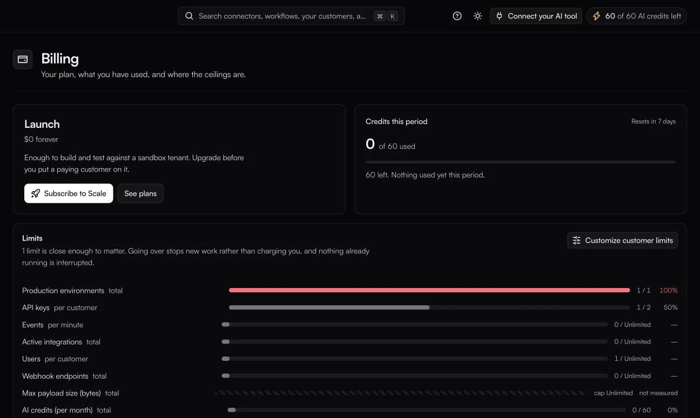

# Billing and limits

**Settings → Billing** ([open in app](https://app.fastn.dev/settings/billing)). Billing is in the Settings menu for **Owners and Admins**, and only they see the plan, credits, payment and invoices, or can press any of its buttons. See [Who sees what](#who-sees-what) for the other roles.

## Plans

fastn is priced by **customer connection**: one of your customers signed in to one app (a customer's HubSpot, their Google Calendar, and so on). The Limits list meters this as **Customer connections**.

<figure><figcaption>The plan card, this period's credits, and every limit with how close you are to it.</figcaption></figure>

| Plan | Price | Includes |
| --- | --- | --- |
| **Launch** | $0 | 3 customer connections. No monthly AI credits from 1 December 2026: AI runs on the up to 50 credits you earn in onboarding. Building with the fastn agent and AI steps need a paid plan. For building and testing before you put a paying customer on it. |
| **Scale** | $500 a month | 10 customer connections included, then $50 a month for each one past that, and 1,000 AI credits a month. Subscribe yourself from this page with **Subscribe to Scale**. |
| **Enterprise** | Custom | Priced to your volume, with no AI credit cap. Contact sales. |

Connectors, workflows and seats are unlimited on every plan. See [fastn.ai/pricing](https://fastn.ai/pricing) for the full comparison, including support and security.


Once you are subscribed, the plan card shows what you are billed for, followed by the renewal date: for example **Billing 12 customer connections · renews** and the date, or **Billing 12 customers** when your subscription is metered per customer. Once a cancellation is scheduled, the date reads **ends** instead, with no further charges.


### The plan card

The card shows the plan you are on and its price. Which buttons it carries depends on where your subscription stands:

| Button | When it appears |
| --- | --- |
| **Subscribe to Scale** | On Launch. Opens Stripe checkout. |
| **See plans** | On Launch. |
| **Manage billing** | Once a Stripe subscription exists. Opens the Stripe billing portal for card and billing details. |
| **Cancel subscription** | Only while you are being billed, and not once a cancellation is already scheduled. It opens the same Stripe portal. |
| **Request plan change** | On a paid plan. On Enterprise without a Stripe subscription, this is the only button. |

A plan change request shows a **Plan change requested** notice at the top of the page; your plan and limits stay as they are until the fastn team decides. If a payment fails, the card says **Payment failed.** and your plan is unchanged while Stripe retries.

## Credits

**Credits this period** shows how many AI credits you have used, how many are left and the days until the reset: 1,000 a month on Scale, no cap on Enterprise. Launch has no monthly credits from 1 December 2026, and Launch accounts created from 25 November 2026 start with none: they use only the onboarding credits they have left. The top bar shows the same number; click it for **Your usage**, **Org total** and a **By agent** breakdown. Credits reset on the 1st of each month (UTC).

Credits are spent each time fastn calls an AI model for you:

* **Building** with the fastn agent. This is most of it.
* **Investigating errors:** failed-run diagnosis and run summaries.
* **Fixing integrations** when an app changes its API.
* **Writing docs** for workflows and widgets.
* **AI steps** in workflows (`fastn.ai.complete`).

Building from your own AI tool uses no credits.

**Paid plans only:** building with the fastn agent, building through the widget's AI assistant, and AI steps need Scale or Enterprise. On every plan, including Launch, you can ask the agent questions, and error diagnosis, run summaries, connector fixes, docs and the widget assistant's configuration changes keep working. They use AI credits.

**Onboarding credits:** onboarding pays up to 50 credits as you finish its steps. They are used after any monthly credits and never expire. Any spend past your monthly and onboarding credits is taken off the next month's credits.

**Out of credits:** workflows without AI steps keep running. An AI step fails until credits are back. The fastn agent and error diagnosis stop until credits are back: at the next monthly reset on Scale, or when you earn onboarding credits or upgrade on Launch. Your own AI tool still works.

## Limits

The **Limits** card lists every quota with your usage against it, ordered so the one closest to its ceiling is at the top. The defaults per plan are:

| Limit | Launch | Scale | Enterprise |
| --- | --- | --- | --- |
| Customer connections | 3 | 10 included, then billed per connection | Custom |
| Connected accounts (your customers) | 3 | No cap | No cap |
| AI credits (per month) | 0 (onboarding credits only) | 1,000 | No cap |
| Workflows running at the same time, account and customers | 1 | 5 | Custom, with per-customer caps |
| Concurrent workflows (Cloud Run), per organization | 1 | 5 | 10 |
| Concurrent instant runs | 3 | 10 | 20 |
| Events per day | 500 | 50,000 | No cap |
| API calls per day | 1,000 | 100,000 | No cap |
| API keys per customer | 2 | 50 | No cap |
| Workflow categories | 2 | 10 | 15 |
| Workflow labels | 2 | 10 | 15 |
| Connectors per integration | 2 | 2 | 2 |
| Database connections | 2 | 7 | 15 |
| fastn.state storage | 50 MiB | 250 MiB | 1 GiB |
| fastn.state keys | 250,000 | 1,000,000 | 5,000,000 |

Separately from the card, API requests are rate limited per minute: 100 on Launch, 500 on Scale, no limit on Enterprise. The count covers calls made with an API key or from an embed session, with your customers' calls counted toward your organization's total. This limit is not a row on the **Limits** card.

**Connected accounts** counts your customers, and is checked only when a new customer is created: on Launch the 4th customer is refused, and a count already past 3 is kept. **Customer connections** is the pricing unit, one customer signed in to one app, summed across your customers.

Connectors, workflows, executions, seats (users) and webhook endpoints are unlimited on every plan. Connectors per integration is 2 on every plan: an integration is your product and one other app, and each further app gets an integration of its own. Workflow categories and labels are managed under [Workflow tags](workflow-tags.md).

**Customize customer limits** overrides the limits for one customer, for example to give a pilot customer more room than the rest. Pick the customer, then edit its limits; an override wins over the plan default.


A limit is checked when new work starts, and going over it **stops that new work**: the 4th customer connection on Launch, a run past the concurrency cap, an event past the daily allowance. What already exists is kept. The one exception is **customer connections on Scale**: connections past the 10 included are allowed and billed, per [fastn.ai/pricing](https://fastn.ai/pricing). A sync that stops at a ceiling can look like a broken sync, so if runs stop unexpectedly, check this page before you debug the workflow.


## Payment and invoices

**Payment** shows the card on file, with **Update card** to change it through Stripe. With no card it reads *Free plan, nothing to pay* on Launch, or *Billed through your fastn agreement* on a plan billed outside Stripe. **Invoices** lists every invoice with its date, amount, status and a receipt you can download. Before your first one it reads *Your first invoice is issued when you subscribe.*

## Who sees what

| Role | What Billing shows them |
| --- | --- |
| **Owner, Admin** | Everything on this page, with working buttons. Billing is in their Settings menu. |
| **Developer** | Not in their menu. Opened directly, the page shows no plan, no credits and no limits; the Limits card reads *Limits appear here once the quotas API is reachable.* |
| **Operator, Viewer** | Not in their menu. Opened directly, they get a simpler **Your Allocation** view instead of this page. |

## Related

* [Customers](../operate/customers.md): who your customers are and what each one has connected (Operate → Customers)
* [Roles](roles.md): who can see billing
