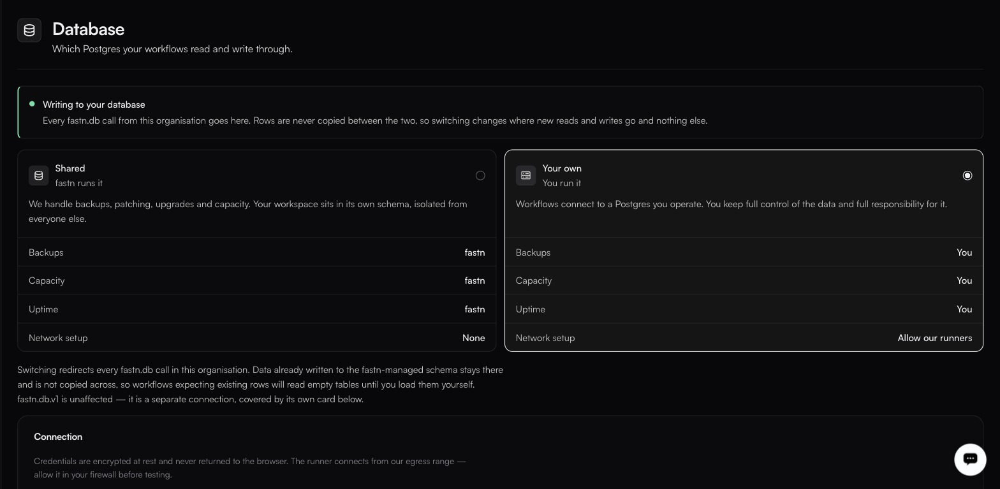

# Database

**Settings → Database**

<figure><figcaption>The choice is exclusive and it is a redirect, not a migration, rows already written stay where they are.</figcaption></figure>

Workflows can persist data with `fastn.db`. This page decides where that data lands.

> Which Postgres your workflows read and write through.

Every `fastn.db` call from this organization, and from its customers, goes to whichever option is selected here, unless a customer has an override (see [Customer overrides](#customer-overrides)). The page shows the active schema name in the form `ws_<32 hex characters>`.

### What a Developer sees

The page is read-only below Owner and Admin. A Developer gets a **Read-only** banner (*An organization admin or owner can change this. Credentials are never shown.*) and a **Current connection** card badged **Shared** or **Your own database**:

| Mode                  | Rows shown                                                          |
| --------------------- | -------------------------------------------------------------------- |
| **Shared**            | **Database** `fastn-managed`, and **Managed schema** `ws_<hash>`, your organization's schema name. |
| **Your own database** | **Host**, **Database**, **Schema in use**, **SSL mode** and **Last changed**. |

Username, password and CA chain are not rendered for this role. That is deliberate, and it is enough: `fastn.db` connects for you, so a workflow never needs the credential. There is no table browser and no SQL console on this page: inspect data from a workflow.

### Two options

| | **Shared** (fastn runs it) | **Your own** (You run it) |
| --- | --- | --- |
| **Backups** | fastn | You |
| **Capacity** | fastn | You |
| **Uptime** | fastn | You |
| **Network setup** | None | Allow our runners |

**Shared**: fastn runs it, and handles backups, patching, upgrades and capacity. Your organization sits in its own schema, isolated from everyone else.

**Your own**: you run it: workflows connect to a Postgres you operate. You keep full control of the data and full responsibility for it, and you will need to allow fastn's runners through your network.

### Reasons to bring your own

Data residency requirements, a compliance regime that will not accept a processor's database, or an existing warehouse you want workflow data to land in directly.

If none of those apply, Shared is less work and one fewer thing to page you at 3am.


Switching changes where **new** reads and writes go. Rows are never copied between the two. If a workflow depends on data written before the switch, it will not find it. Migrate deliberately, or not at all.


### What the isolation actually is

**Each workspace gets its own Postgres schema, and each of your customers is a workspace of its own.** Your organization's schema is the `ws_<hash>` above, isolated from every other organization, which is what the page means by *your organization sits in its own schema, isolated from everyone else*. Every customer gets a separate `ws_<hash>` schema of its own, so `fastn.db` calls made on behalf of one customer land in that customer's schema, not in yours and not in another customer's.

The same holds when you bring your own database: a customer that inherits your connection still gets its own derived schema on your server, never your schema or another customer's.

### Customer overrides

Shown to Owners and Admins only. The **Customer overrides** card lists every customer in this organization with where its data actually lands: the **Database**, the **Schema in use**, **SSL** and a **Source** badge (**fastn-managed**, **Organization default** or **Override**). Customers use your selected database automatically; the ones marked **fastn-managed** are still on fastn's own database.

**Add override** points a single customer somewhere else. An override replaces the whole connection, not part of it. **Remove override** returns that customer to the organization default as runner pools recycle; rows already written to the override database stay there.

### Using it from a workflow

```javascript
await fastn.db.query(`
  CREATE TABLE IF NOT EXISTS sync_log (
    id SERIAL PRIMARY KEY,
    customer_id TEXT,
    source_id TEXT,
    synced_at TIMESTAMP DEFAULT NOW()
  )
`);

await fastn.db.query(
  `INSERT INTO sync_log (customer_id, source_id) VALUES ($1, $2)`,
  [customerId, record.id]
);
```

`fastn.db.query(sql, params)` runs one statement, with `$1`-style parameters. It refuses transaction control (`BEGIN`, `COMMIT`) and more than one statement per call, because each call uses its own pooled connection. To run several statements atomically, pass them to `fastn.db.transaction([{ sql, params }, ...])`. See [Workflow runtime API](../reference/workflow-runtime.md).
